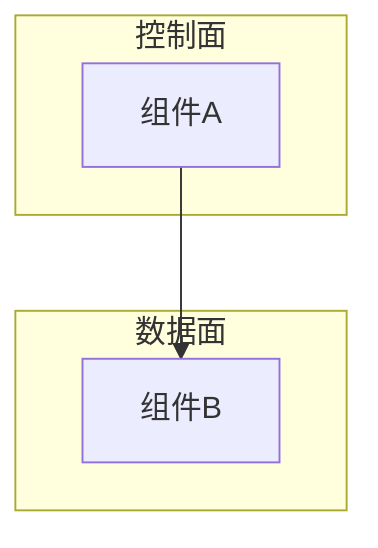

# 产品速查模板

> 复制本文件为 `products/<code>/README.md`，按下方骨架展开编号文件（**v2：9 篇**，依据 docs/design.md）。
> 每个编号文件头部统一格式：`> 产品：<名称> ｜ 口径：<公共云/专有云 vX> ｜ 复核：<日期>`

## README.md（产品导览）

```markdown
# <产品中文名>（<product code>）

一句话定位。

## 文件
- [01-产品架构.md](01-产品架构.md) — 架构图、组件清单、资源模型、可靠性
- [02-…](02-…) — …（02~07 沿用 v1 主题）
- [08-日志与审计.md](08-日志与审计.md) — 日志类型、关键字段、投递加工、审计留痕
- [09-监控与告警.md](09-监控与告警.md) — 核心指标、官方告警、通知渠道、告警配额

## 分支
- [apsara-vX/](apsara-vX/) — 专有云形态，与公共云的关键差异见其 README
```

## 编号文件骨架（01~07 沿用 v1）

- `01-产品架构.md`：产品是什么 → **架构图（Mermaid）** → **组件清单** → 底层组成（虚拟化/多租户/存储/网络栈）→ 资源模型（地域/可用区/部署分布）→ 可靠性机制（迁移/容灾/SLA）
- `02-<资源类型>.md`：命名/分类规则 → 在售清单矩阵 → 选型速查表
- `03-<资源参数>.md`：代表性资源的完整参数表（一张表一个维度）
- `04-<配套参数>.md`：与主资源强绑定的配套产品参数（如 ECS↔块存储）
- `05-<网络参数>.md`：网络相关参数（带宽/网卡/IP）
- `06-配额与限制.md`：默认配额、硬限制、例外情形；这类内容最容易过时，务必带复核日期
- `07-计费与生命周期.md`：计费维度、资源包、欠费/停服/释放规则

## 01 篇新增小节规格（v2）

### 架构图（01 篇内为 `##` 级小节）

- Mermaid `flowchart TB`；每篇 1 张，组件关系复杂者上限 2 张；组件名与正文术语一致
- 图后紧跟来源块，指向该图依据的官方架构页；不收官方 PNG 截图

````markdown
## 架构图



**来源**
- <官方架构页 URL> ｜ 复核：<日期>
````

### 组件清单（01 篇内为 `##` 级小节）

| 组件 | 作用 | 必选/可选 | 是否独立计费 | 备注 |
|---|---|---|---|---|
| <组件> | <一句话作用> | 必选 | 是/否 | 强关联产品给仓库内交叉链接，如 [云盘](../ebs/) |

- 范围：核心构件（如 ACK 的 CNI/CSI/Ingress）+ 强绑定关联产品（如 ECS↔云盘/快照）
- 每行事实须可在来源页核对，来源块置于表后

## 08-日志与审计.md 骨架

1. `## 日志类型总表`：类型（操作/访问/审计/引擎）｜产生方｜查看入口（控制台路径或产品名）｜默认保留期｜是否计费
2. `## 关键日志详表`：该产品最重要的 2~4 类日志；每类列 3~8 个关键字段（名称/类型/含义）
3. `## 投递与加工`：投递目标（SLS/OSS/CMS）、采样与过滤参数、跨账号投递
4. `## 审计与合规`：操作审计（ActionTrail）在该产品的留痕范围与保留期

来源体系：help.aliyun.com 日志文档、SLS/操作审计官方页（允许 `/zh/sls/` 路径）。

## 09-监控与告警.md 骨架

1. `## 核心监控指标`：指标官方英文名｜含义｜单位｜统计周期｜维度
2. `## 官方默认与推荐告警`：指标 + 阈值 + 等级，逐条带官方来源
   - **阈值红线**：只收有官方出处的阈值（官方推荐值/默认规则/文档示例）；官方缺位则写「官方未发布推荐阈值」并标 `📋 待补`，不写经验阈值
3. `## 通知与渠道`：通道类型（短信/邮件/函数计算/webhook）、告警升级与静默
4. `## 告警配额`：告警规则数、通知人配额等（CloudMonitor 侧）

来源体系：help.aliyun.com 产品监控文档、CloudMonitor 指标文档、terms.aliyun.com。

## 分支目录 README 骨架

```markdown
# <产品> · <分支名>

- 口径来源：<官方版本/构建号 + 链接>
- 与主线的差异摘要：3~5 条
- 目录：01-… / 02-…
```
