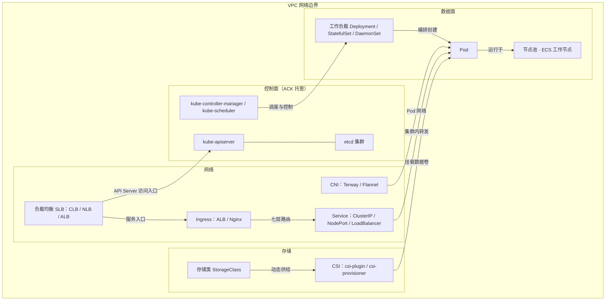

# ACK · 产品架构

> 产品：ACK ｜ 口径：公共云 ｜ 复核：2026-11-16

## 产品定义

| 事实项 | 内容 |
|---|---|
| 全称 | 容器服务 Kubernetes 版 ACK（Container Service for Kubernetes） |
| 认证 | 全球首批通过 Kubernetes 一致性认证的服务平台；CNCF 白金会员，已通过一致性验证 |
| 产品线集群类型 | ACK 托管集群（Pro 版/基础版）、ACK Serverless 集群、ACK Edge 集群、ACK 灵骏集群 |
| 关联产品 | 云原生 AI 套件（AI 底座）、ACK One（分布式云容器平台，多集群/混合云/容灾）、ASM（服务网格）、ACR（镜像仓库） |

与自建 K8s 相比的官方增强点：控制台一键创建、容器优化 OS 镜像、VPC/ENI 网络插件（官方称性能优于普通网络方案 20%）、标准 CSI 驱动、托管 Prometheus、Pro 版多 AZ 托管控制面。

**来源**：
- 什么是阿里云容器服务Kubernetes版：https://help.aliyun.com/zh/ack/product-overview/product-introduction ｜ 复核：2026-11-16
- 什么是容器服务Kubernetes版：https://help.aliyun.com/zh/ack/ack-managed-and-ack-dedicated/product-overview/what-is-ack ｜ 复核：2026-11-16

## 架构图

**来源**
- 什么是容器服务Kubernetes版（ACK托管集群架构：托管组件 kube-apiserver、kube-controller-manager、kube-scheduler、etcd；存储插件与容器网络插件）：https://help.aliyun.com/zh/ack/ack-managed-and-ack-dedicated/product-overview/what-is-ack ｜ 复核：2026-11-17
- ACK托管集群网络规划（Terway/Flannel、Pod/Service 网段）：https://help.aliyun.com/zh/ack/ack-managed-and-ack-dedicated/user-guide/kubernetes-cluster-network-planning ｜ 复核：2026-11-17
- Service快速入门（ClusterIP/NodePort/LoadBalancer）：https://help.aliyun.com/zh/ack/ack-managed-and-ack-dedicated/user-guide/service-management/ ｜ 复核：2026-11-17
- 存储概述（csi-plugin / csi-provisioner）：https://help.aliyun.com/zh/ack/ack-managed-and-ack-dedicated/user-guide/csi-overview-1/ ｜ 复核：2026-11-17
- ALB Ingress概述（Ingress 形态）：https://help.aliyun.com/zh/ack/ack-managed-and-ack-dedicated/user-guide/alb-ingress-management-1/ ｜ 复核：2026-11-17
- ACK托管和专有集群计费说明（API Server CLB/负载均衡资源）：https://help.aliyun.com/zh/ack/ack-managed-and-ack-dedicated/product-overview/ack-pro-cluster-billing ｜ 复核：2026-11-17

## 组件清单

| 组件 | 作用 | 必选/可选 | 是否独立计费 | 备注 |
|---|---|---|---|---|
| 集群（ACK 托管 Pro 版/基础版） | Kubernetes 运行载体，控制面组件、Master 节点、etcd 由 ACK 全托管 | 必选 | Pro 版另收集群管理费，基础版不收 | 专有集群 2024-08-21 起停止新建（云盒除外） |
| 托管控制面（kube-apiserver / etcd） | 暴露 K8s API 并存储集群状态；至少 2 个 kube-apiserver、3 个 etcd 跨可用区部署 | 必选（托管集群） | 含在 Pro 版集群管理费内 | etcd 容量上限 Pro 版 8 GB、基础版 2 GB（详见 06-配额与限制） |
| 节点池 | 工作节点分组，统一管理交换机、运行时、OS、安全组与升级 | 必选 | 是（节点按 [ECS](../ecs/) 计费） | Auto Mode 节点池的 OS 升级、漏洞修复由 ACK 负责 |
| 容器网络插件 CNI（Terway / Flannel） | 为 Pod 分配 IP、构建容器网络与服务访问路径 | 必选 | 否 | 创建集群时选定，创建后不支持更改、二者不可互转 |
| 存储插件 CSI（csi-plugin / csi-provisioner） | 数据卷挂载/卸载与存储卷动态创建 | 必选（集群默认部署） | 否（底层存储另计费） | Flexvolume 已停止维护，1.20 后新建集群不再支持 |
| 存储类 StorageClass | 云盘/NAS/OSS/CPFS 动态供给的参数模板 | 可选 | 底层 [EBS](../ebs/)/[NAS](../nas/)/[OSS](../oss/) 按各自产品计费 | 依赖 csi-provisioner；各存储类型限制详见 04-配套参数 |
| Ingress（ALB Ingress / Nginx Ingress） | 集群服务的七层流量入口与路由 | 可选 | 是（ALB 实例费；Nginx Ingress 经 Service 创建 CLB/NLB） | ALB Ingress 全托管、Controller 不转发流量；Nginx Ingress 需自行运维 |
| 镜像仓库集成（ACR） | 工作负载经 imagePullSecrets 拉取 ACR 私有镜像 | 可选 | 是（ACR 侧计费） | 关联 [ACR](../acr/)；2024-09-09 及之后新建的 ACR 个人版不支持免密组件 |
| 负载均衡 SLB（CLB / NLB / ALB） | API Server 访问入口（自动创建的按量付费实例）与 Service/Ingress 服务入口 | 必选（API Server 入口） | 是（实例费 + LCU/规格费；2024-12-01 起新建 CLB 不再支持包年包月） | 关联 [SLB](../slb/)；API Server 入口实例由 ACK 托管、不可复用与删除 |
| 工作节点 ECS | 承载 Pod 运行的云服务器（含 GPU、弹性裸金属 EBM） | 必选（ACK Serverless 集群改用 ECI） | 是（按节点资源计费） | 关联 [ECS](../ecs/)；ESS 支持节点池弹性伸缩 |
| 日志采集组件（LoongCollector / logtail-ds） | 以 DaemonSet 采集容器日志上报日志服务 SLS | 可选（创建集群勾选「使用日志服务」时安装） | 否（SLS 侧按量计费） | LoongCollector 为 Logtail 升级版，两者不能同时安装；详见 08-日志与审计 |

**来源**
- 什么是容器服务Kubernetes版（集群类型、托管控制面、存储插件、Terway/Flannel、ACR 无缝集成、关联产品）：https://help.aliyun.com/zh/ack/ack-managed-and-ack-dedicated/product-overview/what-is-ack ｜ 复核：2026-11-17
- ACK集群概述（etcd 最低实例数、节点池、Pro 版能力）：https://help.aliyun.com/zh/ack/ack-managed-and-ack-dedicated/user-guide/ack-cluster-overview/ ｜ 复核：2026-11-17
- 容器服务Kubernetes版的使用配额和限制（专有集群停止新建、插件限制）：https://help.aliyun.com/zh/ack/product-overview/limits ｜ 复核：2026-11-17
- ACK托管集群网络规划（容器网络插件创建后不可更改）：https://help.aliyun.com/zh/ack/ack-managed-and-ack-dedicated/user-guide/kubernetes-cluster-network-planning ｜ 复核：2026-11-17
- 存储概述（CSI 组件与存储类型、Flexvolume 停止维护）：https://help.aliyun.com/zh/ack/ack-managed-and-ack-dedicated/user-guide/csi-overview-1/ ｜ 复核：2026-11-17
- ALB Ingress概述：https://help.aliyun.com/zh/ack/ack-managed-and-ack-dedicated/user-guide/alb-ingress-management-1/ ｜ 复核：2026-11-17
- 工作负载FAQ（imagePullSecrets 拉取 ACR 私有镜像、免密组件限制）：https://help.aliyun.com/zh/ack/ack-managed-and-ack-dedicated/user-guide/faq-about-applications ｜ 复核：2026-11-17
- ACK托管和专有集群计费说明（API Server CLB、SLB 实例计费）：https://help.aliyun.com/zh/ack/ack-managed-and-ack-dedicated/product-overview/ack-pro-cluster-billing ｜ 复核：2026-11-17
- 采集ACK集群容器日志（LoongCollector/logtail-ds 组件）：https://help.aliyun.com/zh/ack/ack-managed-and-ack-dedicated/user-guide/collect-text-logs-from-ack-clusters-using-daemonset-deployed-logtail-agents ｜ 复核：2026-11-17

## 控制面与数据面分离

| 形态 | 控制面 | 数据面 |
|---|---|---|
| ACK 托管集群 | 控制面组件、Master 节点、etcd 由 ACK 全托管 | Worker 节点由用户自行创建和运维 |
| ACK 托管集群（开启 Auto Mode） | 全托管 | 默认创建 Auto Mode 节点池 + 系统节点池，节点 OS 升级、软件升级、漏洞修复由 ACK 负责 |
| ACK 专有集群 | 控制面组件、Master 节点、etcd 由用户自行创建和运维 | Worker 节点由用户自行运维 |

- 专有集群已停止新建：2024 年 08 月 21 日起停止创建（云盒场景除外）。
- 集群创建后不可更改项：集群 VPC、集群类型、集群规格（Pro↔基础版）、容器网络插件（Terway/Flannel 不支持互转）。

**来源**：
- 什么是容器服务Kubernetes版：https://help.aliyun.com/zh/ack/ack-managed-and-ack-dedicated/product-overview/what-is-ack ｜ 复核：2026-11-16
- ACK集群概述：https://help.aliyun.com/zh/ack/ack-managed-and-ack-dedicated/user-guide/ack-cluster-overview/ ｜ 复核：2026-11-16
- 容器服务Kubernetes版的使用配额和限制：https://help.aliyun.com/zh/ack/product-overview/limits ｜ 复核：2026-11-16

## 集群组件（etcd / API Server / 调度）

托管集群管控面由 ACK 管理，托管组件包括 kube-apiserver、kube-controller-manager、kube-scheduler 和 etcd。

| 组件 | 托管集群最低实例数 | 部署方式 |
|---|---|---|
| kube-apiserver | ≥ 2 个 | 部署在不同可用区，提供可用区级高可用 |
| etcd | 3 个 | 部署在不同可用区，提供可用区级高可用 |

- ACK 管控持续监控托管组件，保障服务 SLA，并及时修复安全漏洞。
- etcd 存储容量上限：Pro 版 8 GB、基础版 2 GB（详见 06-配额与限制）。
- Pro 版独有能力：etcd 高频冷热备机制、异地容灾、etcd 可观测性监控指标、API Server 监控指标、控制面组件自定义参数设置。

**来源**：
- 什么是容器服务Kubernetes版（ACK托管集群架构）：https://help.aliyun.com/zh/ack/ack-managed-and-ack-dedicated/product-overview/what-is-ack ｜ 复核：2026-11-16
- ACK集群概述（Pro 版能力优势）：https://help.aliyun.com/zh/ack/ack-managed-and-ack-dedicated/user-guide/ack-cluster-overview/ ｜ 复核：2026-11-16

## 可靠性与 SLA

| 集群类型 | SLA |
|---|---|
| ACK 托管集群 Pro 版（区域级集群） | 服务可用性 99.95% |
| ACK 托管集群 Pro 版（可用区级集群） | 服务可用性 99.50% |
| ACK 托管集群基础版 | 不支持 SLA |
| ACK 专有集群 | 不支持 SLA |

- SLA 全称为《阿里云容器服务 Kubernetes 版服务等级协议》。
- Pro 版相对基础版的可靠性增强项：etcd 高频冷热备异地容灾、KMS Secret 落盘加密、Gang scheduling、CPU/GPU 拓扑感知调度、共享 GPU 专业版调度、托管节点池。
- 基础版与专有集群支持热迁移至 Pro 版（业务不中断）。

**来源**：
- ACK集群概述：https://help.aliyun.com/zh/ack/ack-managed-and-ack-dedicated/user-guide/ack-cluster-overview/ ｜ 复核：2026-11-16

## 关联的阿里云产品

| 大类 | 关联产品与用途 |
|---|---|
| 计算 | ECS（含弹性裸金属 EBM、GPU 云服务器）提供节点池工作节点；ECI 提供 Serverless 集群容器实例；ESS 支持节点池弹性伸缩 |
| 网络 | VPC 提供集群私网；SLB（ALB/NLB/CLB）提供 API Server 入口与服务入口；NAT 网关提供节点公网出口；EIP 提供单节点公网能力 |
| 存储 | 块存储（数据盘）、NAS、OSS、CPFS |
| 安全 | RAM+RBAC 子账号权限、云安全中心运行时检测、KMS Secret 落盘加密 |
| 可观测 | 阿里云 Prometheus 监控、日志服务 SLS |
| 云原生资产 | 容器镜像服务 ACR 提供镜像仓库 |
| 其他 | 资源编排 ROS（集群资源模板化） |

**来源**：
- 什么是容器服务Kubernetes版（关联的阿里云产品）：https://help.aliyun.com/zh/ack/ack-managed-and-ack-dedicated/product-overview/what-is-ack ｜ 复核：2026-11-16
