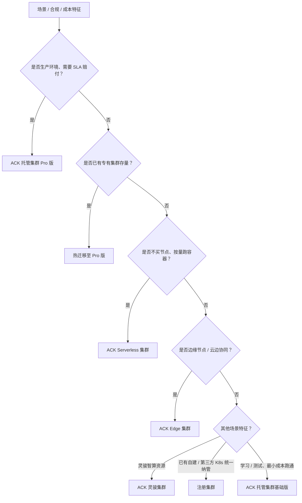

# ACK · 集群类型

> 产品：ACK ｜ 口径：公共云 ｜ 复核：2026-11-18

## 类型总览

| 集群类型 | 一句话说明 | 计费入口 |
|---|---|---|
| ACK 托管集群 Pro 版 | 控制面托管 + 增强可靠性/安全性/调度，支持赔付 SLA，面向生产 | 计费概述 |
| ACK 托管集群基础版 | 控制面托管，免管控费，规模上限小，面向个人测试 | 计费概述 |
| ACK 专有集群 | 控制面自建自运维，2024-08-21 起停止新建（云盒除外） | 计费概述 |
| ACK Serverless 集群 | 无需购买节点，按应用 CPU/内存资源量按需付费 | ACK Serverless 集群计费说明 |
| ACK Edge 集群 | 云边一体化协同托管，云端标准 K8s + 边缘节点 | ACK Edge 集群计费说明 |
| ACK 灵骏集群 | 面向智能计算灵骏，全托管高可用控制面 + 灵骏计算节点 | ACK 灵骏集群计费说明 |
| 注册集群 | 接入已有 Kubernetes 集群统一管理（单账号最多 5 个） | — |

**来源**：
- 什么是阿里云容器服务Kubernetes版：https://help.aliyun.com/zh/ack/product-overview/product-introduction ｜ 复核：2026-11-16
- 容器服务Kubernetes版的使用配额和限制（注册集群配额）：https://help.aliyun.com/zh/ack/product-overview/limits ｜ 复核：2026-11-16

## 托管集群 Pro 版 / 基础版 / 专有集群对比

| 比较项 | Pro 版 | 基础版 | ACK 专有集群 |
|---|---|---|---|
| 单账号最多集群数 | 100 | 2 | 0（已停止新建） |
| 单集群最大 Worker 节点 | 默认 5,000，可通过配额平台申请提高 | 10，不支持提高配额 | 默认 5,000，可申请提高（存量） |
| 控制面 | 全托管；支持 Auto Mode、预设控制面（Pro XL/2XL/4XL） | 全托管，Worker 自运维 | 非托管，Master 和 Worker 均自运维 |
| 管控费 | 收取集群管理费（按集群数量计时长） | 不收集群管理费 | 不收集群管理费 |
| 关联云产品费 | Worker 节点及部分组件（如 SLS）收费 | Worker 节点及部分组件收费 | Master 节点、Worker 节点及部分组件收费 |
| SLA | 区域级 99.95%；可用区级 99.50% | 不支持 SLA | 不支持 SLA |
| 适用场景 | 企业生产与测试、降本、减少运维投入 | 集群规模上限小，个人学习与测试 | 需深度定制控制面、有专业 K8s 运维团队 |

**来源**：
- ACK集群概述：https://help.aliyun.com/zh/ack/ack-managed-and-ack-dedicated/user-guide/ack-cluster-overview/ ｜ 复核：2026-11-16
- 什么是容器服务Kubernetes版（专有集群停止新建）：https://help.aliyun.com/zh/ack/ack-managed-and-ack-dedicated/product-overview/what-is-ack ｜ 复核：2026-11-16

## Pro 版与基础版能力差异

| 对比项 | Pro 版 | 基础版 |
|---|---|---|
| 控制面组件自定义参数设置 | 支持 | 不支持 |
| API Server 监控指标 | 支持 | 不支持 |
| etcd 高频冷热备机制、异地容灾 | 支持 | 不支持 |
| etcd 可观测性监控指标 | 支持 | 不支持 |
| Gang scheduling 调度策略 | 支持 | 不支持 |
| 启用 CPU 拓扑感知调度 | 支持 | 不支持 |
| GPU 拓扑感知调度 | 支持 | 不支持 |
| 共享 GPU 专业版调度 | 支持 | 不支持 |
| 使用阿里云 KMS 进行 Secret 落盘加密 | 支持 | 不支持 |
| 托管节点池 | 支持 | 不支持 |

**来源**：
- ACK集群概述（Pro 版的能力优势）：https://help.aliyun.com/zh/ack/ack-managed-and-ack-dedicated/user-guide/ack-cluster-overview/ ｜ 复核：2026-11-16

## 预设控制面与 Auto Mode

| 特性 | 事实 |
|---|---|
| 预设控制面档位 | Pro / Pro XL / Pro 2XL / Pro 4XL；预先分配并固化控制面资源；支持档位间升档或降档 |
| 预设控制面节点上限 | 配合 ACK Pro 预设控制面，单集群 Terway 最大支持 100,000 个节点 |
| Auto Mode | 创建托管集群时可选开启；控制面和关键组件全托管；默认创建 Auto Mode 节点池 + 系统节点池；自动推荐实例规格；ContainerOS 不可变根文件系统 |
| Auto Mode 适用场景 | 动态资源弹性调度、DevOps/CI-CD 流水线；依赖节点环境定制、节点本地持久化存储的业务需迁移前评估 |
| 热迁移 | 基础版、专有集群均支持热迁移至 Pro 版 |

**来源**：
- ACK集群概述：https://help.aliyun.com/zh/ack/ack-managed-and-ack-dedicated/user-guide/ack-cluster-overview/ ｜ 复核：2026-11-16
- 容器服务Kubernetes版的使用配额和限制（预设控制面 100,000 节点）：https://help.aliyun.com/zh/ack/product-overview/limits ｜ 复核：2026-11-16

## 其他类型要点

| 类型 | 关键事实 |
|---|---|
| ACK Serverless 集群 | 无需购买节点即可部署容器应用；按应用配置的 CPU 和内存资源量按需付费；单账号最多集群数 基础版 2 / Pro 版 100；单集群最大 Pod 数 基础版 1,000 / Pro 版 50,000（大量关联 Service 时建议 ≤20,000） |
| ACK Edge 集群 | 云边一体化协同托管；单账号最多集群数 基础版 2 / Pro 版 100；单集群最大节点数 基础版 10 / Pro 版 1,000；单节点最大 Pod 数 256 |
| 注册集群 | 单阿里云账号最大集群数 5；单集群最大节点池数 100；单节点最大 Pod 数 256 |

**来源**：
- 容器服务Kubernetes版的使用配额和限制：https://help.aliyun.com/zh/ack/product-overview/limits ｜ 复核：2026-11-16
- 什么是阿里云容器服务Kubernetes版：https://help.aliyun.com/zh/ack/product-overview/product-introduction ｜ 复核：2026-11-16

## 选型速查

| 需求 | 选择 |
|---|---|
| 生产环境、需要 SLA 赔付 | ACK 托管集群 Pro 版 |
| 学习/测试、最小成本跑通 | ACK 托管集群基础版（或开启 Auto Mode 的托管集群） |
| 已有专有集群存量 | 热迁移至 Pro 版（专有集群已停止新建） |
| 不买节点、按量跑容器 | ACK Serverless 集群 |
| 边缘节点/云边协同 | ACK Edge 集群 |
| 灵骏智算资源 | ACK 灵骏集群 |
| 已有自建/第三方 K8s 统一纳管 | 注册集群（经 ACK One） |

**来源**：
- ACK集群概述：https://help.aliyun.com/zh/ack/ack-managed-and-ack-dedicated/user-guide/ack-cluster-overview/ ｜ 复核：2026-11-16
- 什么是阿里云容器服务Kubernetes版：https://help.aliyun.com/zh/ack/product-overview/product-introduction ｜ 复核：2026-11-16

## 选型决策树

**来源**：
- ACK集群概述：https://help.aliyun.com/zh/ack/ack-managed-and-ack-dedicated/user-guide/ack-cluster-overview/ ｜ 复核：2026-11-18
- 什么是阿里云容器服务Kubernetes版：https://help.aliyun.com/zh/ack/product-overview/product-introduction ｜ 复核：2026-11-18
