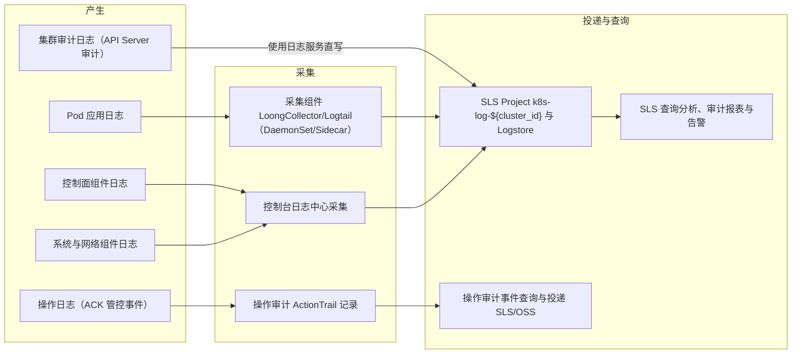

# ACK · 日志与审计

> 产品：ACK ｜ 口径：公共云 ｜ 复核：2026-11-18

## 日志流转图

**来源**
- 集群 API Server 审计（audit Logstore、托管 30 天/专有 365 天、计费说明）：https://help.aliyun.com/zh/ack/ack-managed-and-ack-dedicated/security-and-compliance/work-with-cluster-auditing ｜ 复核：2026-11-18
- 采集托管集群控制面组件日志（组件 Logstore、Pro 版默认开启）：https://help.aliyun.com/zh/ack/ack-managed-and-ack-dedicated/user-guide/collect-control-plane-component-logs-of-ack-managed-cluster ｜ 复核：2026-11-18
- ACK集群日志采集与管理（日志类型总览、DaemonSet/Sidecar、计费）：https://help.aliyun.com/zh/ack/ack-managed-and-ack-dedicated/user-guide/log-management-2 ｜ 复核：2026-11-18
- 采集ACK集群容器日志（DaemonSet 方式，采集组件安装与资源预留）：https://help.aliyun.com/zh/ack/ack-managed-and-ack-dedicated/user-guide/collect-text-logs-from-ack-clusters-using-daemonset-deployed-logtail-agents ｜ 复核：2026-11-18
- 操作审计使用限制（默认 90 天、跟踪配额、10 分钟可查）：https://help.aliyun.com/zh/actiontrail/product-overview/limits ｜ 复核：2026-11-18
- 容器服务 ACK 审计事件（管控事件清单）：https://help.aliyun.com/zh/actiontrail/product-overview/auditable-events-of-container-service-for-kubernetes ｜ 复核：2026-11-18

## 日志类型总表

| 类型 | 产生方 | 查看入口 | 默认保留期 | 是否计费 |
|---|---|---|---|---|
| 集群审计日志（API Server 审计，Logstore `audit-${cluster_id}`） | ACK 控制面 kube-apiserver | 容器服务控制台：安全管理 > 集群审计；SLS 控制台对应 Logstore | 托管集群 30 天，专有集群 365 天（可修改 LogStore 保存时间） | 开启后按日志服务 SLS「按使用功能计费」，费用在账单总览可见明细 |
| 控制面组件日志（Logstore：apiserver / kcm / scheduler / ccm / controlplane-events / alb / cluster-autoscaler 等，每组件一个 Logstore） | ACK 托管控制面 | 容器服务控制台：运维管理 > 日志中心 > 控制面组件日志；SLS 控制台 | 📋 待补（官方未标注各 Logstore 默认保存时间） | SLS 按量付费；托管集群 Pro 版创建时默认开启，基础版需手动开启 |
| 系统与网络组件日志（CSI、Terway、Flannel、弹性伸缩等数据面插件；Ingress 访问日志、CoreDNS 等网络组件） | 数据面/网络组件 Pod | 容器服务控制台：日志中心（网络组件日志等页签）；SLS 控制台 | 📋 待补 | SLS 按量付费；需自行创建采集配置 |
| Pod 应用日志（容器标准输出与容器内文本文件） | 业务 Pod（**需自建采集**：安装日志采集组件并创建采集配置） | SLS 控制台 Project `k8s-log-${cluster_id}`；容器服务控制台日志中心 | 📋 待补（LogStore 保存时间随 SLS 配置） | SLS 按量付费；采集组件有资源预留（loongcollector-ds 每节点 ≥0.1 Core、256 MB 内存） |
| Kubernetes 集群事件（事件中心） | ack-node-problem-detector（NPD）+ kube-eventer | 容器服务控制台：运维管理 > 事件中心；SLS Kubernetes 事件中心 | 默认 90 天内的 ACK 集群事件数据免费 | 默认上报至 SLS，90 天内免费；推送钉钉/EventBridge 另按对应产品计费 |
| 操作日志（ACK 管控事件） | 操作审计 ActionTrail | 操作审计控制台 > 事件查询 | 默认 90 天 | 操作审计本身免费；投递到 SLS/OSS 按目标产品计费 |

- ACK 日志体系与日志服务 SLS 深度集成：采集组件（LoongCollector/Logtail）以 DaemonSet 或 Sidecar 方式将日志实时上传 SLS。
- 使用 ACK 集群使用 SLS 的费用 = 集群管理费用（仅 Pro 版收取）+ SLS 费用（按量付费）。

**来源**
- 集群 API Server 审计（audit Logstore、托管 30 天/专有 365 天、计费说明）：https://help.aliyun.com/zh/ack/ack-managed-and-ack-dedicated/security-and-compliance/work-with-cluster-auditing ｜ 复核：2026-11-17
- 采集托管集群控制面组件日志（组件 Logstore、Pro 版默认开启）：https://help.aliyun.com/zh/ack/ack-managed-and-ack-dedicated/user-guide/collect-control-plane-component-logs-of-ack-managed-cluster ｜ 复核：2026-11-17
- ACK集群日志采集与管理（日志类型总览、DaemonSet/Sidecar、计费）：https://help.aliyun.com/zh/ack/ack-managed-and-ack-dedicated/user-guide/log-management-2 ｜ 复核：2026-11-17
- 采集ACK集群容器日志（DaemonSet 方式，采集组件安装与资源预留）：https://help.aliyun.com/zh/ack/ack-managed-and-ack-dedicated/user-guide/collect-text-logs-from-ack-clusters-using-daemonset-deployed-logtail-agents ｜ 复核：2026-11-17
- 收集系统插件日志（CSI/Terway/Flannel/弹性伸缩）：https://help.aliyun.com/zh/ack/ack-managed-and-ack-dedicated/user-guide/collect-log-files-of-system-components ｜ 复核：2026-11-17
- Nginx Ingress 访问日志与监控（网络组件日志）：https://help.aliyun.com/zh/ack/ack-managed-and-ack-dedicated/user-guide/analyze-and-monitor-the-access-log-of-nginx-ingress ｜ 复核：2026-11-17
- Kubernetes 事件监控（NPD + kube-eventer、SLS 事件中心、默认 90 天免费）：https://help.aliyun.com/zh/ack/ack-managed-and-ack-dedicated/user-guide/event-monitoring ｜ 复核：2026-11-17
- 操作审计使用限制（默认 90 天、跟踪配额、10 分钟可查）：https://help.aliyun.com/zh/actiontrail/product-overview/limits ｜ 复核：2026-11-17
- 容器服务 ACK 审计事件（管控事件清单）：https://help.aliyun.com/zh/actiontrail/product-overview/auditable-events-of-container-service-for-kubernetes ｜ 复核：2026-11-17

## 关键日志详表

**A. 集群审计日志（API Server 审计事件，SLS 字段）**

| 字段 | 类型/示例 | 含义 |
|---|---|---|
| `auditID` | 字符串 | 审计事件唯一 ID；官方告警示例中作「事件ID」输出 |
| `verb` | 字符串（如 create） | 请求动作；官方示例查询 `verb: create` |
| `objectRef.subresource` | 字符串（如 exec） | 资源子操作；`exec` 表示进入容器执行命令 |
| `stage` | 枚举（如 ResponseStarted） | 事件阶段；审计策略（Audit Level）可跳过 RequestReceived 阶段 |
| `responseStatus.code` | 数值（如 200 / 403） | API 响应状态码；官方示例以 <400 判定成功、403 统计非法访问 |
| `user.username` | 字符串 | 操作账号；官方过滤语句排除 node / serviceaccount / apiserver 等系统组件 |
| `sourceIPs` | 数组（IP 地址） | 请求源 IP 列表；官方示例按源 IP 统计访问次数与失败率 |
| `requestURI` | 字符串 | 请求 URI；官方示例从中提取 exec 的资源路径与执行命令 |

**B. Pod 应用日志默认字段（标准输出，SLS 字段）**

| 字段 | 含义 |
|---|---|
| `_time_` | 日志采集时间 |
| `_source_` | 日志源类型：stdout 或 stderr |
| `_image_name_` | 容器使用的镜像名 |
| `_container_name_` | 容器名 |
| `_pod_name_` | Pod 名称 |
| `_namespace_` | Pod 所属命名空间 |
| `_pod_uid_` | Pod 唯一标识（UID） |

- 文本日志（容器内文件）默认字段另含：`__tag__:__hostname__`（宿主机名称）、`__tag__:__path__`（容器内日志文件路径）、`__tag__:_container_ip_`（容器 IP）、`__tag__:_image_name_`、`__tag__:_pod_name_`、`__tag__:_namespace_`、`__tag__:_pod_uid_`。

**C. 操作审计管控事件（ActionTrail 事件结构）**

| 字段 | 含义 |
|---|---|
| `eventTime` | 事件发生时间（UTC 格式） |
| `eventName` | 事件名称（如 CreateCluster、ScaleClusterNodePool） |
| `eventSource` | 事件来源 |
| `eventType` | 事件类型：ApiCall / ConsoleOperation / ConsoleSignin / ConsoleSignout 等 |
| `eventRW` | 事件读写类型：Read / Write |
| `sourceIpAddress` | 事件发起的源 IP 地址 |
| `userIdentity` | 请求者身份信息（type 含 root-account / ram-user / assumed-role 等） |
| `errorCode` | 云服务处理 API 请求发生错误时记录的错误码 |

**来源**
- 集群 API Server 审计（auditID/verb/objectRef/stage/responseStatus/user.username/sourceIPs 查询示例）：https://help.aliyun.com/zh/ack/ack-managed-and-ack-dedicated/security-and-compliance/work-with-cluster-auditing ｜ 复核：2026-11-17
- 采集ACK集群容器日志（标准输出与文本日志默认字段）：https://help.aliyun.com/zh/ack/ack-managed-and-ack-dedicated/user-guide/collect-text-logs-from-ack-clusters-using-daemonset-deployed-logtail-agents ｜ 复核：2026-11-17
- 管控事件结构定义（eventTime/eventName/eventType/eventRW/sourceIpAddress/userIdentity/errorCode）：https://help.aliyun.com/zh/actiontrail/user-guide/management-event-structure ｜ 复核：2026-11-17
- 容器服务 ACK 审计事件（事件名称清单）：https://help.aliyun.com/zh/actiontrail/product-overview/auditable-events-of-container-service-for-kubernetes ｜ 复核：2026-11-17

## 投递与加工

| 通道 | 去向与参数 | 关键限制 / 额度 | 计费要点 |
|---|---|---|---|
| DaemonSet 方式采集（LoongCollector / logtail-ds） | SLS Project `k8s-log-${cluster_id}`；机器组 `k8s-group-${cluster_id}`（另有 `-cluster` 指标采集机器组、`-singleton` 单实例机器组） | 采集配置三种创建方式：控制台、CRD（AliyunLogConfig/AliyunPipelineConfig）、环境变量 `aliyun_logs_<name>`；DaemonSet 采集需 K8s ≥1.10（Mount propagation），CRD 方式需 K8s ≥1.16；LoongCollector 与 logtail-ds 不能同时安装；支持多行正则、NGINX 解析与黑名单过滤 | SLS 按量付费；loongcollector-ds 每节点预留 ≥0.1 Core + 256 MB 内存，operator ≥0.1 Core + 128 MB |
| Sidecar 方式采集 | 每个业务 Pod 内注入采集容器，与主容器共享日志 Volume | 适合大型、混合型集群（每 Pod 独立配置）；单 Pod 资源消耗大；仅采集文本日志（不含标准输出） | SLS 按量付费 |
| 控制台日志服务（日志中心） | 控制面组件日志（每组件独立 Logstore）、网络组件日志（Ingress 访问日志、CoreDNS）、数据面组件日志（CSI/Terway/Flannel/弹性伸缩） | 控制面组件日志可「使用已有 Project 或创建新 Project（`k8s-log-{ClusterID}`）」；组件全部取消勾选即关闭该功能；审计 Logstore 索引已预配置，官方要求勿修改以免报表失效 | SLS 按量付费；Pro 版创建时默认开启控制面组件日志 |
| 审计日志查询与报表加工 | Logstore `audit-${cluster_id}` + 4 个内置审计报表（审计中心概览、资源操作概览、资源操作详细列表、Kubernetes CVE 安全风险） | 报表勿修改，自定义报表在 SLS 控制台新建；可更换日志 Project；审计筛选维度含命名空间、RAM 用户 | SLS 存储与索引按 SLS 规则计费 |
| SLS 查询分析与告警 | 查询分析、仪表盘、SLS 告警（短信、钉钉机器人、邮件、自定义 Webhook、通知中心） | 官方告警示例：exec 命令执行告警（含操作账号、命令、事件 ID、源 IP）；API Server 公网访问告警（访问次数达 10 次且失败率高于 50%） | SLS 查询、告警按 SLS 定价 |
| 审计事件投递（ActionTrail 创建跟踪） | SLS LogStore 或 OSS Bucket；多账号跟踪可将资源目录成员事件统一投递 | 单账号跟踪每地域 5 个；1 个跟踪最多配置 1 个 OSS Bucket；操作后 10 分钟内可查 | 操作审计免费，投递目标按各自定价单独付费 |

**来源**
- 采集ACK集群容器日志（Project/机器组、CRD/控制台/环境变量、Sidecar 与 DaemonSet 对比、资源预留、计费）：https://help.aliyun.com/zh/ack/ack-managed-and-ack-dedicated/user-guide/collect-text-logs-from-ack-clusters-using-daemonset-deployed-logtail-agents ｜ 复核：2026-11-17
- 控制台创建 DaemonSet 采集配置（多行正则、NGINX 解析、黑名单过滤）：https://help.aliyun.com/zh/ack/ack-managed-and-ack-dedicated/user-guide/collect-kubernetes-cluster-text-logs-daemonset ｜ 复核：2026-11-17
- ACK集群日志采集与管理（采集方式与限制、SLS 计费）：https://help.aliyun.com/zh/ack/ack-managed-and-ack-dedicated/user-guide/log-management-2 ｜ 复核：2026-11-17
- 采集托管集群控制面组件日志（已有 Project/新 Project、组件 Logstore 列表）：https://help.aliyun.com/zh/ack/ack-managed-and-ack-dedicated/user-guide/collect-control-plane-component-logs-of-ack-managed-cluster ｜ 复核：2026-11-17
- 集群 API Server 审计（内置报表、索引勿改、告警示例、更换 Project）：https://help.aliyun.com/zh/ack/ack-managed-and-ack-dedicated/security-and-compliance/work-with-cluster-auditing ｜ 复核：2026-11-17
- 操作审计使用限制（跟踪数、OSS Bucket 数、10 分钟可查、计费）：https://help.aliyun.com/zh/actiontrail/product-overview/limits ｜ 复核：2026-11-17
- 创建多账号跟踪（资源目录成员事件统一投递）：https://help.aliyun.com/zh/actiontrail/user-guide/create-a-multi-account-trail ｜ 复核：2026-11-17

## 审计与合规

| 项 | 官方口径 |
|---|---|
| 操作审计接入 | 容器服务 Kubernetes 版已接入操作审计（ActionTrail），记录用户通过 OpenAPI、控制台等方式操作 ACK 产生的管控事件；典型事件：CreateCluster、CreateClusterNodePool、ScaleClusterNodePool、UpgradeCluster、DeleteCluster、GrantPermissions、AddOrUpdateAlertContact |
| 留痕与查询 | 默认为每个阿里云账号记录最近 90 天操作事件；操作后 10 分钟内可在控制台查询；不创建跟踪无法追溯 90 天以前的事件 |
| 长期保存 | 超过 90 天需创建跟踪，将管控事件投递到 SLS LogStore 或 OSS Bucket（等保 2.0 留存场景） |
| 跟踪与查询配额 | 单账号跟踪每地域 5 个；1 个跟踪最多 1 个 OSS Bucket；LookupEvents 每秒最多 2 次 |
| K8s 集群审计范围 | ACK 托管集群、专有集群、Serverless 集群支持 API Server 审计；创建集群时默认选中「使用日志服务」开启；审计日志写入 Logstore `audit-${cluster_id}`；托管集群默认保存 30 天，专有集群 365 天 |
| 审计策略（Audit Level） | None / Metadata / Request / RequestResponse 四级；策略文件 `/etc/kubernetes/audit-policy.yml`；Secrets、ConfigMaps 采集 Metadata，常见资源默认 RequestResponse |
| 专有集群审计后端参数 | `--audit-log-path` 输出 `/var/log/kubernetes/kubernetes.audit`；`--audit-log-maxage` 7 天、`--audit-log-maxbackup` 10 个、`--audit-log-maxsize` 100 MB；kube-apiserver 启动参数仅专有集群可改（托管/Serverless 控制面由 ACK 托管） |
| 容器内部操作审计 | ack-advanced-audit 组件审计 kubectl exec 进入容器后的命令操作；Logstore `advaudit-${cluster_id}` 保存 180 天；功能免费（SLS 另计费）；仅支持托管 Pro 版、基础版、专有集群，内核 >4.19（Alibaba Cloud Linux ≥1.18、ContainerOS ≥1.24、Ubuntu ≥1.30） |
| 事件留痕 | 事件监控默认上报集群事件至 SLS，默认 90 天内事件数据免费 |

**来源**
- 容器服务 ACK 审计事件（CreateCluster/ScaleClusterNodePool/UpgradeCluster/GrantPermissions 等事件清单）：https://help.aliyun.com/zh/actiontrail/product-overview/auditable-events-of-container-service-for-kubernetes ｜ 复核：2026-11-17
- 操作审计使用限制（90 天留痕、跟踪配额、10 分钟可查、LookupEvents 2 次/秒）：https://help.aliyun.com/zh/actiontrail/product-overview/limits ｜ 复核：2026-11-17
- 集群 API Server 审计（适用集群、审计策略、审计后端参数、Logstore 保存时间、内置报表）：https://help.aliyun.com/zh/ack/ack-managed-and-ack-dedicated/security-and-compliance/work-with-cluster-auditing ｜ 复核：2026-11-17
- 使用容器内部操作审计功能（advaudit Logstore 180 天、集群与内核限制、计费）：https://help.aliyun.com/zh/ack/ack-managed-and-ack-dedicated/security-and-compliance/use-container-auditing ｜ 复核：2026-11-17
- Kubernetes 事件监控（默认 90 天内事件数据免费）：https://help.aliyun.com/zh/ack/ack-managed-and-ack-dedicated/user-guide/event-monitoring ｜ 复核：2026-11-17
