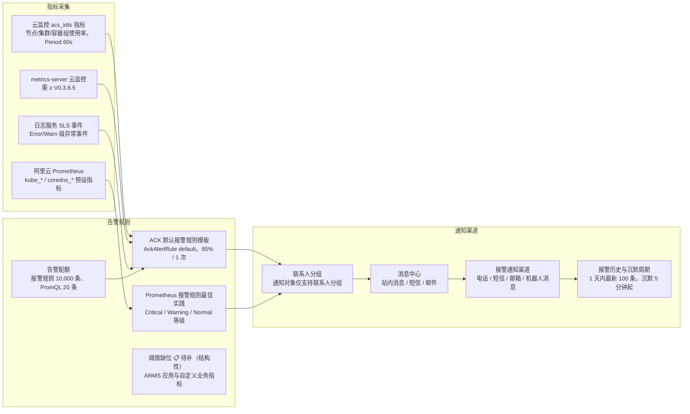

# ACK · 监控与告警

> 产品：ACK ｜ 口径：公共云 ｜ 复核：2026-11-18

## 告警链路图

**来源**
- 容器服务Kubernetes版（新版）云监控指标（Namespace `acs_k8s`、Period、MetricName/Dimensions/Statistics 全表）：https://help.aliyun.com/zh/cms/cloudmonitor-1-0/user-guide/ack ｜ 复核：2026-11-18
- 云监控 Kubernetes 容器监控（停止维护）（metrics-server 前提、2025-04-14 变更、开启方式）：https://help.aliyun.com/zh/ack/ack-managed-and-ack-dedicated/user-guide/monitor-basic-resources ｜ 复核：2026-11-18
- ACK 容器服务报警管理（默认报警规则模板、AckAlertRule CRD、默认阈值 85%/1 次、数据来源三类）：https://help.aliyun.com/zh/ack/ack-managed-and-ack-dedicated/user-guide/alert-management ｜ 复核：2026-11-18
- Prometheus 报警规则配置最佳实践（官方规则阈值与 Critical/Warning/Normal 等级）：https://help.aliyun.com/zh/ack/ack-managed-and-ack-dedicated/user-guide/best-practices-for-configuring-alert-rules-in-prometheus ｜ 复核：2026-11-18
- ACK 通知机制（消息中心、站内信/短信/邮件/机器人渠道、联系人分组、事件订阅）：https://help.aliyun.com/zh/ack/ack-managed-and-ack-dedicated/user-guide/notification-mechanism ｜ 复核：2026-11-18
- 云监控使用限制（报警规则/应用分组/存储时长/企业云监控配额）：https://help.aliyun.com/zh/cms/cloudmonitor-1-0/product-overview/restrictions-on-use ｜ 复核：2026-11-18

## 核心监控指标

- 云监控（CloudMonitor）侧：ACK 的 Namespace 为 `acs_k8s`，Period 默认 60 秒，也可为 60 的整数倍；统计方式（Statistics）为 Value/Sum。
- 前提：集群 metrics-server 组件需 ≥ V0.3.8.5；2024-04-25 10:00 以后创建的集群需手动开启 metrics-server 的云监控功能。
- 变更公告：自 2025-04-14 起新用户在云监控中不再提供 Kubernetes 容器监控能力，官方建议统一使用可观测监控 Prometheus 版；存量用户仍按 `acs_k8s` 提供指标。
- Prometheus 侧：ACK 官方报警规则所用的预设指标（`kube_*` / `coredns_*`），维度为指标标签（labels），统计周期列为官方规则的查询窗口。

| 指标（英文名） | 含义 | 单位 | 统计周期 | 维度 |
|---|---|---|---|---|
| `node.cpu.utilization` | 节点 CPU 使用率 | % | 60s（或 60 的整数倍） | userId、cluster、node |
| `node.memory.utilization` | 节点内存使用率 | % | 60s | userId、cluster、node |
| `node.cpu.usage_rate` | 节点 CPU 使用量 | Core | 60s | userId、cluster、node |
| `node.memory.working_set` | 节点工作内存使用量 | Byte | 60s | userId、cluster、node |
| `node.filesystem.available` | 节点文件系统可用大小 | Byte | 60s | userId、cluster、node |
| `node.network.rx_rate` | 节点网络接收速率 | Byte/s | 60s | userId、cluster、node |
| `cluster.cpu.utilization` | 集群 CPU 使用率 | % | 60s | userId、cluster |
| `cluster.memory.utilization` | 集群内存使用率 | % | 60s | userId、cluster |
| `pod.cpu.utilization` | 容器组 CPU 使用率（usage/limit） | % | 60s | userId、cluster、namespace、type、app、pod |
| `pod.memory.utilization` | 容器组内存使用率（working_set/limit） | % | 60s | userId、cluster、namespace、type、app、pod |
| `kube_pod_status_phase` | 各状态（Pending/Unknown/Failed 等）的容器组数量，即 Pod 数与异常状态判据 | 个（按状态计数） | 官方规则查询窗口 5m（`min_over_time(...[5m:1m])`） | namespace、pod、phase |
| `kube_pod_container_status_restarts_total` | 容器重启累计次数 | 次 | 官方规则窗口 5m（`increase([1m])`，1 分钟步长） | namespace、pod、container |
| `kube_node_status_condition` | 节点条件状态（Ready 等），官方以 Ready=false 判节点下线 | 布尔（0/1） | 官方规则窗口 3m（NotReady 持续 3 分钟） | node、condition、status |
| `kube_deployment_status_replicas_available` | Deployment 可用副本数（与期望副本数对比判工作负载/组件状态） | 个 | Prometheus 采集周期 | namespace、deployment |
| `coredns_dns_requests_total` | CoreDNS DNS 请求计数，速率跌零判定集群 DNS 可用性 | 次 | 官方规则窗口 1m | server、zone |

**来源**
- 容器服务Kubernetes版（新版）云监控指标（Namespace `acs_k8s`、Period、MetricName/Dimensions/Statistics 全表）：https://help.aliyun.com/zh/cms/cloudmonitor-1-0/user-guide/ack ｜ 复核：2026-11-17
- 云监控 Kubernetes 容器监控（停止维护）（metrics-server 前提、2025-04-14 变更、开启方式）：https://help.aliyun.com/zh/ack/ack-managed-and-ack-dedicated/user-guide/monitor-basic-resources ｜ 复核：2026-11-17
- Prometheus 报警规则配置最佳实践（`kube_pod_status_phase`、`kube_pod_container_status_restarts_total`、`kube_node_status_condition`、`kube_deployment_status_replicas_available`、`coredns_dns_requests_total` 与查询窗口）：https://help.aliyun.com/zh/ack/ack-managed-and-ack-dedicated/user-guide/best-practices-for-configuring-alert-rules-in-prometheus ｜ 复核：2026-11-17

## 官方默认与推荐告警

**A. ACK 默认报警规则模板（报警配置 > 报警规则管理，kube-system 下 AckAlertRule `default`）**

| 报警项 | 默认阈值 / 触发条件 | 数据来源 |
|---|---|---|
| 集群节点-CPU 使用率 | ≥85%（官方默认值 85%） | 云监控 `cms.host.cpu.utilization` |
| 集群节点-内存使用率 | ≥85%（官方默认值 85%） | 云监控 `cms.host.memory.utilization` |
| 集群节点-磁盘使用率 | ≥85%（官方默认值 85%） | 云监控 `cms.host.disk.utilization` |
| 集群节点-公网流出带宽使用率 | ≥85%（官方默认值 85%） | 云监控 `cms.host.public.network.utilization` |
| 集群节点-inode 使用率 | ≥85%（官方默认值 85%） | 云监控 `cms.host.fs.inode.utilization` |
| 负载均衡七层 QPS / 网络流出带宽 / 最大连接数使用率 | ≥85%（官方默认值 85%） | 云监控 `cms.slb.qps.utilization` 等 |
| 负载均衡监听每秒丢失连接数 | 持续 ≥1 次（官方默认值 1 次） | 云监控 `cms.slb.drop.connection` |
| Error 事件 / Warn 事件 | 全部 Error 级异常事件；关键 Warn 级事件（排除可忽略项） | 日志服务 SLS 事件 |
| 集群核心组件可用性（API Server/etcd/kube-scheduler/KCM/CCM/CoreDNS） | 可用性异常即触发（可用性类，无水位阈值） | 阿里云 Prometheus |
| Pod Pending 同时累计数 | >1000 | 阿里云 Prometheus |
| ControlPlane 组件发生 OOM | 事件触发 | 日志服务 SLS 事件 |

- 默认模板按规则集组织（Error 事件集、集群核心组件异常、节点池运维事件、节点异常、资源异常、弹性伸缩等），通过 AckAlertRule CRD 的 `thresholds` 字段调整阈值。

**B. 官方文档示例阈值（Prometheus 报警规则最佳实践，含官方等级）**

| 场景 | 阈值 / 条件 | 等级 |
|---|---|---|
| 宿主机 CPU 水位 | ≥85% / ≥90% | Warning / Critical |
| 宿主机内存水位 | ≥85% / ≥90% | Warning / Critical |
| 节点 CPU/内存使用水位（Usage/Allocatable） | ≥85% | Warning |
| 节点 CPU/内存资源分配率（Request/Allocatable） | ≥85% | Normal |
| 节点 CPU/内存超卖率（Limit/Allocatable） | ≥300%（官方注明为推荐参考值） | Warning |
| 容器副本 Pod CPU/内存水位（usage/limit） | ≥85%（官方注明为推荐的参考值） | Warning |
| 容器 CPU 限流 | 最近 3 分钟被限流 CPU 时间片 >25% | Warning |
| Pod 状态异常 | 最近 5 分钟内 Pod 处于 Pending/Unknown/Failed | Critical |
| Pod 启动失败 | 最近 5 分钟内容器重启累计 >3 次 | Critical |
| Pod 调度失败规模化 | 累计 1000 个 Pod Pending 超过 10 分钟 | Critical |
| 节点 NotReady | 持续 3 分钟 | Critical |
| 节点磁盘可用空间不足 | <15%（等价使用率 ≥85%） | Critical |
| Ingress Controller 证书即将过期 | 剩余有效期 <14 天 | Warning |
| CoreDNS 可用性异常 | 请求速率 ≤0（跌零）或 panic 计数 >0 | Critical |
| Deployment/DaemonSet/Job 异常 | 可用副本≠期望副本、misscheduled>0、Job 失败>0 | Critical |

**C. 阈值缺位**

- 应用性能（ARMS 应用监控）与自定义业务指标的告警阈值：**官方未发布推荐阈值** 📋 待补（结构性：官方文档仅提供创建告警规则的操作说明，按阈值红线不收经验值）。

**来源**
- ACK 容器服务报警管理（默认报警规则模板、AckAlertRule CRD、默认阈值 85%/1 次、数据来源三类）：https://help.aliyun.com/zh/ack/ack-managed-and-ack-dedicated/user-guide/alert-management ｜ 复核：2026-11-17
- Prometheus 报警规则配置最佳实践（官方规则阈值与 Critical/Warning/Normal 等级）：https://help.aliyun.com/zh/ack/ack-managed-and-ack-dedicated/user-guide/best-practices-for-configuring-alert-rules-in-prometheus ｜ 复核：2026-11-17

## 通知与渠道

| 渠道 / 机制 | 说明 |
|---|---|
| 消息中心（系统事件通知） | 站内消息、短信、邮件；在消息中心「消息接收人管理」配置联系人与接收类型 |
| 报警通知渠道（监控报警） | 电话、短信（手机号需验证后方可用于电话/短信通知）、邮箱、机器人消息 |
| 机器人渠道 | 钉钉机器人（地址须以 `https://oapi.dingtalk.com` 开头，需追加安全关键字「报警、分派」）、企业微信（`https://qyapi.weixin.qq.com`）、飞书（`https://open.feishu.cn` 或 `https://open.larksuite.com`） |
| 联系人与联系人分组 | 报警管理中联系人=一组唯一联系方式（手机号/邮箱/机器人 Token），联系人分组由多个联系人组成（多对多）；无分组时按账号注册信息自动创建默认分组 `Default Contact Group`；**通知对象仅支持联系人分组** |
| 事件订阅 | 为需接收的通知关联联系人/联系人组；启用报警管理时事件监控默认开启，系统事件投递事件中心后经报警通知渠道发送 |
| 报警历史 | 报警配置页可查看最近 1 天内发送的最新 100 条历史记录 |
| 云监控通道沉默周期 | 5 分钟、15 分钟、30 分钟、60 分钟、3 小时、6 小时、12 小时、24 小时；沉默期内不重复发送（适用于云监控数据源的报警规则） |
| 短信渠道风险提示 | 2025-05-20 起中国电信号码含链接/IP/电话的短信被拦截，官方建议补充邮件或钉钉机器人通知渠道 |
| 告警升级策略 | 官方未发布 ACK 告警升级（Escalation）策略 📋 待补（结构性） |

**来源**
- ACK 通知机制（消息中心、站内信/短信/邮件/机器人渠道、联系人分组、事件订阅）：https://help.aliyun.com/zh/ack/ack-managed-and-ack-dedicated/user-guide/notification-mechanism ｜ 复核：2026-11-17
- ACK 容器服务报警管理（电话/短信/邮箱/机器人、验证手机号、报警历史 1 天 100 条、联系人分组）：https://help.aliyun.com/zh/ack/ack-managed-and-ack-dedicated/user-guide/alert-management ｜ 复核：2026-11-17
- 云监控报警规则概述（通道沉默周期）：https://help.aliyun.com/zh/cms/cloudmonitor-1-0/user-guide/overview-2 ｜ 复核：2026-11-17
- 公告：中国电信号码无法接收特定告警短信：https://help.aliyun.com/zh/ack/product-overview/announcement-on-china-telecom-mobile-subscribers-unable-to-receive-specific-sms-alerts ｜ 复核：2026-11-17

## 告警配额

| 限制项 | 最大值 | 归属 |
|---|---|---|
| 单账号可新建的报警规则数量 | 10,000 条 | 基础云监控 |
| 单账号可新建的动态规则数量 | 1,200 个 | 基础云监控 |
| 单账号可新建的应用分组数量 | 20,000 个 | 基础云监控 |
| 一个应用分组内包含的每种资源数量 | 3,000 个 | 基础云监控 |
| 一个应用分组内允许新建的可用性监控数量 | 500 个 | 基础云监控 |
| 通过标签创建应用分组时单地域可添加的标签数量 | 100 个 | 基础云监控 |
| 监控数据存储时长（Period < 60 秒） | 7 天 | 基础云监控 |
| 监控数据存储时长（Period = 60 秒） | 31 天 | 基础云监控 |
| 监控数据存储时长（Period ≥ 300 秒） | 91 天 | 基础云监控 |
| 单账号可新建的 PromQL 报警规则数量 | 20 条 | 企业云监控 |
| 单账号可新建的指标仓库数量 | 30 个 | 企业云监控 |
| 单账号可新建的 SLS Logstore 组数量 | 20 个（每组最多 25 个 Logstore） | 企业云监控 |
| 一个智能水位分析任务可设置的报警联系人组数量 | 5 个 | 企业云监控 |
| ACK 报警历史可查看范围 | 最近 1 天内最新 100 条 | ACK 报警配置 |
| 报警联系人 / 报警联系人组的数量上限 | 📋 待补（结构性：官方使用限制页未列出该配额） | 基础云监控 |

**来源**
- 云监控使用限制（报警规则/应用分组/存储时长/企业云监控配额）：https://help.aliyun.com/zh/cms/cloudmonitor-1-0/product-overview/restrictions-on-use ｜ 复核：2026-11-17
- ACK 容器服务报警管理（报警历史 1 天 100 条、联系人分组）：https://help.aliyun.com/zh/ack/ack-managed-and-ack-dedicated/user-guide/alert-management ｜ 复核：2026-11-17
