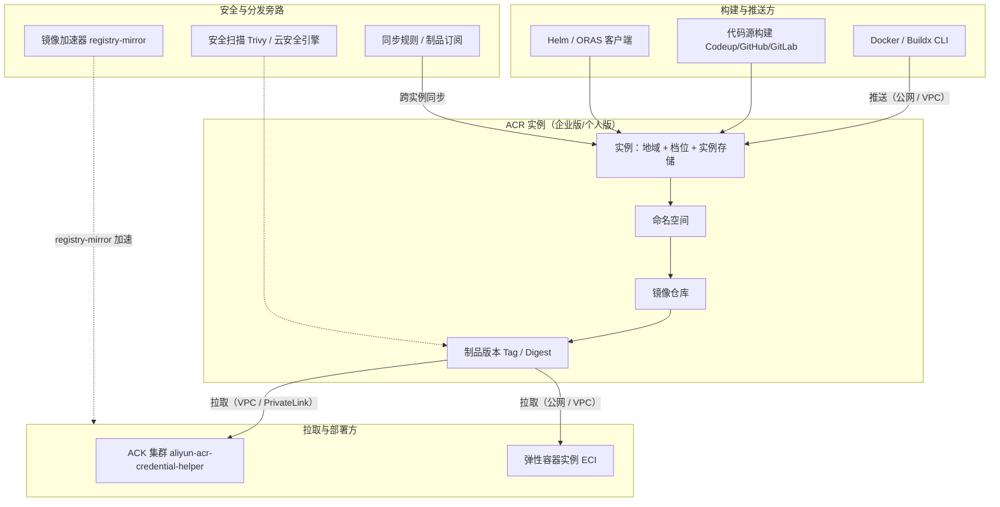

# ACR · 产品架构

> 产品：ACR ｜ 口径：公共云 ｜ 复核：2026-11-17

## 产品定义

阿里云容器镜像服务 ACR（Alibaba Cloud Container Registry）是面向容器镜像、Helm Chart 等符合 OCI 标准云原生制品的安全托管及高效分发平台。

- 企业版支持全球同步加速、大规模和大镜像分发加速、多代码源构建加速，与容器服务 ACK 无缝集成。
- 个人版面向个人开发者，提供应用镜像托管、镜像构建、镜像授权功能。

**来源**：
- 什么是容器镜像服务ACR：https://help.aliyun.com/zh/acr/product-overview/what-is-container-registry ｜ 复核：2026-11-16

## 架构图

**来源**
- 什么是容器镜像服务ACR（实例/制品托管与分发）：https://help.aliyun.com/zh/acr/product-overview/what-is-container-registry ｜ 复核：2026-11-17
- ACR 基本概念（地址格式：实例域名/命名空间/仓库[:Tag]）：https://help.aliyun.com/zh/acr/product-overview/terms ｜ 复核：2026-11-17
- 企业版推送拉取镜像（docker login/tag/push/pull 流程）：https://help.aliyun.com/zh/acr/getting-started/use-a-container-registry-enterprise-edition-instance-to-push-and-pull-images ｜ 复核：2026-11-17
- 容器镜像服务ACR访问配置（公网/VPC 访问设置）：https://help.aliyun.com/zh/acr/user-guide/access-configurations ｜ 复核：2026-11-17
- 在其他云产品中使用ACR镜像部署应用（ACK 部署与免密配置）：https://help.aliyun.com/zh/acr/getting-started/use-acr-images-to-deploy-applications-in-other-cloud-products ｜ 复核：2026-11-17
- 使用免密组件拉取容器镜像（aliyun-acr-credential-helper）：https://help.aliyun.com/zh/acr/user-guide/non-secret-pulling-container-image ｜ 复核：2026-11-17
- ECI 免密拉取 ACR 镜像（AcrRegistryInfo）：https://help.aliyun.com/zh/eci/user-guide/pull-images-from-a-container-registry-enterprise-edition-instance-without-using-a-secret-1 ｜ 复核：2026-11-17
- 容器镜像安全扫描（Trivy/云安全双引擎）：https://help.aliyun.com/zh/acr/user-guide/scan-container-images ｜ 复核：2026-11-17
- Docker Hub 镜像加速器（registry-mirror）：https://help.aliyun.com/zh/acr/user-guide/accelerate-the-pulls-of-docker-official-images ｜ 复核：2026-11-17
- 同账号同步实例（跨地域镜像同步）：https://help.aliyun.com/zh/acr/user-guide/replicate-images-between-instances-in-the-same-account ｜ 复核：2026-11-17

## 组件清单

| 组件 | 作用 | 必选/可选 | 是否独立计费 | 备注 |
|---|---|---|---|---|
| 实例（企业版/个人版） | ACR 服务部署单元：地域 + 档位（经济/基础/标准/高级）+ 实例存储 | 必选 | 是（企业版包年包月；个人版免费） | 个人版单账号限 1 个、无 SLA，官方禁止生产使用 |
| 命名空间 | 仓库的分组容器，地址格式 `<实例域名>/<命名空间>/<仓库>[:Tag]` | 必选 | 是（增量配额 25 元/5 个/月） | 档位默认 3/5/15/25/50（个人版/经济/基础/标准/高级） |
| 镜像仓库 | 制品托管单元，可见性分公有/私有，企业版支持多级仓库名 | 必选 | 是（增量配额 100 元/1000 个/月） | 档位默认 300/200/1000/3000/5000；按 RAM 用户做仓库粒度授权 |
| 制品版本（Tag / Digest） | 容器镜像、Helm Chart、OCI Artifact 的具体版本 | 必选 | 否（存储落 [OSS](../oss/README) Bucket，按 OSS 价格计费） | 企业版默认创建 `<ACR实例ID>-registry` Bucket，AES256 服务端加密 |
| 代码源构建 | 绑定 Codeup/Gitee/GitHub/GitLab/Bitbucket，按 Branch 或正则规则触发 Dockerfile 构建 | 可选 | 否（官方计费说明未列构建计费项） | 并发构建 1/1/3/5/10（个人版/经济/基础/标准/高级） |
| 触发器（Webhook） | 镜像推送成功后回调 HTTP/HTTPS 通知，POST JSON 含 push_data 与 repository | 可选 | 否（官方计费说明未列触发器计费项） | Tag 触发列表最多 10 个；「访问记录」可查历史访问详情 |
| 镜像加速器 | 为 Docker Hub 拉取提供 registry-mirror 地址，加速官方镜像下载 | 可选 | 否（官方计费说明未列该项） | 每账号生成一个加速器地址；已停止同步最新镜像；2024-07-02 起限阿里云用户在支持公网的阿里云产品上使用 |
| 同步规则 | 跨实例/跨地域自动同步镜像（按命名空间或仓库触发） | 可选 | 否（跨境同步加速功能免费，OSS/CEN 链路另计费） | 标准版 30 条、高级版 60 条；源实例须为标准版或高级版 |
| 制品订阅 | 将 Docker Hub/GCR/Quay 等海外源镜像按正则自动同步到实例 | 可选 | 否（官方计费说明未列该项） | 基础版 5/标准版 10/高级版 30 条；Docker Hub 单规则限 5 个镜像版本 |
| 安全扫描 | 双引擎扫描系统/应用漏洞、基线与恶意样本，支持交付链内阻断 | 可选 | 是（Trivy 引擎免费；云安全扫描引擎 800 元/月） | 云安全引擎每月 1 万次以内不同 Digest 扫描，相同 Digest 不限次 |
| 云原生交付链 | 串联镜像构建 → 安全扫描（可阻断）→ 跨域同步 → ACK 分发触发器 | 可选 | 否（官方计费说明未列该项） | 仅企业版高级版支持 |
| 实例存储 OSS Bucket | 承载企业版制品数据（镜像层、Chart 等） | 必选（企业版） | 是（按 OSS 价格；公网拉取产生外网流出流量费） | 关联 [OSS](../oss/README)；仅 VPC 域名拉取无 OSS 外网流出费 |
| 容器服务 ACK（关联产品） | ACK 集群经免密组件拉取实例镜像并部署应用 | 可选（关联产品） | 是（ACK 侧计费，ACR 侧无额外费用） | 关联 [ACK](../ack/README)；组件 aliyun-acr-credential-helper，支持托管/自行运维两种形态 |

**来源**
- 什么是容器镜像服务ACR（实例档位、命名空间/仓库配额、拉取 QPS）：https://help.aliyun.com/zh/acr/product-overview/what-is-container-registry ｜ 复核：2026-11-17
- ACR 基本概念（地址格式、命名空间/仓库）：https://help.aliyun.com/zh/acr/product-overview/terms ｜ 复核：2026-11-17
- ACR 计费说明（必选实例/OSS Bucket、扫描、命名空间/仓库/VPC 配额、个人版免费）：https://help.aliyun.com/zh/acr/product-overview/billing-description ｜ 复核：2026-11-17
- 企业版实例计费（增量配额价格、Trivy 免费、云安全 800 元/月）：https://help.aliyun.com/zh/acr/product-overview/billing-of-container-registry-enterprise-edition-instances ｜ 复核：2026-11-17
- 创建企业版实例（默认 OSS Bucket、AES256 加密前提）：https://help.aliyun.com/zh/acr/user-guide/create-a-container-registry-enterprise-edition-instance ｜ 复核：2026-11-17
- 镜像仓库主要功能（可见性、RAM 授权、Webhook 触发）：https://help.aliyun.com/zh/acr/user-guide/main-features-of-a-repository ｜ 复核：2026-11-17
- 触发器管理（HTTP/HTTPS 回调、Tag 列表最多 10 个、访问记录）：https://help.aliyun.com/zh/acr/user-guide/manage-webhooks ｜ 复核：2026-11-17
- Docker Hub 镜像加速器（registry-mirror、已停止同步最新镜像）：https://help.aliyun.com/zh/acr/user-guide/accelerate-the-pulls-of-docker-official-images ｜ 复核：2026-11-17
- 镜像加速器使用范围调整公告（2024-07-02）：https://help.aliyun.com/zh/acr/product-overview/product-change-acr-mirror-accelerator-function-adjustment-announcement ｜ 复核：2026-11-17
- 同账号同步实例（自动同步规则、源实例要求）：https://help.aliyun.com/zh/acr/user-guide/replicate-images-between-instances-in-the-same-account ｜ 复核：2026-11-17
- 通过制品订阅获取海外源镜像（规则数与 Docker Hub 限额）：https://help.aliyun.com/zh/acr/user-guide/subscribe-to-image-tags ｜ 复核：2026-11-17
- 容器镜像安全扫描（双引擎、一键修复）：https://help.aliyun.com/zh/acr/user-guide/scan-container-images ｜ 复核：2026-11-17
- 创建云原生交付链（仅高级版、构建→扫描→同步→分发）：https://help.aliyun.com/zh/acr/user-guide/create-a-delivery-chain ｜ 复核：2026-11-17
- 在其他云产品中使用ACR镜像部署应用（ACK 免密拉取与部署）：https://help.aliyun.com/zh/acr/getting-started/use-acr-images-to-deploy-applications-in-other-cloud-products ｜ 复核：2026-11-17
- 使用免密组件拉取容器镜像（aliyun-acr-credential-helper 托管/自行运维）：https://help.aliyun.com/zh/acr/user-guide/non-secret-pulling-container-image ｜ 复核：2026-11-17

## 产品类型：个人版与企业版

| 维度 | 个人版 | 企业版 |
|---|---|---|
| 面向 | 个人开发者，仅限开发测试 | 企业客户，生产可用 |
| SLA | 无（无 SLA 承诺及受损赔偿） | 99.95%（经济/基础/标准/高级均为 99.95%） |
| OpenAPI | 不提供 | 提供 |
| 实例数量 | 2024-09-09 起单账号限 1 个，且只能建在选定的单一地域 | 按地域可建多个 |
| 制品范围 | 仅容器镜像（单级仓库名） | 容器镜像（多级仓库名）、Helm Chart、OCI Artifact |
| 存储 | 托管在 ACR 侧 | 托管在您账号的 OSS Bucket（默认创建 `<ACR实例ID>-registry`，可自选已有 Bucket），默认 AES256 服务端加密 |
| 容灾 | 无 | 实例可用区容灾（多可用区地域默认支持）；存储可用区容灾/跨地域备份需 OSS 同城冗余 Bucket / OSS 跨区域复制 |

官方警告：个人版无 SLA、有使用限制，请勿在生产业务中使用。

**来源**：
- 什么是容器镜像服务ACR（规格说明/SLA）：https://help.aliyun.com/zh/acr/product-overview/what-is-container-registry ｜ 复核：2026-11-16
- 个人版和企业版实例差异化说明：https://help.aliyun.com/zh/acr/product-overview/differences-between-personal-edition-instances-and-enterprise-edition-instances ｜ 复核：2026-11-16
- 创建个人版实例（单账号 1 个、无 OpenAPI）：https://help.aliyun.com/zh/acr/user-guide/create-a-container-registry-personal-edition-instance ｜ 复核：2026-11-16
- 新个人版实例使用限制（单地域使用）：https://help.aliyun.com/zh/acr/user-guide/individual-edition-instance-independent-domain-name-capacity-limit ｜ 复核：2026-11-16
- ACR 产品优势（企业版默认 AES256 OSS 加密）：https://help.aliyun.com/zh/acr/product-overview/benefits ｜ 复核：2026-11-16

## 实例模型

- 企业版实例 = 地域 + 实例规格（档位）+ 实例名称 + 实例存储（OSS Bucket）。创建后约 2~3 分钟由「启动中」变为「运行中」。
- 实例规格分经济版、基础版、标准版、高级版四档（购买页可选）；经济版仅在 10 个地域提供：华北1（青岛）、华北2（北京）、华北3（张家口）、华东1（杭州）、华东2（上海）、华南1（深圳）、中国香港、泰国（曼谷）、新加坡、德国（法兰克福）。
- 个人版实例创建时必须选定一个目标地域，后续仅在该地域可用，并自动分配独立访问域名。
- 企业版实例创建前提：已授权 ACR 使用 OSS、VPC、云监控等资源权限，已开通 OSS。

**来源**：
- 创建ACR企业版实例（实例模型/启动时间/前提）：https://help.aliyun.com/zh/acr/user-guide/create-a-container-registry-enterprise-edition-instance ｜ 复核：2026-11-16
- 计费说明（经济版开服地域）：https://help.aliyun.com/zh/acr/product-overview/billing-description ｜ 复核：2026-11-16
- ACR 开服地域（档位×地域矩阵）：https://help.aliyun.com/zh/acr/product-overview/supported-regions ｜ 复核：2026-11-16
- 新个人版实例使用限制（单地域）：https://help.aliyun.com/zh/acr/user-guide/individual-edition-instance-independent-domain-name-capacity-limit ｜ 复核：2026-11-16

## 资源层级：实例 → 命名空间 → 仓库 → 制品版本

- 地址格式：`<实例域名>/<命名空间>/<仓库>[:Tag]`，Tag 不指定默认 latest。
- 企业版：`instance-registry.cn-hangzhou.cr.aliyuncs.com/namespace/repository:v1`；仓库支持多级名称（如 `agent/client/prod`）。
- 个人版：`registry.cn-hangzhou.aliyuncs.com/namespace/repository:v1`；仅支持一级仓库名称。
- 仓库可见性分公有（匿名可下载）与私有；仓库名称建议 2~64 个字符（小写英文字母、数字、下划线、短划线、半角句号，下划线不能在首位或末位，不支持正斜线）。
- 权限经 RAM 控制：可对 RAM 用户做仓库粒度授权（如 `[用户名]@[企业别名]` 登录格式）。

**来源**：
- ACR 基本概念（地址格式/多级仓库名）：https://help.aliyun.com/zh/acr/product-overview/terms ｜ 复核：2026-11-16
- 镜像仓库主要功能（可见性/授权/Webhook）：https://help.aliyun.com/zh/acr/user-guide/main-features-of-a-repository ｜ 复核：2026-11-16
- 使用个人版实例推送拉取镜像（仓库名规则）：https://help.aliyun.com/zh/acr/user-guide/use-a-container-registry-personal-edition-instance-to-push-and-pull-images ｜ 复核：2026-11-16

## 镜像安全扫描与分发加速（概览）

- 安全扫描：双引擎——Trivy（开源、免费、每日更新漏洞库）与云安全扫描引擎（自研、800 元/月）；支持交付链内扫描阻断。
- 分发加速：P2P 分发、按需加载（大镜像免全量下载）、全球同步（跨实例/跨地域镜像同步）、制品订阅（Docker Hub/GCR/Quay 等海外源）。
- 镜像加速器（个人开发者向）：为 Docker Hub 拉取提供 registry-mirror 地址；2024-07-02 起仅限阿里云用户在支持公网的阿里云产品上使用，且仅支持拉取限定范围镜像。
- 详见 [04-配套参数.md](04-配套参数.md)。

**来源**：
- 容器镜像安全扫描：https://help.aliyun.com/zh/acr/user-guide/scan-container-images ｜ 复核：2026-11-16
- Docker Hub 镜像加速器：https://help.aliyun.com/zh/acr/user-guide/accelerate-the-pulls-of-docker-official-images ｜ 复核：2026-11-16
- 镜像加速器使用范围调整公告（2024-07-02）：https://help.aliyun.com/zh/acr/product-overview/product-change-acr-mirror-accelerator-function-adjustment-announcement ｜ 复核：2026-11-16

## SLA 与容灾

| 项 | 个人版 | 企业版（经济/基础/标准/高级） |
|---|---|---|
| SLA | 无 | 99.95% |
| 实例可用区容灾 | 无 | 多可用区地域默认支持 |
| 实例跨地域容灾 | 无 | 需多地域多实例 + 镜像同步（最佳实践方案） |
| 实例存储可用区容灾 | 无 | 需使用 OSS 同城冗余 Bucket |
| 实例存储跨地域备份 | 无 | 需使用 OSS 跨区域复制 |

- 欠费/到期导致实例删除后，镜像物理数据保留在对应 OSS Bucket 上（详见 07）。

**来源**：
- 什么是容器镜像服务ACR（容灾与 SLA 表）：https://help.aliyun.com/zh/acr/product-overview/what-is-container-registry ｜ 复核：2026-11-16
