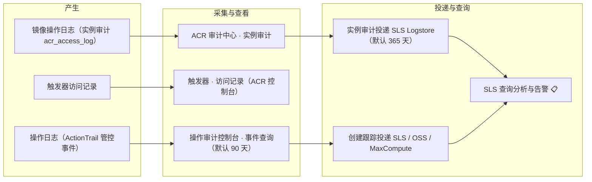

# ACR · 日志与审计

> 产品：ACR ｜ 口径：公共云 ｜ 复核：2026-11-18

## 日志流转图

**来源**
- 实例审计（Logstore `acr_access_log`、默认 365 天、SLS 查询）：https://help.aliyun.com/zh/acr/user-guide/instance-audit ｜ 复核：2026-11-18
- 触发器管理（访问记录查看入口）：https://help.aliyun.com/zh/acr/user-guide/manage-webhooks ｜ 复核：2026-11-18
- 操作审计使用限制（90 天留痕、跟踪投递）：https://help.aliyun.com/zh/actiontrail/product-overview/limits ｜ 复核：2026-11-18
- 什么是日志服务 SLS（查询分析、告警、投递能力）：https://help.aliyun.com/zh/sls/what-is-log-service ｜ 复核：2026-11-18

## 日志类型总表

| 类型 | 产生方 | 查看入口 | 默认保留期 | 是否计费 |
|---|---|---|---|---|
| 镜像操作日志（实例审计，Logstore `acr_access_log`） | ACR 企业版 + 日志服务 SLS | ACR 控制台：实例列表 > 实例管理 > 审计中心 > 实例审计；SLS 控制台 | 默认 365 天（可在 SLS 修改 LogStore 保存时间） | ACR 侧未标注单独收费；日志存储与查询按 SLS「按使用功能付费」计费 |
| 镜像使用分析事件轴（推送 / 拉取 / 删除事件） | ACR 镜像分析 | ACR 控制台：实例管理 > 镜像分析 > 事件轴 | 查询近 30 天内的镜像事件 | 需提交工单开通；官方未标注计费 📋 待补（结构性，企业版计费说明未列该计费项） |
| 触发器访问记录（镜像推送触发器历史访问详情） | ACR 镜像仓库触发器 | ACR 控制台：镜像仓库 > 触发器 > 访问记录 | 📋 待补（控制台口径）（官方未标注保留期） | 官方计费说明未列触发器计费项 |
| 操作日志（管控事件） | 操作审计 ActionTrail | 操作审计控制台 > 事件查询 | 默认 90 天 | 操作审计本身免费；投递到 SLS / OSS / MaxCompute 按目标产品计费 |
| 事件通知记录（同步 / 构建 / 扫描 / 交付链 / 加签 5 类事件） | ACR + 事件总线 EventBridge | ACR 控制台：事件通知；EventBridge 控制台 | 按事件 ID 仅支持查询 3 天内事件 | 官方未标注事件通知计费 📋 待补（结构性，计费说明未列该计费项） |
| 平台操作审计（Inner-ActionTrail，含 ACR 平台操作事件） | 操作审计 + 日志服务 SLS | SLS 控制台专属 Logstore 与专属仪表盘 | Logstore 默认永久存储（可修改） | 操作审计不额外收费；SLS 按存储、读取流量、请求数、加工与投递计费 |

- 实例审计仅企业版实例支持，前提为已开通 SLS 日志服务。
- 同地域下多个实例启用实例审计后存放在同一 Logstore 中，按 `instance_id` 过滤。
- 触发器「访问记录」中，未命中触发条件时访问状态码显示「未触发」。

**来源**
- 实例审计（Logstore、默认 365 天、字段、开通前提、同库过滤）：https://help.aliyun.com/zh/acr/user-guide/instance-audit ｜ 复核：2026-11-17
- 审计与分析（文档入口）：https://help.aliyun.com/zh/acr/user-guide/audit-and-analysis ｜ 复核：2026-11-17
- 镜像使用分析（工单开通、近 30 天事件轴、ACK 集群授权）：https://help.aliyun.com/zh/acr/user-guide/image-usage-analysis ｜ 复核：2026-11-17
- 触发器管理（访问记录、未触发状态码）：https://help.aliyun.com/zh/acr/user-guide/manage-webhooks ｜ 复核：2026-11-17
- 创建事件通知（5 类事件、EventBridge、事件查询 3 天）：https://help.aliyun.com/zh/acr/user-guide/create-an-event-notification ｜ 复核：2026-11-17
- 操作审计使用限制（默认 90 天、跟踪配额、LookupEvents）：https://help.aliyun.com/zh/actiontrail/product-overview/limits ｜ 复核：2026-11-17
- 操作审计计费说明：https://help.aliyun.com/zh/actiontrail/product-overview/billing-1 ｜ 复核：2026-11-17
- 平台操作审计概述（ACR 平台操作事件、Logstore 默认永久存储、费用）：https://help.aliyun.com/zh/actiontrail/user-guide/inner-actiontrail-overview ｜ 复核：2026-11-17
- ACR 计费说明（收费项清单未列触发器/事件通知）：https://help.aliyun.com/zh/acr/product-overview/billing-description ｜ 复核：2026-11-17

## 关键日志详表

**A. 实例审计（`acr_access_log`，SLS 字段）**

| 字段 | 类型/示例 | 含义 |
|---|---|---|
| `time` | 时间（2024-04-12T16:58:30.855892463+08:00） | 服务端收到请求的时间 |
| `action` | 枚举（GetImageManifest / GetBlob / PutImageManifest / DeleteTag） | 操作类型 |
| `instance_id` | 字符串（cri-xxx） | 实例 ID |
| `namespace_repo` | 字符串（test-ns/test-repo） | 镜像仓库完整名称 |
| `tag` | 字符串（v1） | 镜像版本 |
| `network_type` | 枚举（Internet / VPC） | 访问网络类型（公网 / 专有网络） |
| `http_response_status` | 数值（200） | HTTP 请求返回的状态 |
| `user_identity_principal_id` | 字符串（300786xxxxxxx:Alice） | 当前请求者 ID，需结合 `user_identity_user_type` 唯一确认身份 |

- 另含 `blob_digest`、`http_request_host`、`http_request_id`、`http_request_method`、`http_request_remoteaddr`、`http_request_useragent`、`access_credential_type`、`user_identity_user_type`（root-account / ram-user / assumed-role / system）等字段。

**B. 触发器通知内容（POST JSON，触发器「访问记录」关联）**

| 字段 | 类型/示例 | 含义 |
|---|---|---|
| `push_data.digest` | 字符串（sha256:457f4aa8…） | 推送镜像的 Digest |
| `push_data.pushed_at` | 时间（2016-11-29 12:25:46） | 镜像推送时间 |
| `push_data.tag` | 字符串（latest） | 推送的镜像版本 Tag |
| `repository.namespace` | 字符串（namespace） | 镜像仓库命名空间 |
| `repository.name` | 字符串（repoTest） | 镜像仓库名 |
| `repository.region` | 字符串（cn-hangzhou） | 镜像仓库所在地域 |
| `repository.repo_full_name` | 字符串（namespace/repoTest） | 镜像仓库完整名称 |
| `repository.repo_type` | 枚举（PUBLIC / PRIVATE） | 仓库可见性 |

- 触发条件支持表达式触发（正则过滤）与 Tag 触发（列表最多 10 个 Tag）。

**C. 操作审计管控事件（ActionTrail 事件结构）**

| 字段 | 含义 |
|---|---|
| `eventTime` | 事件发生时间（UTC 格式） |
| `eventName` | 事件名称；`eventType` 为 ApiCall 时即 API 名称 |
| `eventSource` | 事件来源 |
| `eventType` | 事件类型：ApiCall / ConsoleOperation / ConsoleSignin / ConsoleSignout / AliyunServiceEvent 等 |
| `eventRW` | 事件读写类型：Read / Write |
| `sourceIpAddress` | 事件发起的源 IP 地址 |
| `userIdentity` | 请求者身份信息（type 含 root-account / ram-user / assumed-role 等） |
| `errorCode` | 云服务处理 API 请求发生错误时记录的错误码 |

**来源**
- 实例审计字段详情（action / instance_id / network_type / user_identity 等）：https://help.aliyun.com/zh/acr/user-guide/instance-audit ｜ 复核：2026-11-17
- 触发器管理（通知内容 JSON、触发条件、Tag 列表最多 10 个）：https://help.aliyun.com/zh/acr/user-guide/manage-webhooks ｜ 复核：2026-11-17
- 管控事件结构定义（eventTime/eventName/eventType/eventRW/sourceIpAddress/userIdentity/errorCode）：https://help.aliyun.com/zh/actiontrail/user-guide/management-event-structure ｜ 复核：2026-11-17
- 容器镜像服务 ACR 审计事件（事件名称与含义清单）：https://help.aliyun.com/zh/actiontrail/product-overview/auditable-events-of-container-registry ｜ 复核：2026-11-17

## 投递与加工

| 通道 | 去向与参数 | 关键限制 / 额度 | 计费要点 |
|---|---|---|---|
| 实例审计投递 SLS | 控制台自动创建 Project `aliyun-product-data-<UID>-<地域>` 与 Logstore `acr_access_log` | 默认保存 365 天，可在 SLS 修改；同地域多实例同一 Logstore，按 `instance_id` 过滤；需先开通 SLS | ACR 侧未标注审计功能费；SLS 存储、索引、查询按「按使用功能付费」 |
| 操作审计创建跟踪 | 管控事件投递到 SLS LogStore / OSS Bucket / MaxCompute 项目；多账号跟踪可将资源目录成员事件统一投递 | 单账号跟踪每地域 5 个；1 个跟踪最多配置 1 个 OSS Bucket；操作后 10 分钟内可查 | 操作审计免费，投递目标按各自定价单独付费 |
| 平台操作审计 Inner-ActionTrail | SLS 自定义 Project 与专属 Logstore（默认开启索引），默认生成仪表盘 `innertrail_跟踪名称_audit_center_cn` / `_en` | 需提交工单或白名单开通；仅支持 1 个跟踪；所有平台操作事件只能投递到 1 个 Logstore；Logstore 默认永久存储 | 操作审计不额外收费；SLS 按存储空间、读取流量、请求数、加工与投递计费 |
| 事件通知投递 | EventBridge default 事件总线下同名规则 → 钉钉机器人 / HTTP / HTTPS | 每地域 10 条事件规则（ACR 与 EventBridge 各可创建 10 条）；钉钉机器人每分钟最多 20 条群消息，超限被限流 10 分钟；在 ACR 修改规则会以 ACR 默认模板覆盖 EventBridge 侧修改 | 官方未标注事件通知计费 📋 待补（结构性，计费说明未列该计费项） |
| 镜像使用分析 | 控制台事件轴：查询近 30 天推送/拉取/删除事件与客户端公网 IP；授权 ACK 集群后可分析镜像在集群/应用中的部署情况 | 需提交工单开通；部署统计每日 0 点更新 | 官方未标注计费 📋 待补（结构性，计费说明未列该计费项） |
| SLS 查询分析与告警 | 在 SLS 控制台对 `acr_access_log` 做查询分析、仪表盘与告警（短信、钉钉机器人、邮件、Webhook 等渠道） | ACR 官方文档未给出查询示例与告警模板 📋 待补（结构性）；采样与投递过滤参数官方未说明 | SLS 存储、查询、告警按 SLS 定价 |

**来源**
- 实例审计（Project/Logstore 命名、365 天、同库过滤、SLS 开通与计费）：https://help.aliyun.com/zh/acr/user-guide/instance-audit ｜ 复核：2026-11-17
- 操作审计使用限制（跟踪数、OSS Bucket 数、10 分钟可查）：https://help.aliyun.com/zh/actiontrail/product-overview/limits ｜ 复核：2026-11-17
- 创建多账号跟踪（资源目录成员事件统一投递）：https://help.aliyun.com/zh/actiontrail/user-guide/create-a-multi-account-trail ｜ 复核：2026-11-17
- 操作审计计费说明：https://help.aliyun.com/zh/actiontrail/product-overview/billing-1 ｜ 复核：2026-11-17
- 平台操作审计概述（工单白名单、1 个跟踪、专属 Logstore 与仪表盘、费用）：https://help.aliyun.com/zh/actiontrail/user-guide/inner-actiontrail-overview ｜ 复核：2026-11-17
- 创建事件通知（EventBridge 规则、钉钉限流、模板覆盖规则）：https://help.aliyun.com/zh/acr/user-guide/create-an-event-notification ｜ 复核：2026-11-17
- 镜像使用分析（近 30 天事件轴、ACK 集群授权、每日 0 点更新）：https://help.aliyun.com/zh/acr/user-guide/image-usage-analysis ｜ 复核：2026-11-17
- 什么是日志服务 SLS（查询分析、告警、投递能力）：https://help.aliyun.com/zh/sls/what-is-log-service ｜ 复核：2026-11-17
- ACR 企业版实例计费说明（计费项仅：实例/OSS/安全扫描/命名空间/仓库/专有网络配额）：https://help.aliyun.com/zh/acr/product-overview/billing-of-container-registry-enterprise-edition-instances ｜ 复核：2026-11-18

## 审计与合规

| 项 | 官方口径 |
|---|---|
| 操作审计接入 | 容器镜像服务已接入操作审计（ActionTrail），可查询用户通过 OpenAPI、控制台等方式操作 ACR 产生的管控事件；典型事件：CreateRepo、CreateNamespace、CreateRepoSyncRule、CreateRepoTrigger、CreateChain、StartImageScan、Release（部分事件含义官方标注后续完善） |
| 管控面与数据面分工 | ActionTrail 记录管控事件（镜像仓库/命名空间/Chart 仓库/构建规则/同步规则/触发器/扫描规则/交付链/VPC 端点等）；数据面推送、拉取日志由实例审计（`acr_access_log`）记录，两套日志独立 |
| 查询与留痕保留 | 默认为每个阿里云账号记录最近 90 天操作事件；操作后 10 分钟内可在控制台查询；不创建跟踪无法追溯 90 天以前的事件 |
| 长期保存 | 超过 90 天需创建跟踪，将管控事件投递到 SLS LogStore 或 OSS Bucket |
| 跟踪与查询配额 | 单账号跟踪每地域 5 个；1 个跟踪最多配置 1 个 OSS Bucket；LookupEvents 每秒最多 2 次 |
| 平台操作审计（Inner-ActionTrail） | 支持采集 KMS、DSC、OSS、ECS、RDS、ACK、ACR、E-MapReduce 的平台操作事件；存储六个月及以上满足等保合规；需工单/白名单，仅支持 1 个跟踪 |
| 实例审计（数据面） | 仅企业版实例；推送/拉取日志投递至 SLS `acr_access_log`，默认保存 365 天，含 action、blob_digest 等字段，可按时间周期选择推送或拉取日志 |
| 计费 | 操作审计本身免费；平台操作审计不额外收费；通过跟踪投递到 SLS/OSS/MaxCompute 时按各自定价单独付费 |

**来源**
- 容器镜像服务 ACR 审计事件（CreateRepo/StartImageScan/CreateRepoSyncRule 等清单）：https://help.aliyun.com/zh/actiontrail/product-overview/auditable-events-of-container-registry ｜ 复核：2026-11-17
- 操作审计使用限制（90 天留痕、10 分钟可查、跟踪配额、LookupEvents 2 次/秒）：https://help.aliyun.com/zh/actiontrail/product-overview/limits ｜ 复核：2026-11-17
- 什么是操作审计 ActionTrail（OpenAPI/控制台管控事件留痕）：https://help.aliyun.com/zh/actiontrail/product-overview/what-is-actiontrail ｜ 复核：2026-11-17
- 平台操作审计概述（ACR 平台操作事件、存储六个月、1 个跟踪）：https://help.aliyun.com/zh/actiontrail/user-guide/inner-actiontrail-overview ｜ 复核：2026-11-17
- 实例审计（企业版、acr_access_log、365 天、字段）：https://help.aliyun.com/zh/acr/user-guide/instance-audit ｜ 复核：2026-11-17
- 操作审计计费说明：https://help.aliyun.com/zh/actiontrail/product-overview/billing-1 ｜ 复核：2026-11-17
