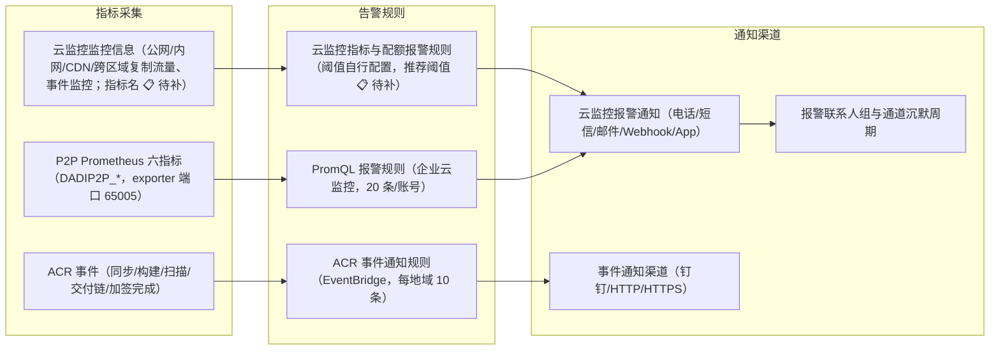

# ACR · 监控与告警

> 产品：ACR ｜ 口径：公共云 ｜ 复核：2026-11-18

## 告警链路图

**来源**
- 创建企业版实例（授权云监控、开通云监控查询实时数据、免费额度限流提示）：https://help.aliyun.com/zh/acr/user-guide/create-a-container-registry-enterprise-edition-instance ｜ 复核：2026-11-18
- 使用P2P加速（DADIP2P_* 指标名、单位、Tag 取值、exporter 配置）：https://help.aliyun.com/zh/acr/user-guide/use-p2p-acceleration-feature ｜ 复核：2026-11-18
- 云产品监控（云监控控制台查看监控数据与设置报警规则）：https://help.aliyun.com/zh/cms/cloudmonitor-1-0/user-guide/cloud-service-monitoring ｜ 复核：2026-11-18
- 创建事件通知（5 类事件、触发时机、生效范围、每地域 10 条、钉钉/HTTP/HTTPS 渠道）：https://help.aliyun.com/zh/acr/user-guide/create-an-event-notification ｜ 复核：2026-11-18
- 创建报警规则（通知与联动、沉默周期取值、报警回调、联系人组、生效时间、无数据处理）：https://help.aliyun.com/zh/cms/cloudmonitor-1-0/user-guide/create-an-alert-rule ｜ 复核：2026-11-18

## 核心监控指标

- ACR 企业版创建实例前提：已为 ACR 授权 OSS、VPC、云监控等资源权限；如需查询实例的实时数据，需开通云监控。
- 官方提示：免费使用云监控时，免费额度用完会受到限流，导致 ACR 控制台的监控信息无法正常显示，但云监控控制台仍可查看。
- ACR 实例「存储管理 > 监控信息」提供事件监控（诊断下载慢等潜在问题）与流量曲线（公网、内网、CDN、跨区域复制）；存储用量在「存储管理 > 基本信息 > 总用量」查看。
- 实例存储用量与公网/内网流入流出量可经 OpenAPI 查询：GetInstanceStorageUsage、GetInstanceStorageInternetIn/Out、GetInstanceStorageIntranetIn/Out（操作审计事件清单收录的 ACR API）。
- 官方文档未发布 ACR 的 CloudMonitor 指标参考页（ACR 文档集与云监控文档均无 ACR 的 Namespace / MetricName 清单）；指标英文名、单位、统计周期、维度以云监控控制台「指标和事件中心」为准，表 A 空位标 📋 待补。
- 分发性能（拉取 QPS）为实例规格保障值（经济版 30、基础版 250、标准版 500、高级版 1000），属配额而非监控指标，见 [06-配额与限制](06-配额与限制.md)。
- 个人版实例的云监控接入与指标官方未说明，⚠️ 待核。

**A. 云监控（CloudMonitor）数据面 — 官方未发布 ACR 指标参考页**

| 指标（英文名） | 含义 | 单位 | 统计周期 | 维度 |
|---|---|---|---|---|
| 📋 待补 | 公网流量（实例存储管理 > 监控信息 > 流量，按时间段查看） | 📋 待补 | 📋 待补 | 企业版实例 |
| 📋 待补 | 内网流量（同上入口） | 📋 待补 | 📋 待补 | 企业版实例 |
| 📋 待补 | CDN 流量（同上入口） | 📋 待补 | 📋 待补 | 企业版实例 |
| 📋 待补 | 跨区域复制流量（同上入口） | 📋 待补 | 📋 待补 | 企业版实例 |
| 📋 待补 | 事件监控（监测指定时间段内事件，用于诊断下载慢等潜在问题） | — | 📋 待补 | 企业版实例 |

**B. P2P 分发加速客户端指标（Prometheus，官方英文名）**

| 指标（英文名） | 含义 | 单位 | 统计周期 | 维度 |
|---|---|---|---|---|
| `DADIP2P_Alive` | P2P 服务是否存活 | 布尔（0/1） | Prometheus 抓取周期（官方未标注间隔） | node、mode |
| `DADIP2P_Read_Throughtput` | P2P 服务吞吐 | byte/s | Prometheus 抓取周期（官方未标注间隔） | node、type、mode |
| `DADIP2P_QPS` | QPS | 次/秒 | Prometheus 抓取周期（官方未标注间隔） | node、type、mode |
| `DADIP2P_MaxLatency` | 延迟统计 | us | Prometheus 抓取周期（官方未标注间隔） | node、type、mode |
| `DADIP2P_Count` | 流量统计 | bytes | Prometheus 抓取周期（官方未标注间隔） | node、type、mode |
| `DADIP2P_Cache` | 单机 Cache 用量（allocated / used） | bytes | Prometheus 抓取周期（官方未标注间隔） | node、type、mode |

- `node` 为 P2P Agent/Root 的服务 IP 和端口；`type` 取值：pread（处理下游请求）、download（回源）、peer（P2P 网络分发）、disk（处理磁盘）、http（处理 HTTP 请求）、allocated（缓存分配空间）、used（缓存使用空间）。
- Metrics 采集为可选步骤：P2P 配置 `exporter.enable: true`（默认端口 65005），`curl 127.0.0.1:$port/metrics` 获取；P2P 加速套件安装文档注明仅适用于企业版标准版或高级版。
- 接入阿里云 Prometheus 后，P2P 组件指标视为自定义指标计费。

**来源**
- 创建企业版实例（授权云监控、开通云监控查询实时数据、免费额度限流提示、开通 ActionTrail）：https://help.aliyun.com/zh/acr/user-guide/create-a-container-registry-enterprise-edition-instance ｜ 复核：2026-11-17
- 企业版存储管理（监控信息：事件监控与公网/内网/CDN/跨区域复制流量；总用量）：https://help.aliyun.com/zh/acr/user-guide/storage-management ｜ 复核：2026-11-17
- 云产品监控指标附录（Namespace/MetricName/Dimensions/Period 取值口径、指标和事件中心入口）：https://help.aliyun.com/zh/cms/cloudmonitor-1-0/support/appendix-1-metrics ｜ 复核：2026-11-17
- 云产品监控（云监控控制台查看监控数据与设置报警规则）：https://help.aliyun.com/zh/cms/cloudmonitor-1-0/user-guide/cloud-service-monitoring ｜ 复核：2026-11-17
- 使用P2P加速（DADIP2P_* 指标名、单位、Tag 取值、exporter 配置）：https://help.aliyun.com/zh/acr/user-guide/use-p2p-acceleration-feature ｜ 复核：2026-11-17
- 安装P2P加速套件（仅标准版/高级版、Prometheus 自定义指标计费、监控大盘接入）：https://help.aliyun.com/zh/acr/user-guide/install-the-ack-p2pagent-node-component-in-the-ack-cluster ｜ 复核：2026-11-17
- 什么是容器镜像服务ACR（拉取 QPS 分发性能）：https://help.aliyun.com/zh/acr/product-overview/what-is-container-registry ｜ 复核：2026-11-17
- 容器镜像服务 ACR 审计事件（GetInstanceStorage* 查询 API）：https://help.aliyun.com/zh/actiontrail/product-overview/auditable-events-of-container-registry ｜ 复核：2026-11-17

## 官方默认与推荐告警

**A. 阈值告警缺位**

- ACR 指标阈值告警：**官方未发布推荐阈值** 📋 待补（ACR 文档与云监控文档均未给出 ACR 指标的默认报警规则或推荐阈值；按阈值红线不收经验值）。
- ACR 系统事件告警：云监控官方「支持系统事件的云产品列表」未收录容器镜像服务 ACR，官方无 ACR 系统事件清单 📋 待补。
- 云监控通用能力：可在云监控控制台「云产品监控」为目标云产品资源创建指标监控与配额监控报警规则，阈值由用户自行配置，官方未提供 ACR 推荐值。

**B. 官方可核的告警联动（EventBridge 事件通知，非阈值告警）**

| 事件类型 | 触发时机 | 生效范围 |
|---|---|---|
| 同步完成 | 镜像同步成功、失败、取消时触发 | 实例 / 命名空间 / 仓库（按镜像版本正则过滤） |
| 镜像构建完成 | 镜像构建成功、失败、取消时触发 | 实例 / 命名空间 / 仓库（按镜像版本正则过滤） |
| 镜像扫描完成 | 镜像扫描成功、失败时触发 | 实例 / 命名空间 / 仓库（按镜像版本正则过滤） |
| 交付链处理完成 | 交付链成功、失败、取消、阻断时触发 | 实例 / 命名空间 / 仓库（按镜像版本正则过滤） |
| 加签完成 | 镜像加签成功、失败时触发 | 实例 / 命名空间 / 仓库（按镜像版本正则过滤） |

- 每地域事件规则上限 10 条（ACR 与 EventBridge 各可创建 10 条，超过需移除废弃规则）。
- 不支持事件通知的地域：华东金融云2、华南金融云1、华东金融云1、华北政务云1、伦敦。

**来源**
- 创建事件通知（5 类事件、触发时机、生效范围、每地域 10 条、不支持地域）：https://help.aliyun.com/zh/acr/user-guide/create-an-event-notification ｜ 复核：2026-11-17
- 支持系统事件的云产品列表（未收录容器镜像服务 ACR）：https://help.aliyun.com/zh/cms/cloudmonitor-1-0/user-guide/appendix-2-system-events ｜ 复核：2026-11-17
- 云产品监控（指标监控与配额监控报警规则创建入口）：https://help.aliyun.com/zh/cms/cloudmonitor-1-0/user-guide/cloud-service-monitoring ｜ 复核：2026-11-17

## 通知与渠道

| 渠道 / 机制 | 说明 |
|---|---|
| 事件通知渠道 | ACR 事件通知经事件总线 EventBridge 支持钉钉（Webhook 地址 + 加签密钥）、HTTP、HTTPS |
| 钉钉机器人限流 | 每个机器人每分钟最多发送 20 条群消息，超过 20 条将被限流 10 分钟 |
| 事件查询 | EventBridge 按事件 ID 仅支持查询 3 天内事件 |
| 事件模板协同 | 可在 EventBridge 编辑事件目标修改钉钉模板；在 ACR 修改规则会以 ACR 默认模板覆盖 EventBridge 侧修改（EventBridge 侧模板修改不同步） |
| 云监控报警通知方式 | 报警服务支持电话、短信、邮件和 Webhook 地址；安装阿里云 App 可通过 App 接收报警通知 |
| 通知与联动 | 报警触发后可发送短信、邮件、Webhook、钉钉机器人等通知，并联动弹性伸缩、函数计算、日志服务（SLS）；不支持自动执行隔绝或阻断动作 |
| 报警联系人组 | 创建报警规则时选择报警联系人组（一组一个或多个报警联系人） |
| 通道沉默周期 | 取值：5 分钟、15 分钟、30 分钟、60 分钟、3 小时、6 小时、12 小时、24 小时；沉默期内不重复发送，超期未恢复再次发送 |
| 报警回调 | 公网可访问的 URL，云监控通过 POST 请求推送报警信息，目前仅支持 HTTP 协议 |
| 生效时间 / 无数据处理 | 报警规则仅在生效期内发送通知；支持配置无监控数据时的报警处理方式 |
| 告警升级策略 | 官方未发布 ACR 告警升级（Escalation）策略 📋 待补 |

**来源**
- 创建事件通知（钉钉/HTTP/HTTPS、加签密钥、钉钉限流、模板覆盖规则）：https://help.aliyun.com/zh/acr/user-guide/create-an-event-notification ｜ 复核：2026-11-17
- 创建报警规则（通知与联动、沉默周期取值、报警回调、联系人组、生效时间、无数据处理）：https://help.aliyun.com/zh/cms/cloudmonitor-1-0/user-guide/create-an-alert-rule ｜ 复核：2026-11-17
- 云监控报警规则概述（电话/短信/邮件/Webhook/App）：https://help.aliyun.com/zh/cms/cloudmonitor-1-0/user-guide/overview-2 ｜ 复核：2026-11-17

## 告警配额

| 限制项 | 最大值 | 归属 |
|---|---|---|
| 单账号可新建的报警规则数量 | 10,000 条 | 基础云监控 |
| 单账号可新建的动态规则数量 | 1,200 个 | 基础云监控 |
| 单账号可新建的应用分组数量 | 20,000 个 | 基础云监控 |
| 一个应用分组内包含的每种资源数量 | 3,000 个 | 基础云监控 |
| 一个应用分组内允许新建的可用性监控数量 | 500 个 | 基础云监控 |
| 监控数据存储时长（Period < 60 秒 / = 60 秒 / ≥ 300 秒） | 7 天 / 31 天 / 91 天 | 基础云监控 |
| 短信报警免费额度 | 1,000 条/月（超额按量 0.045 元/条） | 基础云监控 |
| 监控数据查询 API 免费额度（DescribeMetricLast/List/Data/Top 等） | 100 万次/月 | 基础云监控 |
| 单账号可新建的 PromQL 报警规则数量 | 20 条 | 企业云监控 |
| 单账号可新建的指标仓库数量 | 30 个 | 企业云监控 |
| 单账号可新建的 SLS Logstore 组数量 | 20 个（每组最多 25 个 Logstore） | 企业云监控 |
| 一个智能水位分析任务可设置的报警联系人组数量 | 5 个 | 企业云监控 |
| ACR 事件规则数量 | 每地域 10 条（ACR 与 EventBridge 各 10 条） | ACR 事件通知 |
| 报警联系人 / 报警联系人组的数量上限 | 📋 待补（官方使用限制页未列出该配额） | 基础云监控 |

**来源**
- 云监控使用限制（报警规则/动态规则/应用分组/存储时长/企业云监控配额）：https://help.aliyun.com/zh/cms/cloudmonitor-1-0/product-overview/restrictions-on-use ｜ 复核：2026-11-17
- 基础云监控免费额度（短信 1000 条/月、查询 API 100 万次/月）：https://help.aliyun.com/zh/cms/cloudmonitor-1-0/product-overview/free-quota ｜ 复核：2026-11-17
- 基础云监控按量计费（短信 0.045 元/条）：https://help.aliyun.com/zh/cms/cloudmonitor-1-0/product-overview/pay-as-you-go-1 ｜ 复核：2026-11-17
- 创建事件通知（每地域 10 条事件规则）：https://help.aliyun.com/zh/acr/user-guide/create-an-event-notification ｜ 复核：2026-11-17
