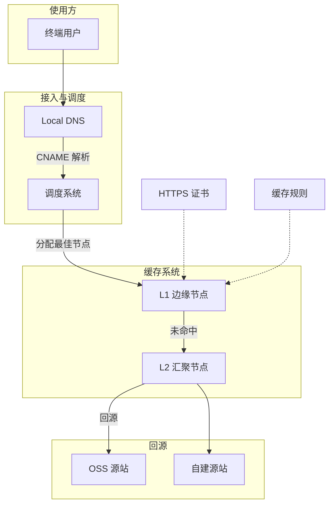

# CDN · 产品架构

> 产品：内容分发网络 CDN ｜ 口径：公共云 ｜ 复核：2026-11-16

## 产品定义与节点规模

- CDN 是由遍布全球的边缘节点服务器群组成的分布式网络，把源站资源缓存到加速节点，终端用户就近获取、无需回源。
- 全球节点总数：3200+。
- 中国内地节点：2300+，覆盖 31 个省级区域。
- 海外及中国香港/澳门节点：900+，覆盖 70 多个国家和地区。
- 全网带宽输出能力：180 Tbps。

**来源**：
- 什么是阿里云CDN：https://help.aliyun.com/zh/cdn/product-overview/what-is-alibaba-cloud-cdn ｜ 复核：2026-11-16

## 架构图

**来源**
- 什么是阿里云CDN（产品架构/加速流程/分级缓存）：https://help.aliyun.com/zh/cdn/product-overview/what-is-alibaba-cloud-cdn ｜ 复核：2026-11-17
- 快速接入（添加域名/CNAME 配置）：https://help.aliyun.com/zh/cdn/getting-started/quick-access-to-alibaba-cloud-cdn ｜ 复核：2026-11-17

## 组件清单

| 组件 | 作用 | 必选/可选 | 是否独立计费 | 备注 |
|---|---|---|---|---|
| 加速域名 | 承载加速配置与计费的最小单位，接入需先做域名归属权验证 | 必选 | 否（按流量/带宽峰值/月结95 等用量计费） | 验证推荐 DNS 解析加 TXT 记录 |
| CNAME 解析 | 把加速域名解析类型改为 CNAME，指向 CDN 分配的专属地址完成接入 | 必选 | 否 | CDN 接管解析后公网 DNS 返回边缘节点 IP，可隐藏源站真实 IP |
| 缓存规则 | 按文件类型/目录/URL 配置缓存过期时间，控制边缘节点缓存时长 | 可选（有默认规则） | 否 | 两级都未命中才回源，回源内容同时缓存供后续访问 |
| HTTPS 证书 | 为加速域名部署 SSL 证书，开启 HTTPS 加密传输 | 可选 | 是（静态 HTTPS 请求数单独计费，按量或资源包） | 支持数字证书管理服务证书批量部署与自定义 PEM 上传 |
| Referer 防盗链 | 按 Referer 黑/白名单拦截或放行请求，防止资源被非法盗用 | 可选 | 否 | 与 URL 鉴权、IP 黑白名单同属访问控制 |
| 回源配置 | 配置源站地址、优先级/权重、回源协议与 HOST，节点未命中时回源取资源 | 必选（添加域名时配置） | 否（回源流量费用由源站侧缴纳） | 源站类型：OSS 域名、IP、源站域名、函数计算域名 |
| OSS 源站加速 | 以 OSS Bucket 为源站经 CDN 分发，提升访问速度并降低 OSS 外网流量费用 | 可选（关联产品） | 是（CDN 流量费 + OSS 回源流出流量费） | 强关联 [OSS](../oss/)；源站类型须设为「OSS域名」才享 CDN 回源流量优惠价 |

**来源**
- 快速接入（添加加速域名/归属权验证/CNAME）：https://help.aliyun.com/zh/cdn/getting-started/quick-access-to-alibaba-cloud-cdn ｜ 复核：2026-11-17
- 配置缓存过期时间（缓存规则）：https://help.aliyun.com/zh/cdn/user-guide/configure-the-cdn-cache-expiration-time ｜ 复核：2026-11-17
- 配置 CDN HTTPS 证书：https://help.aliyun.com/zh/cdn/user-guide/configure-an-ssl-certificate ｜ 复核：2026-11-17
- 静态 HTTPS 请求数计费：https://help.aliyun.com/zh/cdn/product-overview/billing-of-https-requests-for-static-content ｜ 复核：2026-11-17
- 配置 Referer 黑/白名单防盗链：https://help.aliyun.com/zh/cdn/user-guide/configure-a-referer-whitelist-or-blacklist-to-enable-hotlink-protection ｜ 复核：2026-11-17
- 配置 CDN 源站（源站类型/回源费用）：https://help.aliyun.com/zh/cdn/user-guide/configure-an-origin-server ｜ 复核：2026-11-17
- CDN 加速 OSS：https://help.aliyun.com/zh/oss/user-guide/cdn-acceleration ｜ 复核：2026-11-17

## 四大系统与分级缓存

| 系统 | 职责 |
|---|---|
| 链路质量系统 | 实时监测节点与链路负载/健康，反馈给调度系统 |
| 调度系统 | 解析用户 IP 的运营商与区域归属，结合链路质量分配最佳接入节点；支持策略中心、DNS、DoH、302 四种调度模式 |
| 缓存系统 | L1（边缘节点）+ L2（汇聚节点）分级缓存；两级都未命中才回源，回源内容同时缓存供后续访问 |
| 支撑服务系统 | 天眼（QPS/带宽/状态码监控）、数据智能（Top URL/PV/UV）、配置管理（缓存规则等） |

- 分级缓存的作用：提高分发效率、降低回源带宽。
- CDN 接管域名解析后，公网 DNS 返回边缘节点 IP 而非源站真实 IP，可隐藏源站；源站 IP 在接入 CDN 前已泄露的，CDN 无法追溯隐藏。

**来源**：
- 什么是阿里云CDN：https://help.aliyun.com/zh/cdn/product-overview/what-is-alibaba-cloud-cdn ｜ 复核：2026-11-16

## 域名加速流程（CNAME 解析链路）

以加速域名为例，处理流程为：

1. 终端用户向 Local DNS 发起域名解析请求。
2. Local DNS 有缓存则直接返回，否则向网站授权 DNS 请求解析记录。
3. 授权 DNS 返回 CNAME（形如 `www.example.com.example.com` 的 CDN 专属地址）。
4. Local DNS 向阿里云 CDN 的 DNS 调度系统请求该 CNAME 的解析。
5. 调度系统返回最佳节点 IP。
6. Local DNS 把最佳节点 IP 返回给用户。
7. 用户向该节点 IP 发起资源访问请求。
8. 节点命中缓存则直接返回；未命中或已失效则回源拉取，按缓存策略缓存后返回。

**来源**：
- 什么是阿里云CDN：https://help.aliyun.com/zh/cdn/product-overview/what-is-alibaba-cloud-cdn ｜ 复核：2026-11-16

## CDN 与 DCDN、ESA 的关系

- 全站加速 DCDN 已于 2026 年 3 月 12 日起停止新客户开通；存量用户不受影响；需要全站加速能力的新用户官方引导接入 ESA。
- CDN 与 DCDN 的加速域名独立管理，同一域名不会同时存在于两个产品，各自按实际用量独立计费。
- CDN 可与 DCDN 共享下行流量资源包、静态 HTTPS 请求数包。

| 对比项 | CDN | 全站加速 DCDN | 边缘安全加速 ESA |
|---|---|---|---|
| 典型场景 | App/游戏包更新、视频点播、图文网站 | 在线商城、支付、聊天、在线教育、金融 | 游戏、电商、金融、零售等 |
| 加速方式 | 以静态内容加速为主，动态资源直接回源 | 纯动态加速（智能选路）或动静态混合加速 | 动静态缓存加速 + 安全防护 |
| 协议支持 | 应用层：HTTP、HTTPS、QUIC（基于 UDP）；网络层：IPv4、IPv6 | 应用层：HTTP、HTTPS、WebSocket；传输层：TCP、UDP；网络层：IPv4、IPv6 | 应用层：HTTP、HTTPS、WebSocket；传输层：TCP、UDP；网络层：IPv4、IPv6 |
| 安全策略 | Referer 防盗链、URL 鉴权、IP 黑白名单 | 基础 WAF、DDoS 防御、基础 Bot 防御 | 原生 WAF、Tbps 级 DDoS（企业版）、Bot 防护、源站防护 |
| 边缘计算 | EdgeScript 边缘脚本、图片处理 | EdgeRoutine、EdgeScript、图片处理 | 边缘函数（JS）、边缘存储、边缘容器 |

**来源**：
- 什么是阿里云CDN（DCDN 停服迁移说明、CDN/DCDN/ESA 对比）：https://help.aliyun.com/zh/cdn/product-overview/what-is-alibaba-cloud-cdn ｜ 复核：2026-11-16
- 计费概述（域名独立计费、资源包共享）：https://help.aliyun.com/zh/cdn/product-overview/billing-overview ｜ 复核：2026-11-16

## SLA（服务等级协议）

- 协议生效日期：2020 年 12 月 25 日。
- 服务可用性承诺：不低于 99.90%。
- 统计对象：某阿里云账号下所有开启 CDN 服务的域名，月请求量小于 100 万的域名除外。
- 不可用判定：CDN 连续 10 分钟或更长时间出现每 5 分钟错误率大于 0.05%。
- 失败请求：CDN 系统原因导致的 5XX 请求，以及因 CDN 故障未能到达 CDN 服务器端的请求（后者按故障前 7 天用户域名平均请求数计算）。

| 服务可用性 | 赔偿代金券金额 |
|---|---|
| 低于 99.90% 但等于或高于 99.00% | 月度服务费用的 10% |
| 低于 99.00% | 月度服务费用的 25% |

- 赔偿总额上限：未达标当月客户支付的月度服务费用（不含代金券抵扣部分）的 25%。
- 赔偿申请时限：每月第五个工作日后可对上月提出；相关月份结束后 2 个月内提出，逾期不受理。
- 免责含：未提前申请或申请失败的「突发带宽」导致的不可用。

**来源**：
- CDN服务等级协议（stub 页）：https://help.aliyun.com/zh/cdn/support/alibaba-cloud-cdn-sla ｜ 复核：2026-11-16
- CDN服务等级协议（正文条款）：http://terms.aliyun.com/legal-agreement/terms/suit_bu1_ali_cloud/suit_bu1_ali_cloud201803050950_21147.html ｜ 复核：2026-11-16
