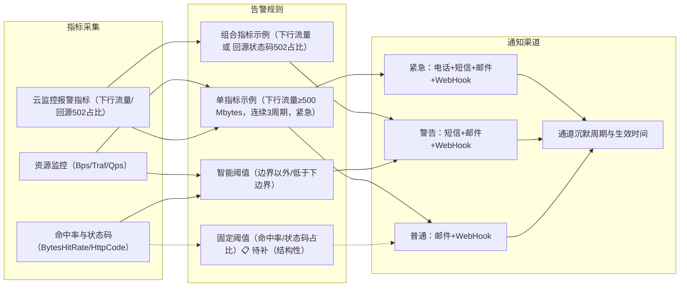

# CDN · 监控与告警

> 产品：CDN ｜ 口径：公共云 ｜ 复核：2026-11-18

## 告警链路图

**来源**
- CDN 域名报警规则（单指标/组合指标示例与级别通知方式）：https://help.aliyun.com/zh/cdn/user-guide/set-an-alert-rule ｜ 复核：2026-11-18
- 智能阈值报警规则概览（CDN 推荐指标与报警条件）：https://help.aliyun.com/zh/cms/cloudmonitor-1-0/user-guide/overview-alert ｜ 复核：2026-11-18
- 云监控报警规则概述（电话/短信/邮件/Webhook/App）：https://help.aliyun.com/zh/cms/cloudmonitor-1-0/user-guide/overview-2 ｜ 复核：2026-11-18
- 资源监控（监控项/粒度/命中率与状态码口径）：https://help.aliyun.com/zh/cdn/user-guide/resource-monitoring ｜ 复核：2026-11-18

## 核心监控指标

CDN 监控数据分两套口径：**监控查询**（资源监控/实时监控，按客户端 IP 归属区域或运营商统计）与**云监控 CloudMonitor 报警指标**（实例维度=加速域名）。计量计费按 CDN 节点所在计费大区统计，与监控查询结果存在差异（监控查询流量约为日志统计流量的 1.1 倍）。

| 指标（官方英文名） | 含义 | 单位 | 统计周期 | 维度 |
|---|---|---|---|---|
| Bps | 加速域名边缘带宽 | bit/s | 5 分钟 / 1 小时 / 1 天（实时监控 1 分钟） | 域名（可按区域、运营商、协议 HTTP/HTTPS/QUIC/IPv4/IPv6 过滤） |
| Traf | 加速域名流量 | Byte | 5 分钟 / 1 小时 / 1 天（实时监控 1 分钟） | 域名（同上） |
| Qps | 每秒请求次数（QPS） | 次/秒 | 5 分钟 / 1 小时 / 1 天（实时监控 1 分钟） | 域名（同上） |
| Acc | 时间粒度内的请求数总和 | 次 | 5 分钟 / 1 小时 / 1 天 | 域名（同上） |
| BytesHitRate | 字节命中率：节点直接响应（非回源）字节数占节点响应总字节数的比例 | % | 5 分钟 / 1 小时 / 1 天 | 域名 |
| RequestHitRate | 请求命中率：节点直接响应请求数占总请求数的比例 | % | 1 天（按天汇总） | 域名 |
| SrcBps | 回源带宽：节点向源站请求资源消耗的带宽 | bit/s | 5 分钟 / 1 小时 / 1 天（实时监控 1 分钟） | 域名 |
| SrcTraffic | 回源流量：节点未命中时向源站请求的数据量 | Byte | 5 分钟 / 1 小时 / 1 天（实时监控 1 分钟） | 域名 |
| HttpCode | 边缘响应 HTTP 状态码分布（2xx/3xx/4xx/5xx） | 次（按状态码计数） | 5 分钟 / 1 小时 / 1 天 | 域名（同上） |
| SrcHttpCode | 回源 HTTP 状态码分布（2xx/3xx/4xx/5xx） | 次（按状态码计数） | 5 分钟 / 1 小时 / 1 天 | 域名 |
| MaxBps | 单日带宽峰值 | bps | 1 天 | 域名 |
| MaxSrcBps | 单日回源带宽峰值 | bps | 1 天 | 域名 |
| TotalTraffic | 单日总流量 | Byte | 1 天 | 域名 |
| Downstream Traffic（下行流量） | 云监控报警指标：域名下行流量 | Byte（阈值示例按 Mbytes） | 1 分钟（1 周期=1 分钟） | 实例（加速域名） |
| Origin 502 Status Code Ratio（回源状态码502占比） | 云监控报警指标：回源 502 占比 | % | 1 分钟（1 周期=1 分钟） | 实例（加速域名） |

- 数据延迟与历史范围：资源监控 5 分钟粒度延迟约 15 分钟、历史 90 天；实时监控 1 分钟粒度延迟约 5 分钟、历史 7 天、单次最长 24 小时。
- 云监控智能水位分析对 CDN 支持的 MetricName（统计列均为 Average）：`QPS`、`InternetOut`、`hitRate`、`l1_acc`、`ori_acc`、`ori_bps`、`rt`、`code5xx`（2026-11-18 对照官方《智能水位分析支持的产品与指标》CDN 行复核一致）；各 MetricName 中文含义官方《云产品监控项》索引页指向云监控控制台「指标和事件中心」维护，文档侧无逐项中文对照表。
- 用量查询与资源监控/实时监控的统计维度不同：用量查询按 CDN 节点（计费大区），资源监控与实时监控按客户端 IP 归属区域/运营商。

**来源**
- 资源监控（监控项/粒度/90 天/命中率与状态码口径）：https://help.aliyun.com/zh/cdn/user-guide/resource-monitoring ｜ 复核：2026-11-17
- 实时监控（1 分钟粒度/7 天/延迟 5 分钟）：https://help.aliyun.com/zh/cdn/user-guide/real-time-monitoring ｜ 复核：2026-11-17
- 按协议类型获取详细数据（Bps/Traf/Qps/Acc/HttpCode 字段与粒度）：https://help.aliyun.com/zh/cdn/developer-reference/api-cdn-2018-05-10-describedomaindetaildatabylayer ｜ 复核：2026-11-17
- 按天查询用量（MaxBps/MaxSrcBps/TotalTraffic/BytesHitRate/RequestHitRate）：https://help.aliyun.com/zh/cdn/developer-reference/api-cdn-2018-05-10-describedomainsusagebyday ｜ 复核：2026-11-17
- 查询带宽（Bps，单位 bit/s）：https://help.aliyun.com/zh/cdn/developer-reference/api-cdn-2018-05-10-describedomainbpsdata ｜ 复核：2026-11-17
- 查询回源带宽（SrcBps）：https://help.aliyun.com/zh/cdn/developer-reference/api-cdn-2018-05-10-describedomainsrcbpsdata ｜ 复核：2026-11-17
- 查询回源流量（SrcTraffic）：https://help.aliyun.com/zh/cdn/developer-reference/api-cdn-2018-05-10-describedomainsrctrafficdata ｜ 复核：2026-11-17
- CDN 域名报警规则（下行流量/回源502占比/1 周期=1 分钟）：https://help.aliyun.com/zh/cdn/user-guide/set-an-alert-rule ｜ 复核：2026-11-18
- 智能水位分析支持的云产品及其监控项（CDN MetricName 清单）：https://help.aliyun.com/zh/cms/cloudmonitor-1-0/user-guide/alibaba-cloud-services-and-related-metrics-that-are-supported-in-resource-usage-reports ｜ 复核：2026-11-18

## 官方默认与推荐告警

**A. 官方文档示例阈值（CDN 域名报警规则）**

| 场景 | 指标 | 阈值/表达式 | 级别 | 出处 |
|---|---|---|---|---|
| 单指标示例 | 下行流量（实例维度） | 最小值 ≥ 500 Mbytes，连续 3 个周期（1 周期=1 分钟） | 紧急 | CDN 域名报警规则（官方配置示例） |
| 单指标示例 | 下行流量（实例维度） | 最大值 ≥ 300 Mbytes，连续 3 个周期 | 警告 | 同上 |
| 单指标示例 | 下行流量（实例维度） | 平均值 ≥ 100 Mbytes，连续 3 个周期 | 普通 | 同上 |
| 组合指标示例 | 下行流量 或 回源状态码502占比 | 下行流量最大值 ≥ 300（2026-11-18 复核官方原页：正文示例写 300 Mbps、下方配置步骤表写 300 Mbytes，两处单位在同一官方页并存，原文如此）或回源状态码502占比最大值 ≥ 1%，满足其一（\|\|），连续 3 个周期 | 警告 | 同上 |

**B. 官方智能阈值推荐（CDN）**

| 云产品 | 典型异常 | 推荐监控指标 | 报警条件 |
|---|---|---|---|
| CDN | 访问量突增、突降、波动、持续峰值或响应时间增加 | 边缘网络带宽、每秒访问次数、下行流量 | 边界以外 |
| CDN | 响应时间增加 | 边缘响应时间 | 高于上边界 |
| CDN | 命中率下跌（需请求源站，加速失效） | 边缘字节命中率 | 低于下边界 |

- 智能阈值基于机器学习为每个实例动态计算上下报警边界，无需输入固定数值，官方称可降低 80%~90% 误报、异常发生 3 分钟内召回 85% 以上问题。
- 防护类阈值（非告警，触发即自动下线域名）：用量封顶——带宽峰值 1 Mbps~1 Tbps、流量 1 MB~10000 TB、HTTPS 请求数三类阈值，数据约 10 分钟监控延迟。
- 其余指标（命中率、状态码占比、回源带宽等固定阈值）：**官方未发布推荐阈值** 📋 待补（结构性：官方文档仅提供报警规则配置说明与示例，按阈值红线不收经验值）。

**来源**
- CDN 域名报警规则（单指标/组合指标示例与级别通知方式）：https://help.aliyun.com/zh/cdn/user-guide/set-an-alert-rule ｜ 复核：2026-11-18
- 智能阈值报警规则概览（CDN 推荐指标与报警条件）：https://help.aliyun.com/zh/cms/cloudmonitor-1-0/user-guide/overview-alert ｜ 复核：2026-11-17
- 配置用量封顶（三类阈值/10 分钟延迟）：https://help.aliyun.com/zh/cdn/user-guide/configure-usage-cap ｜ 复核：2026-11-17
- 高额账单风险防范（云监控带宽报警建议）：https://help.aliyun.com/zh/cdn/product-overview/configure-high-bill-alerts ｜ 复核：2026-11-17

## 通知与渠道

| 渠道/机制 | 说明 |
|---|---|
| 通知方式 | 云监控报警服务支持电话、短信、邮件和 Webhook 地址；安装阿里云 App 可通过 App 接收报警通知 |
| 报警级别与通知组合 | 紧急（Critical）：电话+短信+邮件+WebHook；警告（Warn）：短信+邮件+WebHook；普通（Info）：邮件+WebHook |
| 级别升级（Escalations）模型 | 阈值达到某个级别时仅触发该级别报警，不会连带触发其他级别 |
| 通道沉默周期 | 取值：5 分钟、15 分钟、30 分钟、60 分钟、3 小时、6 小时、12 小时、24 小时；沉默期内不重复发送，超期未恢复再次发送 |
| 生效时间 | 报警规则仅在生效时间内发送通知；不在生效期不发送，但报警历史仍记录 |
| 报警联系人组 | 创建报警规则时选择已绑定报警联系人的联系人组 |
| 报警回调（Webhook） | 公网可访问的 URL，云监控通过 POST 推送报警信息，目前仅支持 HTTP 协议 |
| 无数据处理 | 取值：不做任何处理（默认）、发送无数据报警、视为恢复 |
| 规则标签 | 单条报警规则最多可设置 6 组标签 |
| 智能阈值 | 支持基于机器学习的智能阈值报警规则，无需输入固定阈值 |
| 高账单场景告警 | 官方建议用云监控设置产品级/域名级带宽监控规则，达到设定带宽峰值后向管理员发送告警（短信、邮件和钉钉） |
| 告警升级（Escalation）策略 | 官方未发布 CDN 告警升级（值班升级）策略 📋 待补（结构性；上表「级别升级模型」仅指报警级别互不连带触发） |

**来源**
- CDN 域名报警规则（沉默周期/生效时间/联系人组/标签/Escalations 模型）：https://help.aliyun.com/zh/cdn/user-guide/set-an-alert-rule ｜ 复核：2026-11-18
- 云监控报警规则概述（电话/短信/邮件/Webhook/App）：https://help.aliyun.com/zh/cms/cloudmonitor-1-0/user-guide/overview-2 ｜ 复核：2026-11-17
- 创建报警模板（级别通知组合/回调仅 HTTP/无数据处理）：https://help.aliyun.com/zh/cms/cloudmonitor-1-0/user-guide/create-an-alert-template ｜ 复核：2026-11-17
- 高额账单风险防范（带宽监控告警建议）：https://help.aliyun.com/zh/cdn/product-overview/configure-high-bill-alerts ｜ 复核：2026-11-17

## 告警配额

| 限制项 | 最大值 | 归属 |
|---|---|---|
| 单账号可新建的报警规则数量 | 10,000 条 | 基础云监控 |
| 单账号可新建的动态规则数量 | 1,200 个 | 基础云监控 |
| 单账号可新建的应用分组数量 | 20,000 个 | 基础云监控 |
| 一个应用分组内允许新建的可用性监控数量 | 500 个 | 基础云监控 |
| 一个应用分组内包含的每种资源数量 | 3,000 个 | 基础云监控 |
| 标签创建应用分组时单地域可添加的标签数量 | 100 个 | 基础云监控 |
| 单账号可创建的报警模板数量 | 100 个（每个模板最多 30 个监控项） | 基础云监控 |
| 监控数据存储时长（Period < 60 秒） | 7 天 | 基础云监控 |
| 监控数据存储时长（Period = 60 秒） | 31 天 | 基础云监控 |
| 监控数据存储时长（Period ≥ 300 秒） | 91 天 | 基础云监控 |
| 单账号可新建的 PromQL 报警规则数量 | 20 条 | 企业云监控 |
| 单账号可新建的指标仓库数量 | 30 个 | 企业云监控 |
| 单账号可新建的 SLS Logstore 组数量 | 20 个（每组最多 25 个 Logstore） | 企业云监控 |
| 一个智能水位分析任务可设置的报警联系人组数量 | 5 个 | 企业云监控 |
| 单条 CDN 报警规则可设置的标签数量 | 6 组 | CDN 报警规则 |
| 报警联系人 / 报警联系人组的数量上限 | 📋 待补（结构性：官方使用限制页未列出该配额） | 基础云监控 |

**来源**
- 云监控使用限制与配额（报警规则/应用分组/存储时长/企业云监控配额）：https://help.aliyun.com/zh/cms/cloudmonitor-1-0/product-overview/restrictions-on-use ｜ 复核：2026-11-17
- 创建报警模板（100 个模板/每模板 30 个监控项）：https://help.aliyun.com/zh/cms/cloudmonitor-1-0/user-guide/create-an-alert-template ｜ 复核：2026-11-17
- CDN 域名报警规则（标签最多 6 组）：https://help.aliyun.com/zh/cdn/user-guide/set-an-alert-rule ｜ 复核：2026-11-18
