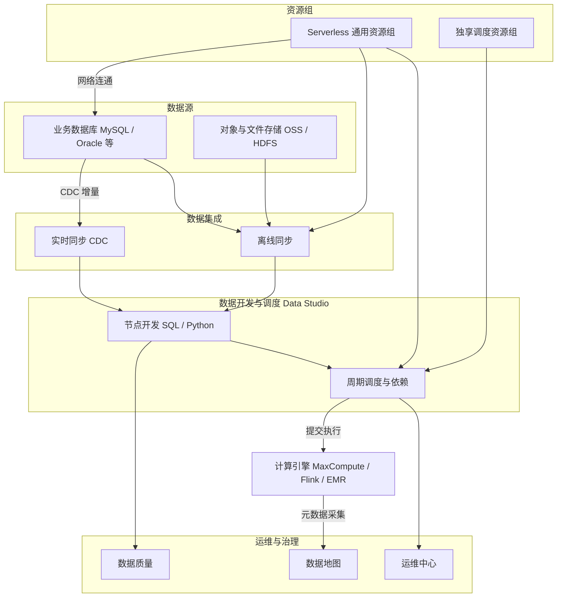
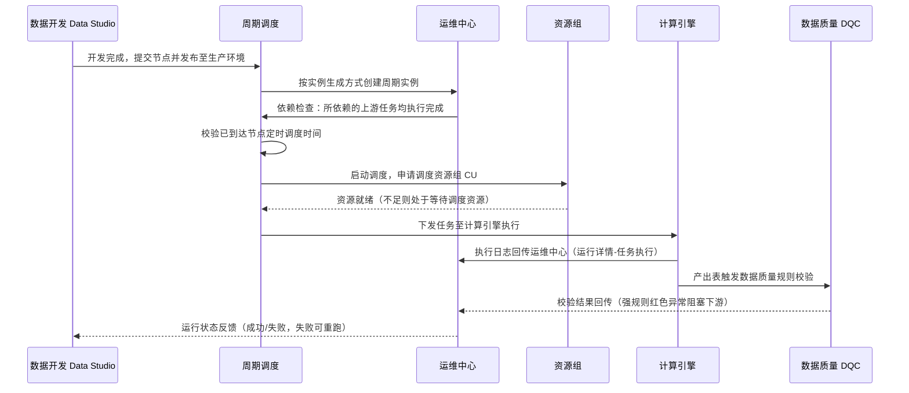

# DataWorks · 产品架构

> 产品：DataWorks ｜ 口径：公共云 ｜ 复核：2026-11-18

## 产品定位

DataWorks 是阿里云一站式智能大数据开发治理平台，适配 MaxCompute、E-MapReduce、Hologres、Flink、AnalyticDB、StarRocks、PAI 等数十种大数据和 AI 计算服务。

关键事实：

- 2009 年在阿里巴巴集团立项，2015 年正式上云（「数加平台」核心产品）。
- 官方将能力归纳为六项全链路能力：智能数据建模、全域数据集成、高效数据生产、主动数据治理、全面数据安全、数据分析服务。
- DataWorks 只做任务研发与调度编排，数据存储与计算发生在底层引擎，引擎费用独立计费。
- 仅支持 PC 端 Chrome 69 及以上版本使用。

**来源**：
- 什么是 DataWorks：https://help.aliyun.com/zh/dataworks/user-guide/what-is-dataworks.md ｜ 复核：2026-11-16
- DataWorks 计费总览（引擎独立计费）：https://help.aliyun.com/zh/dataworks/billing-overview.md ｜ 复核：2026-11-16

## 架构图

**来源**
- 管理控制台功能概述（工作空间/资源组/计算资源/数据源实体关系）：https://help.aliyun.com/zh/dataworks/user-guide/overview-of-features-in-settingcenter.md ｜ 复核：2026-11-17
- 数据集成概述：https://help.aliyun.com/zh/dataworks/user-guide/data-integration-overview.md ｜ 复核：2026-11-17
- 运维中心概述：https://help.aliyun.com/zh/dataworks/user-guide/overview-of-operation-center.md ｜ 复核：2026-11-17
- 数据地图（元数据采集与血缘）：https://help.aliyun.com/zh/dataworks/user-guide/data-map.md ｜ 复核：2026-11-17
- DataWorks 资源组概述：https://help.aliyun.com/zh/dataworks/user-guide/resource-group-management.md ｜ 复核：2026-11-17
- 网络连通方案概述：https://help.aliyun.com/zh/dataworks/user-guide/data-source-test-connectivity.md ｜ 复核：2026-11-17

## 关键链路

一个调度节点从开发到运行的链路（开发提交 → 依赖检查 → 调度触发 → 任务运行 → 日志回传 → 数据质量校验）：

**来源**：
- 任务运行诊断（上游依赖/定时时间/调度资源/任务执行四步检查与日志查看）：https://help.aliyun.com/zh/dataworks/user-guide/use-the-intelligent-diagnosis-feature ｜ 复核：2026-11-18
- 运维中心概述：https://help.aliyun.com/zh/dataworks/user-guide/overview-of-operation-center.md ｜ 复核：2026-11-18
- DataWorks 资源组概述：https://help.aliyun.com/zh/dataworks/user-guide/resource-group-management.md ｜ 复核：2026-11-18
- DataWorks 数据质量 DQC 概述：https://help.aliyun.com/zh/dataworks/user-guide/data-quality.md ｜ 复核：2026-11-18

## 组件清单

| 组件 | 作用 | 必选/可选 | 是否独立计费 | 备注 |
|---|---|---|---|---|
| 工作空间 | 任务开发和成员权限管理的基本单元，隔离节点、资源与成员 | 必选 | 否 | 简单模式 1 空间对应 1 数据源，标准模式开发/生产两套数据源；系统内置默认空间不建议开发生产任务 |
| 数据开发与调度（Data Studio） | 节点开发（SQL/Python 等）+ 周期调度与依赖编排 | 必选 | 否（版本订阅费另计，见 07） | 绑定计算资源后方可开发；发布至生产环境才会自动调度 |
| 资源组（Serverless 通用 / 旧版独享调度） | 为任务运行提供 CPU、内存，独立于工作空间存在，须绑定工作空间 | 必选 | 是 | 1 CU = 1 核 CPU + 4 GiB 内存；Serverless 支持包年包月与按量付费，旧版独享仅包年包月 |
| 计算资源（引擎绑定） | 为数据开发提供语法解析、编译与执行环境 | 必选（按所用引擎） | 是（引擎费用独立计费） | 关联 [MaxCompute](../maxcompute/README)、[Flink](../flink/README)、[EMR](../emr/README)，另支持 Hologres、AnalyticDB、StarRocks 等 |
| 数据集成 | 离线同步、实时同步、全增量同步，覆盖 50 多种异构数据源 | 可选 | 否（运行消耗资源组 CU，费用计入资源组） | 仅 Serverless 资源组（推荐）与旧版独享数据集成资源组可运行 |
| 数据质量（DQC） | 表级/字段级/自定义质量规则，强规则红色异常时阻塞下游 | 可选 | 是（按运行成功的规则实例计费，每日 10 个免费） | 30 多种预设模板；质量监控任务默认 0.25 CU |
| 数据地图 | 元数据采集与检索、表/字段血缘、影响分析、权限申请 | 可选 | 否（元数据采集消耗 Serverless 资源组 CU） | 支持 15+ 数据源元数据；表/字段血缘为标准版及以上 |
| 运维中心 | 周期/手动/实时任务实例运维、智能基线、监控报警、补数据 | 必选 | 否（报警短信/电话超额后按量计费） | 开发环境无运维大屏、智能基线等模块 |
| 开放平台（OpenAPI / OpenEvent / Extensions） | OpenAPI 系统集成、开放事件订阅、扩展程序卡点 | 可选 | 是（超出月免费额度后 0.3 元/万次） | OpenAPI 版本 2024-05-18（新版 Data Studio）与 2020-05-18 |

**来源**
- 什么是 DataWorks：https://help.aliyun.com/zh/dataworks/user-guide/what-is-dataworks.md ｜ 复核：2026-11-17
- DataWorks 功能特性总览（数据集成/数据质量/数据地图/开放平台）：https://help.aliyun.com/zh/dataworks/user-guide/functions-and-features.md ｜ 复核：2026-11-17
- 工作空间概述：https://help.aliyun.com/zh/dataworks/user-guide/workspace-management.md ｜ 复核：2026-11-17
- DataWorks 资源组概述：https://help.aliyun.com/zh/dataworks/user-guide/resource-group-management.md ｜ 复核：2026-11-17
- Serverless 资源组计费（CU 定义与计费模式）：https://help.aliyun.com/zh/dataworks/new-resource-group-overview.md ｜ 复核：2026-11-17
- 数据集成概述：https://help.aliyun.com/zh/dataworks/user-guide/data-integration-overview.md ｜ 复核：2026-11-17
- DataWorks 数据质量 DQC 概述：https://help.aliyun.com/zh/dataworks/user-guide/data-quality.md ｜ 复核：2026-11-17
- 数据地图（元数据采集与血缘）：https://help.aliyun.com/zh/dataworks/user-guide/data-map.md ｜ 复核：2026-11-17
- 运维中心概述：https://help.aliyun.com/zh/dataworks/user-guide/overview-of-operation-center.md ｜ 复核：2026-11-17
- 开放平台概述：https://help.aliyun.com/zh/dataworks/user-guide/open-platform-overview.md ｜ 复核：2026-11-17
- 资源成本（数据质量/OpenAPI 计费）：https://help.aliyun.com/zh/dataworks/resource-costs.md ｜ 复核：2026-11-17
- DataWorks 计费总览：https://help.aliyun.com/zh/dataworks/billing-overview.md ｜ 复核：2026-11-17

## 工作空间与项目模型

- 工作空间是任务开发和成员权限管理的**基本单元**；一个工作空间可创建多种数据源、绑定多种计算资源。
- 两种模式：**简单模式**（1 空间对应 1 数据源，提交即生产）与**标准模式**（开发/生产两套数据源，发布后生效）；官方建议使用标准模式。
- 绑定计算资源时系统自动创建对应数据源；数据开发与权限控制基于所选模式执行。
- 系统内置一个默认工作空间，官方明确不建议在其中开发生产任务。
- 成员角色（空间级）：项目所有者、空间管理员、数据分析师、开发、运维、部署、安全管理员、数据治理管理员、模型设计师、访客。
- 建议：工作空间由主账号创建并授予子账号「工作空间管理员」角色；原则上任何人不应同时具备**开发**和**运维**角色。

| 维度 | 简单模式 | 标准模式 |
|---|---|---|
| 数据源 | 1 个（开发即生产） | 开发/生产各 1 个 |
| 提交发布 | 提交即生产 | 需发布至生产环境 |
| 开发生产隔离 | 无 | 物理隔离 |

**来源**：
- 工作空间概述：https://help.aliyun.com/zh/dataworks/user-guide/workspace-management.md ｜ 复核：2026-11-16
- 简单模式与标准模式区别（条目摘要）：https://help.aliyun.com/zh/dataworks/llms.txt ｜ 复核：2026-11-16

## 核心模块

| 模块 | 关键事实 |
|---|---|
| 数据集成 | 支持离线同步、实时同步、离线实时一体化全增量同步；支持 50 多种异构数据源；引擎架构为星形引擎；仅 Serverless 资源组（推荐）与旧版独享数据集成资源组可运行集成任务 |
| 数据开发（Data Studio） | 支持 MaxCompute、E-MapReduce、CDH、Hologres、AnalyticDB、ClickHouse 等引擎统一开发；提供开发/生产隔离、版本管理、代码评审、冒烟测试、发布管控、操作审计 |
| 运维中心 | 数据时效性保障（智能基线）、任务诊断、影响分析、自动运维、移动运维 |
| 数据质量 | 30 多种预设表级/字段级/自定义监控模板；异常时阻塞生产链路，阻断脏数据向下游蔓延 |
| 数据地图 | 元数据采集与检索、表/字段血缘、影响分析、数据预览、权限申请；支持 15+ 数据源元数据 |
| 数据服务 | Serverless 架构，零代码/SQL 双模式生成 API，一键发布至 API 网关 |
| 开放平台 | OpenAPI、开放事件（OpenEvent）、扩展程序（Extensions） |

**来源**：
- DataWorks 功能特性总览（功能全景）：https://help.aliyun.com/zh/dataworks/user-guide/functions-and-features.md ｜ 复核：2026-11-16

## SLA（服务等级协议）

SLA 版本生效日期 2024-07-15（新版按各服务项分别计算可用性与赔偿）。

| 项目 | 数值/规则 |
|---|---|
| 适用服务项 | DataWorks 产品管控服务、调度任务服务、数据集成任务服务、数据服务 |
| 服务可用性承诺 | 不低于 **99.95%**（单 region 单服务项维度） |
| 可用性公式 | （服务周期总分钟数 − 服务不可用分钟数）/ 服务周期总分钟数 × 100% |
| 统计方法 | 产品管控/数据服务按每 1 分钟；调度/数据集成按每 5 分钟 |
| 调度任务不可用判定 | 5 分钟内提交态任务数 >30 时，错误率 >5% 视为该 5 分钟不可用；≤30 时全部未正常调度记 100% |
| 数据集成不可用判定 | 5 分钟内提交态任务数 >20 时，错误率 >10% 视为该 5 分钟不可用；≤20 时全部失败记 100% |
| 数据服务不可用判定 | 每 1 分钟错误率 100%（连续尝试均失败）视为该 1 分钟不可用 |
| 免责时段 | 00:00:00~00:30:00 提交的调度/集成任务不计入错误率统计 |
| 其他免责 | 基础版产品管控服务不计入；配置了失败重跑且最终成功的任务不计为失败；公共资源组的数据服务不进入失败率统计 |
| 赔偿标准 | 99.90% ≤ 可用性 < 99.95% → 月度服务费用 10%；可用性 < 99.90% → 25%；赔偿为代金券，总额不超过当月对应服务项费用的 25% |
| 赔偿申请时限 | 每自然月第 5 个工作日后可申请上月赔偿，最迟不超过相关月份结束后 2 个月 |

- 服务周期为一个自然月；不满一个月按一个月计算。
- SLA 不适用于公测、邀测、免费版本及功能，不适用于本地云版本。

**来源**：
- DataWorks 服务等级协议（SLA）入口：https://help.aliyun.com/zh/dataworks/user-guide/dataworks-sla.md ｜ 复核：2026-11-16
- 阿里云大数据开发治理平台 DataWorks 服务等级协议（全文）：https://terms.aliyun.com/legal-agreement/terms/suit_bu1_ali_cloud/suit_bu1_ali_cloud201905282354_34795.html ｜ 复核：2026-11-16
- SLA 变更公告（2024-07-15 起分服务项计算）：https://help.aliyun.com/zh/dataworks/announcement-on-changes-to-dataworks-sla.md ｜ 复核：2026-11-16
