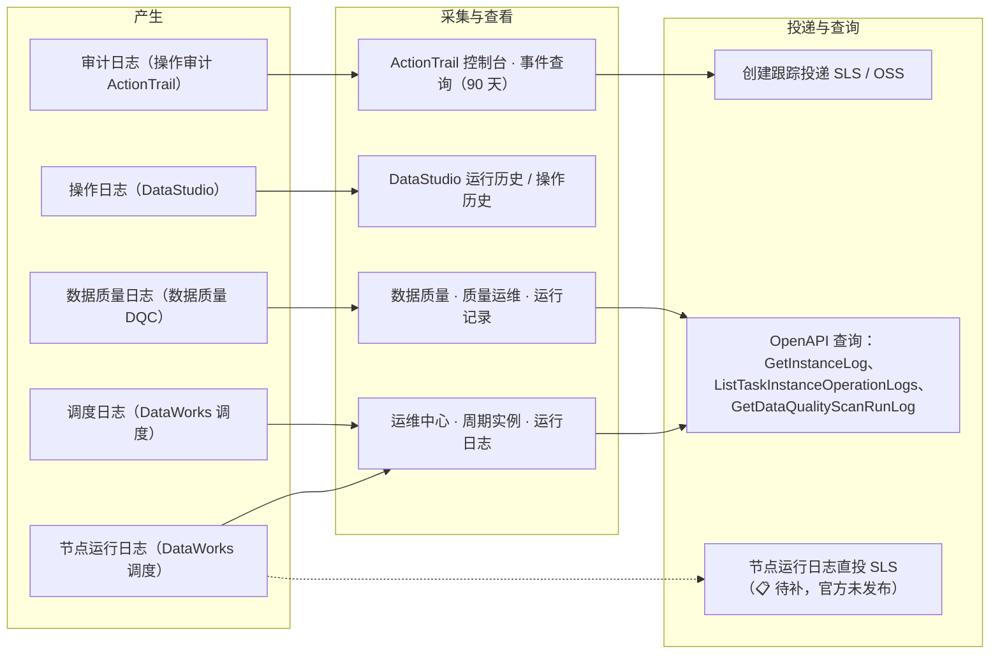

# DataWorks · 日志与审计

> 产品：DataWorks ｜ 口径：公共云 ｜ 复核：2026-11-18

## 日志流转图

**来源**
- 查看周期实例（运行日志/操作日志入口、实例与日志保留期）：https://help.aliyun.com/zh/dataworks/user-guide/view-auto-triggered-node-instances.md ｜ 复核：2026-11-18
- DataStudio 操作记录查看（操作历史）：https://help.aliyun.com/zh/dataworks/user-guide/view-operation-records-on-the-datastudio-page.md ｜ 复核：2026-11-18
- 查看质量监控执行详情（运行记录与原始日志）：https://help.aliyun.com/zh/dataworks/user-guide/view-monitoring-results.md ｜ 复核：2026-11-18
- ActionTrail 查询 DataWorks 行为日志（90 天与投递 LogStore/OSS）：https://help.aliyun.com/zh/dataworks/user-guide/use-actiontrail-to-query-behavior-events.md ｜ 复核：2026-11-18
- 操作审计 FAQ（投递与告警）：https://help.aliyun.com/zh/dataworks/actiontrail.md ｜ 复核：2026-11-18
- GetInstanceLog 获取实例运行日志：https://help.aliyun.com/zh/dataworks/developer-reference/api-dataworks-public-2020-05-18-getinstancelog.md ｜ 复核：2026-11-18
- ListTaskInstanceOperationLogs 实例操作日志（31 天）：https://help.aliyun.com/zh/dataworks/developer-reference/api-dataworks-public-2024-05-18-listtaskinstanceoperationlogs.md ｜ 复核：2026-11-18
- GetDataQualityScanRunLog 获取数据质量扫描运行日志：https://help.aliyun.com/zh/dataworks/developer-reference/api-dataworks-public-2024-05-18-getdataqualityscanrunlog.md ｜ 复核：2026-11-18

## 日志类型总表

| 类型 | 产生方 | 查看入口 | 默认保留期 | 是否计费 |
|---|---|---|---|---|
| 节点运行日志（周期/测试/补数据实例运行日志） | DataWorks 调度 | 运维中心 > 周期实例 > 查看运行日志；数据开发 DataStudio > 运行历史（近 3 天） | 公共调度资源组：实例 30 天、日志 7 天；Serverless/独享调度资源组：实例与日志 30 天；完成实例日志 >3 MB 每日定时清理 | 否 |
| 调度日志（实例操作记录与实例运行日志 OpenAPI） | DataWorks 调度 | 实例详情 > 属性/运行日志/操作日志；OpenAPI `GetInstanceLog`、`ListTaskInstanceOperationLogs` | 实例保留 30 天（公共调度资源组口径）；操作日志仅支持查询过去 31 天记录；`GetInstanceLog` 超过 7 天的实例可能查不到日志 | 否 |
| 数据质量日志（质量监控运行记录与原始日志） | 数据质量 DQC | 数据治理 > 数据质量 > 质量运维 > 运行记录 > 原始日志；OpenAPI `GetDataQualityScanRunLog` | 📋 待补（官方未标注该日志类型保留期） | 否（数据质量按运行成功的规则实例计费） |
| 操作日志（DataStudio 操作历史） | 数据开发 DataStudio | 数据开发左侧边栏 > 操作历史（按操作类型/操作人/操作时间筛选） | 📋 待补（官方未标注保留期） | 否 |
| 审计日志（操作审计行为事件） | 操作审计 ActionTrail | ActionTrail 控制台 > 事件 > 事件查询 > 云服务名称选 DataWorks | 默认可检索最近 90 天 | 操作审计本身免费；投递 SLS/OSS 按目标产品计费 |

- 运行日志与操作日志可在实例 DAG 图中单击实例 > 展开详情，查看属性、运行日志、操作日志和代码四个页签。
- 数据质量运行记录支持按数据源、表名、质量结果、问题处置、我的订阅筛选。

**来源**
- 查看周期实例（运行日志/操作日志入口、实例与日志保留期）：https://help.aliyun.com/zh/dataworks/user-guide/view-auto-triggered-node-instances.md ｜ 复核：2026-11-17
- 运维中心其他 FAQ（日志与实例保留多长时间）：https://help.aliyun.com/zh/dataworks/others.md ｜ 复核：2026-11-17
- 数据开发运行历史（近 3 天执行日志）：https://help.aliyun.com/zh/dataworks/user-guide/view-operating-history.md ｜ 复核：2026-11-17
- 离线同步日志分析（运行日志查看入口）：https://help.aliyun.com/zh/dataworks/user-guide/analyze-run-logs-generated-for-a-batch-synchronization-node.md ｜ 复核：2026-11-17
- 查看质量监控执行详情（运行记录与原始日志）：https://help.aliyun.com/zh/dataworks/user-guide/view-monitoring-results.md ｜ 复核：2026-11-17
- DataStudio 操作记录查看（操作历史）：https://help.aliyun.com/zh/dataworks/user-guide/view-operation-records-on-the-datastudio-page.md ｜ 复核：2026-11-17
- GetInstanceLog 获取实例运行日志：https://help.aliyun.com/zh/dataworks/developer-reference/api-dataworks-public-2020-05-18-getinstancelog.md ｜ 复核：2026-11-17
- ListTaskInstanceOperationLogs 实例操作日志（31 天）：https://help.aliyun.com/zh/dataworks/developer-reference/api-dataworks-public-2024-05-18-listtaskinstanceoperationlogs.md ｜ 复核：2026-11-17
- GetDataQualityScanRunLog 获取数据质量扫描运行日志：https://help.aliyun.com/zh/dataworks/developer-reference/api-dataworks-public-2024-05-18-getdataqualityscanrunlog.md ｜ 复核：2026-11-17
- ActionTrail 查询 DataWorks 行为日志（90 天）：https://help.aliyun.com/zh/dataworks/user-guide/use-actiontrail-to-query-behavior-events.md ｜ 复核：2026-11-17

## 关键日志详表

**A. 节点运行日志（运行日志核心参数 + 离线同步状态行）**

| 字段 | 类型/示例 | 含义 |
|---|---|---|
| `SKYNET_TASKID` | 数值 | 实例 ID |
| `SKYNET_ID` | 数值 | 节点 ID |
| `SKYNET_NODENAME` | 字符串 | 节点名称 |
| `SKYNET_ONDUTY` | 字符串 | 任务责任人 |
| `SKYNET_CYCTIME` | 时间 | 节点的定时运行时间 |
| `SKYNET_PARAVALUE` | 字符串 | 调度参数列表 |
| `State` | 枚举（SUBMIT / WAIT / RUN / FAIL / SUCCESS） | 离线同步任务阶段：提交、等待资源、同步中、失败、成功 |
| `Dirty data` | 数值（如 `Dirty data: 1R 28B`） | 脏数据条数与字节数，脏数据不写入目标端 |

- 离线同步日志按 SUBMIT（提交实例）→ WAIT（申请资源）→ RUN（开始同步）→ FAIL/SUCCESS（执行完成）四段输出，RUN 阶段内含前置准备、切分任务、同步数据、后置准备四个子阶段。

**B. 调度日志（周期实例属性与操作记录）**

| 字段 | 类型/含义 |
|---|---|
| 实例 ID / 节点 ID | 实例 ID 定位单个周期实例；节点 ID 定位该任务当天全部小时/分钟实例 |
| 任务状态 | 未运行、等待时间、等待资源、运行中、运行成功、运行失败、暂停/冻结 |
| 上游依赖 | DAG 图中的依赖链路，用于定位阻塞当前任务的上游任务 |
| 定时时间 / 业务日期 | 定时运行时间；业务日期 = 定时时间 − 1 天 |
| 等待资源耗时 | 任务等待调度资源的时长，用于判断资源组是否紧张 |
| 运行时长 | 本次运行耗时，与历史运行情况对比定位变慢任务 |
| 操作记录 | 时间、操作人、具体操作（重跑、终止、冻结、置成功等） |

**C. 数据质量运行记录（规则视角字段）**

| 字段 | 类型/含义 |
|---|---|
| ID / 规则名称 | 质量规则的 ID 和名称 |
| 质量结果 | 通过、橙色异常、红色异常、校验中、校验失败 |
| 问题处置 | 告警、阻塞 |
| 重要程度 | 强规则（红色异常默认阻塞下游）/ 弱规则（仅告警） |
| 监控阈值 | 规则的比较方式和阈值范围 |
| 表名 / 关联范围 | 校验目标表；表级或字段级 |
| 结束时间 / 数据范围 | 校验结束时间；校验的目标分区 |

**D. 审计事件（ActionTrail 管控事件字段）**

| 字段 | 含义 |
|---|---|
| `eventTime` | 事件发生时间 |
| `eventName` | 事件名称；OpenAPI 类事件与 OpenAPI 名称一一对应 |
| `eventSource` | 事件来源 |
| `eventRW` | 事件读写类型：Read / Write |
| `sourceIpAddress` | 事件发起的源 IP 地址 |
| `userIdentity` | 操作者名称（RAM 角色）等身份信息 |
| `errorCode` | 云服务处理请求出错时记录的错误码 |

**来源**
- 查看周期实例（附录：运行日志参数介绍、实例属性与操作日志）：https://help.aliyun.com/zh/dataworks/user-guide/view-auto-triggered-node-instances.md ｜ 复核：2026-11-17
- 离线同步日志分析（SUBMIT/WAIT/RUN/FAIL/SUCCESS 状态与脏数据）：https://help.aliyun.com/zh/dataworks/user-guide/analyze-run-logs-generated-for-a-batch-synchronization-node.md ｜ 复核：2026-11-17
- 查看质量监控执行详情（质量结果/问题处置/重要程度/监控阈值）：https://help.aliyun.com/zh/dataworks/user-guide/view-monitoring-results.md ｜ 复核：2026-11-17
- ActionTrail 查询 DataWorks 行为日志（事件详情字段）：https://help.aliyun.com/zh/dataworks/user-guide/use-actiontrail-to-query-behavior-events.md ｜ 复核：2026-11-17
- 运维中心概述（实例运行状态与运行诊断）：https://help.aliyun.com/zh/dataworks/user-guide/overview-of-operation-center.md ｜ 复核：2026-11-17

## 投递与加工

| 通道 | 去向与参数 | 关键限制 / 额度 | 计费要点 |
|---|---|---|---|
| 操作审计创建跟踪 | 事件日志投递至日志服务 SLS LogStore 或指定 OSS Bucket | 用于事件监控告警、行为回溯与合规审计；查询侧默认仅最近 90 天 | 操作审计免费；SLS/OSS 存储与索引按目标产品定价 |
| API 调用日志智能分析 | 按 Request ID、响应时长、时间范围筛选调用日志，智能分析展示各环节甘特图 | 仅 DataWorks 专业版支持 | 含在专业版订阅内 |
| 数据质量原始日志 | 运行记录详情页 > 原始日志；OpenAPI 按运行记录 Id + Offset 分段拉取 | 单次最多返回 512 KB，`NextOffset = -1` 表示读取完毕 | 否 |
| 报警信息对接 | 运维中心 > 报警信息；自定义 WebHook、钉钉群机器人 | 公网 WebHook 需将 DataWorks 各地域出口 IP 加入白名单，或指定连通资源组发送（仅企业版） | — |
| 节点运行日志直投 SLS | 官方未发布该功能页 | 📋 待补（若后续官方提供运行日志投递能力再回填） | — |

- DataWorks 侧目前没有「运行日志一键投递 SLS」的官方功能页，可投递的是操作审计事件日志；SLS 侧的消费（查询、告警、投递）沿用 SLS 自身能力。

**来源**
- ActionTrail 查询 DataWorks 行为日志（投递 LogStore/OSS）：https://help.aliyun.com/zh/dataworks/user-guide/use-actiontrail-to-query-behavior-events.md ｜ 复核：2026-11-17
- 操作审计 FAQ（投递与告警）：https://help.aliyun.com/zh/dataworks/actiontrail.md ｜ 复核：2026-11-17
- 操作审计计费说明：https://help.aliyun.com/zh/actiontrail/product-overview/billing-1.md ｜ 复核：2026-11-17
- API 调用日志智能分析：https://help.aliyun.com/zh/dataworks/user-guide/log-analysis.md ｜ 复核：2026-11-17
- GetDataQualityScanRunLog 获取数据质量扫描运行日志：https://help.aliyun.com/zh/dataworks/developer-reference/api-dataworks-public-2024-05-18-getdataqualityscanrunlog.md ｜ 复核：2026-11-17
- DataWorks 自定义 Webhook 报警对接：https://help.aliyun.com/zh/dataworks/user-guide/user-defined-webhook-docking-solution.md ｜ 复核：2026-11-17

## 审计与合规

| 项 | 官方口径 |
|---|---|
| 接入方式 | DataWorks 已集成至操作审计（ActionTrail），可查看及检索阿里云账号最近 90 天的 DataWorks 行为事件日志 |
| 查询入口 | ActionTrail 控制台 > 事件 > 事件查询，云服务名称选择 DataWorks |
| 事件规模 | DataWorks 在操作审计中可查 500+ 事件，覆盖租户、数据开发、数据集成、数据分析等服务模块 |
| 事件分类 | OpenAPI 类事件（事件名称与 OpenAPI 名称一一对应）与非 OpenAPI 类事件（如 `DownloadSqlResult` 下载查询结果、`RunTask` 运行 SQL、`DIDeleteDatasource` 删除数据源） |
| 事件字段 | API 请求 ID、事件 ID、操作者名称（RAM 角色）、事件发生时间、事件源、地域、云服务名称、事件名称、错误码、事件源 IP、AccessKey ID，以及关联资源与 JSON 事件记录 |
| 长期保存 | 超过 90 天需通过创建跟踪将事件日志投递至日志服务 LogStore 或指定 OSS Bucket |
| 关联留痕 | 数据开发 DataStudio 操作历史（任务责任人/调度属性变更、提交、删除、下载等）；安全中心权限审计可查看 MaxCompute 表权限归属与有效期 |
| 计费 | 操作审计本身免费；通过跟踪投递到 SLS/OSS 时按各自定价单独付费 |

- DataStudio 操作历史与 ActionTrail 互补：前者是产品内操作记录，后者是账号级管控事件留痕。

**来源**
- ActionTrail 查询 DataWorks 行为日志：https://help.aliyun.com/zh/dataworks/user-guide/use-actiontrail-to-query-behavior-events.md ｜ 复核：2026-11-17
- 操作审计-DataWorks 审计事件（500+ 事件）：https://help.aliyun.com/zh/actiontrail/product-overview/audit-events-of-dataworks.md ｜ 复核：2026-11-17
- 操作审计 FAQ（90 天、投递、权限审计）：https://help.aliyun.com/zh/dataworks/actiontrail.md ｜ 复核：2026-11-17
- DataStudio 操作记录查看（操作历史与 ActionTrail 关系）：https://help.aliyun.com/zh/dataworks/user-guide/view-operation-records-on-the-datastudio-page.md ｜ 复核：2026-11-17
- 操作审计计费说明：https://help.aliyun.com/zh/actiontrail/product-overview/billing-1.md ｜ 复核：2026-11-17
