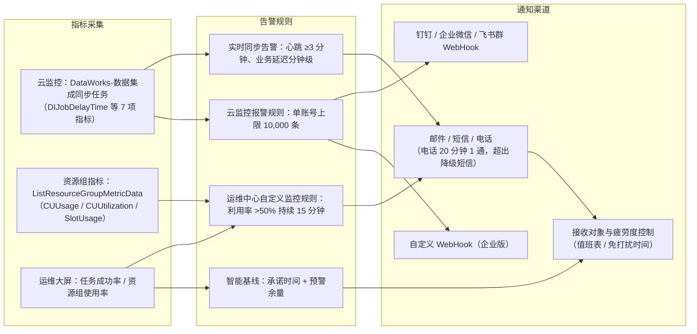

# DataWorks · 监控与告警

> 产品：DataWorks ｜ 口径：公共云 ｜ 复核：2026-11-18

## 告警链路图

**来源**
- 实时同步任务对接云监控（云监控报警规则入口）：https://help.aliyun.com/zh/dataworks/user-guide/real-time-synchronization-task-docking-cloud-monitoring.md ｜ 复核：2026-11-18
- ListResourceGroupMetricData 资源组指标数据：https://help.aliyun.com/zh/dataworks/developer-reference/api-dataworks-public-2024-05-18-listresourcegroupmetricdata.md ｜ 复核：2026-11-18
- 运维大屏（资源组使用率 80% 扩容建议、周期实例完成情况）：https://help.aliyun.com/zh/dataworks/user-guide/view-the-statistics-on-the-overview-page.md ｜ 复核：2026-11-18
- 实时同步告警设置最佳实践（任务状态 ≥3 分钟、业务延迟分钟级建议）：https://help.aliyun.com/zh/dataworks/user-guide/best-practices-for-configuring-an-alert-rule-for-real-time-synchronization-nodes.md ｜ 复核：2026-11-18
- 自定义监控报警规则（触发条件、50%/15 分钟示例、电话间隔 20 分钟）：https://help.aliyun.com/zh/dataworks/user-guide/create-a-custom-alert-rule.md ｜ 复核：2026-11-18

## 核心监控指标

DataWorks 的监控数据分三路：① 实时同步任务已接入云监控（云产品列表「DataWorks-数据集成同步任务」）；② 资源组指标经 DataWorks OpenAPI `ListResourceGroupMetricData` 提供（仅 Serverless 资源组）；③ 调度任务成功率与资源组负载在运维中心运维大屏查看（平台指标，官方未公布英文名）。

| 指标（官方英文名） | 含义 | 单位 | 统计周期 | 维度 |
|---|---|---|---|---|
| `DIJobDelayTime` | 业务延迟：数据从源端到目标端的同步延迟 | ms | ⚠️ 待核（云监控页未标注 Min Period） | 解决方案任务 ID + 子任务 ID |
| `DIJobTotalRecordsRead` | 读端同步条数：源端读取的数据总条数 | 条 | ⚠️ 待核 | 解决方案任务 ID + 子任务 ID |
| `DIJobSpeedRecordsRead` | 读端同步速率：源端读取数据的速率 | 条/秒 | ⚠️ 待核 | 解决方案任务 ID + 子任务 ID |
| `DIJobSpeedRecordsWrite` | 写端同步速率：目标端写入数据的速率 | 条/秒 | ⚠️ 待核 | 解决方案任务 ID + 子任务 ID |
| `DIJobMasterResourceUtilization` | Master 节点资源利用率：CPU 与内存利用率的较大值 | % | ⚠️ 待核 | 解决方案任务 ID + 子任务 ID |
| `DIJobWorkerResourceUtilization` | 各 Worker 节点资源利用率：CPU 与内存利用率的较大值 | % | ⚠️ 待核 | 解决方案任务 ID + 子任务 ID + Worker ID |
| `DIJobTotalDmlInsertWrite` | 任务级写端 Insert 操作条数 | 条 | ⚠️ 待核 | 解决方案任务 ID + 子任务 ID |
| `CUUsage` | 资源组 CU 使用量 | CU | 60 秒（默认，取 60 的倍数） | ResourceGroupId（Serverless 资源组） |
| `CUUtilization` | 资源组 CU 使用率 | % | 60 秒（默认） | ResourceGroupId |
| `SlotUsage` | 资源组调度已使用并发数 | slot | 60 秒（默认） | ResourceGroupId |
| 资源组使用率（运维大屏，英文名未公布 ⚠️ 待核） | 运行在该资源组上的实例所占用资源的百分比 | % | 最多统计 7 天 | 资源组级（多空间共享资源组时为合计值） |
| 周期实例完成率（运维大屏，英文名未公布 ⚠️ 待核） | 当日周期实例完成情况（口径为运行成功或未运行的实例），含昨日/今日/历史平均三条折线 | % | 当日 00:00~23:00；历史平均取近 10 天 | 工作空间 |

- 云监控侧 7 项指标的统计周期官方页面未标注，标 `⚠️ 待核`；`ListResourceGroupMetricData` 的 Period 官方明确为 60 的倍数、默认 60 秒，时间窗最长 31 天。
- 资源组类指标还有 `CUSpec`（最大 CU 容量）、`SlotSpec`（调度最大并发数）、`SchedulerCUUsage`、`DataIntegrationCUUsage` 等，同一接口同一维度。
- 实时同步任务的 DML 指标另有表维度版本（`DIJobTableDmlInsertRead` 等），需精确到数据库名、Schema 名和表名。

**来源**
- 实时同步任务对接云监控（指标英文名/含义/单位/维度）：https://help.aliyun.com/zh/dataworks/user-guide/real-time-synchronization-task-docking-cloud-monitoring.md ｜ 复核：2026-11-17
- ListResourceGroupMetricData 资源组指标数据（指标清单/Period/维度）：https://help.aliyun.com/zh/dataworks/developer-reference/api-dataworks-public-2024-05-18-listresourcegroupmetricdata.md ｜ 复核：2026-11-17
- ListDIJobMetrics 查询任务指标（6 项任务指标）：https://help.aliyun.com/zh/dataworks/developer-reference/api-dataworks-public-2024-05-18-listdijobmetrics.md ｜ 复核：2026-11-17
- 运维大屏（资源组使用情况、周期实例完成情况）：https://help.aliyun.com/zh/dataworks/user-guide/view-the-statistics-on-the-overview-page.md ｜ 复核：2026-11-17

## 官方默认与推荐告警

**A. 官方推荐阈值与官方文档示例（有出处，逐条收录）**

| 场景 | 指标/条件 | 官方阈值或建议 | 出处 |
|---|---|---|---|
| 实时同步·任务状态告警 | 任务心跳状态 | 建议阈值不小于 3 分钟，防止网络抖动导致误报 | 实时同步告警设置最佳实践 |
| 实时同步·业务延迟告警 | 业务延迟 | 建议阈值为分钟级别（官方未给具体数值） | 实时同步告警设置最佳实践 |
| 调度资源组扩容提示 | 资源组使用率 | 超过 **80%** 时建议扩容，以免资源不足影响任务执行 | 运维大屏 |
| 自定义规则·独享资源组 | 资源组利用率 | 官方示例：利用率大于 **50%** 并持续 **15 分钟** 触发报警 | 自定义监控报警规则 |
| 自定义规则·独享资源组 | 资源组等资源实例数 | 官方示例：等资源实例数大于 **10** 并持续 **15 分钟** 触发报警 | 自定义监控报警规则 |
| 电话告警防轰炸 | 同一用户报警电话接收间隔 | 默认 **20 分钟**，超出部分自动降级为短信（租户告警策略可改） | 自定义监控报警规则 |
| 智能基线 | 承诺时间 + 预警余量 | 官方机制性建议（承诺时间应晚于任务历史最晚完成时间并留预警余量），未给统一数值 | 基线承诺时间与预警余量配置 |

**B. 官方未发布推荐阈值的指标**

- 任务运行成功率、出错实例数/占比、实例运行超时、消息堆积量、Failover 次数、脏数据条数等指标：**官方未发布推荐阈值** 📋 待补（官方仅提供触发条件与配置说明，阈值由用户按业务自定；按阈值红线不收经验值）。
- 实时同步 7 类告警指标（任务状态、业务延迟、消息堆积量、Failover、DDL 不支持、DDL 通知、脏数据）中，仅任务状态与业务延迟给了方向性建议（见 A 表），其余无官方数值。

**来源**
- 实时同步告警设置最佳实践（任务状态 ≥3 分钟、业务延迟分钟级建议）：https://help.aliyun.com/zh/dataworks/user-guide/best-practices-for-configuring-an-alert-rule-for-real-time-synchronization-nodes.md ｜ 复核：2026-11-17
- 运维大屏（资源组使用率 80% 扩容建议）：https://help.aliyun.com/zh/dataworks/user-guide/view-the-statistics-on-the-overview-page.md ｜ 复核：2026-11-17
- 自定义监控报警规则（触发条件、50%/15 分钟与 10/15 分钟示例、电话间隔 20 分钟）：https://help.aliyun.com/zh/dataworks/user-guide/create-a-custom-alert-rule.md ｜ 复核：2026-11-17
- 基线承诺时间与预警余量配置：https://help.aliyun.com/zh/dataworks/user-guide/configure-an-appropriate-committed-point-in-time-and-an-appropriate-alert-margin-threshold-for-a-baseline.md ｜ 复核：2026-11-17
- 运维中心-智能监控概览（全局规则与实例告警）：https://help.aliyun.com/zh/dataworks/user-guide/monitor.md ｜ 复核：2026-11-17

## 通知与渠道

| 渠道/机制 | 说明 | 限制 |
|---|---|---|
| 邮件 | 报警发送至接收人邮箱 | 接收人在 DataWorks「报警联系人」配置；未设置时升级到主账号邮箱 |
| 短信 | 报警发送至接收人手机号 | 手机号需含 86 等国际区号 |
| 电话 | 语音电话告警 | 仅中国内地手机号；需专业版及以上；同一用户默认 20 分钟内最多 1 通，超出降级为短信 |
| 钉钉群机器人 WebHook | 推送至钉钉群，支持 AT 策略 @所有人/@指定接收人 | 关键词必须包含 `DataWorks`（区分大小写），最多 10 个关键词 |
| 企业微信 / 飞书群 WebHook | 基础版即支持群 WebHook 方式 | — |
| 自定义 WebHook | 推送至自有服务，支持企业微信/飞书 | 仅企业版；公网推送需加白 DataWorks 各地域出口 IP，内网用指定连通资源组发送 |
| 接收对象 | 任务责任人、值班表、其他接收人 | 值班表前两次仅主值班人收到，第三次起主+备同时通知 |
| 疲劳度控制 | 最大报警次数、最小报警间隔、免打扰时间 | 免打扰时段内不发送，超期仍异常再发 |
| 云监控侧报警 | 云监控为实时同步任务指标配置报警规则（短信/邮件/电话/Webhook） | 走云监控报警服务，与运维中心自定义监控规则是两套对象 |
| 报警升级策略 | 官方未发布 DataWorks 告警升级（Escalation）策略 | 📋 待补（现有机制仅为电话超间隔自动降级短信） |

**来源**
- 自定义监控报警规则（邮件/短信/电话/钉钉/WebHook、接收对象、疲劳度控制、电话间隔）：https://help.aliyun.com/zh/dataworks/user-guide/create-a-custom-alert-rule.md ｜ 复核：2026-11-17
- 配置报警联系人（手机号/邮箱/语言/备选联系人）：https://help.aliyun.com/zh/dataworks/user-guide/configure-and-view-alert-contacts.md ｜ 复核：2026-11-17
- 运维值班表管理（主备值班人通知规则）：https://help.aliyun.com/zh/dataworks/user-guide/create-and-manage-a-shift-schedule.md ｜ 复核：2026-11-17
- DataWorks 自定义 Webhook 报警对接（出口 IP 白名单/内网资源组）：https://help.aliyun.com/zh/dataworks/user-guide/user-defined-webhook-docking-solution.md ｜ 复核：2026-11-17
- 实时同步告警设置最佳实践（告警接收方式）：https://help.aliyun.com/zh/dataworks/user-guide/best-practices-for-configuring-an-alert-rule-for-real-time-synchronization-nodes.md ｜ 复核：2026-11-17
- 实时同步任务对接云监控（云监控报警规则入口）：https://help.aliyun.com/zh/dataworks/user-guide/real-time-synchronization-task-docking-cloud-monitoring.md ｜ 复核：2026-11-17

## 告警配额

| 限制项 | 数值 | 归属 |
|---|---|---|
| 单条自定义监控规则可添加的任务节点 | 50 个 | DataWorks 运维中心 |
| 单条规则可添加的基线 / 业务流程 | 各 5 个 | DataWorks 运维中心 |
| 单条规则可添加的工作空间 | 1 个 | DataWorks 运维中心 |
| 单条规则任务黑名单 | 最多 50 个任务 | DataWorks 运维中心 |
| 每日报警短信/电话数量上限 | 默认无限制，可自行设置（仅当前地域生效） | DataWorks 报警资源 |
| 每月免费报警短信 | 基础版 100 条、标准版 1,000 条、专业版 2,000 条、企业版 10,000 条 | DataWorks 报警资源 |
| 每月免费报警电话 | 基础版/标准版无，专业版 500 通、企业版 1,000 通 | DataWorks 报警资源 |
| 超额单价（公共云） | 短信 0.045 元/条、电话 0.15 元/通 | DataWorks 报警资源 |
| 单账号可新建的报警规则 | 10,000 条 | 基础云监控 |
| 单账号可新建的动态规则 / 应用分组 | 1,200 个 / 20,000 个 | 基础云监控 |
| 监控数据存储时长 | Period < 60 秒存 7 天；= 60 秒存 31 天；≥ 300 秒存 91 天 | 基础云监控 |
| 报警联系人 / 联系人组数量上限 | 📋 待补（官方使用限制页未列出该配额） | DataWorks / 云监控 |

**来源**
- 自定义监控报警规则（规则对象数量上限）：https://help.aliyun.com/zh/dataworks/user-guide/create-a-custom-alert-rule.md ｜ 复核：2026-11-17
- 查看与设置报警资源（每日上限、附赠额度）：https://help.aliyun.com/zh/dataworks/user-guide/view-and-configure-alert-resources.md ｜ 复核：2026-11-17
- 资源成本（各版本免费短信/电话额度与超额单价）：https://help.aliyun.com/zh/dataworks/resource-costs.md ｜ 复核：2026-11-17
- 云监控使用限制（报警规则/动态规则/应用分组/存储时长）：https://help.aliyun.com/zh/cms/cloudmonitor-1-0/product-overview/restrictions-on-use.md ｜ 复核：2026-11-17
