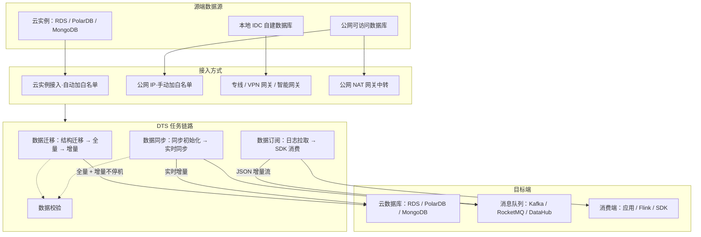
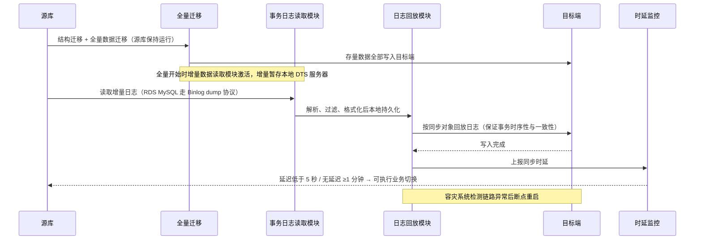

# DTS · 产品架构

> 产品：DTS ｜ 口径：公共云 ｜ 复核：2026-11-18

## 产品定义

数据传输服务 DTS（Data Transmission Service）是阿里云的一站式数据传输与处理平台，集成数据迁移、数据同步、数据订阅、数据加工、数据校验五项核心能力。

| 功能类型 | 主要能力 | 适用场景（官方口径） |
|---|---|---|
| 数据迁移 | 一次性将数据从一个数据源迁移至另一个数据源，支持同构/异构，不停服迁移，停机时间降至分钟级 | 业务上云、数据库搬迁 |
| 数据同步 | 在数据源之间建立实时、持续的同步链路，支持单向或双向；另提供数据投递链路 | 版本升级、拆分扩容、异地多活、异地灾备、跨境同步、查询报表分流、实时数仓 |
| 数据订阅 | 实时捕获源库增量变化（INSERT/UPDATE/DELETE），供下游按需消费 | 缓存更新、异步解耦、为复杂 ETL 提供实时数据流 |
| 数据加工 | 数据流动过程中的实时抽取、转换、加载（ETL） | 实时清洗、格式转换、字段增删 |
| 数据校验 | 在迁移/同步任务中或独立任务中对比源端与目标端数据，验证一致性 | 发现并定位数据不一致 |

**来源**：
- 什么是数据传输服务DTS：https://help.aliyun.com/zh/dts/product-overview/what-is-dts ｜ 复核：2026-11-16

## 架构图

**来源**
- 产品架构：https://help.aliyun.com/zh/dts/product-overview/system-architecture-and-design-concepts ｜ 复核：2026-11-17
- 什么是数据传输服务DTS：https://help.aliyun.com/zh/dts/product-overview/what-is-dts ｜ 复核：2026-11-17
- 支持的数据库概览（源端/目标端）：https://help.aliyun.com/zh/dts/product-overview/supported-databases ｜ 复核：2026-11-17
- 添加DTS服务器IP地址白名单（接入方式与白名单）：https://help.aliyun.com/zh/dts/user-guide/add-the-cidr-blocks-of-dts-servers-to-the-security-settings-of-on-premises-databases ｜ 复核：2026-11-17
- 通过公网NAT网关实现本地IDC与DTS云服务互通（中转接入）：https://help.aliyun.com/zh/dts/user-guide/connect-an-on-premises-database-to-dts-using-internet-nat-gateway ｜ 复核：2026-11-17

## 关键链路

一个增量同步任务（全量 + 增量不停机）的数据链路：

**来源**：
- 产品架构（迁移三阶段与同步两模块）：https://help.aliyun.com/zh/dts/product-overview/system-architecture-and-design-concepts ｜ 复核：2026-11-18
- 业务切换流程（时延口径）：https://help.aliyun.com/zh/dts/user-guide/switch-workloads-to-the-destination-database-1 ｜ 复核：2026-11-18

## 组件清单

| 组件 | 作用 | 必选/可选 | 是否独立计费 | 备注 |
|---|---|---|---|---|
| 数据迁移任务 | 一次性将数据从源库迁移至目标库，结构迁移 → 全量 → 增量三阶段可组合 | 可选（按任务类型选用） | 是（仅增量迁移配置费按量计费；结构迁移、全量迁移不计费） | 仅支持按量付费；不停机迁移停机时间降至分钟级 |
| 数据同步任务 | 源/目标之间建立实时、持续的同步链路，支持单向与双向 | 可选 | 是（增量同步配置费；包年包月 / 按量付费 / Serverless） | 单向同步目标实例只读勿写；价格高于迁移任务 |
| 数据订阅任务 | 捕获源库增量变化，输出结构化 JSON 数据流供下游按需消费 | 可选 | 是（订阅通道配置费；包年包月 + 源库 MySQL 另收数据流量费） | 单源多消费组；同一订阅链路服务端仅向一个消费进程推送 |
| 数据校验 | 全量 / 结构 / 增量三种方式对比源端与目标端数据一致性 | 可选（迁移、同步任务中勾选，也可创建独立任务） | 部分（按表行数校验不收费；按行抽样全字段校验按实际校验数据量收费） | 单表差异超 100,000 行终止该表校验 |
| 业务切换（迁移切换） | 迁移完成后把业务从源库切换到目标库的流程，含反向迁移回退 | 可选（迁移场景） | 否（流程本身不收费） | 切换前须延迟低于 5 秒并保持无延迟 ≥1 分钟；反向任务只能勾选增量数据迁移 |
| 中转接入（公网 NAT 网关中转） | 本地 IDC 数据库不便逐条加白名单时，经中转 VPC + NAT 网关 + EIP 与 DTS 互通 | 可选 | 是（公网 NAT 网关与 EIP 费用） | 官方 6 种接入方式清单中无「中转实例」，「中转」即公网 NAT 网关中转（2026-11-18 复核产品 llms.txt 索引，仅有「通过公网 NAT 网关接入数据库」一条中转方案，无「中转实例」形态） |
| 关联：云数据库 RDS | 作为 DTS 链路的源端或目标端云数据库 | 可选（关联产品） | 否（RDS 侧另行计费） | [RDS](../rds-mysql/README) |
| 关联：PolarDB | 作为 DTS 链路的源端或目标端云数据库集群 | 可选（关联产品） | 否（PolarDB 侧另行计费） | [PolarDB](../polardb/README) |

**来源**
- 什么是数据传输服务DTS：https://help.aliyun.com/zh/dts/product-overview/what-is-dts ｜ 复核：2026-11-17
- 支持的数据库概览：https://help.aliyun.com/zh/dts/product-overview/supported-databases ｜ 复核：2026-11-17
- 计费项：https://help.aliyun.com/zh/dts/product-overview/billable-items ｜ 复核：2026-11-17
- 配置数据校验（校验方式与计费）：https://help.aliyun.com/zh/dts/user-guide/enable-data-verification ｜ 复核：2026-11-17
- 业务切换流程：https://help.aliyun.com/zh/dts/user-guide/switch-workloads-to-the-destination-database-1 ｜ 复核：2026-11-17
- 添加DTS服务器IP地址白名单（6 种接入方式）：https://help.aliyun.com/zh/dts/user-guide/add-the-cidr-blocks-of-dts-servers-to-the-security-settings-of-on-premises-databases ｜ 复核：2026-11-17
- 通过公网NAT网关实现本地IDC与DTS云服务互通：https://help.aliyun.com/zh/dts/user-guide/connect-an-on-premises-database-to-dts-using-internet-nat-gateway ｜ 复核：2026-11-17
- 产品架构（订阅链路多进程推送与断点重启）：https://help.aliyun.com/zh/dts/product-overview/system-architecture-and-design-concepts ｜ 复核：2026-11-17

## 系统架构与高可用

- DTS 内部每个模块都有主备架构；容灾系统实时检测节点健康，发现节点异常后将链路快速切换到其他节点。
- 数据源地址动态适配：对数据订阅及同步链路，容灾系统监测数据源连接地址变更并动态适配新的连接方式。
- 同步链路：DTS 容灾系统检测到链路异常后，在健康服务节点上断点重启链路。
- 订阅链路：日志拉取模块异常时在健康节点断点重启；同一订阅链路可启动多个下游 SDK 消费进程，服务端同时只向一个进程推送，进程异常后自动切换到其他健康消费进程。
- 底层采用服务集群架构，服务内部提供 7×24 小时数据准确性校验；安全手段含安全传输协议、安全 Token 认证、SSL 加密；跨境/跨地域同步使用专线网络隔离。

**来源**：
- 产品架构：https://help.aliyun.com/zh/dts/product-overview/system-architecture-and-design-concepts ｜ 复核：2026-11-16
- 什么是数据传输服务DTS：https://help.aliyun.com/zh/dts/product-overview/what-is-dts ｜ 复核：2026-11-16

## 三类任务工作原理

| 任务 | 阶段/模块 | 关键机制 |
|---|---|---|
| 数据迁移 | 结构迁移 → 全量数据迁移 → 增量数据迁移 三阶段 | 迁移期间源库保持运行；全量阶段开始时增量数据读取模块被激活，增量数据解析后暂存本地 DTS 服务器；全量完成后回放增量直至两端完全同步 |
| 数据同步 | 同步初始化 → 数据实时同步 两阶段 | 初始化先收集增量再加载结构与存量；增量依赖事务日志读取模块（RDS MySQL 走 Binlog dump 协议）+ 日志回放模块（保证事务时序性与一致性） |
| 数据订阅 | 日志拉取 → SDK 消费 | 日志抓取模块通过数据库协议实时拉取源库增量日志并本地持久化；下游通过 SDK/Flink 客户端消费 |

- 迁移期间保持源库正常运行时，必须同时勾选结构迁移、全量数据迁移、增量数据迁移三种迁移类型。
- 订阅输出为结构化 JSON 数据流（捕获 Binlog、WAL 等日志）。

**来源**：
- 产品架构：https://help.aliyun.com/zh/dts/product-overview/system-architecture-and-design-concepts ｜ 复核：2026-11-16
- 什么是数据传输服务DTS：https://help.aliyun.com/zh/dts/product-overview/what-is-dts ｜ 复核：2026-11-16

## 全量 + 增量不停机链路

- 不停机上云迁移 = 全量迁移 + 增量同步：业务不停止写入完成迁移，再将应用切换至新库，停机时间缩短至分钟级。
- 全量迁移峰值性能可达 70 MB/s；实时同步峰值性能可达 30,000 RPS（并发粒度缩小至事务级别）。
- DTS 支持链路断点续传和自动修复重启；支持多并发压缩传输以降低带宽占用。
- 迁移失败的任务，DTS 将尝试恢复 7 天内运行失败的实例；技术支持人员将在 8 小时内尝试恢复运行失败的实例。
- 切换前的时延口径：迁移任务进度为「增量迁移」且显示「无延迟」或延迟低于 5 秒才进入业务切换步骤（详见 04）。

**来源**：
- 什么是数据传输服务DTS：https://help.aliyun.com/zh/dts/product-overview/what-is-dts ｜ 复核：2026-11-16
- DTS实例的注意事项及限制：https://help.aliyun.com/zh/dts/product-overview/limits-and-notes-on-the-dts-instance ｜ 复核：2026-11-16
- 业务切换流程：https://help.aliyun.com/zh/dts/user-guide/switch-workloads-to-the-destination-database-1 ｜ 复核：2026-11-16

## SLA

| 项目 | 官方口径 |
|---|---|
| 版本生效日期 | 2025 年 9 月 1 日 |
| 服务可用性承诺 | 不低于 99.95%（单实例维度） |
| 服务不可用定义 | DTS 实例的写入数据无法同步到目的端，且状态持续超过 5 分钟以上 |
| 赔偿：<99.95% 且 ≥99.00% | 月度服务费用的 15%（代金券） |
| 赔偿：<99.00% 且 ≥95.00% | 月度服务费用的 30% |
| 赔偿：<95.00% | 月度服务费用的 100% |
| 赔偿申请时限 | 每月第五个工作日后提出，且须在不达标月份结束后 2 个月内 |
| 适用范围 | 仅 DTS 收费实例；不适用公测/邀测/免费功能、本地云版本、专属集群超配比 >150%、使用公网代理类工具（数据库网关 DG/FRP 等） |
| 性能规格与 SLA 关系 | 各链路规格的性能上限为测试数据，不在 SLA 承诺范围内 |

除外情形（节选）：阿里云预通知的维护、源/目数据库自身原因、密码修改未及时更新、单可用区地域的可用区级故障、不可抗力等 11 类。

**来源**：
- 数据传输DTS服务等级协议：https://terms.aliyun.com/legal-agreement/terms/suit_bu1_ali_cloud/suit_bu1_ali_cloud201803051053_36596.html ｜ 复核：2026-11-16
- 数据同步链路规格说明：https://help.aliyun.com/zh/dts/product-overview/specifications-of-data-synchronization-channels ｜ 复核：2026-11-16
