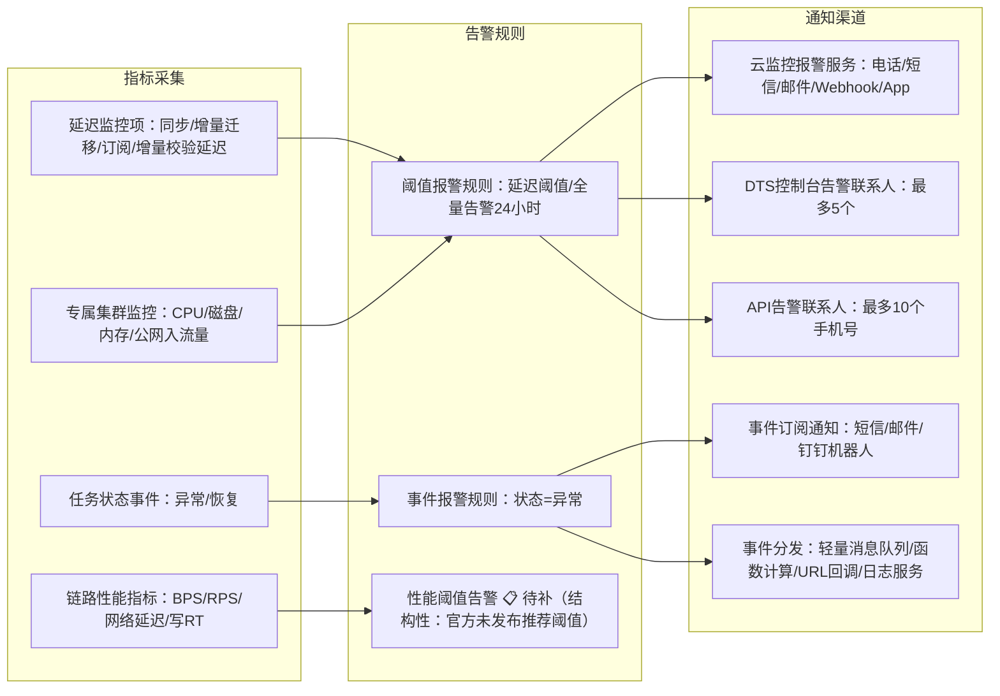

# DTS · 监控与告警

> 产品：DTS ｜ 口径：公共云 ｜ 复核：2026-11-18

## 告警链路图

**来源**
- 通过云监控平台为DTS任务设置报警规则（监控项 / 产品类型 / 事件报警）：https://help.aliyun.com/zh/dts/user-guide/configure-alert-rules-for-dts-tasks-in-the-cloudmonitor-console ｜ 复核：2026-11-18
- 配置监控告警（监控项清单与默认启停 / 全量告警 24 小时默认规则）：https://help.aliyun.com/zh/dts/user-guide/configure-monitoring-and-alerting-1 ｜ 复核：2026-11-18
- 云监控报警规则概述（电话 / 短信 / 邮件 / Webhook / App）：https://help.aliyun.com/zh/cms/cloudmonitor-1-0/user-guide/overview-2 ｜ 复核：2026-11-18
- 订阅 DTS 事件通知（钉钉机器人 / MNS / 函数计算 / URL 回调 / 日志服务）：https://help.aliyun.com/zh/dts/user-guide/subscribe-to-event-notifications ｜ 复核：2026-11-18

## 核心监控指标

- DTS 已接入云监控（CloudMonitor）；云监控平台对任务提供的监控项为「延迟信息」（阈值报警）与「任务状态」（事件报警）两类。
- 云监控阈值报警的 DTS 产品类型：**数据传输服务 DTS（Migration）**（数据迁移实例）、**数据传输服务 DTS（Synchronization）**（数据同步实例）、**数据传输服务 DTS（Change_tracking）**（数据订阅实例）。
- 任务级 CloudMonitor 的英文 MetricName 与 Namespace 官方未公布 → ⚠️ 待核（2026-11-18 已复核「通过云监控平台为 DTS 任务设置报警规则」与「配置监控告警」两页，均只给中文监控项名与产品类型，未给 MetricName/Namespace；help 侧仅专属集群 `DescribeMetricList` 公布英文 MetricName。控制台「指标和事件中心」`cms.console.aliyun.com/metric-meta/` 可查实际取值）；下表「官方名」列为官方文档原文名称。

| 指标 / 监控项（官方名） | 含义 | 单位 | 统计周期 | 维度 |
|---|---|---|---|---|
| 同步延迟（监控项） | 同步任务增量数据延迟超过设定值时触发报警 | 分属两套告警对象、单位各不相同（2026-11-18 两页均已逐字复核）：云监控平台阈值报警**单位为毫秒**；DTS 任务告警规则 `CreateJobMonitorRule` delay 类型 `DelayRuleTime` **单位为秒**（建议 10 秒以上） | 官方未标注 | 数据同步任务 |
| 增量迁移延迟（监控项） | 迁移任务增量阶段延迟超过设定值时触发报警 | 同上 | 官方未标注 | 数据迁移任务 |
| 订阅延迟（监控项） | 订阅任务延迟超过设定值时触发报警 | 同上 | 官方未标注 | 数据订阅任务 |
| 增量校验延迟（监控项） | 增量校验任务延迟触发报警 | 秒 | `Period` 可选 1 / 5 / 10 / 30 分钟，`Times` 为周期数 | 数据校验任务 |
| 全量告警（`Type=full_timeout`） | 全量任务运行耗时超过设定值时触发报警 | 小时 | 官方未标注（按告警规则检查） | 数据迁移 / 数据同步任务 |
| 迁移 / 同步 / 订阅状态（`Type=error`，事件） | 任务状态为「异常」或「恢复」时触发事件报警 | —（状态型） | 事件驱动 | 三种任务类型 |
| BPS | 链路每秒传输数据量：源库→DTS 读取量、DTS→目标库 写入量 | MB/s | 自定义时间范围趋势图 | 链路模块（源库 / DTS 采集 / DTS 缓存 / DTS 写入 / 目标库） |
| RPS | 链路每秒传输行数 | 行/s | 自定义时间范围趋势图 | 同上 |
| 网络延迟 | DTS 与源库、目标库之间（链路模块之间）的网络延迟 | 官方未标注单位 ⚠️ 待核（2026-11-18 复核监控任务性能/全量迁移性能/增量迁移性能三页，定义均无单位） | 自定义时间范围趋势图 | 同上 |
| 写 RT | DTS 写入到目标库的响应时间 | 官方未标注单位 ⚠️ 待核（2026-11-18 复核全量迁移性能页，定义仅「响应时间」无单位） | 自定义时间范围趋势图 | 全量迁移 / 同步链路（DTS→目标库） |
| 迁移延迟 / 任务延迟（ms） | 迁移延迟：迁移到目标库的最新数据时间戳与源库当前时间戳差；任务延迟（ms）：数据在源库产生到写入目标库的时间差 | ms（任务延迟，官方指标名即「任务延迟（ms）」）；迁移延迟官方未标注单位 ⚠️ 待核（2026-11-18 复核增量迁移性能页，定义为「时间差」无单位） | 选定时间范围 | 数据迁移任务 |
| DDL 执行数量 / 目标库慢 SQL 数量 | 选定时间范围内目标库执行 DDL 语句的数量 / 产生的慢 SQL 数量 | 个 | 选定时间范围 | 数据迁移任务 |

- 专属集群监控（`DescribeMetricList`）：MetricName 支持 `cpu_total`、`diskusage_utilization`、`memory_usedutilization`、`InternetIn` 等，Period 最小 15 秒，维度为集群 / 节点。
- 性能监控页另提供全量同步流量、源和目标实例 RPS、读写响应时间、网络延时等指标趋势图，可选时间范围查看。

**来源**
- 通过云监控平台为DTS任务设置报警规则（监控项 / 产品类型 / 延迟毫秒口径，未给 MetricName）：https://help.aliyun.com/zh/dts/user-guide/configure-alert-rules-for-dts-tasks-in-the-cloudmonitor-console ｜ 复核：2026-11-18
- 配置监控告警（监控项清单与默认启停；监控项仅中文名、无英文 MetricName）：https://help.aliyun.com/zh/dts/user-guide/configure-monitoring-and-alerting-1 ｜ 复核：2026-11-18
- CreateJobMonitorRule（Type / DelayRuleTime 秒单位与建议 10 秒以上 / Period）：https://help.aliyun.com/zh/dts/developer-reference/api-createjobmonitorrule ｜ 复核：2026-11-18
- 监控任务性能（BPS / RPS / 网络延迟定义，网络延迟无单位）：https://help.aliyun.com/zh/dts/user-guide/monitor-task-performance ｜ 复核：2026-11-18
- 查看全量迁移链路状态和性能（写 RT 定义，无单位）：https://help.aliyun.com/zh/dts/user-guide/view-the-connection-status-and-performance-of-full-data-migration ｜ 复核：2026-11-18
- 查看增量迁移链路状态与性能（迁移流量 / 迁移延迟无单位 / 任务延迟（ms）/ DDL / 慢 SQL）：https://help.aliyun.com/zh/dts/user-guide/view-the-connection-status-and-performance-of-incremental-data-migration ｜ 复核：2026-11-18
- DescribeMetricList（专属集群 MetricName 与 Period）：https://help.aliyun.com/zh/dts/developer-reference/api-view-cluster-monitoring-information ｜ 复核：2026-11-17
- 云监控指标与事件中心（MetricName 查询入口）：https://cms.console.aliyun.com/metric-meta/ ｜ 复核：2026-11-17

## 官方默认与推荐告警

**A. 官方默认规则（DTS 控制台「告警设置」）**

| 场景 / 监控项 | 官方默认或推荐 | 说明 |
|---|---|---|
| 全量告警（迁移 / 同步） | 默认已开启；默认规则为「全量任务运行超过 24 小时则产生告警」 | 默认无告警联系人，需自行添加 |
| 同步延迟（同步作业监控报警页） | 默认报警阈值为 30 秒 | 同步作业列表 > 监控报警（旧版控制台） |
| 监控项默认启停 | 数据同步：同步延迟、同步状态默认禁用，全量告警默认启用；数据迁移：增量迁移延迟、迁移状态默认禁用，全量告警默认启用；数据订阅：订阅延迟、订阅状态默认禁用；DTS Insight 主动诊断告警默认启用 | 数据校验各监控项状态取决于创建校验任务时的校验告警设置 |
| 同步状态 / 迁移状态 | 告警规则固定为「状态 = 异常」，不可修改阈值 | 仅可配置告警联系人、启用或禁用 |
| 延迟阈值官方建议 | `CreateJobMonitorRule` delay 类型阈值「建议设置 10 秒以上」，避免网络、数据库负载波动 | 单位为秒；`full_timeout` 单位为小时 |
| 任务异常 / 恢复事件 | 云监控事件报警：产品选「数据传输」，事件名称为数据迁移、数据同步、数据订阅任务的异常和恢复事件 | 实例任务异常（JobStatus）等级为 WARN；同步任务异常（`sync_job_abnormal`）示例等级为 CRITICAL |

**B. 指标阈值类告警**

- BPS、RPS、网络延迟、写 RT、DDL 执行数量、目标库慢 SQL 数量等性能指标的阈值告警：**官方未发布推荐阈值** 📋 待补（结构性：官方文档仅提供告警规则配置操作说明，未给出 DTS 推荐阈值；按阈值红线不收经验值）。

**来源**
- 配置监控告警（全量告警 24 小时默认规则 / 默认启停 / 状态=异常 / 最多 5 个联系人）：https://help.aliyun.com/zh/dts/user-guide/configure-monitoring-and-alerting-1 ｜ 复核：2026-11-17
- 数据同步监控报警配置（同步延迟默认 30 秒）：https://help.aliyun.com/zh/dts/user-guide/configure-monitoring-and-alerting-2 ｜ 复核：2026-11-17
- CreateJobMonitorRule（delay 建议 10 秒以上 / full_timeout 小时）：https://help.aliyun.com/zh/dts/developer-reference/api-createjobmonitorrule ｜ 复核：2026-11-17
- 通过云监控平台为DTS任务设置报警规则（事件报警）：https://help.aliyun.com/zh/dts/user-guide/configure-alert-rules-for-dts-tasks-in-the-cloudmonitor-console ｜ 复核：2026-11-17
- 订阅 DTS 事件通知（事件等级与状态）：https://help.aliyun.com/zh/dts/user-guide/subscribe-to-event-notifications ｜ 复核：2026-11-17

## 通知与渠道

| 渠道 / 机制 | 说明 |
|---|---|
| DTS 控制台告警联系人 | 告警设置中填写告警联系人手机号码，最多支持 5 个 |
| API 告警联系人（`Phone`） | 最多传入 10 个手机号码（英文逗号分隔）；仅支持中国内地手机号码；国际站不支持手机告警，仅支持通过云监控平台设置报警规则 |
| 云监控报警服务 | 支持电话、短信、邮件和 Webhook 地址；安装阿里云 App 可通过 App 接收报警通知 |
| 事件订阅通知方式 | 通过短信、邮件、钉钉机器人对事件发生进行报警 |
| 事件分发（自动化处理） | 将事件分发到轻量消息队列（原 MNS）、函数计算、URL 回调和日志服务 SLS |
| 前提条件 | 消息中心「云数据库故障或运维通知」通知开关处于开启状态并设置消息接收人；已创建报警联系人和报警联系人组并完成关联 |
| 告警升级与静默 | 官方未发布 DTS 专属告警升级（Escalation）与静默策略 📋 待补（结构性：DTS 文档未给出专属设置） |

**来源**
- 配置监控告警（控制台联系人最多 5 个）：https://help.aliyun.com/zh/dts/user-guide/configure-monitoring-and-alerting-1 ｜ 复核：2026-11-17
- CreateJobMonitorRule（`Phone` 最多 10 个、仅中国内地）：https://help.aliyun.com/zh/dts/developer-reference/api-createjobmonitorrule ｜ 复核：2026-11-17
- 云监控报警规则概述（电话 / 短信 / 邮件 / Webhook / App）：https://help.aliyun.com/zh/cms/cloudmonitor-1-0/user-guide/overview-2 ｜ 复核：2026-11-17
- 订阅 DTS 事件通知（钉钉机器人 / MNS / 函数计算 / URL 回调 / 日志服务 / 消息中心开关）：https://help.aliyun.com/zh/dts/user-guide/subscribe-to-event-notifications ｜ 复核：2026-11-17

## 告警配额

| 限制项 | 最大值 | 归属 |
|---|---|---|
| 单账号可新建的报警规则数量 | 10,000 条 | 基础云监控 |
| 单账号可新建的动态规则数量 | 1,200 个 | 基础云监控 |
| 单账号可新建的应用分组数量 | 20,000 个 | 基础云监控 |
| 一个应用分组内允许新建的可用性监控数量 | 500 个 | 基础云监控 |
| 监控数据存储时长（Period = 60 秒） | 31 天 | 基础云监控 |
| 监控数据存储时长（Period ≥ 300 秒） | 91 天 | 基础云监控 |
| 单账号可新建的 PromQL 报警规则数量 | 20 条 | 企业云监控 |
| 单账号可新建的指标仓库数量 | 30 个 | 企业云监控 |
| 报警联系人 / 报警联系人组的数量上限 | 📋 待补（结构性：官方使用限制页未列出该配额） | 基础云监控 |
| 单个 DTS 任务的告警联系人手机号（控制台） | 5 个 | DTS |
| 单个 DTS 任务的告警联系人手机号（API `Phone`） | 10 个（仅中国内地手机号） | DTS |

**来源**
- 云监控使用限制（报警规则 / 应用分组 / 存储时长 / 企业云监控配额）：https://help.aliyun.com/zh/cms/cloudmonitor-1-0/product-overview/restrictions-on-use ｜ 复核：2026-11-17
- 配置监控告警（控制台最多 5 个联系人）：https://help.aliyun.com/zh/dts/user-guide/configure-monitoring-and-alerting-1 ｜ 复核：2026-11-17
- CreateJobMonitorRule（`Phone` 最多 10 个）：https://help.aliyun.com/zh/dts/developer-reference/api-createjobmonitorrule ｜ 复核：2026-11-17
