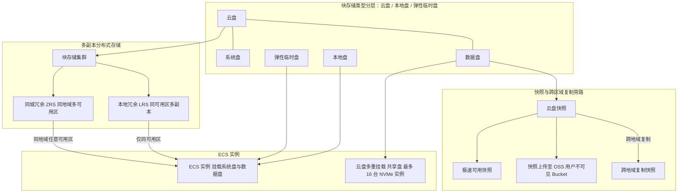

# EBS · 产品架构

> 产品：EBS 云盘 ｜ 口径：公共云 ｜ 复核：2026-11-17

## 产品是什么

块存储是为云服务器 ECS 提供的块设备类型产品，具备高性能、低时延特性，可像使用物理硬盘一样格式化并建立文件系统。

块存储包含三类：

| 类别 | 说明 | 能否单独创建 |
|---|---|---|
| 云盘 | 基于分布式存储架构，为 ECS 实例提供高数据可靠性保证 | 可以 |
| 本地盘 | 数据仅存放在实例所在物理机的本地硬盘，无存储冗余 | 不可以，随实例规格交付 |
| 弹性临时盘 | 用户自定义容量的临时数据存储块设备 | 可以 |

云盘按用途分两类：

| 类型 | 说明 |
|---|---|
| 系统盘 | 实例启动盘，只能随实例创建，生命周期与挂载的 ECS 实例相同 |
| 数据盘 | 存储用户数据/日志，可随实例创建，也可单独创建 |

**来源**

- 块存储概述：https://help.aliyun.com/zh/ecs/user-guide/elastic-block-storage-devices
- 复核：2026-11-16

## 架构图

**来源**
- 块存储概述（三类构成、云盘基于分布式存储架构、同城冗余挂载范围）：https://help.aliyun.com/zh/ecs/user-guide/elastic-block-storage-devices ｜ 复核：2026-11-17
- 块存储性能（本地冗余/同城冗余机制、块存储集群多副本）：https://help.aliyun.com/zh/ecs/user-guide/block-storage-performance ｜ 复核：2026-11-17
- 快照概述（快照存储于 OSS、极速可用免等 100% 上传）：https://help.aliyun.com/zh/ecs/user-guide/snapshot-overview ｜ 复核：2026-11-17
- 复制快照（同地域/跨地域复制）：https://help.aliyun.com/zh/ecs/user-guide/copy-a-snapshot ｜ 复核：2026-11-17
- 云盘多重挂载（最多 16 台 NVMe 实例、仅按量付费数据盘）：https://help.aliyun.com/zh/ecs/user-guide/enable-multi-attach ｜ 复核：2026-11-17

## 组件清单

| 组件 | 作用 | 必选/可选 | 是否独立计费 | 备注 |
|---|---|---|---|---|
| 云盘（系统盘 / 数据盘） | 为 ECS 实例提供块设备存储；系统盘随实例创建，数据盘可单独创建 | 必选（每实例至少 1 块系统盘） | 是（容量费；AutoPL/PL-X 另收预配置性能费） | 本地冗余仅可挂同可用区实例，同城冗余可挂同地域任意可用区实例 |
| 本地盘 | 数据仅存放在实例所在物理机的本地硬盘，无存储冗余 | 可选（随实例规格交付，不支持单独购买） | 否（费用已计入实例规格费用） | 不允许自行挂载新的本地盘、不支持快照 |
| 弹性临时盘 | 用户自定义容量的临时数据存储块设备 | 可选 | 是（按容量，包年包月 / 按量付费） | 不支持创建快照 |
| 快照 | 云盘数据在某个时刻的完整拷贝，存储在 OSS 用户不可见 Bucket | 可选 | 是（按快照类型与容量收存储费） | 首份标准快照全量、后续增量；单块云盘手动/自动各保留 2,000 个 |
| 极速可用快照 | 快照创建后秒级可用，无需等 100% 上传 OSS | 可选（ESSD 系列云盘默认支持） | 否（随标准快照存储计费） | 复制后的快照不支持极速可用 |
| 快照上传（至 OSS） | 快照数据写入 OSS 用户不可见 Bucket，供回滚、创建云盘、共享使用 | 必选（快照机制固有） | 否（快照计费项为存储费与复制流量费） | 云盘数据越多上传耗时越长；极速可用能力免等上传完成即可使用 |
| 复制快照 | 将快照同地域或跨地域复制一份，实现异地数据备份 | 可选 | 是（快照存储费 + 复制流量费） | 复制后的快照 ID 与原快照不同，不能用于回滚云盘 |
| 云盘多重挂载（共享盘） | 单块云盘同时挂载多台 ECS 实例，实现数据共享与故障转移 | 可选（创建云盘时开启） | 否（功能本身不收费，按云盘计费） | 仅按量付费 ESSD / ESSD AutoPL / ESSD 同城冗余数据盘；最多 16 台 NVMe 实例；不支持快照一致性组 |
| 自动快照策略 | 按设定周期自动为云盘创建快照 | 可选 | 否 | 单账号单地域 100 条；单块云盘最多绑定 10 个 |
| ECS 实例 | 云盘、本地盘与弹性临时盘的使用宿主，挂载数量上限由实例规格决定 | 关联产品 | —（ECS 侧计费，见 [ECS](../ecs/README)） | 创建实例时最多 1 块系统盘 + 64 块数据盘 |

**来源**
- 块存储概述（云盘/本地盘/弹性临时盘、系统盘与数据盘、同城冗余挂载范围）：https://help.aliyun.com/zh/ecs/user-guide/elastic-block-storage-devices ｜ 复核：2026-11-17
- 块存储计费（本地盘计入实例规格费用、弹性临时盘按容量计费、云盘计费项）：https://help.aliyun.com/zh/ecs/block-storage-devices ｜ 复核：2026-11-17
- 快照概述（快照存储位置、极速可用、自动快照策略、复制限制）：https://help.aliyun.com/zh/ecs/user-guide/snapshot-overview ｜ 复核：2026-11-17
- 快照计费（计费项为标准/归档快照存储费）：https://help.aliyun.com/zh/ecs/snapshots-1 ｜ 复核：2026-11-17
- 云盘多重挂载功能（按量付费数据盘、最多 16 台、功能本身不收费）：https://help.aliyun.com/zh/ecs/user-guide/enable-multi-attach ｜ 复核：2026-11-17
- ECS 使用限制与配额（挂载点、1 系统盘 + 64 数据盘、快照额度）：https://help.aliyun.com/zh/ecs/limitations ｜ 复核：2026-11-17

## 多副本分布式存储（冗余机制）

云盘提供两种存储冗余类型：

| 冗余 | 机制 | 数据可靠性 | 覆盖云盘 | 单可用区故障 |
|---|---|---|---|---|
| 同城冗余（ZRS） | 同一地域 3 个或以上可用区冗余存储，IDC/机柜/电力物理隔离 | 99.9999999999%（12 个 9） | ESSD 同城冗余云盘 | 读写服务不受影响 |
| 本地冗余（LRS） | 同 1 个可用区内多个设施的多个设备冗余 | 99.9999999%（9 个 9） | ESSD、ESSD AutoPL、ESSD PL-X、ESSD Entry 等 | 该可用区不可用时数据不可访问 |

- LRS 下业务数据以多副本形式分布存储在块存储集群中，保证读写过程中的数据稳定性。
- 同城冗余写入需同步写多个可用区，写时延高于本地冗余云盘；对比 ESSD PL1：同城冗余时延「毫秒级」，PL1 为 0.2 ms（Block Size=4K）。
- 同城冗余云盘可挂载至**同地域任意可用区**的实例；LRS 云盘仅能挂载至**相同可用区**的实例。

数据安全机制（仅适用于云盘，不适用于本地盘和弹性临时盘）：

| 机制 | 要点 |
|---|---|
| 数据擦除 | 底层基于顺序追加写；删除/覆盖写遗留数据从物理磁盘强制永久释放；释放云盘立即销毁元数据，物理空间再分配前必清零 |
| 加密 | 云盘加密采用 AES-256；实例到云盘的数据自动加密、读取自动解密 |
| 快照备份 | 定期手动/自动创建快照，ECS 实例不会自动备份云盘数据 |

**来源**

- 块存储概述（ZRS/LRS/数据安全）：https://help.aliyun.com/zh/ecs/user-guide/elastic-block-storage-devices
- 块存储性能（同城冗余 vs PL1 时延）：https://help.aliyun.com/zh/ecs/user-guide/block-storage-performance
- 复核：2026-11-16

## 挂载与独立生命周期

| 事实 | 数值/规则 |
|---|---|
| 数据盘 | 可单独创建、不挂载时也计费；挂载/卸载独立于实例生命周期 |
| 系统盘 | 只能随实例创建，生命周期与实例相同 |
| 挂载点 | 系统盘 /dev/vda；数据盘 1~25 块 /dev/vd[b-z]，>25 块 /dev/vd[aa-zz] |
| 挂载数量上限 | 由实例规格决定（DescribeInstanceTypes 查询）；创建实例时最多 1 系统盘 + 64 数据盘 |
| 同可用区约束 | 本地冗余云盘仅能挂载到同可用区实例；同城冗余云盘可挂同地域任意可用区实例 |
| 本地盘 | 不允许自行挂载新的本地盘；仅允许变更带宽；数据有单点风险 |

**来源**

- ECS 使用限制与配额（挂载点/数量/本地盘限制）：https://help.aliyun.com/zh/ecs/limitations
- 块存储概述（系统盘/数据盘、同城冗余挂载范围）：https://help.aliyun.com/zh/ecs/user-guide/elastic-block-storage-devices
- 复核：2026-11-16

## 快照与容灾机制

| 机制 | 事实 |
|---|---|
| 快照定义 | 云盘数据在某个时刻的完整拷贝；资源粒度为单个云盘或一组云盘（一致性组） |
| 存储位置 | 快照默认存储在阿里云 OSS（用户不可见 Bucket）；OSS 支持同城冗余的地域默认用同城冗余 Bucket |
| 增量备份 | 首份标准快照为全量，后续均为增量，仅备份新增/修改的数据块 |
| 极速可用 | 快照创建后秒级可用，无需等 100% 上传 OSS；ESSD 系列云盘（含同城冗余）默认支持 |
| 跨地域容灾 | 复制快照可同地域/跨地域复制；同城冗余盘只解决同城，跨地域建议自动快照策略 + 复制快照 |
| 同城 RPO | ESSD 同城冗余云盘通过物理复制实现 RPO=0 |
| 加密继承 | 加密云盘的快照自动继承加密属性，复制到其他地域后仍加密 |

**来源**

- 快照概述：https://help.aliyun.com/zh/ecs/user-guide/snapshot-overview
- 复制快照：https://help.aliyun.com/zh/ecs/user-guide/copy-a-snapshot
- 块存储性能（同城冗余 RPO=0 脚注）：https://help.aliyun.com/zh/ecs/user-guide/block-storage-performance
- 复核：2026-11-16
