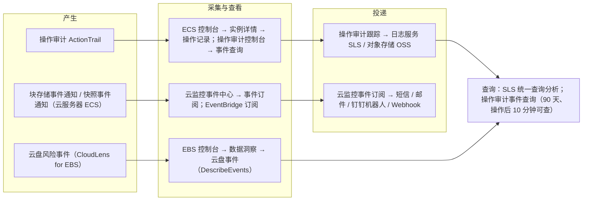

# EBS · 日志与审计

> 产品：EBS 云盘 ｜ 口径：公共云 ｜ 复核：2026-11-18

## 日志流转图

**来源**
- ECS 监控与日志概览（操作审计留痕、配置审计、监控与日志入口）：https://help.aliyun.com/zh/ecs/user-guide/monitoring-and-logging ｜ 复核：2026-11-18
- 什么是操作审计（创建跟踪、投递 SLS/OSS）：https://help.aliyun.com/zh/actiontrail/product-overview/what-is-actiontrail ｜ 复核：2026-11-18

## 日志类型总表

| 类型 | 产生方 | 查看入口 | 默认保留期 | 是否计费 |
|---|---|---|---|---|
| 操作日志·管控事件（云盘、快照、实例等操作） | 操作审计 ActionTrail | ECS 控制台 → 实例详情 → 操作记录 页签；操作审计控制台 → 事件查询 | 90 天（每过去一天清除最早一天） | 操作审计不收取费用；创建跟踪投递 SLS/OSS/MaxCompute 后按目标产品定价单独付费 |
| 块存储事件通知（系统事件 Degraded/SeverelyDegraded/Stalled、挂载/卸载数据盘、云盘保留、欠费释放） | 云服务器 ECS | 云监控控制台 → 事件中心 → 事件订阅；事件总线 EventBridge 订阅 | 📋 待补（控制台口径：官方未标注事件通知保留期） | 事件通知本身不单独计费：云监控侧仅按通知渠道计费（短信 0.045 元/条、电话 0.15 元/个，含免费额度），EventBridge 侧云服务专用总线与阿里云目标免费（2026-11-18 复核） |
| 快照事件通知（快照创建成功 / 失败） | 云服务器 ECS 快照 | 云监控事件订阅；EventBridge 订阅 | 📋 待补（控制台口径：官方未标注事件通知保留期） | 事件通知本身不单独计费：云监控侧仅按通知渠道计费（短信 0.045 元/条、电话 0.15 元/个，含免费额度），EventBridge 侧云服务专用总线与阿里云目标免费（2026-11-18 复核） |
| 云盘风险事件（数据保护、IO Hang、IOPS/BPS 达上限、慢 IO、突发 IO 等） | 块存储数据洞察 CloudLens for EBS | EBS 控制台 → 数据洞察（EBS Lens）→ 云盘事件；API DescribeEvents | 📋 待补（控制台口径：官方未标注事件保留期） | 否（CloudLens for EBS 相关功能免费） |
| 监控数据（云盘分钟级 IOPS/吞吐/时延、秒级性能、使用率与 inode 使用率） | 云服务器 ECS / 云监控 / CloudLens for EBS | ECS 控制台 → 块存储 → 云盘 → 监控；云监控 → 主机监控 → 云盘；EBS 控制台 → 数据洞察 → 云盘分析 | 按云监控 Period 存储：Period=60 秒存 31 天，≥300 秒存 91 天 | 基础云监控免费；CloudLens for EBS 免费 |
| 配置审计（资源配置变更历史） | 配置审计 Cloud Config | 配置审计控制台（ECS 已接入，默认每 10 分钟记录资源配置变更） | 📋 待补（控制台口径：官方未标注保留期） | 官方口径「免费试用」；投递到 SLS 后按 SLS 定价计费 |

- 官方文档为 EBS 提供的日志类目为操作审计事件、事件通知、风险事件与监控数据，未见类似 OSS 访问日志的类目。
- 块存储只有异常类系统事件，没有维护类系统事件；事件发生与结束时均可发出通知。

**来源**
- ECS 实例操作记录（90 天、由操作审计提供）：https://help.aliyun.com/zh/ecs/user-guide/check-the-ecs-instance-operating-records ｜ 复核：2026-11-17
- 操作审计使用限制（默认 90 天、单账号跟踪每地域 5 个、操作后 10 分钟可查）：https://help.aliyun.com/zh/actiontrail/product-overview/limits ｜ 复核：2026-11-17
- 操作审计计费说明（操作审计不收费、投递按目标产品付费）：https://help.aliyun.com/zh/actiontrail/product-overview/billing-1 ｜ 复核：2026-11-17
- 块存储事件通知（事件类型与通知名称）：https://help.aliyun.com/zh/ecs/user-guide/ebs-event-notifications ｜ 复核：2026-11-17
- 快照事件通知（创建快照成功/失败事件）：https://help.aliyun.com/zh/ecs/user-guide/snapshot-event-notifications ｜ 复核：2026-11-17
- 基础云监控按量计费（仅短信/电话/查询 API/智能阈值四项收费）：https://help.aliyun.com/zh/cms/cloudmonitor-1-0/product-overview/pay-as-you-go-1 ｜ 复核：2026-11-18
- 事件总线计费说明（云服务专用总线与阿里云目标免费）：https://help.aliyun.com/zh/eventbridge/product-overview/billing-of-event-buses ｜ 复核：2026-11-18
- 什么是块存储数据洞察（风险事件、免费口径）：https://help.aliyun.com/zh/ecs/user-guide/what-is-a-piece-of-data-is-stored-insight ｜ 复核：2026-11-17
- ECS 监控与日志概览（基础云监控免费、配置审计每 10 分钟记录、免费试用）：https://help.aliyun.com/zh/ecs/user-guide/monitoring-and-logging ｜ 复核：2026-11-17
- 云监控使用限制（Period 与监控数据存储时长）：https://help.aliyun.com/zh/cms/cloudmonitor-1-0/product-overview/restrictions-on-use ｜ 复核：2026-11-17
- 查看云盘监控信息（云盘监控入口）：https://help.aliyun.com/zh/ecs/user-guide/view-the-monitoring-data-of-a-disk ｜ 复核：2026-11-17

## 关键日志详表

**A. 块存储事件通知（JSON 消息体）**

| 字段 | 示例 / 取值 | 含义 |
|---|---|---|
| `name` | `Disk:Stalled:Executing` | 事件通知名称，格式 `<资源类型>:<事件类型>:<状态>` |
| `level` | `CRITICAL` / `INFO` / `WARN` | 事件等级 |
| `eventTime` | `20190410T080101.922+0800` | 事件发生时间 |
| `content.diskId` | `d-t4ndyqve********n4ds` | 受影响的云盘 ID |
| `content.device` | `/dev/xvdb` | 云盘在实例上的挂载点 |
| `content.eventType` | `Degraded` / `SeverelyDegraded` / `Stalled` | 块存储系统事件类型（性能降级程度） |
| `content.operation` + `content.result` | `AttachDisk` + `accomplished` | 挂载/卸载操作与结果（`accomplished` / `failed`） |
| `content.executeStartTime` / `content.executeFinishTime` | `2019-04-10T01:01:01Z` | 系统事件执行开始 / 结束时间（UTC+0） |

- 挂载/卸载成功时 `level` 为 `INFO`，失败时为 `WARN`；本地盘受损事件通知名称为 `Disk:ErrorDetected:Executing` / `Disk:ErrorDetected:Executed`。

**B. 快照事件通知（`Snapshot:CreateSnapshotCompleted`）**

| 字段 | 示例 / 取值 | 含义 |
|---|---|---|
| `name` | `Snapshot:CreateSnapshotCompleted` | 快照创建完成事件（快照支持设置的唯一事件通知） |
| `level` | `INFO` | 事件等级（官方示例值） |
| `content.result` | `accomplished` / `failed` | 创建结果：完成 / 失败 |
| `content.snapshotId` / `content.snapshotName` | `s-bp1fis********b859b3` / `test-snapshot` | 快照 ID 与名称 |
| `content.snapshotType` | `user` / `timer` / `copied` / `imported` | 手动创建 / 定时创建 / 复制新增 / 导入镜像后自动创建 |
| `content.diskId` | `d-bp1bwa********9ol4mi` | 源云盘 ID |
| `content.startTime` / `content.endTime` | `2019-04-22T08:36:09Z` | 快照创建开始 / 完成时间（UTC+0） |

**C. 云盘风险事件（CloudLens for EBS，API DescribeEvents）**

| 字段 | 取值 / 含义 |
|---|---|
| `EventName` | 事件名称（如数据保护、云盘有 IO Hang 发生、云盘 IOPS 达到云盘上限） |
| `ResourceId` | 事件关联的资源 ID，即云盘 ID |
| `EventType` | `Notification`（触发后即刻自动恢复）/ `Alert`（需手动恢复）/ `System Exception`（底层触发） |
| `EventLevel` | `Critical`（严重）/ `Warn`（警告）/ `Info`（通知） |
| `EventStatus` | 正在发生 / 已恢复 |
| `StartTime` / `EndTime` | 事件开始 / 结束时间 |
| `RecommendAction` | 推荐操作：`ModifyDiskSpec` 变配 / `CreateSnapshot` 创建快照 / `ResizeDisk` 扩容 / `AdjustProvision` 调节预配置 / `ModifyInstanceSpec` 实例变配 |

**D. 审计管控事件（ActionTrail，云盘与快照操作留痕）**

| 字段 | 含义 |
|---|---|
| `eventTime` | 事件发生时间（UTC） |
| `eventName` | 事件名称，即 API 名，如 `CreateDisk`、`AttachDisk`、`ResizeDisk`、`CreateSnapshot`、`CopySnapshot`、`DeleteSnapshot` |
| `eventType` | 事件类型，如 `ApiCall`（API 调用） |
| `eventSource` | 事件来源，如 `ecs-cn-hangzhou-share.aliyuncs.com` |
| `sourceIpAddress` | 发起操作的源 IP 地址 |
| `userIdentity` | 请求者身份（`type` 含 `root-account` / `ram-user` / `assumed-role` 等） |
| `referencedResources` | 关联资源，如 `ACS::ECS::Instance` 对应实例 ID 列表 |
| `requestParameters` | 请求参数（`InstanceId`、`DiskId` 等） |

- 云服务器 ECS 审计事件清单覆盖云盘与快照操作，如 `CreateDisk`（创建按量付费或包年包月数据盘）、`AttachDisk`（挂载按量付费数据盘）、`DeleteSnapshot`（删除指定的快照）、`CopySnapshot`（将标准快照从一个地域复制到另一个地域）、`ApplyAutoSnapshotPolicy`（为云盘应用自动快照策略）等。

**来源**
- 块存储事件通知（JSON 结构与 content 字段解释、事件通知名称）：https://help.aliyun.com/zh/ecs/user-guide/ebs-event-notifications ｜ 复核：2026-11-17
- 快照事件通知（字段与 snapshotType 取值）：https://help.aliyun.com/zh/ecs/user-guide/snapshot-event-notifications ｜ 复核：2026-11-17
- 云盘事件说明（事件属性与推荐操作）：https://help.aliyun.com/zh/ecs/user-guide/risk-events-overview ｜ 复核：2026-11-17
- 查询云盘风险事件 DescribeEvents：https://help.aliyun.com/zh/ecs/developer-reference/api-ebs-2021-07-30-describeevents ｜ 复核：2026-11-17
- 操作审计-ECS 事件示例（JSON 字段与 StopInstance 示例）：https://help.aliyun.com/zh/actiontrail/user-guide/ecs ｜ 复核：2026-11-17
- 云服务器 ECS 审计事件（云盘/快照事件名与含义）：https://help.aliyun.com/zh/actiontrail/product-overview/audit-events-of-ecs ｜ 复核：2026-11-17

## 投递与加工

| 通道 | 去向与参数 | 关键限制 / 额度 | 计费要点 |
|---|---|---|---|
| 操作审计跟踪 | 创建单账号/多账号跟踪，将事件持续投递到日志服务 SLS 或对象存储 OSS（单纯归档存储诉求推荐 OSS） | 单账号跟踪每个地域最多 5 个；1 个跟踪允许配置 1 个 OSS Bucket；操作后 10 分钟内可查到事件；删除跟踪后自动创建的 Logstore 不会自动删除 | 操作审计本身不收费；投递到 SLS/OSS/MaxCompute 按各自定价单独付费（SLS 侧含存储费、写入流量费） |
| 云监控事件订阅 | 云监控控制台 → 事件中心 → 事件订阅策略，选择云服务器 ECS 的系统事件，通过短信、邮件、钉钉机器人、Webhook 推送；也可分发到消息队列、日志服务、函数计算 | 事件时延要求高或事件量大时，官方建议改用事件总线 EventBridge 订阅 | 官方未标注事件通知本身计费（标记见日志类型总表）；分发目标按各自产品定价 |
| EventBridge 订阅块存储风险事件 | 部分云盘风险事件类型已接入事件总线 EventBridge 官方事件源，可主动订阅，或对事件进行过滤和转换后推送函数计算、消息队列等 | 与云监控事件订阅二选一，按事件量与时延需求选择 | —（EventBridge 计费见事件总线产品页） |
| CloudLens 应用管理（周期报告） | 按资源筛选 Tag 将云盘/快照监控数据生成报告，以邮件或站内信发送 | 默认 `default` 应用覆盖账号下全部云盘；除 `default` 外最多添加 5 个应用；生成周期可选每周 / 每双周 / 每月 | CloudLens for EBS 免费 |
| 配置审计投递 SLS | 将资源配置变更历史与不合规事件数据投递到日志服务 SLS 的指定日志库，统一查询分析 | 由配置审计控制台配置投递 | 配置审计免费试用；投递后按 SLS 定价计费 |
| 秒级监控数据采集 | CloudLens for EBS 实时采集并存储云盘性能秒级监控数据；亦可通过日志服务自行采集业务高频关注的存储资源数据 | 秒级监控数据有 1~5 分钟延迟；不支持监控开启多重挂载的云盘 | CloudLens for EBS 免费；自行采集按 SLS 定价 |

**来源**
- 什么是操作审计（创建单账号/多账号跟踪、投递 OSS/SLS、归档推荐 OSS）：https://help.aliyun.com/zh/actiontrail/product-overview/what-is-actiontrail ｜ 复核：2026-11-17
- 操作审计使用限制（每地域 5 个跟踪、1 个跟踪 1 个 Bucket、10 分钟可查）：https://help.aliyun.com/zh/actiontrail/product-overview/limits ｜ 复核：2026-11-17
- 操作审计计费说明（投递 SLS/OSS/MaxCompute 单独付费、SLS 计费项、删除跟踪后的残留费用）：https://help.aliyun.com/zh/actiontrail/product-overview/billing-1 ｜ 复核：2026-11-17
- 云监控订阅 ECS 系统事件（短信/邮件/钉钉/Webhook、分发消息队列/SLS/函数计算、事件量大建议 EventBridge）：https://help.aliyun.com/zh/ecs/user-guide/configure-event-notifications ｜ 复核：2026-11-17
- 查看并处理云盘事件（DescribeEvents、EventBridge 官方事件源）：https://help.aliyun.com/zh/ecs/user-guide/view-and-handle-risk-events ｜ 复核：2026-11-17
- CloudLens for EBS 应用管理（default + 最多 5 个应用、邮件/站内信、每周/双周/每月）：https://help.aliyun.com/zh/ecs/user-guide/ebs-application-management ｜ 复核：2026-11-17
- ECS 监控与日志概览（配置审计投递 SLS）：https://help.aliyun.com/zh/ecs/user-guide/monitoring-and-logging ｜ 复核：2026-11-17
- 什么是块存储数据洞察（自动化采集、免费、可自行通过日志服务采集）：https://help.aliyun.com/zh/ecs/user-guide/what-is-a-piece-of-data-is-stored-insight ｜ 复核：2026-11-17
- 云盘分析（秒级监控数据 1~5 分钟延迟）：https://help.aliyun.com/zh/ecs/user-guide/cloud-disk-analysis ｜ 复核：2026-11-17

## 审计与合规

| 项 | 官方口径 |
|---|---|
| 接入方式 | 云服务器 ECS 已接入操作审计（ActionTrail），记录通过阿里云控制台、OpenAPI、开发者工具访问和使用云上产品的日志数据 |
| 云盘/快照留痕范围 | 云服务器 ECS 审计事件清单覆盖云盘与快照的管控操作，如 `CreateDisk`、`DeleteDisk`、`AttachDisk`、`DetachDisk`、`ResizeDisk`、`ModifyDiskSpec`、`ReInitDisk`、`CreateSnapshot`、`DeleteSnapshot`、`CopySnapshot`、`CreateAutoSnapshotPolicy`、`ApplyAutoSnapshotPolicy` 等 |
| 默认保留期 | 操作审计默认为每个阿里云账号记录最近 90 天的操作事件；不创建跟踪则无法追溯 90 天以前的事件 |
| 查询时延与限流 | 用户操作后 10 分钟内可通过控制台或 API 查询事件；单账号跟踪的历史事件经控制台或 LookupEvents 查询每秒最多 2 次 |
| 长期保存 | 超过 90 天需创建单账号/多账号跟踪，将事件持续投递到 SLS 或 OSS；等保 2.0 等合规标准要求日志保存不少于规定天数 |
| 事件告警 | 支持事件告警：模板预置账号连续登录失败、Root 账号连续登录、未授权 IP 登录、非工作时间登录等规则，也支持自定义字段与告警条件 |
| Insights 智能分析 | 基于数学模型发现异常调用，可识别风险 API 调用、API 错误、IP 请求、AccessKey 调用、权限变更、密码变更、隐匿行踪等事件 |
| 配置审计 | ECS 已接入配置审计（Cloud Config），默认每隔 10 分钟记录资源配置变更，提供配置历史追踪、配置合规审计与等保 2.0 云上预检（免费试用口径） |
| 运维支持场景 | 操作审计事件数据默认用于工单排查等运维支持场景，阿里云运维人员可能获取事件详情 |

**来源**
- ActionTrail 操作审计最佳实践（90 天、事件告警模板与自定义规则、Insights、等保 2.0）：https://help.aliyun.com/zh/ecs/user-guide/audit-cloud-operations-with-actiontrail ｜ 复核：2026-11-17
- 云服务器 ECS 审计事件（云盘/快照事件名与含义清单）：https://help.aliyun.com/zh/actiontrail/product-overview/audit-events-of-ecs ｜ 复核：2026-11-17
- 操作审计使用限制（90 天、10 分钟、LookupEvents 每秒 2 次）：https://help.aliyun.com/zh/actiontrail/product-overview/limits ｜ 复核：2026-11-17
- 什么是操作审计（留痕范围、90 天、创建跟踪长期保存）：https://help.aliyun.com/zh/actiontrail/product-overview/what-is-actiontrail ｜ 复核：2026-11-17
- ECS 监控与日志概览（配置审计每 10 分钟记录、等保 2.0 预检、操作审计留痕）：https://help.aliyun.com/zh/ecs/user-guide/monitoring-and-logging ｜ 复核：2026-11-17
- 运维支持场景使用审计事件说明：https://help.aliyun.com/zh/actiontrail/product-overview/operation-and-maintenance-support-scenarios-using-operation-audit-events ｜ 复核：2026-11-17
