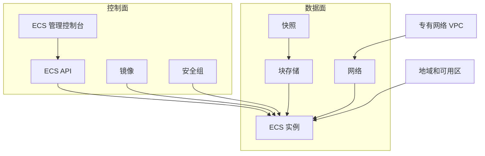
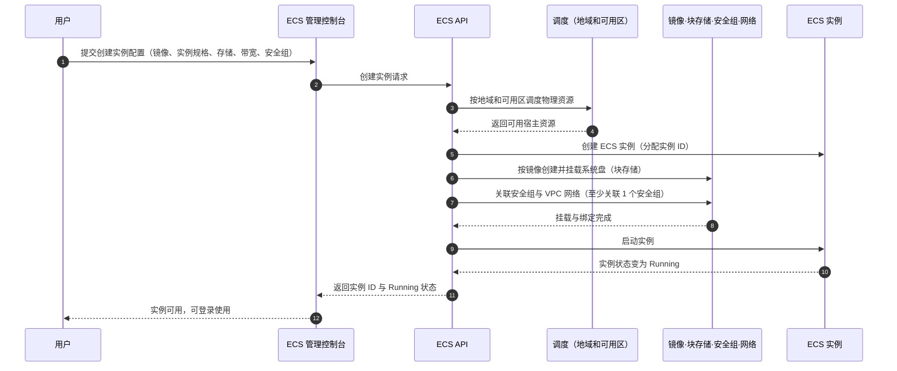

# ECS · 产品架构

> 产品：云服务器 ECS ｜ 口径：公共云 ｜ 复核：2026-11-18

## 架构图

**来源**
- 什么是云服务器ECS（产品架构：实例、镜像、块存储、快照、安全组、网络；部署建议：地域和可用区、专有网络 VPC）：https://help.aliyun.com/zh/ecs/user-guide/what-is-ecs ｜ 复核：2026-11-17

## 关键链路

实例从创建到可用的全流程（自定义购买主链路）：

**来源**
- 创建实例（创建方式：快速购买、自定义购买等；自定义购买可选付费类型、镜像、实例规格、存储、带宽、安全组）：https://help.aliyun.com/zh/ecs/user-guide/create-instances/ ｜ 复核：2026-11-18
- 安全组概述（创建实例需指定安全组、至少关联 1 个、未指定时关联默认安全组）：https://help.aliyun.com/zh/ecs/user-guide/overview-44 ｜ 复核：2026-11-18
- 地域和可用区（实例创建后不可更换地域、可用区之间内网互通）：https://help.aliyun.com/zh/ecs/user-guide/regions-and-zones ｜ 复核：2026-11-18

## 组件清单

| 组件 | 作用 | 必选/可选 | 是否独立计费 | 备注 |
|---|---|---|---|---|
| ECS 实例 | 提供 vCPU、内存等计算能力的虚拟服务器 | 必选 | 是（计算资源 vCPU+内存） | 选型见 [02-实例规格族](02-实例规格族.md) |
| 镜像 | 创建实例时提供运行环境的模板 | 必选 | 是（官方计费资源清单含镜像） | 镜像族系见 [07-计费与生命周期](07-计费与生命周期.md) |
| 块存储（云盘） | 实例的系统盘与数据盘 | 必选（系统盘）／可选（数据盘） | 是 | 强关联产品：[云盘](../ebs/)；参数见 [04-块存储参数](04-块存储参数.md) |
| 快照 | 云盘的时间点备份 | 可选 | 是 | 强关联产品：[快照](../ebs/04-快照参数.md) |
| 安全组 | 控制 ECS 实例出入站流量的虚拟防火墙 | 必选（至少关联 1 个，未指定时关联默认安全组） | 否（普通/企业级安全组均免费） | 规则见 [05-网络参数](05-网络参数.md) |
| 网络 | 实例的内网/公网带宽、弹性网卡与 IP | 必选（内网）／可选（公网） | 公网带宽计费 | 见 [05-网络参数](05-网络参数.md) |
| 专有网络 VPC | 承载实例网络、可自行规划私网 IP 的私有网络 | 必选（VPC 类型实例；官方 API 文档注明「经典网络已下线」，2026-11-18 复核） | 否（ECS 计费资源清单不含 VPC） | 阿里云官方推荐使用 VPC；强关联产品：[VPC](../vpc/) |
| DDoS 基础防护 | 默认开启的免费 DDoS 防护能力 | 默认开启 | 否（免费，不超过 5 Gbps） | 更高防护需购买 DDoS 高防 |
| 基础安全服务 | 异常登录检测、漏洞扫描、基线配置核查 | 默认提供 | 否（免费） | 升级版为云安全中心付费版本 |

**来源**
- 什么是云服务器ECS（组件、计费资源、安全组免费、DDoS 基础防护 5 Gbps、基础安全服务免费、推荐 VPC）：https://help.aliyun.com/zh/ecs/user-guide/what-is-ecs ｜ 复核：2026-11-17
- 安全组概述（创建实例需指定安全组、至少关联 1 个、默认安全组、两类安全组均免费）：https://help.aliyun.com/zh/ecs/user-guide/overview-44 ｜ 复核：2026-11-17
- DescribeInstances（API 文档注明经典网络已下线，佐证 VPC 必选）：https://help.aliyun.com/zh/ecs/developer-reference/api-ecs-2014-05-26-describeinstances ｜ 复核：2026-11-18

## 产品组件

实例、镜像、块存储、快照、安全组、网络。计费资源 = 计算资源（vCPU+内存）、镜像、块存储、公网带宽、快照。

官方可靠性基线：

| 指标 | 数值 |
|---|---|
| 单实例可用性 | 99.975% |
| 多可用区多实例可用性 | 99.995% |
| 云盘数据可靠性（多副本） | 99.9999999%（11 个 9） |
| 免费 DDoS 基础防护 | 默认开启，不超过 5 Gbps |

**来源**
- 什么是云服务器ECS（组件、计费资源、可靠性基线、DDoS 5 Gbps）：https://help.aliyun.com/zh/ecs/user-guide/what-is-ecs ｜ 复核：2026-11-16

## 虚拟化底座（按代际）

| 体系 | 官方表述要点 | 典型规格族 |
|---|---|---|
| 第三代神龙架构 | 大量虚拟化功能卸载到专用硬件，存储/网络性能与计算稳定性数量级提升 | 6/7 代企业级（g6/g7/c7/r7…） |
| 第四代神龙架构 | 同上，性能进一步提升 | 8 代倚天（g8y/c8y/r8y） |
| CIPU 架构 | 稳定算力输出 + 更强 I/O 引擎 + 芯片级安全加固 | 8/9 代 Intel/AMD（g8i/g8a/g9i…） |
| 虚拟化 2.0（裸金属） | 应用直接访问处理器/内存，零虚拟化开销，保留物理机特性（VT-x） | ebm 系列 |

衍生形态：SCC = 裸金属 + RDMA 互联；hpc 规格族只给物理核、无超线程。

**来源**
- 在售的实例规格族（第三代/第四代神龙、CIPU 表述）：https://help.aliyun.com/zh/ecs/user-guide/overview-of-instance-families ｜ 复核：2026-11-16
- 实例规格分类与命名（虚拟化 2.0、SCC、hpc）：https://help.aliyun.com/zh/ecs/user-guide/instance-specification-naming-and-classification/ ｜ 复核：2026-11-16

## 资源模型：地域与可用区

- 地域 = 地理区域，实例创建后**不可更换地域**；与 RDS 等内网互通产品必须同地域
- 可用区 = 同地域内电力/网络互相独立的物理区域；可用区之间内网互通 + 故障隔离
- 选型原则：高容灾 → 同地域跨可用区；低时延 → 同可用区

**来源**
- 地域和可用区：https://help.aliyun.com/zh/ecs/user-guide/regions-and-zones ｜ 复核：2026-11-16

## 部署集（物理拓扑放置策略）

| 策略 | 逻辑 | 关键参数 |
|---|---|---|
| 高可用策略 | 实例分散在不同物理机/机架/交换机 | 部署类型 host/rack/switch，亲和度 1~10；单可用区最多 20 台 |
| 部署集组高可用 | 单可用区分组隔离 | 最多 7 组 × 20 台/组 |
| 网络低时延 | 集中到同一网络拓扑 | 必须同可用区，最多 20 台 |

限制：大部分 6 代及以上实例支持；不支持 DDH；使用本身免费。粒度越细容灾越强，但物理资源不足时创建失败。

**来源**
- 部署集：https://help.aliyun.com/zh/ecs/user-guide/overview-43 ｜ 复核：2026-11-16

## 安全多样化

- vTPM 可信计算（TPM/TCM 启动链度量）：g7/g8i/g8a/g8y/g9 系支持
- 机密计算路线：Intel SGX（加密内存）、Intel TDX（g8i）、神龙 Enclave（实例内隔离可信空间，仅 vsock 通信，4 vCPU 以上 g8i/g7）、海光 CSV（g7h）；官方机密计算文档未收录 AMD SEV（2026-11-18 复核机密计算能力目录：SGX/TDX/CSV/异构/Enclave）
- 内网巨型帧：8500 字节

**来源**
- 机密计算解决方案：https://help.aliyun.com/zh/ecs/user-guide/confidential-computing-solutions ｜ 复核：2026-11-16
- 机密计算能力（目录仅 SGX/TDX/CSV/异构/Enclave，无 AMD SEV）：https://help.aliyun.com/zh/ecs/user-guide/confidential-computing-capabilities ｜ 复核：2026-11-18
- 实例规格分类与命名（vTPM、巨型帧 8500 字节）：https://help.aliyun.com/zh/ecs/user-guide/instance-specification-naming-and-classification/ ｜ 复核：2026-11-16

## 指标口径常识

- PPS = 出 + 入方向之和
- 网络突发带宽：用闲置资源让利，**不承诺 SLA**；全双工带宽 7 代起支持
- 云盘基础 IOPS/带宽有 SLA；突发值无 SLA
- X86 每 vCPU = 1 超线程；ARM 每 vCPU = 1 物理核（独享）

**来源**
- 实例规格分类与命名（指标说明：PPS、突发带宽、云盘 IOPS/带宽 SLA、vCPU 口径）：https://help.aliyun.com/zh/ecs/user-guide/instance-specification-naming-and-classification/ ｜ 复核：2026-11-16
