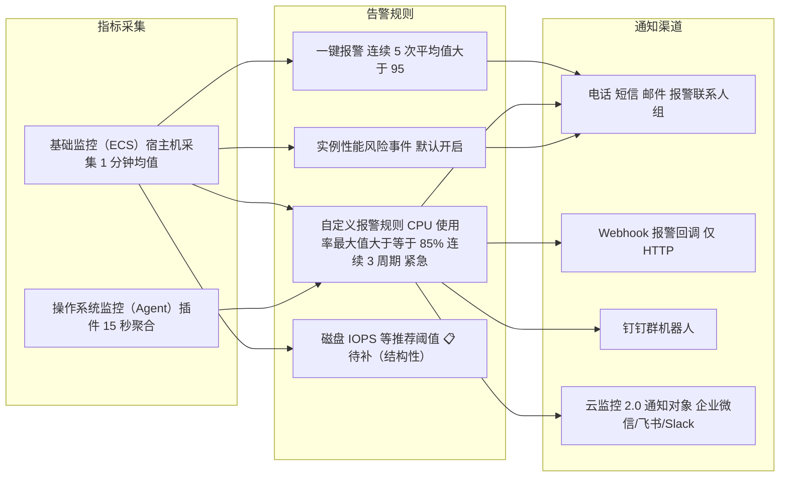

# ECS · 监控与告警

> 产品：ECS ｜ 口径：公共云 ｜ 复核：2026-11-18

## 告警链路图

**来源**
- 查看ECS实例的监控信息（基础监控指标与采集粒度 1 分钟）：https://help.aliyun.com/zh/ecs/user-guide/view-the-monitoring-information-of-an-ecs-instance ｜ 复核：2026-11-18
- 设置ECS实例报警规则（一键报警、自定义阈值示例、通道沉默周期与生效时间、报警回调仅 HTTP）：https://help.aliyun.com/zh/ecs/user-guide/configure-alerts-for-an-ecs-instance ｜ 复核：2026-11-18
- 创建报警规则（ECS CPU 85%/3 周期紧急示例、智能阈值前提）：https://help.aliyun.com/zh/cms/cloudmonitor-1-0/user-guide/create-an-alert-rule ｜ 复核：2026-11-18
- 创建报警联系人或报警联系人组（电话/短信/邮件、紧急级别自动电话）：https://help.aliyun.com/knowledge_detail/104004.html ｜ 复核：2026-11-18

## 核心监控指标

- 基础监控由宿主机（虚拟化平台）采集，采集粒度 1 分钟，仅输出均值；操作系统监控由云监控插件采集，每秒采样、每 15 秒聚合一个数据点，输出最小值/平均值/最大值。
- 基础监控指标以「（ECS）」开头，无需插件；操作系统监控指标以「（Agent）」开头，需安装云监控插件。

| 指标名（MetricName） | 含义 | 单位 | 统计周期 | 维度（Dimensions） |
|---|---|---|---|---|
| CPUUtilization | （ECS）CPU 使用率 | % | 1 分钟 | userId、instanceId |
| IntranetInRate | （ECS）内网流入带宽（私网入流量平均速率） | bit/s | 1 分钟 | userId、instanceId |
| IntranetOutRate | （ECS）内网流出带宽（私网出流量平均速率） | bit/s | 1 分钟 | userId、instanceId |
| InternetInRate | （ECS）经典网络公网流入带宽 | bit/s | 1 分钟 | userId、instanceId |
| InternetOutRate | （ECS）经典网络公网流出带宽 | bit/s | 1 分钟 | userId、instanceId |
| VPC_PublicIP_InternetInRate | （ECS）IP 维度公网流入带宽 | bit/s | 1 分钟 | userId、instanceId、ip |
| VPC_PublicIP_InternetOutRate | （ECS）IP 维度公网流出带宽 | bit/s | 1 分钟 | userId、instanceId、ip |
| VPC_PublicIP_InternetOutRate_Percent | （ECS）IP 维度公网流出带宽使用率 | % | 1 分钟 | userId、instanceId、ip |
| DiskReadBPS | （ECS）所有磁盘读取 BPS | Byte/s | 1 分钟 | userId、instanceId |
| DiskWriteBPS | （ECS）所有磁盘写入 BPS | Byte/s | 1 分钟 | userId、instanceId |
| DiskReadIOPS | （ECS）所有磁盘每秒读取次数（读 IOPS） | 次/秒 | 1 分钟 | userId、instanceId |
| DiskWriteIOPS | （ECS）所有磁盘每秒写入次数（写 IOPS） | 次/秒 | 1 分钟 | userId、instanceId |
| cpu_total | （Agent）当前消耗的总 CPU 百分比 | % | 15 秒 | userId、instanceId |
| memory_usedutilization | （Agent）内存使用率 | % | 15 秒 | userId、instanceId |
| load_5m | （Agent）过去 5 分钟的系统平均负载（仅 Linux） | 无 | 15 秒 | userId、instanceId |

**来源**
- 查看ECS实例的监控信息（基础监控指标表：名称/含义/单位/MetricName/Dimensions/Statistics、采集粒度 1 分钟）：https://help.aliyun.com/zh/ecs/user-guide/view-the-monitoring-information-of-an-ecs-instance ｜ 复核：2026-11-17
- 基础监控和操作系统监控说明（两类监控采集方式、cpu_total/memory_usedutilization/load_5m、15 秒聚合）：https://help.aliyun.com/zh/cms/cloudmonitor-1-0/user-guide/overview-of-basic-and-operating-system-monitoring ｜ 复核：2026-11-17

## 官方默认与推荐告警

| 指标/对象 | 阈值与触发条件 | 等级 | 性质 | 来源 |
|---|---|---|---|---|
| CPU 使用率、磁盘使用率、内存使用率、网络带宽使用率（一键报警，对账号下全部 ECS 实例生效） | 连续 5 次平均值大于 95 | 官方未标注等级 | 官方默认（一键报警开启后自动创建） | https://help.aliyun.com/zh/ecs/user-guide/configure-alerts-for-an-ecs-instance ｜ 复核：2026-11-17 |
| （ECS）CPU 使用率（全部实例，1 周期=1 分钟） | 最大值大于等于 85%，连续 3 个周期 | 紧急 | 官方文档示例（创建报警规则） | https://help.aliyun.com/zh/cms/cloudmonitor-1-0/user-guide/create-an-alert-rule ｜ 复核：2026-11-17 |
| CPU 使用率（自定义规则说明示例，5 分钟粒度） | 5 分钟平均值大于等于 90%，持续 3 个周期 | 官方未标注等级 | 官方文档示例（ECS 自定义报警规则说明） | https://help.aliyun.com/zh/ecs/user-guide/configure-alerts-for-an-ecs-instance ｜ 复核：2026-11-17 |
| 实例性能风险事件（CPU/存储性能触达所购规格上限） | 无需配置，默认开启；实例运行指标触达购买的实例规格上限时触发 | 官方未标注等级 | 官方默认事件告警 | https://help.aliyun.com/zh/ecs/user-guide/status-and-alerts ｜ 复核：2026-11-17 |
| 磁盘 IOPS、内网带宽绝对值、其余 Agent 指标 | 官方未发布推荐阈值 📋 待补（结构性） | — | — | — |

- 一键报警的规则可在「规则详情」下禁用或删除；智能阈值报警规则对 CPU 类、流量类等指标推荐使用，需开通按量计费或试用智能阈值。

**来源**
- 设置ECS实例报警规则（一键报警覆盖指标、连续 5 次平均值大于 95、自定义规则示例 90%、通道沉默周期与生效时间定义）：https://help.aliyun.com/zh/ecs/user-guide/configure-alerts-for-an-ecs-instance ｜ 复核：2026-11-17
- 创建报警规则（ECS CPU 85%/3 周期紧急示例、基础监控与 Agent 指标采集周期、智能阈值前提）：https://help.aliyun.com/zh/cms/cloudmonitor-1-0/user-guide/create-an-alert-rule ｜ 复核：2026-11-17
- 状态和报警（性能风险事件默认开启、云监控报警列表）：https://help.aliyun.com/zh/ecs/user-guide/status-and-alerts ｜ 复核：2026-11-17

## 通知与渠道

| 渠道/机制 | 说明 |
|---|---|
| 电话、短信、邮件 | 报警联系人配置；需在 24 小时内通过激活链接完成验证，否则收不到通知 |
| 电话告警 | 云监控默认集成的通知方式；报警级别为紧急（Critical）且联系人组含有效手机号时，自动通过电话、短信、邮件及 Webhook 同步发送 |
| Webhook（报警回调） | 填写公网可访问 URL，云监控以 POST 推送报警信息，目前仅支持 HTTP 协议 |
| 钉钉群机器人 | 将钉钉机器人 Webhook 地址加入报警联系人组，报警/事件通知推送到钉钉群 |
| 云监控 2.0 通知对象 | 联系人（电话/短信/邮件）、钉钉、企业微信、飞书、Slack、自定义 Webhook；行动集成支持日志服务、消息队列、函数计算、pagerDuty 等 |
| 通道沉默周期（静默） | 报警发生后未恢复时，间隔多久重复发送通知；云监控 2.0 取值 1、5、10、15、30、50 分钟与 1、3、6、12、24 小时 |
| 生效时间 | 报警规则仅在生效时段内检查并通知；不指定则全天生效 |
| 告警升级 | 基础云监控（1.0）阈值报警未见官方升级策略说明 📋 待补（结构性）；重复/升级/恢复策略见 Prometheus 告警配置 |

**来源**
- 创建报警联系人或报警联系人组（电话/短信/邮件、电话默认集成、紧急级别同步通知、24 小时激活）：https://help.aliyun.com/knowledge_detail/104004.html ｜ 复核：2026-11-17
- 通过钉钉群接收报警通知（钉钉机器人 Webhook 接收报警）：https://help.aliyun.com/document_detail/52872.html ｜ 复核：2026-11-17
- 云监控 2.0 告警规则（通知对象类型、通道沉默周期取值、行动集成）：https://help.aliyun.com/zh/cms/cloudmonitor-2-0/alert-rules ｜ 复核：2026-11-17
- 云监控 2.0 通知对象（联系人电话/短信/邮件验证要求）：https://help.aliyun.com/zh/cms/cloudmonitor-2-0/contact ｜ 复核：2026-11-17
- Prometheus 告警配置（重复/升级/恢复策略）：https://help.aliyun.com/zh/cms/cloudmonitor-1-0/user-guide/configure-managed-service-for-prometheus-alerts ｜ 复核：2026-11-17
- 设置ECS实例报警规则（报警回调仅 HTTP、通道沉默周期定义、生效时间）：https://help.aliyun.com/zh/ecs/user-guide/configure-alerts-for-an-ecs-instance ｜ 复核：2026-11-17

## 告警配额

| 配额项 | 限制 | 适用范围 |
|---|---|---|
| 报警规则数（可新建） | 10000 条/账号 | 基础云监控 |
| 动态规则数 | 1200 个/账号 | 基础云监控 |
| 应用分组数 | 20000 个/账号 | 基础云监控 |
| 应用分组内每种资源数 | 3000 个 | 基础云监控 |
| 可用性监控数 | 500 个/应用分组 | 基础云监控 |
| 非阿里云主机数 | 15000 个/账号 | 基础云监控（主机监控） |
| PromQL 报警规则数 | 20 条/账号 | 企业云监控 |
| 指标仓库数 | 30 个/账号 | 企业云监控 |
| 单指标仓库管理 ECS 实例数 | 10000 个 | 企业云监控 |
| 智能水位分析任务的报警联系人组数 | 5 个/任务 | 企业云监控 |
| 报警联系人/联系人组数量上限 | 官方未在使用限制页发布 📋 待补（结构性，2026-11-18 复核云监控使用限制页） | 云监控 |

**来源**
- 云监控使用限制（基础云监控与企业云监控全部配额数字；2026-11-18 复核仍无报警联系人配额项）：https://help.aliyun.com/zh/cms/cloudmonitor-1-0/product-overview/restrictions-on-use ｜ 复核：2026-11-18
