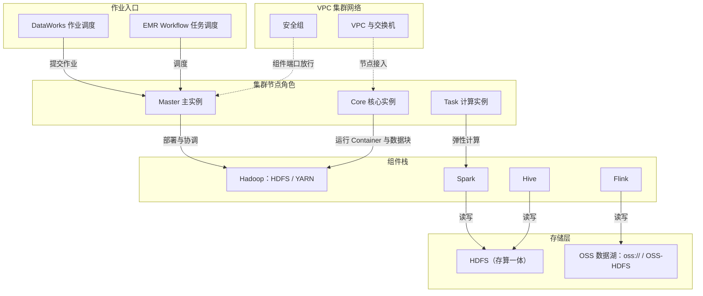

# EMR · 产品架构

> 产品：EMR ｜ 口径：公共云 ｜ 复核：2026-11-17

## 产品定位（EMR on ECS 是什么）

EMR on ECS 在阿里云 ECS 上托管运行 Apache Hadoop、Spark、Flink、Hive 等开源大数据组件，并集成 OSS-HDFS、JindoCache 等自研组件与 DataWorks、DLF 服务；支持包年包月与按量付费，可在数分钟内创建可弹性伸缩的大数据集群。

| 维度 | 官方口径 |
|---|---|
| 托管程度 | 半托管：集群资源归属用户阿里云账号，开源组件的容量规划、参数调优、故障处理由用户负责 |
| 架构组成 | 集成的阿里云产品、开源组件、自研组件、集群管理 四部分 |
| 集成的阿里云产品 | 部署在 ECS 上；数据可存储在 OSS；与 DataWorks 集成；EMR Workflow 提供全托管工作流与任务调度 |
| 集群管理能力 | 快速创建/扩容、集群与服务可视化运维、多维度指标监控、日志分析、监控报警 |
| 费用构成 | EMR 服务费用 + ECS 产品费用（另加公网带宽、OSS、DLF 等关联产品费用） |

**来源**：
- 什么是 EMR on ECS：https://help.aliyun.com/zh/emr/emr-on-ecs/product-overview/what-is-e-mapreduce-on-ecs ｜ 复核：2026-11-16
- 计费项：https://help.aliyun.com/zh/emr/emr-on-ecs/product-overview/billable-items/ ｜ 复核：2026-11-16

## 架构图

**来源**
- 什么是 EMR on ECS（架构四部分、开源组件）：https://help.aliyun.com/zh/emr/emr-on-ecs/product-overview/what-is-e-mapreduce-on-ecs ｜ 复核：2026-11-17
- 实例类型（Master/Core/Task 节点角色）：https://help.aliyun.com/zh/emr/emr-on-ecs/user-guide/node-categories-19 ｜ 复核：2026-11-17
- 选择业务场景（组件栈与集群类型）：https://help.aliyun.com/zh/emr/emr-on-ecs/user-guide/select-a-business-scenario ｜ 复核：2026-11-17
- 选择地域和存储（OSS/OSS-HDFS、oss:// 访问）：https://help.aliyun.com/zh/emr/emr-on-ecs/user-guide/select-region-and-storage-architecture ｜ 复核：2026-11-17
- 创建集群（VPC、交换机与安全组）：https://help.aliyun.com/zh/emr/emr-on-ecs/user-guide/create-a-cluster-on-the-emr-on-ecs-page ｜ 复核：2026-11-17

## 组件清单

| 集群类型 | 节点角色 | 组件栈 | 作业入口 | 存储（HDFS·OSS） |
|---|---|---|---|---|
| 数据湖 DataLake | Master / Core / Task；Gateway（EMR-5.10.1 及以上） | Spark、Hive、Tez、Trino、Kyuubi、Presto；Yarn、Zookeeper；OpenLDAP、Ranger、DLF-Auth、Knox | DataWorks（[DataWorks](../dataworks/README)）、EMR Workflow | HDFS、OSS-HDFS、Celeborn、JindoCache；数据湖格式 Hudi / Iceberg / Paimon；数据可落 [OSS](../oss/README)（`oss://`） |
| 数据分析 OLAP | Master / Core / Task | StarRocks、ClickHouse、Doris；Zookeeper | DataWorks（[DataWorks](../dataworks/README)）、EMR Workflow | —（联邦查询，不落集群存储） |
| 实时数据流 DataFlow | Master / Core / Task；Gateway（EMR-5.10.1 及以上） | Flink；Yarn、Zookeeper；OpenLDAP、Knox | DataWorks（[DataWorks](../dataworks/README)）、EMR Workflow | HDFS、OSS-HDFS；数据湖格式 Paimon；可落 [OSS](../oss/README) |
| 数据服务 DataServing | Master / Core / Task | Phoenix（列存 HBase）；Zookeeper；OpenLDAP、Ranger、Knox | DataWorks（[DataWorks](../dataworks/README)）、EMR Workflow | HDFS、OSS-HDFS、JindoCache |
| 自定义 Custom | Master / Core / Task；Gateway（EMR-5.17.1 及以上） | Spark、Hive、Flink、StarRocks、HBase、Trino 等；Yarn、Zookeeper；OpenLDAP、Ranger、DLF-Auth、Knox | DataWorks（[DataWorks](../dataworks/README)）、EMR Workflow | HDFS、OSS-HDFS、Celeborn、JindoCache |

- 节点角色与本篇「集群与节点角色」一致；Gateway 仅 EMR-5.10.1 及以上 DataLake/DataFlow、EMR-5.17.1 及以上 Custom 支持。
- 组件栈与本篇「组件栈（按集群类型）」一致；每个 EMR 版本预装固定组件版本，不支持升级（02 篇）。
- 作业入口（DataWorks 集成、EMR Workflow 全托管调度）为产品级能力；存储强关联 [OSS](../oss/README)，调度强关联 [DataWorks](../dataworks/README)。

**来源**
- 选择业务场景（五类集群组件矩阵）：https://help.aliyun.com/zh/emr/emr-on-ecs/user-guide/select-a-business-scenario ｜ 复核：2026-11-17
- 实例类型（Master/Core/Task/Gateway 节点角色）：https://help.aliyun.com/zh/emr/emr-on-ecs/user-guide/node-categories-19 ｜ 复核：2026-11-17
- 什么是 EMR on ECS（DataWorks 集成、EMR Workflow、自研组件）：https://help.aliyun.com/zh/emr/emr-on-ecs/product-overview/what-is-e-mapreduce-on-ecs ｜ 复核：2026-11-17
- 选择地域和存储（OSS-HDFS 支持版本与 oss:// 访问）：https://help.aliyun.com/zh/emr/emr-on-ecs/user-guide/select-region-and-storage-architecture ｜ 复核：2026-11-17
- 发行版本（组件版本固定）：https://help.aliyun.com/zh/emr/emr-on-ecs/product-overview/emr-on-ecs-release-version ｜ 复核：2026-11-17

## 集群与节点角色

集群 = 一个或多个 ECS 实例组成的独立机器组合；节点按角色分三类，同一角色的实例组成一个节点组。

| 角色 | 职责 | 部署服务（存算一体示例） | 数量口径 |
|---|---|---|---|
| Master（主实例） | 集群服务部署、管控与协调 | NameNode、ResourceManager、HiveServer、HiveMetastore、SparkHistoryServer | 创建时默认 1 台；API DeployMode=HA 为 3 台，NORMAL 为 1 台 |
| Core（核心实例） | 提供计算与存储，保存全部数据 | DataNode、NodeManager | 默认 2 台，可按需调整；创建完成后支持扩容 |
| Task（计算实例） | 只计算、不保存 HDFS 数据 | NodeManager | 默认不开启，可选；EMR-3.2.0 及后续版本支持 |
| Gateway（任务类型节点组） | 频繁提交任务的入口节点 | 按所选服务部署 | 仅 EMR-5.10.1 及以上 DataLake/DataFlow、EMR-5.17.1 及以上 Custom 支持 |
| Master-Extend | 分担 Master 节点负载 | 按新增节点组时勾选的服务部署 | 需手动新增节点组，新增后默认不部署服务 |

- 开启服务高可用后，Master 节点分布在不同底层硬件上；单主节点集群故障无自动恢复，多主节点集群由 EMR 自动替换故障主节点。
- Task 节点组支持按量付费、抢占式实例、包年包月三种付费类型。
- EMR-5.12.1 及后续版本、EMR-3.46.1 及后续版本的 DataLake/DataFlow/DataServing/Custom 集群，若所选服务可不依赖 Core 节点，可移除 Core 节点组。

**来源**：
- 实例类型（Master/Core/Task 定义）：https://help.aliyun.com/zh/emr/emr-on-ecs/user-guide/node-categories-19 ｜ 复核：2026-11-16
- 创建集群（默认台数、高可用、Task 付费类型、移除节点组）：https://help.aliyun.com/zh/emr/emr-on-ecs/user-guide/create-a-cluster-on-the-emr-on-ecs-page ｜ 复核：2026-11-16
- 使用 CreateCluster API 创建集群（DeployMode NORMAL/HA、Gateway）：https://help.aliyun.com/zh/emr/emr-on-ecs/use-cases/call-the-createcluster-operation-to-create-a-cluster ｜ 复核：2026-11-16
- 管理节点组（Master-Extend）：https://help.aliyun.com/knowledge_detail/107499.html ｜ 复核：2026-11-16
- 选择硬件与网络（单主/多主对比、自动替换故障主节点）：https://help.aliyun.com/zh/emr/emr-on-ecs/user-guide/hardware-and-network-configurations ｜ 复核：2026-11-16

## 组件栈（按集群类型）

| 集群类型 | 计算/分析引擎 | 存储 | 数据湖格式 | 资源与协调 | 安全与权限 |
|---|---|---|---|---|---|
| 数据湖 DataLake | Spark、Hive、Tez、Trino、Kyuubi、Presto | HDFS、OSS-HDFS、Celeborn、JindoCache（数据集成 Flume、Sqoop） | Hudi、Iceberg、Paimon | Yarn、Zookeeper | OpenLDAP、Ranger、DLF-Auth、Knox |
| 数据分析 OLAP | StarRocks、ClickHouse、Doris | —（联邦查询） | — | Zookeeper | — |
| 实时数据流 DataFlow | Flink | HDFS、OSS-HDFS | Paimon | Yarn、Zookeeper | OpenLDAP、Knox |
| 数据服务 DataServing | Phoenix | HDFS、OSS-HDFS、JindoCache（列存 HBase） | — | Zookeeper | OpenLDAP、Ranger、Knox |
| 自定义 Custom | Spark、Hive、Tez、Trino、Kyuubi、Presto、Flink、Phoenix、StarRocks、HBase | HDFS、OSS-HDFS、Celeborn、JindoCache | Hudi、Iceberg、Paimon | Yarn、Zookeeper | OpenLDAP、Ranger、DLF-Auth、Knox |

- 自研组件：OSS-HDFS（兼容 HDFS 接口的对象存储方案）、JindoCache（分布式缓存）、DLF-Auth（数据湖构建 DLF 的数据权限）。
- 每个 EMR 版本预装固定组件版本，组件版本不支持升级（详见 02 篇）。

**来源**：
- 选择业务场景（组件矩阵）：https://help.aliyun.com/zh/emr/emr-on-ecs/user-guide/select-a-business-scenario ｜ 复核：2026-11-16
- 什么是 EMR on ECS（自研组件）：https://help.aliyun.com/zh/emr/emr-on-ecs/product-overview/what-is-e-mapreduce-on-ecs ｜ 复核：2026-11-16
- 发行版本（组件版本固定）：https://help.aliyun.com/zh/emr/emr-on-ecs/product-overview/emr-on-ecs-release-version ｜ 复核：2026-11-16

## 与 OSS 的协同

| 事项 | 官方口径 |
|---|---|
| 数据落点 | 数据可以存储在阿里云 OSS 上；存算分离架构下数据持久化在 OSS-HDFS/OSS |
| 访问方式 | `oss://bucket-name.endpoint/path/to/data`；OSS-HDFS 完全兼容 HDFS 接口 |
| 支持版本 | EMR-5.12.1 及后续版本、EMR-3.46.1 及后续版本的 DataLake/DataFlow/DataServing/Custom 集群支持选择 OSS-HDFS |
| 集群存储根路径 | 选择 OSS-HDFS 服务时需配置；由控制台创建的 OSS-HDFS Bucket 仅支持 EMR 读写，不支持控制台及 API 操作 |
| 元数据 | DLF 统一元数据（推荐）、自建 RDS、内置 MySQL（不推荐用于生产） |
| 计费关系 | OSS 与 DLF 的费用按各自产品计费文档另计 |

**来源**：
- 什么是 EMR on ECS：https://help.aliyun.com/zh/emr/emr-on-ecs/product-overview/what-is-e-mapreduce-on-ecs ｜ 复核：2026-11-16
- 创建集群（存储根路径、元数据三选一）：https://help.aliyun.com/zh/emr/emr-on-ecs/user-guide/create-a-cluster-on-the-emr-on-ecs-page ｜ 复核：2026-11-16
- 选择地域和存储（oss:// 访问方式）：https://help.aliyun.com/zh/emr/emr-on-ecs/user-guide/select-region-and-storage-architecture ｜ 复核：2026-11-16
- 计费项（OSS/DLF 另计）：https://help.aliyun.com/zh/emr/emr-on-ecs/product-overview/billable-items/ ｜ 复核：2026-11-16

## 可靠性机制与 SLA

| 指标 | 数值/口径 |
|---|---|
| EMR 服务可用性承诺 | 不低于 99.9%（按单地域、账号维度统计） |
| 服务不可用定义 | 5 分钟内用户对某地域 EMR 的所有有效请求均返回 500 或 503 |
| 有效请求范围 | 创建集群、扩容、缩容、弹性伸缩及其旧版 API |
| 赔偿（99.0% ≤ 可用性 < 99.9%） | 月度服务费用的 10% 代金券 |
| 赔偿（95.0% ≤ 可用性 < 99.0%） | 月度服务费用的 25% 代金券 |
| 赔偿（可用性 < 95.0%） | 月度服务费用的 50% 代金券（赔偿总额不超过月度服务费用 50%） |
| 赔偿口径 | 仅指 EMR 服务费用，不含 ECS、ACK、弹性公网 IP 等基础资源费用；SLA 版本更新日期 2024-03-01 |
| 云盘数据可靠性 | 分布式三副本，99.9999999% |
| 本地盘 | 数据可靠性取决于物理机，存在单点故障风险 |

- 多主节点（HA）通过 ZooKeeper/HDFS 多数派机制避免脑裂；ECS 部署集把 Master 分布在不同物理硬件（单节点组上限 20 台）。
- SLA 不适用于公测、邀测、免费功能及版本，也不适用于 EMR 本地云版本。

**来源**：
- EMR 服务等级协议（SLA）索引页：https://help.aliyun.com/zh/emr/emr-on-ecs/support/emr-sla ｜ 复核：2026-11-16
- E-MapReduce 服务等级协议正文：https://terms.alicdn.com/legal-agreement/terms/ali_cloud_sla/ali_cloud_sla202107310019_37671.html ｜ 复核：2026-11-16
- 基本概念（云盘/本地盘可靠性）：https://help.aliyun.com/zh/emr/emr-on-ecs/product-overview/terms ｜ 复核：2026-11-16
- 开启部署集（20 台上限、创建后不可更改）：https://help.aliyun.com/zh/emr/emr-on-ecs/user-guide/add-nodes-to-the-deployment-set ｜ 复核：2026-11-16
