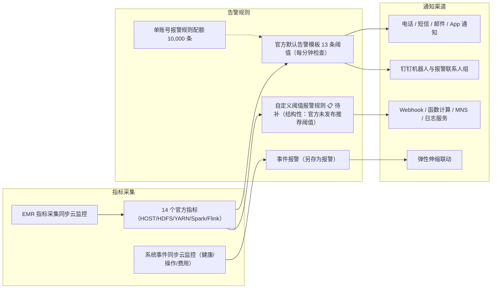

# EMR · 监控与告警

> 产品：EMR ｜ 口径：公共云 ｜ 复核：2026-11-18

## 告警链路图

**来源**
- 指标采集与同步云监控（查看服务监控指标）：https://help.aliyun.com/zh/emr/emr-on-ecs/user-guide/view-service-metrics ｜ 复核：2026-11-18
- 告警规则（管理报警规则、默认告警模板 13 条阈值与配额）：https://help.aliyun.com/zh/emr/emr-on-ecs/user-guide/manage-alert-rules ｜ 复核：2026-11-18
- 自定义阈值与事件报警规则（作用范围、沉默周期、回调与通道）：https://help.aliyun.com/zh/emr/emr-on-ecs/user-guide/create-a-threshold-triggered-alert-rule ｜ 复核：2026-11-18
- 通知渠道（电话/短信/邮件/Webhook/App 报警通知）：https://help.aliyun.com/zh/cms/cloudmonitor-1-0/user-guide/overview-2 ｜ 复核：2026-11-18

## 核心监控指标

- EMR 自动采集集群服务指标并同步到云监控（CloudMonitor）；查看路径：EMR 控制台 > 集群 > 监控诊断 > 指标监控（Dashboard 按服务分大盘），告警在云监控控制台配置。
- 官方指标文档按组件拆分：HOST、HDFS、YARN、Spark、Hive、Flink、ZooKeeper、ClickHouse、StarRocks、HBase、Kafka、Trino、Presto、Impala、Kudu、Kyuubi、RSS、JindoData、Hue、SNAPSHOT 共 20 篇。
- 统计周期：官方指标文档未逐项标注 ⚠️ 待核（2026-11-18 已复核 HOST/YARN 指标页与查看服务监控指标页，三处均无采集/统计周期列；云监控侧的 Period 取值官方口径为指标列表页 `Min Periods` 列，而该列仅在云监控控制台「指标和事件中心」展示，help 页不公布。官方默认告警模板口径为「每分钟检查一次指标数据」，即告警规则按 1 分钟周期检查）。

| 指标（官方英文名） | 含义 | 单位 | 统计周期 | 维度（指标归属） |
|---|---|---|---|---|
| `emr_node_cpu_idle` | 节点等待 idle 完成的 CPU 使用百分比 | % | 官方未标注 | 节点（HOST） |
| `emr_node_mem_used_percent` | 节点内存使用率 | % | 官方未标注 | 节点（HOST） |
| `emr_node_part_max_used` | 节点所有磁盘分区最大使用百分比 | % | 官方未标注 | 节点（HOST） |
| `hdfs_namenode_fsnamesystem_CapacityUsedGB` | NameNode 已使用的 HDFS 空间大小 | GB | 官方未标注 | HDFS NameNode |
| `hdfs_namenode_fsnamesystem_CapacityRemainingGB` | NameNode 剩余的 HDFS 空间大小 | GB | 官方未标注 | HDFS NameNode |
| `hdfs_namenode_fsnamesystem_NumLiveDataNodes` | 存活的 DataNode 个数 | 个 | 官方未标注 | HDFS NameNode |
| `hdfs_namenode_fsnamesystem_MissingBlocks` | NameNode 丢失的块数 | 个 | 官方未标注 | HDFS NameNode |
| `hdfs_namenode_fsnamesystem_CorruptBlocks` | NameNode 损坏的块数 | 个 | 官方未标注 | HDFS NameNode |
| `yarn_cluster_activeNodes` | YARN 集群存活的节点数 | 个 | 官方未标注 | YARN 集群（ResourceManager） |
| `yarn_cluster_unhealthyNodes` | YARN 集群不健康的节点数 | 个 | 官方未标注 | YARN 集群（ResourceManager） |
| `yarn_cluster_appsFailed` | YARN 集群失败的任务数 | 个 | 官方未标注 | YARN 集群（ResourceManager） |
| `yarn_cluster_appsPending` | YARN 集群正在阻塞的任务数 | 个 | 官方未标注 | YARN 集群（ResourceManager） |
| `spark_history_jvm_old_space_utilization` | Spark HistoryServer JVM 老年代内存使用率 | % | 官方未标注 | Spark HistoryServer |
| `flink_jobmanager_numRunningJobs` | Flink JobManager 中正在运行的作业数 | 个 | 官方未标注 | Flink JobManager |

- YARN 集群指标另有 `yarn_cluster_totalMB` / `yarn_cluster_availableMB`（集群总/可用内存，MB）、`yarn_cluster_lostNodes`（死掉节点数）等，完整清单见 YARN 指标页。
- Flink 作业级指标另有 `flink_jobmanager_job_numberOfFailedCheckpoints`（失败检查点数，个）、`flink_jobmanager_job_lastCheckpointDuration`（最近检查点耗时，ms）。

**来源**
- 查看服务监控指标（采集与同步云监控、指标页索引、HDFS 80% 告警示例、无统计周期口径）：https://help.aliyun.com/zh/emr/emr-on-ecs/user-guide/view-service-metrics ｜ 复核：2026-11-18
- HOST 指标（emr_node_cpu_idle / mem_used_percent / part_max_used；表仅参数/指标/描述三列，无周期列）：https://help.aliyun.com/zh/emr/emr-on-ecs/user-guide/host-metrics ｜ 复核：2026-11-18
- HDFS 指标（CapacityUsedGB / NumLiveDataNodes / MissingBlocks / CorruptBlocks）：https://help.aliyun.com/zh/emr/emr-on-ecs/user-guide/hdfs-metrics ｜ 复核：2026-11-17
- YARN 指标（activeNodes / unhealthyNodes / appsFailed / appsPending / totalMB / availableMB；表仅参数/指标/描述三列，无周期列）：https://help.aliyun.com/zh/emr/emr-on-ecs/user-guide/yarn-metrics ｜ 复核：2026-11-18
- Spark 指标（spark_history_jvm_old_space_utilization）：https://help.aliyun.com/zh/emr/emr-on-ecs/user-guide/spark-metrics ｜ 复核：2026-11-17
- Flink 指标（numRunningJobs、Checkpoint 指标）：https://help.aliyun.com/zh/emr/emr-on-ecs/user-guide/flink-metrics-1 ｜ 复核：2026-11-17
- 云监控指标索引（Period 取指标列表页 Min Periods 列）：https://help.aliyun.com/zh/cms/cloudmonitor-1-0/support/appendix-1-metrics ｜ 复核：2026-11-18

## 官方默认与推荐告警

**A. 官方默认报警模板（EMR 控制台「报警管理 > 通过模板创建报警规则」，模板服务范围）**

| 服务 / 组件 | 指标 | 官方默认阈值（每分钟检查一次） |
|---|---|---|
| 节点 Host - 磁盘 | `emr_node_part_max_used` | 平均值 > 80%，持续 2 个周期 |
| 节点 Host - CPU | `emr_node_cpu_idle` | 平均值 < 5%，持续 5 个周期 |
| 节点 Host - 内存 | `emr_node_mem_used_percent` | 平均值 > 90%，持续 2 个周期 |
| HDFS NameNode - JVM 堆 | `hdfs_namenode_jvm_MemHeapUsedM / hdfs_namenode_jvm_MemHeapMaxM` | 平均值 > 95%，持续 2 个周期，或无指标产生 |
| HDFS NameNode - RPC | `hdfs_namenode_rpc_service_activity_CallQueueLength` | 平均值 > 1000，持续 2 个周期 |
| HDFS NameNode - 数据块 | `hdfs_namenode_fsnamesystem_CorruptBlocks` | 平均值 > 1，持续 2 个周期 |
| HDFS NameNode - 安全模式 | `hdfs_namenode_safemode_status` | 每分钟统计一次，发生 1 次处于 safemode 即触发 |
| HDFS DataNode - JVM 堆 | `hdfs_datanode_jvm_MemHeapUsedM / hdfs_datanode_jvm_MemHeapMaxM` | 平均值 > 95%，持续 2 个周期，或无指标产生 |
| YARN NodeManager | `yarn_cluster_unhealthyNodes` | 平均值 > 1，持续 2 个周期 |
| YARN ResourceManager - JVM 堆 | `yarn_resourcemanager_jvm_MemHeapUsedM / yarn_resourcemanager_jvm_MemHeapMaxM` | 平均值 > 95%，持续 2 个周期，或无指标产生 |
| Spark HistoryServer | `spark_history_jvm_old_space_utilization` | 平均值 > 95%，持续 2 个周期 |
| HiveMetaStore | `hive_metastore_threads_blocked_count` | 平均值 > 50%，持续 2 个周期 |
| ZooKeeper | `zk_znode_count` / `zk_watch_count` | 平均值 >= 10000 / >= 1000，持续 2 个周期 |

- 模板未标注报警等级（官方未标注）；模板内阈值可修改。模板还覆盖 HiveServer2、SparkThriftServer、Kafka、Trino、Presto、Impala、Kudu 等组件，完整清单见来源页。
- YARN ResourceManager 状态指标 `yarn_cluster_status`：过去 5 分钟内发生至少两次 HA 切换、存在无状态为 1 的节点或状态一直为 -1 的节点时触发告警（每分钟检查一次）。

**B. 官方文档示例阈值**

| 场景 | 阈值/条件 | 出处 |
|---|---|---|
| HDFS 存储空间使用率告警 | 在云监控中配置「HDFS 存储空间使用率超过 80% 时立即发送短信」 | 查看服务监控指标（官方教程示例） |

**C. 系统事件告警（EMR 事件同步云监控，可「另存为报警」）**

| 事件类型 | 说明 | 事件等级 |
|---|---|---|
| 健康事件 | 服务组件健康状态异常变化（状态：待处理 / 已完成 / 已取消） | 严重 / 警告 / 信息（按事件等级划分） |
| 操作事件 | 自行操作触发失败等异常（仅展示 3 天内的严重与警告事件） | 严重 / 警告 / 信息 |
| 费用事件 | 包年包月集群到期或即将到期 | 严重 / 警告 / 信息 |

**D. 指标阈值类告警**

- 除上述模板与文档示例外，EMR 各组件指标的阈值告警：**官方未发布推荐阈值** 📋 待补（结构性：官方仅提供创建报警规则的操作说明，按阈值红线不收经验值）。

**来源**
- 管理报警规则（模板服务范围与默认阈值、可修改默认阈值）：https://help.aliyun.com/zh/emr/emr-on-ecs/user-guide/manage-alert-rules ｜ 复核：2026-11-17
- 查看服务监控指标（HDFS 存储空间使用率超过 80% 示例）：https://help.aliyun.com/zh/emr/emr-on-ecs/user-guide/view-service-metrics ｜ 复核：2026-11-17
- 管理事件（事件类型、状态与等级）：https://help.aliyun.com/zh/emr/emr-on-ecs/user-guide/manage-events ｜ 复核：2026-11-17
- 创建事件报警规则（事件中心 > 系统事件 > 另存为报警）：https://help.aliyun.com/zh/emr/emr-on-ecs/user-guide/create-an-event-triggered-alert-rule-19 ｜ 复核：2026-11-17
- 创建阈值报警规则（云监控操作步骤）：https://help.aliyun.com/zh/emr/emr-on-ecs/user-guide/create-a-threshold-triggered-alert-rule ｜ 复核：2026-11-17

## 通知与渠道

| 渠道 / 机制 | 说明 |
|---|---|
| 通知方式（云监控创建阈值规则） | 报警服务支持电话、短信、邮件和 Webhook 地址；安装阿里云 App 可通过 App 接收报警通知 |
| 通知方式（EMR 控制台模板创建） | 可选：电话+短信+邮件+钉钉机器人 / 短信+邮件+钉钉机器人 / 邮件+钉钉机器人；报警邮件主题（非必填） |
| 报警联系人组 | 创建规则时选择已绑定报警联系人的联系人组 |
| 报警规则作用范围 | 全部资源（用户名下全部集群）/ 应用分组 / 指定实例（集群） |
| 通道沉默周期 | 报警发生后未恢复时重复发送通知的间隔，创建规则时设置 |
| 生效时间 | 报警规则仅在生效时间内检查监控数据 |
| 无数据处理 | 取值：不做任何处理（默认值）、发送无数据报警、视为正常（高级设置） |
| 报警回调 | 公网可访问的 URL，云监控通过 POST 推送报警信息，目前仅支持 HTTP 协议 |
| 函数计算 | 报警发生时将通知发送至函数计算进行格式处理（需设置地域、服务、函数） |
| 轻量消息队列（原 MNS） | 报警发生时写入指定 Topic |
| 日志服务 | 报警发生时将报警信息写入 SLS（需设置地域、Project、Logstore） |
| 弹性伸缩联动 | 报警发生时触发相应伸缩规则（需设置地域、伸缩组、规则） |
| 事件报警 | 事件中心 > 系统事件 > 另存为报警；支持调试 MNS、函数计算、URL 回调、日志服务通道 |
| RAM 权限 | RAM 用户需 `cms:DescribeContactGroupList`、`cms:DescribeMetricMetaList`、`cms:PutResourceMetricRules`、`cms:DescribeMetricRuleList`（`Resource: *`） |
| 告警升级（Escalation） | 官方未发布 EMR 告警升级策略 📋 待补（结构性） |

**来源**
- 创建阈值报警规则（作用范围、沉默周期、生效时间、无数据处理、回调、函数计算、MNS、日志服务、弹性伸缩）：https://help.aliyun.com/zh/emr/emr-on-ecs/user-guide/create-a-threshold-triggered-alert-rule ｜ 复核：2026-11-17
- 管理报警规则（通知方式、钉钉机器人、RAM 权限策略）：https://help.aliyun.com/zh/emr/emr-on-ecs/user-guide/manage-alert-rules ｜ 复核：2026-11-17
- 云监控报警规则概述（电话/短信/邮件/Webhook/App）：https://help.aliyun.com/zh/cms/cloudmonitor-1-0/user-guide/overview-2 ｜ 复核：2026-11-17
- 创建事件报警规则（事件报警与调试）：https://help.aliyun.com/zh/emr/emr-on-ecs/user-guide/create-an-event-triggered-alert-rule-19 ｜ 复核：2026-11-17

## 告警配额

| 限制项 | 最大值 | 归属 |
|---|---|---|
| 单账号可新建的报警规则数量 | 10,000 条 | 基础云监控 |
| 单账号可新建的动态规则数量 | 1,200 个 | 基础云监控 |
| 单账号可新建的应用分组数量 | 20,000 个 | 基础云监控 |
| 一个应用分组内包含的每种资源数量 | 3,000 个 | 基础云监控 |
| 一个应用分组内允许新建的可用性监控数量 | 500 个 | 基础云监控 |
| 标签创建应用分组时一个地域允许添加的标签数量 | 100 个 | 基础云监控 |
| 监控数据存储时长（Period < 60 秒） | 7 天 | 基础云监控 |
| 监控数据存储时长（Period = 60 秒） | 31 天 | 基础云监控 |
| 监控数据存储时长（Period ≥ 300 秒） | 91 天 | 基础云监控 |
| 单账号可新建的 PromQL 报警规则数量 | 20 条 | 企业云监控 |
| 单账号可新建的指标仓库数量 | 30 个（每个最多管理 10,000 个 ECS 实例） | 企业云监控 |
| 单账号可新建的 SLS Logstore 组数量 | 20 个（每组最多 25 个 Logstore） | 企业云监控 |
| 一个智能水位分析任务可设置的报警联系人组数量 | 5 个 | 企业云监控 |
| 一个智能守护任务允许添加的资源数量 | 100 个 | 企业云监控 |
| 报警联系人 / 报警联系人组数量上限 | 📋 待补（结构性：官方使用限制页未列出该配额） | 基础云监控 |
| EMR 侧报警规则配额 | 📋 待补（结构性：EMR 文档未给出独立于云监控的报警配额） | EMR |

**来源**
- 云监控使用限制（报警规则/应用分组/存储时长/企业云监控配额）：https://help.aliyun.com/zh/cms/cloudmonitor-1-0/product-overview/restrictions-on-use ｜ 复核：2026-11-17
- 管理报警规则（EMR 报警走云监控，无独立配额说明）：https://help.aliyun.com/zh/emr/emr-on-ecs/user-guide/manage-alert-rules ｜ 复核：2026-11-17
