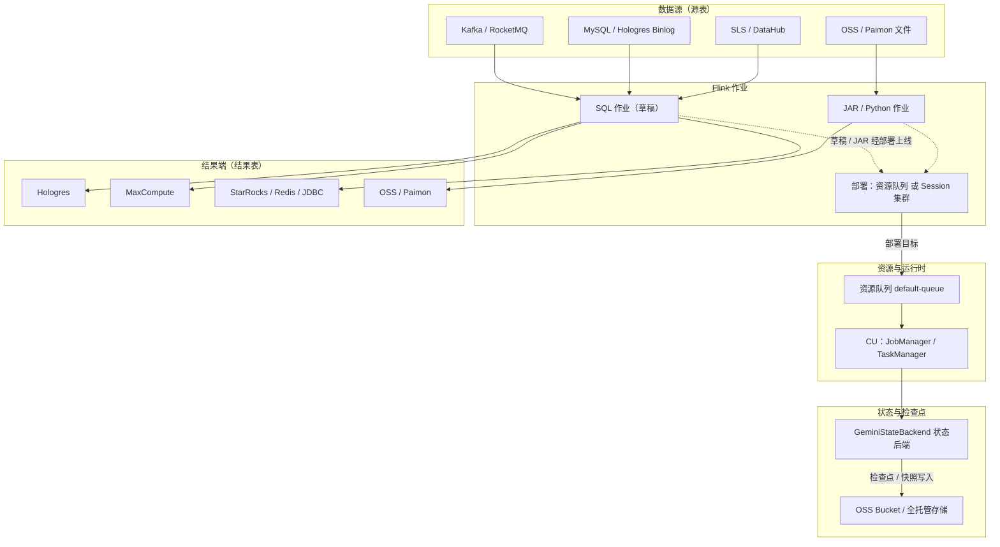

# Flink · 产品架构

> 产品：实时计算 Flink 版 ｜ 口径：公共云 ｜ 复核：2026-11-16

## 产品定位

全托管 Serverless 的 Flink 云服务，开箱即用，100% 兼容 Apache Flink，支持开源平滑迁移上云。

官方口径的增强点：

| 项 | 官方表述 |
|---|---|
| 引擎 | 基于 Apache Flink 增强的企业级引擎 Ververica Runtime（VVR） |
| 性能 | 核心企业级增强 Flink 引擎较开源 Flink 约两倍性能提升（Nexmark 测试口径） |
| 功能 | 内置 Flink CDC、企业级 CEP、30+ 开箱即用连接器 |
| 支持 | 7×24 小时技术支持，SLA 99.9% 保证 |

**来源**：
- 什么是阿里云实时计算Flink版：https://help.aliyun.com/zh/flink/realtime-flink/product-overview/what-is-alibaba-cloud-realtime-compute-for-apache-flink ｜ 复核：2026-11-16

## 架构图

**来源**
- 什么是阿里云实时计算Flink版：https://help.aliyun.com/zh/flink/realtime-flink/product-overview/what-is-alibaba-cloud-realtime-compute-for-apache-flink ｜ 复核：2026-11-17
- 基本概念（工作空间/项目空间/CU/资源队列/连接器/部署）：https://help.aliyun.com/zh/flink/realtime-flink/product-overview/basic-concepts ｜ 复核：2026-11-17
- 配置作业部署信息（部署目标：资源队列 / Session 集群）：https://help.aliyun.com/zh/flink/user-guide/configure-a-deployment ｜ 复核：2026-11-17
- 连接器支持概览（源表/维表/结果表）：https://help.aliyun.com/zh/flink/developer-reference/supported-connectors ｜ 复核：2026-11-17
- 企业级状态后端存储介绍（GeminiStateBackend）：https://help.aliyun.com/zh/flink/user-guide/geministatebackend ｜ 复核：2026-11-17
- 查看历史作业实例日志（OSS 目录 flink-jobs / flink-savepoints）：https://help.aliyun.com/zh/flink/realtime-flink/user-guide/view-the-logs-of-a-historical-job ｜ 复核：2026-11-17
- 开通实时计算Flink工作空间（存储类型：全托管存储或 OSS Bucket）：https://help.aliyun.com/zh/flink/realtime-flink/getting-started/activate-fully-managed-flink ｜ 复核：2026-11-17

## 组件清单

| 组件 | 作用 | 必选/可选 | 是否独立计费 | 备注 |
|---|---|---|---|---|
| 工作空间 Workspace | 计算资源隔离、开发控制台独立的管理基本单元 | 必选 | 是（管控资源固定约 2 CU + 计算资源 CU） | 见 [07-计费与生命周期](07-计费与生命周期.md) |
| 项目空间 Namespace | 管理作业的基本单元，多租户资源与权限完全隔离 | 必选 | 否 | 所有配置、作业、权限均在单个项目空间下 |
| 部署 Deployment / 作业实例 Job | 草稿、JAR、Python 包上线为线上作业，开发与生产隔离 | 必选 | 否 | 部署目标为资源队列（生产默认）或 Session 集群（官方标注「请勿生产使用」） |
| 资源队列（default-queue） | 作业部署目标，把资源隔离到队列 | 必选（每项目空间默认含 default-queue） | 否（占用工作空间 CU） | 扩容自上而下、缩容自下而上 |
| 计算资源 CU | 基本计量单位：1 CU = 1 核 CPU + 4 GiB 内存 + 20 GB 本地存储（放日志、系统检查点等） | 必选 | 是（包年包月 / 按量付费 / 混合计费 / 资源抵扣包） | 管控资源固定 2 CU；窗口函数作业官方建议至少 4 CU |
| 连接器 Connector | 上下游数据读写与同步（源表/维表/结果表），内置 30+ 并支持自定义 | 必选（内置能力） | 否 | 关联 [MaxCompute](../maxcompute/README)、[Hologres](../hologres/README) 连接器，见 [04-配套参数](04-配套参数.md) |
| 状态后端 GeminiStateBackend | 默认状态存储引擎（KV/LSM 架构，存算分离、不依赖本地盘） | 必选（默认） | 否（官方未列独立计费项） | 对比 RocksDBStateBackend，约一半用例性能领先 70% 以上 |
| 检查点 / 快照存储 | 系统检查点与作业快照持久化（工作空间绑定 OSS Bucket 的 flink-jobs / flink-savepoints 目录或全托管存储） | 必选 | 是（OSS Bucket 存储按 OSS 计费） | 系统检查点超时默认 10 分钟；全托管存储公测 2026-09-14 起停止新购 |
| 日志归档 | 作业日志滚动归档，供作业日志页与历史实例查询 | 必选（默认开启） | 否 | 归档日志有效期默认 7 天，见 [08-日志与审计](08-日志与审计.md) |
| 消息投递 | 启动日志、资源情况、运行事件、作业消耗资源、状态变更投递至 SLS 或 Kafka | 可选 | 否（投递免费；SLS 索引与流量按 SLS 计费） | 两渠道独立配置、可同时开启，见 [08-日志与审计](08-日志与审计.md) |
| 监控告警（云监控 / ARMS） | 作业指标告警、事件告警、工作流告警 | 可选 | 云监控监控与告警管理免费；ARMS Prometheus 按量计费 | 见 [09-监控与告警](09-监控与告警.md) |
| DataWorks（关联产品） | 将 Flink 工作空间/项目空间/队列绑定为 DataWorks 计算资源，用于离线开发调度与任务编排 | 可选（关联产品） | DataWorks 侧计费（[DataWorks](../dataworks/README)） | 需 AliyunStreamFullAccess 权限，仅支持 Data Studio 工作空间和 Serverless 资源组 |

**来源**
- 基本概念（工作空间/项目空间/连接器/资源队列）：https://help.aliyun.com/zh/flink/realtime-flink/product-overview/basic-concepts ｜ 复核：2026-11-17
- 计费项（CU 定义、管控 2 CU、OSS 相关产品费用、4 CU 建议）：https://help.aliyun.com/zh/flink/product-overview/billable-items ｜ 复核：2026-11-17
- 配置作业部署信息（部署与作业类型）：https://help.aliyun.com/zh/flink/user-guide/configure-a-deployment ｜ 复核：2026-11-17
- Flink Python 作业（Session 集群「请勿生产使用」）：https://help.aliyun.com/document_detail/374263.html ｜ 复核：2026-11-17
- 资源调整（队列扩容/缩容顺序）：https://help.aliyun.com/zh/flink/realtime-flink/user-guide/reconfigure-resources ｜ 复核：2026-11-17
- 连接器支持概览：https://help.aliyun.com/zh/flink/developer-reference/supported-connectors ｜ 复核：2026-11-17
- 企业级状态后端存储介绍：https://help.aliyun.com/zh/flink/user-guide/geministatebackend ｜ 复核：2026-11-17
- 查看历史作业实例日志（OSS 目录与日志归档 7 天）：https://help.aliyun.com/zh/flink/realtime-flink/user-guide/view-the-logs-of-a-historical-job ｜ 复核：2026-11-17
- Flink 全托管存储公测（2026-09-14 停止新购）：https://help.aliyun.com/zh/flink/realtime-flink/product-overview/public-preview-of-fully-managed-storage ｜ 复核：2026-11-17
- 消息投递（SLS/Kafka 与计费）：https://help.aliyun.com/zh/flink/realtime-flink/user-guide/get-started-with-message-delivery ｜ 复核：2026-11-17
- 云监控与 ARMS 告警功能对比（计费口径）：https://help.aliyun.com/zh/flink/realtime-flink/user-guide/feature-comparison-between-cloudmonitor-and-arms ｜ 复核：2026-11-17
- 绑定全托管 Flink 计算资源（DataWorks 关联）：https://help.aliyun.com/zh/dataworks/user-guide/bind-flink-computing-resources ｜ 复核：2026-11-17

## 资源层次结构

| 层级 | 概念 | 说明 |
|---|---|---|
| 1 | 工作空间（Workspace） | 管理项目空间的基本单元；每个工作空间计算资源隔离、开发控制台独立 |
| 2 | 项目空间（Namespace） | 管理作业的基本单元；所有配置、作业、权限均在单个项目空间下，多租户完全隔离 |
| 3 | 草稿（Draft） | ETL 界面的 SQL 作业、数据摄入页的 YAML 作业；仅控制台开发方式有此概念 |
| 4 | 部署（Deployment） | 将草稿/JAR/Python 包变为线上作业，开发与生产隔离，具有确定的流批属性 |
| 5 | 作业实例（Job） | 由部署生成的线上运行实例 |

资源分配链路：工作空间 → 项目空间 → 资源队列（每项目空间有 default-queue）。扩容自上而下，缩容自下而上。

**来源**：
- 基本概念：https://help.aliyun.com/zh/flink/product-overview/basic-concepts ｜ 复核：2026-11-16
- 资源调整（队列链路）：https://help.aliyun.com/zh/flink/realtime-flink/user-guide/reconfigure-resources ｜ 复核：2026-11-16

## 作业模式（部署目标 / 作业类型）

官方没有「Per Job 集群」这一全托管形态；作业维度的口径是**作业类型** + **部署目标**：

| 维度 | 取值 | 说明 |
|---|---|---|
| 作业类型 | SQL 作业 | 草稿开发，含 SQL 代码、引擎版本、附加依赖 |
| 作业类型 | JAR 作业 | JAR Uri + Entry Point Class + 主参数 + Kerberos 集群等 |
| 作业类型 | Python 作业 | Python Uri + Entry Module + Python Libraries/Archives |
| 部署目标 | 资源队列（如 default-queue） | 生产运行的默认目标，资源隔离到队列 |
| 部署目标 | Session 集群 | 官方标注「请勿生产使用」；作业不支持监控告警/数据曲线、不支持配置告警、不支持自动调优，仅作开发测试环境 |

Session 集群的作业即使不被配置运行，其已运行的 Session 集群也会计费（按量付费口径）。

**来源**：
- 配置作业部署信息（作业类型）：https://help.aliyun.com/zh/flink/user-guide/configure-a-deployment ｜ 复核：2026-11-16
- Flink Python作业（Session 集群限制）：https://help.aliyun.com/document_detail/374263.html ｜ 复核：2026-11-16
- 按量付费（Session 集群计费）：https://help.aliyun.com/zh/flink/product-overview/pay-as-you-go ｜ 复核：2026-11-16

## 引擎与部署形态

产品形态（发布状态口径）：

| 产品形态 | 部署形态 | 计算引擎 | 开发平台 | 发布状态 |
|---|---|---|---|---|
| Flink 全托管 | 基于 K8s 容器部署 | VVR | 企业级开发运维平台 | GA |
| Flink 半托管/EMR（Dataflow 集群） | 基于 Yarn 部署 | VVR | Zeppelin | GA |
| Blink 独享集群（原产品线） | 基于 Yarn 部署 | Blink | Bayes | EOM2，EOS 2023.07.30 |
| Blink 共享集群（原产品线） | 基于 Yarn 部署 | Blink | Bayes | EOFS，EOS 2023.03.30 |

- Blink 独享集群 2021.04.28 停止新购；Blink 共享集群 2019.12.24 停止新购。
- VVR 版本号格式 Major1.Major2.Minor：大版本对应 Apache Flink X/Y 位变更，小版本为 Z 位兼容修复。
- 兼容承诺：不承诺大版本之间兼容；承诺同一大版本内小版本兼容（SQL 语法、类库接口、引擎框架）。

**来源**：
- 产品形态：https://help.aliyun.com/zh/flink/product-overview/service-types ｜ 复核：2026-11-16
- 引擎版本介绍：https://help.aliyun.com/zh/flink/product-overview/engine-version ｜ 复核：2026-11-16

## 可靠性与 SLA

| 项 | 官方口径 |
|---|---|
| 服务 SLA | 99.9% 保证，7×24 小时专业技术支持 |
| JobManager | 全链路自动容错，支持 JobManager 高可用，系统无单点故障 |
| 同城高可用 | 支持跨可用区（同城高可用）部署；仅部分地域 Intel X86 且包年包月的工作空间支持 |
| 状态与快照 | 系统检查点与作业快照全生命周期管理，状态兼容性检查与数据迁移能力 |
| 状态后端 | GeminiStateBackend 为默认状态存储后端（存储计算分离，不依赖本地盘） |

**来源**：
- 什么是阿里云实时计算Flink版（SLA/高可用）：https://help.aliyun.com/zh/flink/realtime-flink/product-overview/what-is-alibaba-cloud-realtime-compute-for-apache-flink ｜ 复核：2026-11-16
- 使用限制（跨可用区条件）：https://help.aliyun.com/zh/flink/product-overview/limits ｜ 复核：2026-11-16
- 企业级状态后端存储介绍：https://help.aliyun.com/zh/flink/user-guide/geministatebackend ｜ 复核：2026-11-16
