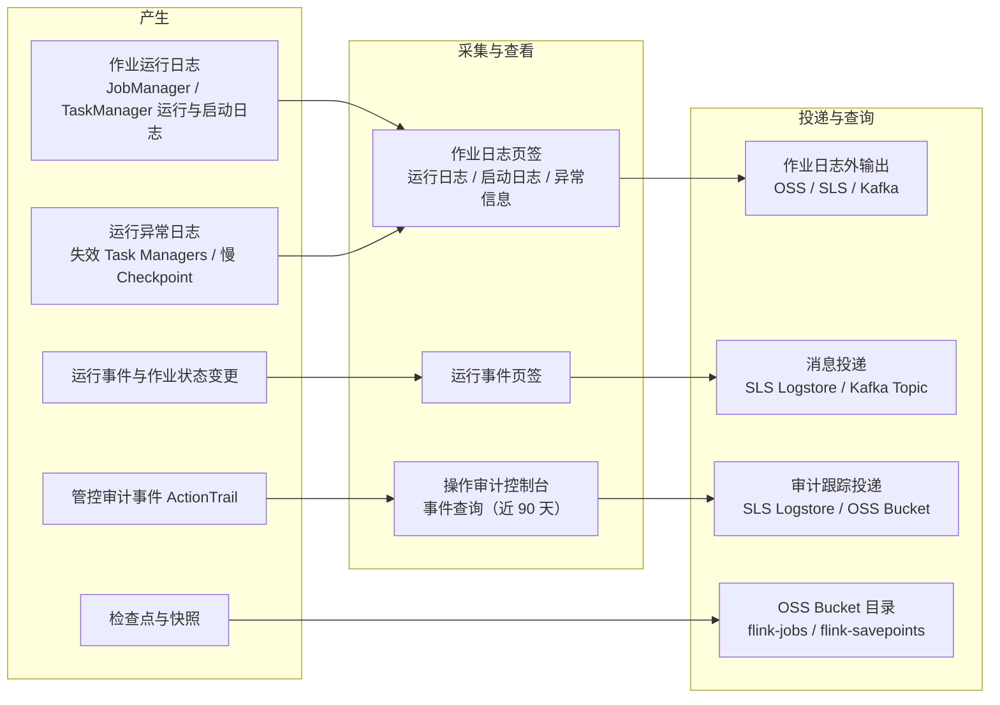

# Flink · 日志与审计

> 产品：实时计算 Flink 版 ｜ 口径：公共云 ｜ 复核：2026-11-18

## 日志流转图

**来源**
- 作业日志（总览）：https://help.aliyun.com/zh/flink/realtime-flink/user-guide/job-logs ｜ 复核：2026-11-18
- 查看运行异常日志（异常历史近 7 天、失效 TM、慢 Checkpoint）：https://help.aliyun.com/zh/flink/realtime-flink/user-guide/view-the-exception-logs-of-a-deployment ｜ 复核：2026-11-18
- 查看运行事件：https://help.aliyun.com/zh/flink/realtime-flink/user-guide/view-the-events-of-a-deployment ｜ 复核：2026-11-18
- 配置作业日志输出（OSS/SLS/Kafka）：https://help.aliyun.com/zh/flink/realtime-flink/user-guide/configure-parameters-to-export-logs-of-a-deployment ｜ 复核：2026-11-18
- 消息投递（投递类型与计费）：https://help.aliyun.com/zh/flink/realtime-flink/user-guide/get-started-with-message-delivery ｜ 复核：2026-11-18
- 查看 Flink 审计事件（90 天 / 10 分钟延迟）：https://help.aliyun.com/zh/flink/realtime-flink/user-guide/view-audit-events ｜ 复核：2026-11-18
- 计费项（OSS 绑定 Bucket 存检查点/快照/日志/JAR）：https://help.aliyun.com/zh/flink/product-overview/billable-items ｜ 复核：2026-11-18

## 日志类型总表

| 类型 | 产生方 | 查看入口 | 默认保留期 | 是否计费 |
|---|---|---|---|---|
| 作业运行日志（JobManager / TaskManager 运行日志与启动日志） | Flink 作业 | 运维中心 > 作业运维 > 作业日志（运行日志 / 启动日志页签）；亦可在 Flink UI 查看 | 控制台系统默认保留最近 5 MB 运行日志；日志配置默认保留 2 个文件、单文件 5 MB（滚动归档） | 官方未标注单独计费项 |
| 运行异常日志（Job Manager 异常、失效 Task Managers、慢 Checkpoint 关联 Task Managers 日志） | Flink 作业（Failover / 异常） | 作业日志 > 异常信息（异常历史）；运行日志 > 失效 Task Managers；Checkpoints 页签 | 异常历史近 7 天；失效 TM 日志仅限日志归档有效期内（日志归档默认开启，归档日志有效期默认 7 天） | 官方未标注单独计费项 |
| 检查点与快照（Checkpoint / Savepoint 文件） | Flink 引擎 | 开通时绑定的 OSS Bucket 目录：`flink-jobs`（Checkpoint）、`flink-savepoints`（Savepoint）；或全托管存储 | 📋 待补（官方未标注检查点/快照自动清理策略） | OSS Bucket 内存储按 OSS 计费；全托管存储为公测口径，2026-09-14 起停止新购 |
| 运行事件（作业启动各时间点的状态、信息、操作） | Flink 平台 | 作业详情 > 运行事件页签 | 📋 待补（官方未标注保留期） | 官方未标注单独计费项 |
| 消息投递消息（启动日志 / 资源情况 / 运行事件 / 作业消耗资源 / 状态变更） | Flink 平台 | SLS Logstore 或云消息队列 Kafka Topic（运维中心 > 配置管理 > 消息投递配置） | 由投递目标保存策略决定（SLS Logstore 保留时间由用户配置） | 投递功能本身不收费；SLS 索引与流量按 SLS 计费 |
| 作业日志外输出（OSS / SLS / Kafka，日志模板 Appender） | Flink 作业 | 对应 OSS Bucket `logs/` 目录、SLS Logstore 或 Kafka Topic | 随作业日志归档策略；OSS 按 `rollingBytes` 滚动；未关闭日志归档时开通时配置的存储仍持续保存 | 投递免费；OSS 存储、SLS 索引与流量按目标产品计费 |
| 审计日志（管控事件，操作审计 ActionTrail） | 操作审计 ActionTrail | 操作审计控制台 > 事件 > 事件查询 | 控制台可查当前地域最近 90 天（操作后约 10 分钟可查） | 操作审计免费；创建跟踪投递 SLS/OSS 按目标产品计费 |

- 消息投递与作业运行日志是两条独立通道：消息投递不含作业运行日志，运行日志走「配置作业日志输出」。
- 作业日志支持分页，每页显示 1 MB（约 8000~9000 行）。
- 若 JobManager 与 TaskManager 均未正常启动，日志不会写入 OSS 或 SLS。

**来源**
- 作业日志（总览）：https://help.aliyun.com/zh/flink/realtime-flink/user-guide/job-logs ｜ 复核：2026-11-17
- 查看历史作业实例日志（5 MB 保留、归档 7 天、OSS 目录、JM/TM 未启动时无日志）：https://help.aliyun.com/zh/flink/realtime-flink/user-guide/view-the-logs-of-a-historical-job ｜ 复核：2026-11-17
- 查看运行异常日志（异常历史近 7 天、失效 TM、慢 Checkpoint）：https://help.aliyun.com/zh/flink/realtime-flink/user-guide/view-the-exception-logs-of-a-deployment ｜ 复核：2026-11-17
- 查看启动和运行日志（每页 1 MB 约 8000~9000 行）：https://help.aliyun.com/zh/flink/realtime-flink/user-guide/view-startup-logs-and-operational-logs-of-a-deployment ｜ 复核：2026-11-17
- 查看运行事件：https://help.aliyun.com/zh/flink/realtime-flink/user-guide/view-the-events-of-a-deployment ｜ 复核：2026-11-17
- 配置作业日志输出（OSS/SLS/Kafka）：https://help.aliyun.com/zh/flink/realtime-flink/user-guide/configure-parameters-to-export-logs-of-a-deployment ｜ 复核：2026-11-17
- 消息投递（投递类型与计费）：https://help.aliyun.com/zh/flink/realtime-flink/user-guide/get-started-with-message-delivery ｜ 复核：2026-11-17
- 查看 Flink 审计事件（90 天 / 10 分钟延迟）：https://help.aliyun.com/zh/flink/realtime-flink/user-guide/view-audit-events ｜ 复核：2026-11-17
- 计费项（OSS 绑定 Bucket 存检查点/快照/日志/JAR）：https://help.aliyun.com/zh/flink/product-overview/billable-items ｜ 复核：2026-11-17
- Flink 全托管存储公测（2026-09-14 停止新购）：https://help.aliyun.com/zh/flink/realtime-flink/product-overview/public-preview-of-fully-managed-storage ｜ 复核：2026-11-17

## 关键日志详表

**A. 运行事件消息（`JOB_EVENT`，消息投递 JSON 字段）**

| 字段 | 类型/示例 | 含义 |
|---|---|---|
| `messageType` | 字符串，固定 `JOB_EVENT` | 消息类型（运行事件） |
| `deploymentId` | 字符串 | 已部署作业 ID |
| `jobId` | 字符串 | 作业实例 ID |
| `eventId` | 字符串 | 事件 ID |
| `eventName` | 字符串 | 事件名称 |
| `content` | 字符串 | 作业启动日志详情 |
| `namespace` | 字符串 | 项目空间名称 |
| `timestamp` | 数值 | 时间戳 |

**B. 作业状态变更消息（`JOB_STATUS_CHANGED`，消息投递 JSON 字段）**

| 字段 | 类型/示例 | 含义 |
|---|---|---|
| `messageType` | 字符串，固定 `JOB_STATUS_CHANGED` | 消息类型（作业状态变更） |
| `previousStatus` | 字符串 | 变更前的作业状态 |
| `currentStatus` | 字符串 | 变更后的作业状态 |
| `deploymentName` | 字符串 | 已部署作业名称 |
| `jobId` | 字符串 | 作业实例 ID |
| `additionalInfo` | 字符串 | 附加信息 |
| `workspace` | 字符串 | 工作空间名称 |
| `timestamp` | 数值（毫秒） | 消息产生的时间戳 |

**C. 作业启动日志（`JOB_START_LOG`，消息投递 JSON 字段）**

| 字段 | 类型/示例 | 含义 |
|---|---|---|
| `messageType` | 字符串，固定 `JOB_START_LOG` | 消息类型（作业启动日志） |
| `content` | 字符串 | 作业启动日志详情（Flink 环境初始化至 JobManager 启动） |
| `length` | 数值 | 日志总长度 |
| `offset` | 数值 | 日志分片时该条日志的起始位置 |
| `tag` | 字符串 | 作业标签（未配置为空） |
| `deploymentId` | 字符串 | 已部署作业 ID |
| `workspace` | 字符串 | 工作空间 ID |
| `timestamp` | 数值 | 时间戳 |

**D. 管控审计事件（ActionTrail 事件结构，示例为删除部署作业）**

| 字段 | 类型/示例 | 含义 |
|---|---|---|
| `eventTime` | UTC 时间（如 `2023-06-02T06:08:21Z`） | 事件发生时间 |
| `eventName` | 如 `DeleteDeployment` | 事件名称 |
| `eventSource` | `RealtimeCompute` | 事件来源 |
| `eventType` | `ApiCall` | 事件类型 |
| `eventRW` | `Write` | 事件读写类型（Read / Write） |
| `sourceIpAddress` | IP 地址 | 事件发起的源 IP 地址 |
| `userIdentity` | 对象（`type` 含 `ram-user` 等） | 请求者身份信息（账号、RAM 用户等） |
| `referencedResources` | 如 `ACS::RealtimeCompute::Deployment` | 关联资源类型与资源名 |

**来源**
- 消息投递（字段含义说明：JOB_EVENT / JOB_STATUS_CHANGED / JOB_START_LOG）：https://help.aliyun.com/zh/flink/realtime-flink/user-guide/get-started-with-message-delivery ｜ 复核：2026-11-17
- 查看 Flink 审计事件（事件 JSON 示例结构）：https://help.aliyun.com/zh/flink/realtime-flink/user-guide/view-audit-events ｜ 复核：2026-11-17
- 查看运行事件（时间/信息/操作三部分）：https://help.aliyun.com/zh/flink/realtime-flink/user-guide/view-the-events-of-a-deployment ｜ 复核：2026-11-17

## 投递与加工

| 通道 | 目标与关键参数 | 过滤 / 采样 | 关键限制 | 计费 |
|---|---|---|---|---|
| 消息投递 → 日志服务 SLS | 授权模式 STS Token（仅工作空间同地域）或 AccessKey（可跨地域，需 Region、Endpoint、AK）；投递范围 5 类：启动日志、资源详情、运行事件全量、作业消耗资源、作业状态变更 | 按投递范围与消息类型选择；官方未提供采样/抽样参数 📋 待补 | 投递前需自建 SLS Project 与 Logstore；资源情况每 30 秒一条、作业消耗资源每 10 分钟一条、启动日志在启动成功或终态时各投一次、状态变更触发即投；配置变更最长 30 s 延迟 | 投递功能不收费；SLS 索引与流量按 SLS 计费 |
| 消息投递 → 云消息队列 Kafka 版 | 实例、Endpoint、Topic（需预先创建）；STS Token（仅同地域）或手动配置（Topic 3~64 字符） | 同上 | 仅支持投递至与 Flink 工作空间同地域的 Kafka 实例；与 SLS 配置相互独立、可同时开启 | 投递免费，Kafka 按其定价计费 |
| 作业运行日志 → OSS | 日志模板自定义 Appender（`type=OSS`）：`baseUri`（Bucket）、`endpoint`（取 VPC 内网 Endpoint）、`flushIntervalSeconds` / `flushIntervalEventCount`（按时间或条数刷写）、`rollingBytes`（单文件滚动阈值） | 根日志等级 + 类日志等级；可用 log4j2 `ThresholdFilter` 为不同存储配不同级别（如控制台 INFO、SLS ERROR） | 修改日志配置需重启作业；JAR 作业业务日志需在 Appender 设 `isInitStrictly=false` 否则被跳过；跨账号 AK 建议用变量托管 | OSS 存储按 OSS 计费 |
| 作业运行日志 → SLS | Appender `type=SLS`：`project` / `logStore` / `endpoint`（私网）/ AK 或 SLS Token（VVR 11.5+，限工作空间同地域） | 同上 | SLS 与 Flink 不同账号时需给 SLS 服务账号配置 `log:PostLogStoreLogs` 等写入权限；AK 通过项目变量填写 | SLS 索引与流量按 SLS 计费 |
| 作业运行日志 → Kafka | Appender `type=KafkaVVP`：`bootstrap.servers`、`acks`、`buffer.memory`、`retries`、`compression.type` | 同上 | 暂不支持开启 Kerberos 认证的 Kafka 集群；需显式指定 KafkaAppender 插件包路径 | 按 Kafka 定价计费 |
| 工作空间级日志模板 | 运维中心 > 配置管理 > 作业默认配置 > 日志模板（自定义模板对项目空间内后续所有作业生效） | 根日志等级 / 类日志等级 | 仅对配置后新建作业默认生效 | 同各通道 |
| 审计事件投递 | 创建单账号跟踪，将事件投递至 SLS Logstore 或 OSS Bucket | 官方未提供事件级采样/抽样参数 📋 待补 | 超过 90 天的事件必须创建跟踪并投递才可追溯；多账号跟踪事件只能在对应 SLS/OSS 中查询 | 操作审计免费，投递目标按各自定价计费 |

- 跨账号投递的 AccessKeyId / Secret 统一通过变量（项目变量/作业变量）托管，避免明文泄露。

**来源**
- 消息投递（渠道参数、投递时机、SLS 免费投递与索引计费）：https://help.aliyun.com/zh/flink/realtime-flink/user-guide/get-started-with-message-delivery ｜ 复核：2026-11-17
- 配置作业日志输出（Appender 参数、重启要求、ThresholdFilter 分级、isInitStrictly、跨账号权限）：https://help.aliyun.com/zh/flink/realtime-flink/user-guide/configure-parameters-to-export-logs-of-a-deployment ｜ 复核：2026-11-17
- 配置管理（工作空间级日志模板）：https://help.aliyun.com/zh/flink/realtime-flink/user-guide/configuration-management ｜ 复核：2026-11-17
- 查看 Flink 审计事件（跟踪投递与 90 天限制）：https://help.aliyun.com/zh/flink/realtime-flink/user-guide/view-audit-events ｜ 复核：2026-11-17
- 作业与项目变量管理（AK 托管）：https://help.aliyun.com/zh/flink/realtime-flink/user-guide/manage-keys ｜ 复核：2026-11-17

## 审计与合规

| 项 | 官方口径 |
|---|---|
| 接入方式 | 阿里云 Flink 全托管已对接操作审计（ActionTrail），无需付费即可在 ActionTrail 中获取资源的操作事件 |
| 留痕范围 | 通过控制台、OpenAPI、开发者工具对 Flink 产品和服务的访问与使用行为；可查询事件见官方「实时计算 Flink 版事件列表」 |
| 事件示例 | 删除部署作业 `DeleteDeployment`：`eventSource=RealtimeCompute`、`eventRW=Write`、`eventType=ApiCall`，关联 `ACS::RealtimeCompute::Deployment` 资源 |
| 查询窗口 | 仅能查询当前地域最近 90 天事件；云上操作后约 10 分钟才可通过控制台查询 |
| 查询限流 | 单账号跟踪事件在操作审计控制台每秒最多查询 2 次 |
| 跨 90 天留存 | 需创建单账号跟踪并将事件投递到 SLS 或 OSS；多账号跟踪事件不能在控制台查询，只能在对应 SLS Logstore / OSS Bucket 中查询 |
| 全局事件查询地域 | 公共云仅华东 1（杭州）可查询全局事件 |
| 计费 | 操作审计本身免费；通过跟踪投递到 SLS/OSS 按各自定价单独付费 |

- 可按读写类型、操作者名称、事件名称、关联资源、AccessKey ID、是否敏感操作等条件过滤查询。

**来源**
- 查看 Flink 审计事件（接入、90 天、10 分钟、每秒 2 次、事件示例、全局事件地域）：https://help.aliyun.com/zh/flink/realtime-flink/user-guide/view-audit-events ｜ 复核：2026-11-17
- 什么是操作审计 ActionTrail：https://help.aliyun.com/zh/actiontrail/product-overview/what-is-actiontrail ｜ 复核：2026-11-17
