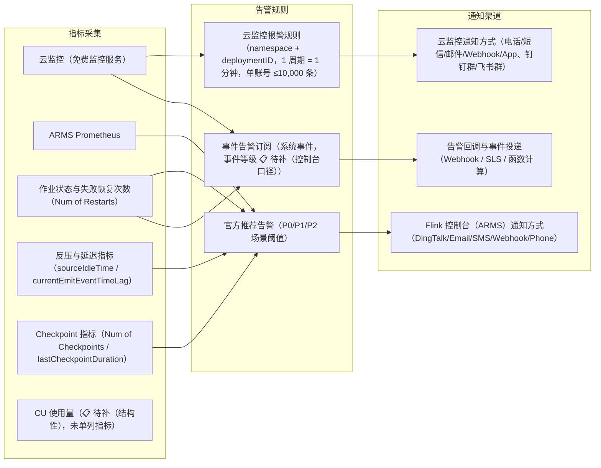

# Flink · 监控与告警

> 产品：实时计算 Flink 版 ｜ 口径：公共云 ｜ 复核：2026-11-18

## 告警链路图

**来源**
- Flink 监控指标说明（指标/反压/延迟判断）：https://help.aliyun.com/zh/flink/realtime-flink/user-guide/metrics ｜ 复核：2026-11-18
- 配置监控告警（维度、频率、通知渠道、事件订阅）：https://help.aliyun.com/zh/flink/realtime-flink/user-guide/configure-alert-rules ｜ 复核：2026-11-18
- 监控告警推荐配置示例与模板（P0/P1/P2 阈值）：https://help.aliyun.com/zh/flink/realtime-flink/user-guide/best-practices-for-monitoring-and-alerting ｜ 复核：2026-11-18
- 云监控使用限制（报警规则配额 10,000 条）：https://help.aliyun.com/zh/cms/cloudmonitor-1-0/product-overview/restrictions-on-use ｜ 复核：2026-11-18

## 核心监控指标

- 监控服务两档：云监控（免费监控服务）与 ARMS Prometheus；下表指标取自官方《监控指标说明》，为 Flink 控制台与云监控共用指标集。
- 云监控报警规则维度：`namespace`（Flink 项目空间名称）+ `deploymentID`（部署作业 ID，见作业「部署详情」页签）；不填则监控所有项目空间下的所有作业。
- 统计周期按云监控报警规则口径：1 周期 = 1 分钟；Flink 控制台监控图表展示实时值。云监控侧各指标数据点的原始统计周期官方未单列（2026-11-18 复核《监控指标说明》仅说明预聚合差异、未给周期；表中按报警周期口径填写）。
- 云监控监控数据存储免费，默认 30 天（功能对比页口径；云监控使用限制页口径 Period=60s 存储 31 天）；ARMS 默认 90 天。
- 反压判断首选 Flink UI 反压监测面板；反压的指标特征为 `sourceIdleTime` 周期性上升、`currentFetchEventTimeLag` 与 `currentEmitEventTimeLag` 持续增长。
- 作业 CU 使用量官方通过消息投递（`RESOURCE_QUOTA` / `JOB_RESOURCE_USAGE`）与 JobMetric OpenAPI 提供，《监控指标说明》未单列 CU 使用率指标 📋 待补（结构性）。

| 指标（官方英文名） | 含义 | 单位 | 统计周期 | 维度 |
|---|---|---|---|---|
| Num of Restarts | 作业错误恢复次数（不含 JM Failover 次数），用于查看作业可用性与状态 | 次数 | 1 分钟 | 项目空间（namespace）+ 部署作业（deploymentID） |
| currentEmitEventTimeLag | 业务延时：数据离开 Source 算子的延时，偏大说明拉取或处理存在延时 | 毫秒（ms） | 1 分钟 | 同上 |
| currentFetchEventTimeLag | 传输延时：数据从产生到被 Source 拉取的延时，偏大需查网络 I/O 或上游系统 | 毫秒（ms） | 1 分钟 | 同上 |
| watermarkLag | Watermark 延迟，用于判断 Subtask 级别的作业延迟 | 毫秒（ms） | 1 分钟 | 同上 |
| sourceIdleTime | 源端未处理数据的时间；值较大说明外部系统数据产出速率低 | 毫秒（ms） | 1 分钟 | 同上 |
| busyTimePerSecond | 每秒内 Task 线程处于繁忙（处理数据）状态的毫秒数，取值 0~1000，越高负载越大 | 毫秒（ms） | 1 分钟 | 同上 |
| numRecordsInOfSourcePerSecond（IN RPS） | Source 端每秒输入记录数；为 0 可能表示上游数据未被消费 | 条/秒 | 1 分钟 | 同上 |
| numRecordsOutOfSinkPerSecond（OUT RPS） | Sink 端每秒输出记录数；为 0 可能表示作业逻辑过滤了全部数据 | 条/秒 | 1 分钟 | 同上 |
| numRecordsInPerSecond | 整个数据流每秒输入的记录数 | 条/秒 | 1 分钟 | 同上 |
| numRecordsOutPerSecond | 整个数据流每秒输出的记录数 | 条/秒 | 1 分钟 | 同上 |
| Num of Checkpoints | Checkpoint 数量，用于总览检查点状态、设置 Checkpoint 告警 | 个 | 1 分钟 | 同上 |
| lastCheckpointDuration | 最近一个 Checkpoint 的持续时间；耗时过长可能因状态过大、网络、Barrier 未对齐或反压 | 毫秒（ms） | 1 分钟 | 同上 |
| lastCheckpointSize | 最近一次实际上传的 Checkpoint 大小 | Bytes | 1 分钟 | 同上 |
| TM CPU Usage | 单个 TaskManager 的 CPU 使用率（1 Core 用满 = 100%，长期 >100% 说明 CPU 繁忙） | 无（按核折算百分比） | 1 分钟 | 同上 |
| TM Heap Memory | 单个 TaskManager 的堆内存 | Bytes | 1 分钟 | 同上 |

- 其余指标（状态类 State Size / State File Size、JVM GC、IO、水印、MySQL/Kafka/Paimon 连接器指标等）见《监控指标说明》。
- 云监控采用预聚合，「最大值」与 Flink 控制台实时值可能有细微不一致；排查以 Flink 控制台为准。

**来源**
- Flink 监控指标说明（英文名/含义/单位、反压与延迟判断）：https://help.aliyun.com/zh/flink/realtime-flink/user-guide/metrics ｜ 复核：2026-11-17
- 配置监控告警（namespace / deploymentID 维度、1 周期 = 1 分钟）：https://help.aliyun.com/zh/flink/realtime-flink/user-guide/configure-alert-rules ｜ 复核：2026-11-17
- 云监控与 ARMS 告警功能对比（存储 30/90 天）：https://help.aliyun.com/zh/flink/realtime-flink/user-guide/feature-comparison-between-cloudmonitor-and-arms ｜ 复核：2026-11-17
- 云监控使用限制（Period 与存储时长）：https://help.aliyun.com/zh/cms/cloudmonitor-1-0/product-overview/restrictions-on-use ｜ 复核：2026-11-17
- 消息投递（RESOURCE_QUOTA / JOB_RESOURCE_USAGE 资源用量）：https://help.aliyun.com/zh/flink/realtime-flink/user-guide/get-started-with-message-delivery ｜ 复核：2026-11-17

## 官方默认与推荐告警

**A. 官方推荐告警规则（《监控告警推荐配置示例与模板》口径）**

| 场景 | 指标 / 事件 | 阈值与条件 | 级别 | 出处 |
|---|---|---|---|---|
| 作业失败 | 作业运行状态事件 | `= FAILED`（事件告警） | P0 | 监控告警推荐配置示例与模板 |
| Failover 激增 | 作业每分钟错误恢复次数 | `≥ 1`，连续 1 个周期（1 分钟） | P0 | 同上 |
| Checkpoint 连续失败 | Checkpoint 成功次数（5 分钟累计） | `≤ 0`，连续 1 个周期 | P0 | 同上 |
| 业务延时高（有数据） | 业务延时 + 每秒 Source 端输入记录数 | 推荐规则表示例：延时最大值 `≥ 180000` ms、输入记录数 `≥ 0`，连续 3 个周期；同页详细配置建议给出 `≥ 300000` ms（5 分钟）、输入记录数 `> 0`、时间周期 5 分钟——**官方同页两处口径并存，冲突注明** | P1 | 同上 |
| 上游数据流中断 | 每秒 Source 端输入记录数 + 源端未处理数据时间 | 输入记录数 `≤ 0` 且未处理时间最大值 `≥ 60000` ms，持续 5 个周期 | P1 | 同上 |
| 下游数据无输出 | 每秒输出到 Sink 端记录数 | `≤ 0`，连续 5 个周期 | P1 | 同上 |
| CPU 性能瓶颈 | 单个 TM 的 CPU 利用率 | `≥ 85%`，连续 10 个周期（10 分钟） | P2 | 同上 |
| 内存性能瓶颈 | TM 的堆内存已使用 | `≥ 90%`，连续 10 个周期（10 分钟） | P2 | 同上 |

**B. 官方事件告警（云监控事件中心订阅）**

| 事件名称 | 事件等级 | 说明 |
|---|---|---|
| 作业运行失败 | 📋 待补（控制台口径）（官方文档未标注事件等级，云监控事件订阅控制台可见，订阅时事件等级可保持全部） | 订阅类型选「系统事件」，产品选「实时计算Flink版」；事件内容可填工作空间 ID / 项目空间名称 / 部署作业名称 / DeploymentID 指定或批量告警 |
| ECS 宕机事后处理 | 📋 待补（控制台口径）（同上） | 云监控事件订阅支持的 Flink 关联事件 |
| ECS 主动运维影响 | 📋 待补（控制台口径）（同上） | 同上 |
| 工作流任务状态变化（`flink:Workflow:TaskStateChange`） | 📋 待补（控制台口径）（同上） | 事件内容支持 `toState: FAILED`、`toState: SUCCESS`、`fromState: SCHEDULED, toState: RUNNING` 过滤；云监控展示通常有几分钟延迟 |

- ARMS 侧事件告警仅支持 `Job Failed`，其余事件告警统一走云监控事件订阅。
- 仅 Flink 控制台配置的告警纳入 Flink 监控告警 SLA 范围，API/SDK/CLI 配置的告警不在保障范围。

**C. 阈值缺位**

- `lastCheckpointDuration`、`lastCheckpointSize`、`State Size`、`watermarkLag` 及连接器级指标的推荐阈值：**官方未发布推荐阈值** 📋 待补（结构性）（按阈值红线不收经验值）。

**来源**
- 监控告警推荐配置示例与模板（8 类场景阈值/级别）：https://help.aliyun.com/zh/flink/realtime-flink/user-guide/best-practices-for-monitoring-and-alerting ｜ 复核：2026-11-17
- 配置监控告警（事件名称、事件内容过滤、Job Failed、工作流事件）：https://help.aliyun.com/zh/flink/realtime-flink/user-guide/configure-alert-rules ｜ 复核：2026-11-17
- Flink 监控告警 SLA 范围：https://help.aliyun.com/zh/flink/realtime-flink/product-overview/sla-scope-for-flink-monitoring ｜ 复核：2026-11-17
- 云监控与 ARMS 告警功能对比（告警指标数量）：https://help.aliyun.com/zh/flink/realtime-flink/user-guide/feature-comparison-between-cloudmonitor-and-arms ｜ 复核：2026-11-17

## 通知与渠道

| 渠道 / 机制 | 说明 |
|---|---|
| 云监控通知方式 | 报警服务支持电话、短信、邮件和 Webhook 地址；安装阿里云 App 可通过 App 接收报警通知 |
| 云监控通知对象 | 报警联系人与联系人组，支持排班通知；支持钉钉群、飞书群接收报警通知 |
| Flink 控制台（ARMS）通知方式 | DingTalk、Email、SMS、Webhook、Phone（电话需接收人完成验证）；需先在「通知对象管理」创建对应通知对象 |
| ARMS 控制台通知方式 | 电话、短信、邮件、钉钉、企业微信、飞书、Webhook，支持排班通知 |
| 告警频率 / 生效时间 | Flink 控制台：告警频率 1~1440 分钟；生效时间默认 00:00–23:59 全天，可指定白天（9~18 点） |
| 告警降噪 | Flink 控制台高级开关：对集群调度、自动调优等触发的短期 Failover 不发通知，连续达到阈值才发送 |
| 无数据告警 | Flink 控制台高级开关：监控数据连续无汇报时触发（JobManager 异常、作业异常停止等场景） |
| 静默与升级 | ARMS 支持静默策略、告警升级通知策略与排班；云监控支持动态阈值报警、通知合并报警、黑名单报警策略 |
| 事件告警投递 | 云监控事件可投递到轻量消息队列（原 MNS）队列、函数计算、公网可访问的 URL 或日志服务 SLS |
| 告警回调 | 云监控与 Flink 侧均支持告警回调（Webhook）；Flink 开发控制台回调 Body 支持 `$content` 占位符输出报警内容 |
| 钉钉机器人关键词 | 钉钉安全设置需至少选中「自定义关键词」，关键词至少包含「报警」才可收到告警 |

**来源**
- 配置监控告警（通知方式、告警频率、降噪、无数据告警、钉钉关键词、Webhook）：https://help.aliyun.com/zh/flink/realtime-flink/user-guide/configure-alert-rules ｜ 复核：2026-11-17
- 云监控与 ARMS 告警功能对比（通知对象、静默/升级、事件投递、通知策略）：https://help.aliyun.com/zh/flink/realtime-flink/user-guide/feature-comparison-between-cloudmonitor-and-arms ｜ 复核：2026-11-17
- 云监控报警服务通知方式（电话/短信/邮件/Webhook/App）：https://help.aliyun.com/zh/cms/cloudmonitor-1-0/user-guide/overview-2 ｜ 复核：2026-11-17
- Flink 监控告警 SLA 范围（仅控制台配置纳入 SLA）：https://help.aliyun.com/zh/flink/realtime-flink/product-overview/sla-scope-for-flink-monitoring ｜ 复核：2026-11-17

## 告警配额

| 限制项 | 最大值 | 归属 |
|---|---|---|
| 单账号可新建的报警规则数量 | 10,000 条 | 基础云监控 |
| 单账号可新建的动态规则数量 | 1,200 个 | 基础云监控 |
| 单账号可新建的应用分组数量 | 20,000 个 | 基础云监控 |
| 一个应用分组内允许新建的可用性监控数量 | 500 个 | 基础云监控 |
| 一个应用分组内包含的每种资源数量 | 3,000 个 | 基础云监控 |
| 监控数据存储时长（Period < 60 秒） | 7 天 | 基础云监控 |
| 监控数据存储时长（Period = 60 秒） | 31 天 | 基础云监控 |
| 监控数据存储时长（Period ≥ 300 秒） | 91 天 | 基础云监控 |
| 单账号可新建的 PromQL 报警规则数量 | 20 条 | 企业云监控 |
| 单账号可新建的指标仓库数量 | 30 个 | 企业云监控 |
| 单账号可新建的 SLS Logstore 组数量 | 20 个（每组最多 25 个 Logstore） | 企业云监控 |
| 一个智能水位分析任务可设置的报警联系人组数量 | 5 个 | 企业云监控 |
| 报警联系人 / 报警联系人组数量上限 | 📋 待补（结构性）（官方使用限制页未列出该配额，2026-11-18 复核） | 基础云监控 |
| Flink 作业可用的告警指标数量 | 云监控 20 个指标告警；Flink 开发控制台 7 个（含作业失败），其余指标需 ARMS PromQL 自定义 | 功能口径（非账号配额） |

- Flink 侧使用限制：Session 集群作业与批作业不支持配置监控告警；ARMS 监控不支持工作流告警（工作流告警走云监控）。
- 云监控监控与告警管理免费，通知渠道仅短信和语音按条数收费。

**来源**
- 云监控使用限制（报警规则/应用分组/存储时长/企业云监控配额；2026-11-18 复核仍无报警联系人配额项）：https://help.aliyun.com/zh/cms/cloudmonitor-1-0/product-overview/restrictions-on-use ｜ 复核：2026-11-18
- 配置监控告警（Session 集群与批作业限制）：https://help.aliyun.com/zh/flink/realtime-flink/user-guide/configure-alert-rules ｜ 复核：2026-11-17
- 云监控与 ARMS 告警功能对比（20/7 个指标、免费口径）：https://help.aliyun.com/zh/flink/realtime-flink/user-guide/feature-comparison-between-cloudmonitor-and-arms ｜ 复核：2026-11-17
