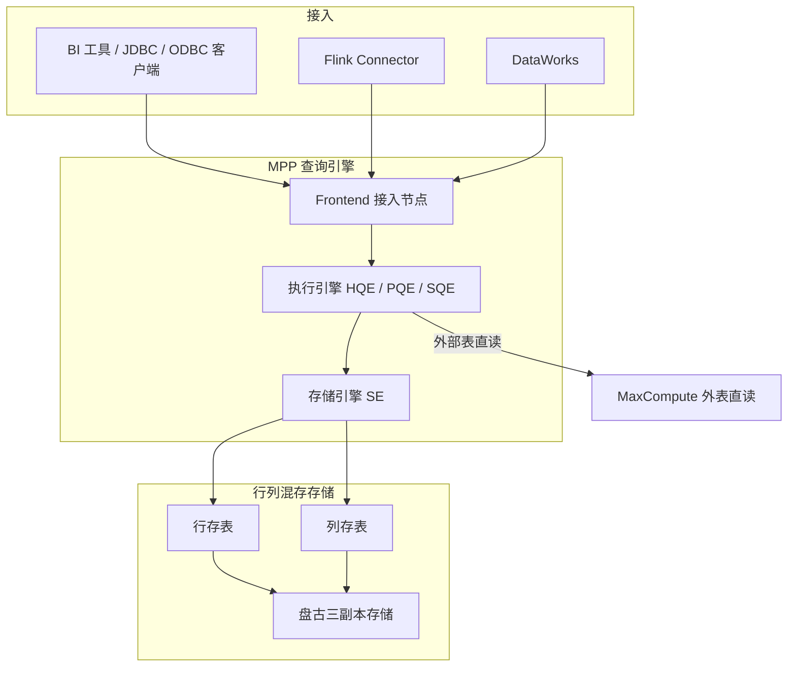

# Hologres · 产品架构

> 产品：Hologres ｜ 口径：公共云 ｜ 复核：2026-11-16

## 产品定位

- Hologres 是阿里巴巴自主研发的一站式实时数仓引擎（Real-Time Data Warehouse），支持海量数据实时写入、实时更新、实时加工、实时分析。
- 支持标准 SQL，兼容 PostgreSQL 协议和语法，支持大部分 PostgreSQL 函数；提供 JDBC/ODBC 接口。
- 支持 PB 级数据多维分析（OLAP）、即席分析（Ad Hoc）与高并发低延迟在线数据服务（Serving）。
- 典型场景：实时数据中台、精细化分析、自助式分析、营销画像、人群圈选、实时风控。

**来源**：
- 什么是实时数仓Hologres：https://help.aliyun.com/zh/hologres/product-overview/what-is-hologres ｜ 复核：2026-11-16

## 架构图

**来源**
- Hologres 产品架构（FE/HQE/PQE/SQE/SE/盘古存储层）：https://help.aliyun.com/zh/hologres/product-overview/architecture ｜ 复核：2026-11-17
- 什么是实时数仓Hologres（MPP/行列混存/存算分离/BI 工具与 JDBC/ODBC 接口）：https://help.aliyun.com/zh/hologres/product-overview/what-is-hologres ｜ 复核：2026-11-17
- 加速访问MaxCompute概览（外表直读）：https://help.aliyun.com/zh/hologres/user-guide/accelerated-queries-on-maxcompute-data ｜ 复核：2026-11-17
- Hologres 基本概念（内部表/外部表）：https://help.aliyun.com/zh/hologres/product-overview/terms ｜ 复核：2026-11-17

## 组件清单

| 组件 | 作用 | 必选/可选 | 是否独立计费 | 备注 |
|---|---|---|---|---|
| 实例 Instance | 使用和管理数据库存储服务的实体，对数据库的所有操作都在实例中完成 | 必选 | 是（计算 CU + 存储，见 [07](07-计费与生命周期.md)） | 兼容 PostgreSQL 协议与语法，提供 JDBC/ODBC 接口 |
| 数据库 Database | 按数据结构组织、存储、管理数据的仓库，表与函数挂在库下 | 必选 | 否 | 购买后系统自动创建 `postgres` 库（仅管理用），业务需新建库 |
| 表（内部表） | 行和列组成的数据存储单元；支持行存、列存、行列共存三种存储模式 | 必选 | 否（存储按 GB 计费，见 [04](04-存储与配套.md)） | 数据存储在 Hologres 侧（盘古三副本冗余） |
| 外部表 Foreign Table | 不在 Hologres 存储数据、仅字段映射的只读表，用于加速查询外部数据源 | 可选 | 否（外部数据源侧扫描费用见关联产品） | 强关联 [MaxCompute](../maxcompute/README) 外表直读 |
| 用户与权限 | 主账号默认 Superuser；RAM 用户/普通用户经授权访问，支持 SPM/SLPM 权限模型 | 必选 | 否 | 普通用户只能查本 DB 自己的慢 Query 日志 |
| 计算 CU | 计费与规格单位，1 CU = 1 core 4 GB；每 16 CU 对应一个计算节点 | 必选 | 是（计算按 CU 计费，见 [07](07-计费与生命周期.md)） | 实例规格 = 计算节点 + Frontend 接入节点 |
| Flink | 内置 Connector 作为源表/维表/结果表写入，消费 Binlog 做数仓分层 | 可选（关联产品） | 是（Flink 侧计费，见 [Flink](../flink/README)） | 强关联 [Flink](../flink/README) |
| DataWorks | 深度集成：图形化数仓搭建、数据集成实时同步、调度与数据服务 | 可选（关联产品） | 是（DataWorks 侧计费，见 [DataWorks](../dataworks/README)） | 强关联 [DataWorks](../dataworks/README) |
| MaxCompute 外表直读 | 无需导出数据，一份存储支持离线 + 实时；相比原生 MaxCompute 访问加速 5-10 倍 | 可选（关联产品） | 是（MaxCompute 侧计费，见 [MaxCompute](../maxcompute/README)） | 强关联 [MaxCompute](../maxcompute/README) |

**来源**
- Hologres 基本概念（账号/角色/实例/数据库/内部表/外部表）：https://help.aliyun.com/zh/hologres/product-overview/terms ｜ 复核：2026-11-17
- Hologres计费概述（计算 CU 计费）：https://help.aliyun.com/zh/hologres/product-overview/billing-overview ｜ 复核：2026-11-17
- 什么是实时数仓Hologres（协同与 5-10 倍加速）：https://help.aliyun.com/zh/hologres/product-overview/what-is-hologres ｜ 复核：2026-11-17
- 加速访问MaxCompute概览：https://help.aliyun.com/zh/hologres/user-guide/accelerated-queries-on-maxcompute-data ｜ 复核：2026-11-17
- Hologres 对接 Flink（Connector/源表/维表/结果表）：https://help.aliyun.com/zh/hologres/user-guide/import-using-flink ｜ 复核：2026-11-17
- DataWorks 实时同步至 Hologres：https://help.aliyun.com/zh/hologres/user-guide/use-real-time-sync-nodes-of-dataworks-to-synchronize-data-from-databases-to-hologres ｜ 复核：2026-11-17
- 慢 Query 日志查看与分析（权限口径）：https://help.aliyun.com/zh/hologres/user-guide/query-and-analyze-slow-query-logs ｜ 复核：2026-11-17

## 架构：MPP + 行列混存 + 存算分离

| 要素 | 官方口径 |
|---|---|
| 计算架构 | 可扩展大规模并行处理（MPP）架构全并行计算，向量化算子发挥 CPU 算力 |
| 存储格式 | 基于 AliORC 压缩存储，面向 SSD 存储优化 IO 吞吐 |
| 存储模式 | 行存、列存、行列共存三种存储模式和多种索引类型 |
| 存算关系 | 计算和存储分离架构，存储资源与实例规格不相关，可独立修改计算和存储资源 |
| 底层冗余 | 无需本地盘，盘古三副本高可靠冗余存储 |
| 负载隔离 | 多个计算实例组成一主多从模式，实例间共享一份存储，计算资源隔离 |
| 运行时资源 | 元数据管理进程、查询服务计算资源、导入链路资源、缓存服务；全部基于云原生容器技术的并行容器计算节点 |
| 性能口径 | 行存主键点查支持每秒数十万 QPS（官方宣称，相比开源系统提升 10 倍以上）；PB 级数据亚秒级交互式分析 |

**来源**：
- 什么是实时数仓Hologres（MPP/AliORC/行列混存/数十万QPS/盘古三副本）：https://help.aliyun.com/zh/hologres/product-overview/what-is-hologres ｜ 复核：2026-11-16
- 实例规格概述（存算分离、运行时资源）：https://help.aliyun.com/zh/hologres/user-guide/overview-of-instance-specifications ｜ 复核：2026-11-16

## 资源模型

| 项目 | 规则 |
|---|---|
| 计费/规格单位 | 1 CU = 1 core 4 GB |
| 计算节点 | 每 16 CU 对应一个计算节点；实例规格 = 计算节点 + Frontend 接入节点 |
| Frontend 节点数 | 512 Core 及以下规格：默认计算节点数与 Frontend 节点数相同；1600 CU 及以上：Frontend 节点数保持 100 不变 |
| 最大连接数 | 由规格决定、不可修改；总连接数 = 单 Frontend 节点最大连接数 × Frontend 节点数（详见 03） |
| Shard 数 | 按规格预分配默认值，可通过创建新 Table Group 调整（详见 03） |

**来源**：
- 实例规格概述：https://help.aliyun.com/zh/hologres/user-guide/overview-of-instance-specifications ｜ 复核：2026-11-16
- Hologres计费概述（1CU=1core 4GB）：https://help.aliyun.com/zh/hologres/product-overview/billing-overview ｜ 复核：2026-11-16
- 实例管理（1600 CU 及以上 Frontend 100 不变）：https://help.aliyun.com/zh/hologres/user-guide/instance-management/ ｜ 复核：2026-11-16

## 与 MaxCompute / Flink / DataWorks 协同

| 协同对象 | 机制 | 官方数字 |
|---|---|---|
| MaxCompute | 外部表透明加速查询、元数据自动导入；无需导出数据，一份存储支持离线+实时 | 相比原生 MaxCompute 访问加速 5-10 倍；两系统间百万行每秒高速同步 |
| Flink / Spark | 内置 Connector，支持源表、结果表、维度表多种场景高通量实时写入与更新 | — |
| Flink（事件驱动） | Hologres 表更新 Binlog 透出，Flink 消费 Binlog 实现数仓分层实时开发 | — |
| DataWorks | 深度集成，图形化数仓搭建、数据血缘、实时同步、数据服务 | — |

**来源**：
- 什么是实时数仓Hologres：https://help.aliyun.com/zh/hologres/product-overview/what-is-hologres ｜ 复核：2026-11-16
- 加速访问MaxCompute概览：https://help.aliyun.com/zh/hologres/user-guide/accelerated-queries-on-maxcompute-data ｜ 复核：2026-11-16

## SLA（服务等级协议）

| 项目 | 数值/规则 |
|---|---|
| 版本生效日期 | 2026 年 9 月 27 日（版本更新日期 2026 年 8 月 27 日） |
| 适用服务项 | 独享实例（按量付费/包年包月）、AI 资源（按量/包年包月）；不含共享集群（湖仓加速版）、公测/邀测/免费功能、本地云版本 |
| 可用性承诺 | 独享实例计算服务、Serverless Computing 计算服务、AI 计算服务可用性不低于 **99.9%** |
| 计算公式 | 服务可用性 =（服务周期总分钟数 − 服务不可用时间段个数 × 5）/ 服务周期总分钟数 × 100% |
| 服务不可用判定 | 以 5 分钟为单位：有效请求数 ≥10 且失败率 100%，该 5 分钟计为 1 个不可用时间段 |
| 赔偿（代金券） | 99.0%≤可用性<99.9% → 月度服务费用 10%；95.0%≤可用性<99.0% → 25%；可用性<95.0% → 50%；总额不超过当月月度服务费用 100% |
| 赔偿申请时限 | 自然月第 5 个工作日后可申请上月赔偿，最迟不晚于相关月份结束后 2 个月 |
| 存储冗余口径 | 本地冗余（单可用区）存在可用区级故障全不可用风险；同城冗余（3AZ，多可用区）可避免单可用区故障，建议关键业务采用 |

**来源**：
- 实时数仓Hologres服务等级协议：https://terms.aliyun.com/legal-agreement/terms/suit_bu1_ali_cloud/suit_bu1_ali_cloud202002020943_88421.html ｜ 复核：2026-11-16
