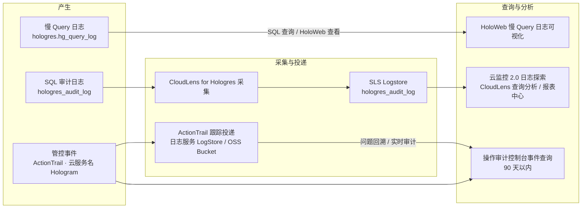

# Hologres · 日志与审计

> 产品：Hologres ｜ 口径：公共云 ｜ 复核：2026-11-18

## 日志流转图

**来源**
- 慢 Query 日志查看与分析（HoloWeb 可视化 / SQL 查询 hg_query_log）：https://help.aliyun.com/zh/hologres/user-guide/query-and-analyze-slow-query-logs ｜ 复核：2026-11-18
- SQL 审计（CloudLens for Hologres 一键采集）：https://help.aliyun.com/zh/hologres/security-and-compliance/sql-audit ｜ 复核：2026-11-18
- 云监控 2.0 Hologres 数据接入（SLS Project/Logstore）：https://help.aliyun.com/zh/cms/cloudmonitor-2-0/real-time-data-warehouse-hologres-data-access ｜ 复核：2026-11-18
- ActionTrail 事件审计日志（查询与投递 SLS/OSS）：https://help.aliyun.com/zh/hologres/security-and-compliance/query-event-logs ｜ 复核：2026-11-18

## 日志类型总表

| 类型 | 产生方 | 查看入口 | 默认保留期 | 是否计费 |
|---|---|---|---|---|
| 引擎日志·慢/失败 Query 日志（`hologres.hg_query_log` 系统表） | Hologres 引擎（元仓系统） | HoloWeb「慢 Query 日志」可视化；或 SQL 查询 `hologres.hg_query_log` | 系统表默认保留一个月；HoloWeb 可视化最多查看 7 天历史 | 否（慢 Query 日志不单独计费；其稳定性不在 SLA 保护范围内） |
| 审计日志·SQL 审计日志（`hologres_audit_log`，CloudLens for Hologres 采集） | Hologres + 云监控 CloudLens / 日志服务 SLS | 云监控控制台 CloudLens for Hologres「查询分析/报表中心」；云监控 2.0「Hologres 洞察 > 日志探索」 | 存储于 SLS，保存天数在「存储目标库」配置；默认值官方未标注 📋 待补 | 按日志服务 SLS 计费（接入费用说明口径） |
| 操作日志·管控事件（ActionTrail，云服务名称 `Hologram`） | 操作审计 ActionTrail | 操作审计控制台 > 事件 > 事件查询 > 云服务名称选 `Hologram` | 仅能查询 90 天以内事件；事件生成延迟约 5~10 分钟 | 事件查询费用官方未标注 ⚠️ 待核；投递到 SLS/OSS 按目标产品计费 |
| 运维事件日志（计划内/历史事件：系统维护、代理版本升级、架构升级） | Hologres 后台运维 | Hologres 管控台 > 运维事件管理（计划内事件/历史事件）；云监控「事件中心 > 系统事件」（产品选「交互式分析」） | 历史事件统计已运行完成的事件；保留天数官方未标注 📋 待补 | 否（事件自动短信/邮件推送主账号） |

- 慢 Query 日志仅记录已执行完成的 SQL；单次查询最多返回 10,000 条。
- 慢 Query 采集阈值由 GUC 参数 `log_min_duration_statement` 控制，V2.2.7 起默认 100 ms。
- SQL 审计日志接入要求实例版本 r2.2.0 及以上（云监控 2.0 日志接入口径）。

**来源**
- 慢 Query 日志查看与分析（保留一个月/单次 10000 条/100ms 默认阈值）：https://help.aliyun.com/zh/hologres/user-guide/query-and-analyze-slow-query-logs ｜ 复核：2026-11-17
- SQL 审计（CloudLens for Hologres 一键采集）：https://help.aliyun.com/zh/hologres/security-and-compliance/sql-audit ｜ 复核：2026-11-17
- 云监控 2.0 Hologres 数据接入（SLS Project/Logstore、r2.2.0 版本要求、费用）：https://help.aliyun.com/zh/cms/cloudmonitor-2-0/real-time-data-warehouse-hologres-data-access ｜ 复核：2026-11-17
- 云监控 Hologres 使用管理（存储目标库与保存时间）：https://help.aliyun.com/zh/cms/cloudmonitor-1-0/user-guide/hologres-usage-management ｜ 复核：2026-11-17
- ActionTrail 事件审计日志（90 天/5~10 分钟生成/Hologram）：https://help.aliyun.com/zh/hologres/security-and-compliance/query-event-logs ｜ 复核：2026-11-17
- 运维事件管理（计划内/历史事件、短信邮件推送）：https://help.aliyun.com/zh/hologres/user-guide/o-m-event-management ｜ 复核：2026-11-17
- 设置运维事件告警（云监控系统事件订阅）：https://help.aliyun.com/zh/hologres/user-guide/set-event-alert ｜ 复核：2026-11-17

## 关键日志详表

**A. 慢/失败 Query 日志（`hologres.hg_query_log`，节选 8 个关键字段）**

| 字段 | 类型 | 含义 |
|---|---|---|
| `usename` | text | 执行查询的用户名 |
| `status` | text | 查询最终状态：SUCCESS / FAILED（聚合记录仅 SUCCESS） |
| `query_id` | text | Query 唯一 ID；失败 Query 一定有，成功 Query 不一定有 |
| `digest` | text | SQL 指纹编码（MD5 哈希，V2.2 起新增），用于聚合定位同类 SQL |
| `command_tag` | text | 查询类型：DML（SELECT/INSERT/UPDATE/DELETE/COPY）、DDL（CREATE TABLE 等）、其他（EXPLAIN/GRANT 等） |
| `duration` | integer | 查询总耗时（ms），含 Optimization / Start Query / Get Result 三段 |
| `query` | text | 查询文本内容，长度上限 51200 字符，超出截断 |
| `application_name` | text | 查询应用类型，如 `holoweb`、`MaxCompute`、`QuickBI_public_{version}`、Flink/DataWorks 连接串标识 |

**B. SQL 审计日志（`hologres_audit_log`，云监控 2.0 日志探索索引字段，节选 8 个）**

| 字段 | 含义 |
|---|---|
| `__topic__` | 日志主题，固定为 `hologres_audit_log` |
| `instance` | Hologres 实例 ID |
| `client_addr` | 访问 Hologres 实例的客户端 IP 地址 |
| `datname` | 数据库名 |
| `usename` | 执行操作的用户名 |
| `query` | 执行的 SQL 语句内容 |
| `duration` | 执行 SQL 操作后多久返回结果，单位 ms |
| `status` | 执行状态（如 SUCCESS） |

**C. 管控事件（ActionTrail 管控事件结构，节选 8 个字段）**

| 字段 | 含义 |
|---|---|
| `eventTime` | 事件发生时间（UTC 格式） |
| `eventName` | 事件名称，如 CreateInstance、AddUsers、EnableSSL、CONN、LoginInstanceInHoloWeb |
| `eventSource` | 事件来源（Hologres 对应云服务名 `Hologram`） |
| `eventType` | 事件类型：ApiCall / ConsoleOperation / ConsoleSignin 等 |
| `eventRW` | 事件读写类型：Read / Write |
| `sourceIpAddress` | 事件发起的源 IP 地址 |
| `userIdentity` | 请求者身份信息（root-account / ram-user / assumed-role 等） |
| `errorCode` | 云服务处理 API 请求发生错误时记录的错误码 |

**来源**
- 慢 Query 日志字段说明（hg_query_log 全字段表）：https://help.aliyun.com/zh/hologres/user-guide/query-and-analyze-slow-query-logs ｜ 复核：2026-11-17
- 云监控 2.0 日志探索（Hologres 审计日志字段/索引）：https://help.aliyun.com/zh/cms/cloudmonitor-2-0/hologres-log-explorer ｜ 复核：2026-11-17
- 实时数仓Hologres的审计事件（事件名称列表）：https://help.aliyun.com/zh/actiontrail/product-overview/audit-events-of-hologres ｜ 复核：2026-11-17
- 管控事件结构定义：https://help.aliyun.com/zh/actiontrail/user-guide/management-event-structure ｜ 复核：2026-11-17

## 投递与加工

| 通道 | 去向与参数 | 关键限制 / 额度 | 计费要点 |
|---|---|---|---|
| CloudLens for Hologres SQL 审计采集 | SLS Project `aliyun-product-data-<账号ID>-<地域>`，Logstore `hologres_audit_log` | 一键开启采集；实例版本 r2.2.0+；公共云支持华东1（杭州）、华北2（北京）、华南1（深圳）、华东2（上海）等 14 个地域 | 日志接入按日志服务 SLS 计费 |
| 存储目标库管理 | 云监控控制台 > CloudLens for Hologres > 存储目标库：可查看/配置目标日志库、地域、数据保存时间（天）、采集实例 | 默认保存天数官方未标注 📋 待补 | 同上（SLS 存储/索引费用） |
| 审计事件投递（ActionTrail 跟踪） | 创建跟踪后将查询结果投递至日志服务 LogStore 或 OSS Bucket | 用于事件监控告警、及时审计、问题回溯 | 投递目标按 SLS/OSS 各自定价；查询计费口径 ⚠️ 待核 |
| 慢 Query 日志查询与分析 | SQL 查询 `hologres.hg_query_log`；HoloWeb 可视化查看 | 单次最多返回 10,000 条；HoloWeb 仅 Superuser 可视化查看（最多 7 天）；V3.0.2 起对 <100 ms 成功 DML/DQL 按连接每分钟聚合记录（`calls`/`agg_stats`） | 不单独计费 |
| 云监控 2.0 指标与日志接入 | 指标 → Prometheus 实例 `RegionShare:<工作空间>:<地域>`；审计日志 → 上述 SLS Logstore | RAM 用户需 `AliyunCloudMonitorFullAccess`；需开通可观测 Prometheus 版与企业云监控 | 指标接入产生企业云监控实时导出费 + Prometheus 费用；日志接入按 SLS 计费 |
| 下游告警与报表 | CloudLens「报表中心」（SQL 审计报表）；云监控事件订阅（短信/邮件） | 报表支持按实例 ID、数据库、账号、类型、客户端 IP、状态筛选 | 云监控报警本身不单独收费，通知渠道按短信/电话等渠道资费 |
| 跨账号投递 | 官方文档未说明 Hologres 日志的跨账号投递方式 📋 待补 | — | — |

**来源**
- 云监控 2.0 Hologres 数据接入（存储位置/费用/地域/版本要求）：https://help.aliyun.com/zh/cms/cloudmonitor-2-0/real-time-data-warehouse-hologres-data-access ｜ 复核：2026-11-17
- 云监控 Hologres 使用管理（存储目标库、查询分析、报表中心）：https://help.aliyun.com/zh/cms/cloudmonitor-1-0/user-guide/hologres-usage-management ｜ 复核：2026-11-17
- ActionTrail 事件审计日志（投递 SLS/OSS）：https://help.aliyun.com/zh/hologres/security-and-compliance/query-event-logs ｜ 复核：2026-11-17
- 慢 Query 日志查看与分析（权限/聚合/限制）：https://help.aliyun.com/zh/hologres/user-guide/query-and-analyze-slow-query-logs ｜ 复核：2026-11-17
- 设置运维事件告警（事件订阅）：https://help.aliyun.com/zh/hologres/user-guide/set-event-alert ｜ 复核：2026-11-17
- SQL 审计（CloudLens for Hologres 功能清单）：https://help.aliyun.com/zh/hologres/security-and-compliance/sql-audit ｜ 复核：2026-11-17

## 审计与合规

| 项 | 官方口径 |
|---|---|
| 接入方式 | Hologres 已与操作审计 ActionTrail 集成，记录用户通过 OpenAPI、控制台等方式操作产生的管控事件；云服务名称为 `Hologram` |
| 查询范围 | 支持查询 90 天以内事件；实例操作约 5~10 分钟后生成行为事件日志 |
| 留痕事件范围 | 实例/库/用户/计算组/备份/网络与白名单/SSL 等管控事件，如 `CreateInstance`、`ModifyInstance`、`AddUsers`、`DropUsers`、`EnableSSL`、`CONN`（AK 连接登录）、`LoginInstanceInHoloWeb`、`SaveWhiteIPList`、`ScaleInstance`、`Release` 等 |
| 查询入口 | 操作审计控制台 > 事件 > 事件查询 > 地域 > 云服务名称选 `Hologram`；也支持 OpenAPI、开发者工具查询 |
| 长期保存 | 查询结果可投递至日志服务 LogStore 或 OSS Bucket，满足实时审计与问题回溯；重要事件可配置跟踪警告 |
| SQL 级审计 | CloudLens for Hologres 一键开启 SQL 审计日志采集，提供实时存储、查询分析与可视化报表；云监控 2.0「日志探索」按 `hologres_audit_log` 索引分析 |
| 合规基线 | Hologres 安全白皮书口径：SOC 3 / PCI DSS 合规、KMS BYOK 存储加密、SSL 传输加密、列级数据脱敏、ActionTrail 审计、VPC 隔离与 IP 白名单 |
| 事件订阅 | 除管控事件外，运维事件（系统维护/代理版本升级/架构升级）自动短信、邮件推送主账号，并同步到云监控系统事件 |

**来源**
- ActionTrail 事件审计日志（查询方式与注意事项）：https://help.aliyun.com/zh/hologres/security-and-compliance/query-event-logs ｜ 复核：2026-11-17
- 实时数仓Hologres的审计事件（事件列表）：https://help.aliyun.com/zh/actiontrail/product-overview/audit-events-of-hologres ｜ 复核：2026-11-17
- SQL 审计（CloudLens for Hologres）：https://help.aliyun.com/zh/hologres/security-and-compliance/sql-audit ｜ 复核：2026-11-17
- 云监控 2.0 日志探索（审计日志索引字段）：https://help.aliyun.com/zh/cms/cloudmonitor-2-0/hologres-log-explorer ｜ 复核：2026-11-17
- 运维事件管理（事件类型与通知）：https://help.aliyun.com/zh/hologres/user-guide/o-m-event-management ｜ 复核：2026-11-17
- Hologres 安全白皮书（合规基线）：https://help.aliyun.com/zh/hologres/security-and-compliance/security-white-paper ｜ 复核：2026-11-17
