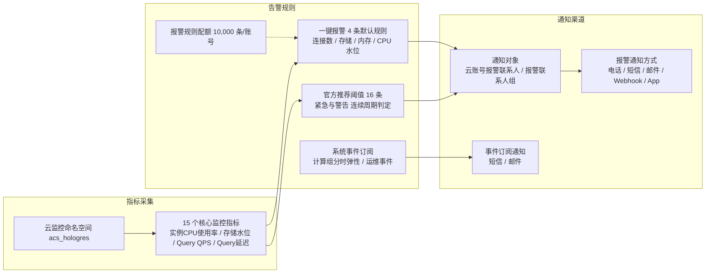

# Hologres · 监控与告警

> 产品：Hologres ｜ 口径：公共云 ｜ 复核：2026-11-18

## 告警链路图

**来源**
- 云监控接入与告警（Namespace/一键报警默认规则/最佳实践阈值/系统事件/通知对象）：https://help.aliyun.com/zh/hologres/user-guide/cloudmonitor ｜ 复核：2026-11-18
- Hologres 监控指标说明（15 个核心监控指标/30 天保留）：https://help.aliyun.com/zh/hologres/user-guide/hologres-metrics ｜ 复核：2026-11-18
- 设置运维事件告警（事件订阅与短信邮件通知）：https://help.aliyun.com/zh/hologres/user-guide/set-event-alert ｜ 复核：2026-11-18
- 云监控报警规则概述（电话/短信/邮件/Webhook/App）：https://help.aliyun.com/zh/cms/cloudmonitor-1-0/user-guide/overview-2 ｜ 复核：2026-11-18
- 云监控使用限制（报警规则数量配额 10,000 条）：https://help.aliyun.com/zh/cms/cloudmonitor-1-0/product-overview/restrictions-on-use ｜ 复核：2026-11-18

## 核心监控指标

- Hologres 已接入云监控（CloudMonitor），命名空间（Namespace）为 `acs_hologres`；云监控中产品名称为「交互式分析」。
- 指标集按实例类型拆分：`hologres_standard`（通用型）、`hologres_warehouse`（计算组）、`hologres_shared`（湖仓加速）、`hologres_follower`（从实例）。
- metricid（Metric ID）按实例类型加前缀：通用型 `standard_`、从实例 `follower_`、计算组 `warehouse_`、湖仓加速 `shared_`；云监控 2.0 中指标以 `AliyunHologres_` 为前缀（官方示例 `AliyunHologres_connection_count`）。
- 完整英文 Metric ID、Dimensions、Min Periods 仅在登录后的云监控「指标列表」页展示，下表相关单元格标 `⚠️ 待核`；「维度」列统一为实例维度，具体 Dimensions 取值以指标列表页为准 `⚠️ 待核`。
- 监控数据最多保留 30 天（Hologres 管控台口径）。

| 指标（官方英文名 / Metric ID） | 含义 | 单位 | 统计周期 | 维度 |
|---|---|---|---|---|
| 实例CPU使用率（%）｜英文名 `⚠️ 待核` | 实例整体 CPU 使用率，代表计算负载 | % | 1 分钟（官方告警实践口径） | 实例 |
| Worker节点CPU使用率（%）｜英文名 `⚠️ 待核` | 实例内每个 Worker 的 CPU 使用率 | % | 1 分钟（官方告警实践口径） | 实例 |
| 实例内存使用率（%）｜英文名 `⚠️ 待核` | 实例整体内存综合使用率（无查询时 30%~40% 属正常） | % | 1 分钟（官方告警实践口径） | 实例 |
| 标准存储使用率（%）｜英文名 `⚠️ 待核` | 标准存储量的使用率（存储水位） | % | ⚠️ 待核（Min Periods 见指标列表页） | 实例 |
| 标准存储已用容量（byte）｜英文名 `⚠️ 待核` | 标准存储已使用的存储量 | byte | ⚠️ 待核（Min Periods 见指标列表页） | 实例 |
| Query QPS（countS）｜英文名 `⚠️ 待核` | 实例内平均每秒 SQL 执行次数（SELECT/INSERT/UPDATE/DELETE/UTILITY/UNKNOWN 总和） | countS | ⚠️ 待核（Min Periods 见指标列表页） | 实例 |
| Query延迟（milliseconds）｜英文名 `⚠️ 待核` | 实例内 Query 的平均延迟 | 毫秒 | ⚠️ 待核（Min Periods 见指标列表页） | 实例 |
| Query P99延迟（milliseconds）｜英文名 `⚠️ 待核` | Query 的 P99 延迟 | 毫秒 | ⚠️ 待核（Min Periods 见指标列表页） | 实例 |
| 失败Query QPS（countS）｜英文名 `⚠️ 待核` | 实例内平均每秒失败 Query 数（≥ QE 失败 + FixedQE 失败） | countS | 1 分钟（官方告警实践口径） | 实例 |
| 最大FE连接数使用率（%）｜`frontend_connection_used_rate` | 所有 Frontend 节点连接数使用率的最大值，即 Max(frontend_connection_used_rate) | % | 1 分钟（官方告警实践口径） | 实例 |
| Gateway连接数（个）｜英文名 `⚠️ 待核` | 实例 Gateway 的总连接数，反映接入层整体连接负载 | 个 | ⚠️ 待核（Min Periods 见指标列表页） | 实例 |
| FE replay延迟（milliseconds）｜英文名 `⚠️ 待核` | 每个 FE 的 Replay 延迟，过长可能 FE 卡住导致 Query 卡住 | 毫秒 | 1 分钟（官方告警实践口径） | 实例 |
| 主从同步延迟（milliseconds）｜英文名 `⚠️ 待核` | 从实例读取主实例数据的延迟（仅从实例展示） | 毫秒 | 1 分钟（官方告警实践口径） | 实例（仅从实例） |
| Shard多副本同步延迟（milliseconds）｜英文名 `⚠️ 待核` | 开启 Replication 后 Shard 多副本之间的同步延迟 | 毫秒 | ⚠️ 待核（Min Periods 见指标列表页） | 实例 |
| 每秒消费Binlog的条数｜英文名 `⚠️ 待核` | 每秒消费 Binlog 的条数 | 条/秒 ⚠️ 待核 | ⚠️ 待核（Min Periods 见指标列表页） | 实例 |

- 其余官方指标分类还有：Memory（QE Query 内存使用量/使用率、内存分布）、Locks（DDL 锁/后端拿锁耗时）、IO（标准/低频读写吞吐）、Query Queue（排队数量/平均排队时长）、Auto Analyze（统计信息缺失表个数）、Serverless Computing（排队数量/Quota 使用率）、Binlog（每秒消费字节数、Walsender 使用率）、Dynamic Table（刷新失败 QPS、数据延迟）、Gateway（CPU/内存/入口出口流量）等。
- 若指标显示「暂无数据」，可能是实例版本暂不支持该指标或长期无数据。

**来源**
- Hologres 监控指标说明（指标分类/含义/支持实例类型/metricid 前缀/30 天）：https://help.aliyun.com/zh/hologres/user-guide/hologres-metrics ｜ 复核：2026-11-17
- 云监控接入与告警（Namespace/指标列表页/一键报警/告警最佳实践）：https://help.aliyun.com/zh/hologres/user-guide/cloudmonitor ｜ 复核：2026-11-17
- 云监控 2.0 Hologres 指标探索（`AliyunHologres_` 前缀与示例）：https://help.aliyun.com/zh/cms/cloudmonitor-2-0/hologres-metric-explorer ｜ 复核：2026-11-17
- 控制台查看监控指标（CPU/内存/存储/连接数/QPS/延迟/RPS）：https://help.aliyun.com/zh/hologres/user-guide/view-metrics ｜ 复核：2026-11-17

## 官方默认与推荐告警

**A. 官方一键报警默认规则（作用于主账号下所有 Hologres 实例，告警周期默认 5 分钟，可自定义）**

| 指标 | 等级 | 默认触发条件 | 通知对象 |
|---|---|---|---|
| 连接数使用率 | 通知（Info） | 连续 3 次平均值 ≥95 | 云账号报警联系人 |
| 存储水位 | 警告（Warn） | 连续 3 次平均值 >90 | 云账号报警联系人 |
| 内存水位 | 警告（Warn） | 连续 3 次平均值 ≥90 | 云账号报警联系人 |
| CPU 水位 | 通知（Info） | 连续 3 次平均值 ≥99 | 云账号报警联系人 |

**B. 官方推荐告警（「告警设置最佳实践」，1 周期 = 1 分钟）**

| 指标 | 等级 | 官方推荐阈值 |
|---|---|---|
| 实例CPU使用率 | 紧急（Critical） | 连续 60 个周期监控值 ≥99% |
| 实例CPU使用率 | 警告（Warn） | 连续 10 个周期监控值 ≥99% |
| Worker节点CPU使用率 | 紧急（Critical） | 连续 60 个周期监控值 ≥99% |
| Worker节点CPU使用率 | 警告（Warn） | 连续 10 个周期监控值 ≥99% |
| 实例内存使用率 | 紧急（Critical） | 连续 60 个周期监控值 ≥99% |
| 实例内存使用率 | 警告（Warn） | 连续 10 个周期监控值 ≥99% |
| Worker节点内存使用率 | 紧急（Critical） | 连续 60 个周期监控值 ≥99% |
| Worker节点内存使用率 | 警告（Warn） | 连续 10 个周期监控值 ≥99% |
| 连接数使用率最高的FE的连接数使用率 | 警告（Warn） | 连续 5 个周期监控值 ≥95% |
| wal sender使用率最高的FE的wal sender使用率 | 警告（Warn） | 连续 5 个周期监控值 ≥95% |
| 本实例正在运行中Query最长的时长 | 警告（Warn） | 连续 10 个周期监控值 ≥3,600,000 ms |
| 正在运行的 Serverless Computing 查询最长时长 | 警告（Warn） | 连续 10 个周期监控值 ≥3,600,000 ms |
| 失败Query QPS | 警告（Warn） | 连续 10 个周期监控值 ≥10 countS |
| FE replay延迟 | 警告（Warn） | 连续 10 个周期监控值 ≥300,000 ms |
| 主从同步延迟（仅从实例） | 警告（Warn） | 连续 10 个周期监控值 ≥600,000 ms |
| 每个DB统计信息缺失的表个数 | 警告（Warn） | 连续 60 个周期监控值 ≥10 countS |

- 官方提示：不建议 CPU/内存单次达到 100% 即告警；CPU 告警水位不宜设置过低；FE replay 延迟不宜设得过短（元数据修改即有 replay，秒级属正常）。
- 其他指标（Query QPS、Query 延迟、存储已用容量、IO 吞吐、Binlog 消费、Query Queue 等）：**官方未发布推荐阈值** 📋 待补（结构性）（按阈值红线不收经验值）。

**C. 官方系统事件告警（事件订阅，产品选「交互式分析」）**

| 功能 | 系统事件 |
|---|---|
| 计算组分时弹性 | 计算组分时弹性变配开始、计算组分时弹性变配完成、计算组分时弹性变配失败 |
| 运维事件 | 创建计划事件、计划事件开始执行、计划事件执行成功、计划事件执行失败、计划事件取消、计划事件执行时间变更 |

- 旧版系统事件报警规则功能已停止升级并逐步下线，官方建议改用事件订阅功能。

**来源**
- 云监控接入与告警（一键报警默认规则/最佳实践阈值/系统事件清单）：https://help.aliyun.com/zh/hologres/user-guide/cloudmonitor ｜ 复核：2026-11-18
- 设置运维事件告警（事件订阅步骤与事件列表）：https://help.aliyun.com/zh/hologres/user-guide/set-event-alert ｜ 复核：2026-11-18
- Hologres 监控指标说明（指标含义与适用版本）：https://help.aliyun.com/zh/hologres/user-guide/hologres-metrics ｜ 复核：2026-11-18

## 通知与渠道

| 渠道/机制 | 说明 |
|---|---|
| 报警通知方式 | 云监控报警服务支持电话、短信、邮件和 Webhook 地址；安装阿里云 App 可通过 App 接收报警通知 |
| 通知对象 | 一键报警默认通知对象为「云账号报警联系人」；创建报警规则时可选已绑定的报警联系人组 |
| 报警规则入口 | 云监控控制台 > 报警服务 > 报警规则 > 创建报警规则；Hologres 监控大盘内也可单击「创建报警规则/查看报警规则」 |
| 系统事件订阅 | 事件中心 > 系统事件 > 立即创建，订阅类型选「系统事件」、产品选「交互式分析」，通过短信、邮件接收通知 |
| 运维事件自动通知 | Hologres 发起运维事件时，自动通过短信、邮件推送至实例对应主账号，并同步推送至云监控系统事件 |
| 报警升级（Escalation） | Hologres 官方文档未发布告警升级策略 📋 待补（结构性） |
| 通道沉默周期（Silence） | 云监控通用取值：5 分钟、15 分钟、30 分钟、60 分钟、3 小时、6 小时、12 小时、24 小时；沉默期内不重复发送，超期未恢复再次发送（2026-11-18 复查已发布，原「未标注取值」作废） |
| RAM 用户查看监控 | 默认 RAM 用户无法查看云监控指标，需授予 `AliyunCloudMonitorFullAccess` / `AliyunCloudMonitorReadOnlyAccess` / `AliyunCloudMonitorMetricDataReadOnlyAccess` 之一 |

**来源**
- 云监控报警规则概述（电话/短信/邮件/Webhook/App）：https://help.aliyun.com/zh/cms/cloudmonitor-1-0/user-guide/overview-2 ｜ 复核：2026-11-18
- 云监控接入与告警（通知对象/报警规则入口/事件订阅/RAM 授权）：https://help.aliyun.com/zh/hologres/user-guide/cloudmonitor ｜ 复核：2026-11-18
- 设置运维事件告警（短信邮件通知）：https://help.aliyun.com/zh/hologres/user-guide/set-event-alert ｜ 复核：2026-11-18
- 创建报警规则（通道沉默周期取值 5 分钟~24 小时、生效时间、无数据处理）：https://help.aliyun.com/zh/cms/cloudmonitor-1-0/user-guide/create-an-alert-rule ｜ 复核：2026-11-18
- 运维事件管理（自动推送主账号）：https://help.aliyun.com/zh/hologres/user-guide/o-m-event-management ｜ 复核：2026-11-18

## 告警配额

| 限制项 | 最大值 | 归属 |
|---|---|---|
| 单账号可新建的报警规则数量 | 10,000 条 | 基础云监控 |
| 单账号可新建的动态规则数量 | 1,200 个 | 基础云监控 |
| 单账号可新建的应用分组数量 | 20,000 个 | 基础云监控 |
| 一个应用分组内允许新建的可用性监控数量 | 500 个 | 基础云监控 |
| 一个应用分组内包含的每种资源数量 | 3,000 个 | 基础云监控 |
| 一个地域允许通过标签创建的应用分组标签数量 | 100 个 | 基础云监控 |
| 监控数据存储时长（Period < 60 秒） | 7 天 | 基础云监控 |
| 监控数据存储时长（Period = 60 秒） | 31 天 | 基础云监控 |
| 监控数据存储时长（Period ≥ 300 秒） | 91 天 | 基础云监控 |
| Hologres 监控数据查看时长（管控台口径） | 30 天 | Hologres 管控台 |
| 单账号可新建的 PromQL 报警规则数量 | 20 条 | 企业云监控 |
| 单账号可新建的指标仓库数量 | 30 个 | 企业云监控 |
| 单账号可新建的 SLS Logstore 组数量 | 20 个（每组最多 25 个 Logstore） | 企业云监控 |
| 一个智能水位分析任务可设置的报警联系人组数量 | 5 个 | 企业云监控 |
| 一个智能守护任务可添加的资源数量 | 100 个 | 企业云监控 |
| 报警联系人 / 报警联系人组数量上限 | 📋 待补（结构性）（官方使用限制页未列出该配额） | 基础云监控 |

**来源**
- 云监控使用限制（报警规则/应用分组/存储时长/企业云监控配额）：https://help.aliyun.com/zh/cms/cloudmonitor-1-0/product-overview/restrictions-on-use ｜ 复核：2026-11-18
- Hologres 监控指标说明（监控数据最多保留 30 天）：https://help.aliyun.com/zh/hologres/user-guide/hologres-metrics ｜ 复核：2026-11-18
- 云监控接入与告警（Hologres 侧告警入口）：https://help.aliyun.com/zh/hologres/user-guide/cloudmonitor ｜ 复核：2026-11-18
