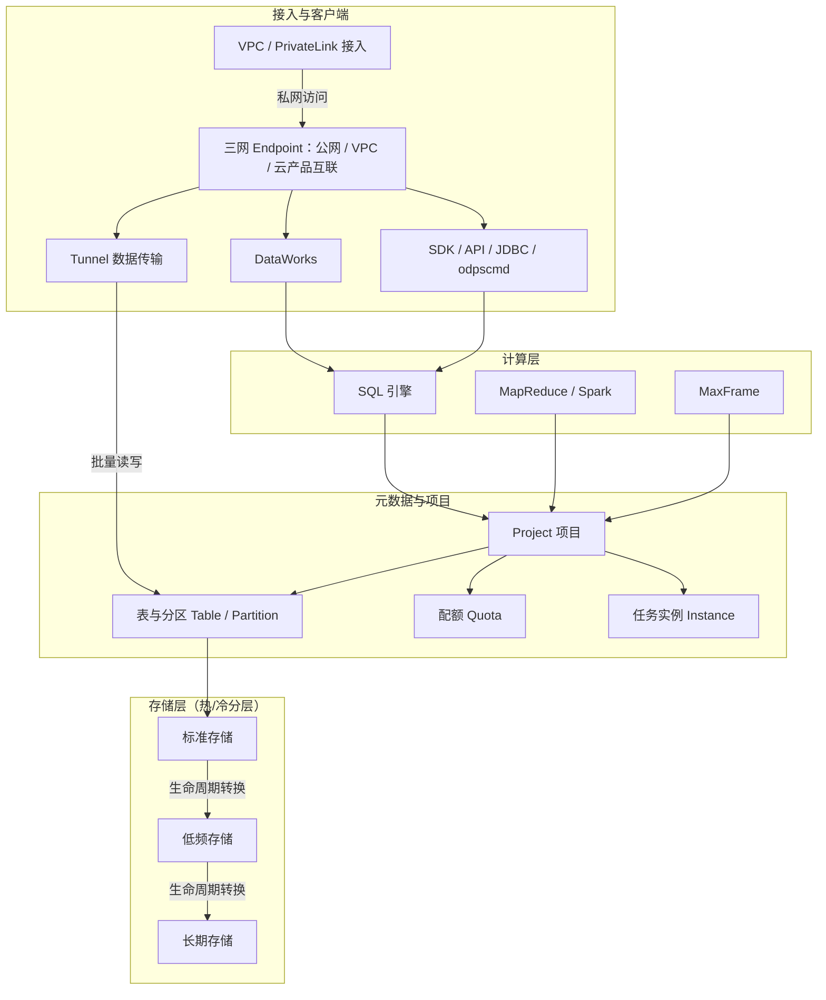

# MaxCompute · 产品架构

> 产品：MaxCompute（原 ODPS） ｜ 口径：公共云 ｜ 复核：2026-11-18

## 产品定义

- MaxCompute（原名 ODPS）是阿里云的云原生大数据计算服务，官方定位为 Serverless 架构的企业级 SaaS 化智能云数据仓库。
- 以 Serverless、存算分离方式提供全托管服务：存储和计算独立扩展、动态扩缩容，无需预留资源。
- 接入方式：SDK / API / JDBC 等标准接口；上层集成 DataWorks、PAI、Hologres、Quick BI。

**来源**：
- 什么是MaxCompute：https://help.aliyun.com/zh/maxcompute/user-guide/what-is-maxcompute ｜ 复核：2026-11-16

## 架构图

**来源**
- 什么是MaxCompute（存储层/计算层/运维管控层、SDK/API/JDBC 接入、DataWorks 集成）：https://help.aliyun.com/zh/maxcompute/user-guide/what-is-maxcompute ｜ 复核：2026-11-17
- Endpoint（公网/VPC/云产品互联三网）：https://help.aliyun.com/zh/maxcompute/endpoints ｜ 复核：2026-11-17
- 通过VPC私网连接访问MaxCompute（PrivateLink）：https://help.aliyun.com/zh/maxcompute/user-guide/vpc-private-link-maxcompute ｜ 复核：2026-11-17
- 数据传输服务概述（Tunnel）：https://help.aliyun.com/zh/maxcompute/overview-of-dts ｜ 复核：2026-11-17
- MaxCompute 功能特性（SQL/MapReduce/Spark/MaxFrame 计算引擎）：https://help.aliyun.com/zh/maxcompute/user-guide/product-function-node-odps-1694660305068 ｜ 复核：2026-11-17
- 项目：https://help.aliyun.com/zh/maxcompute/user-guide/project ｜ 复核：2026-11-17
- 配额（Quota）：https://help.aliyun.com/zh/maxcompute/user-guide/quota ｜ 复核：2026-11-17
- 任务实例（状态取值）：https://help.aliyun.com/zh/maxcompute/user-guide/task-instance ｜ 复核：2026-11-17
- 存储资源-分层存储（标准/低频/长期）：https://help.aliyun.com/zh/maxcompute/user-guide/tiered-storage ｜ 复核：2026-11-17

## 组件清单

| 组件 | 作用 | 必选/可选 | 是否独立计费 | 备注 |
|---|---|---|---|---|
| 项目 Project | MaxCompute 基本组织单元，多用户隔离与访问控制边界，计费以项目为单位 | 必选 | 否（作为计费归属单元，本身不产生费用） | 创建时选择默认 Quota；包含表、资源、函数、实例 |
| 表与分区 Table / Partition | 数据存储与查询裁剪的基本对象 | 必选 | 否（按存储量计费） | 单表最多 60000 个分区、1200 列 |
| 任务 Task / 任务实例 Instance | 基本计算单元；Instance 代表任务运行生命周期 | 必选 | 否（按扫描量/CU 消耗计费） | 状态取值 Running、Success、Failed、Cancelled；SQL/MR 提交后解析为多 Stage 执行计划 |
| 配额 Quota | 计算资源池，1 CU = 1 CPU + 4 GB 内存，项目内作业默认使用关联配额组 | 必选 | 是（包年包月/按量/按时计费） | 包年包月标准版 50 CU 起售 |
| Tunnel 数据传输服务 | 数据上传/下载通道（普通 Tunnel 批量 + Stream Tunnel 流式） | 可选（入仓/出仓时使用） | 部分（公网下载收费，内网导入不收费） | 公网下载 0.8 元/GB；共享资源组每地域 1 个并有并发上限，独享资源组单独购买 |
| 资源 Resource | UDF 与 MapReduce 依赖的辅助文件（File/Table/JAR/Archive/Python 五类） | 可选 | 否 | 单个资源上限 2048 MB |
| 冷热分层存储 | 标准/低频/长期三层，按最后修改/访问时间自动或手动转换 | 可选 | 是（分层单价不同，低频/长期另收数据访问费） | 规则分项目级与分区表级；平台每天定时扫描两次 |
| 数据开发与集成 DataWorks | 上层数据同步、开发、调度与运维平台 | 可选（关联产品） | 是（DataWorks 侧计费） | 强关联 [DataWorks](../dataworks/) |
| OSS 外部表 / 数据入仓 | 外部表直读 OSS 数据，或经 Tunnel/DataWorks 将 OSS 数据写入 MaxCompute | 可选（关联产品） | 是（OSS 侧存储与流量计费） | 强关联 [OSS](../oss/) |

**来源**
- 项目：https://help.aliyun.com/zh/maxcompute/user-guide/project ｜ 复核：2026-11-17
- 表概念（内部表与外部表）：https://help.aliyun.com/zh/maxcompute/user-guide/table ｜ 复核：2026-11-17
- MaxCompute 使用限制（单表 1200 列/60000 分区）：https://help.aliyun.com/zh/maxcompute/user-guide/limits-4 ｜ 复核：2026-11-17
- 任务（Task 与执行计划）：https://help.aliyun.com/zh/maxcompute/user-guide/task ｜ 复核：2026-11-17
- 任务实例（Instance 生命周期与状态）：https://help.aliyun.com/zh/maxcompute/user-guide/task-instance ｜ 复核：2026-11-17
- 配额（1 CU 定义与起售规格）：https://help.aliyun.com/zh/maxcompute/user-guide/quota ｜ 复核：2026-11-17
- 数据传输服务概述（Tunnel 构成与共享/独享资源组）：https://help.aliyun.com/zh/maxcompute/overview-of-dts ｜ 复核：2026-11-17
- 数据传输费用（公网下载 0.8 元/GB、导入不收费）：https://help.aliyun.com/zh/maxcompute/data-transfer-fee ｜ 复核：2026-11-17
- 资源 Resource：https://help.aliyun.com/zh/maxcompute/user-guide/resource ｜ 复核：2026-11-17
- 存储资源-分层存储（转换规则与扫描频率）：https://help.aliyun.com/zh/maxcompute/user-guide/tiered-storage ｜ 复核：2026-11-17
- 存储费用（分层单价与数据访问费）：https://help.aliyun.com/zh/maxcompute/storage-fee ｜ 复核：2026-11-17
- 什么是MaxCompute（DataWorks/PAI 集成）：https://help.aliyun.com/zh/maxcompute/user-guide/what-is-maxcompute ｜ 复核：2026-11-17

## 架构分层

| 层 | 官方职责 |
|---|---|
| 存储层 | 存储引擎整合标准、低频、长期存储类型的原生存储体系，支持开放湖仓一体（OpenLake） |
| 计算层 | 多种引擎支持离线、近实时、Data+AI 等计算任务 |
| 运维管控层 | 项目、配额、优先级资源治理；资源观测、监控报警、作业诊断、安全审计 |
| 整个平台 | 构建在多可用区部署的基础设施之上，通过 SDK/API/JDBC 对上层产品开放 |

存储细节：数据列式压缩存储，压缩比一般在 6.5 倍左右；默认三个副本冗余存储；存储费用只按一个副本压缩后的大小计费。支持单 AZ / 多 AZ 部署。

**来源**：
- 什么是MaxCompute（架构分层）：https://help.aliyun.com/zh/maxcompute/user-guide/what-is-maxcompute ｜ 复核：2026-11-16
- 存储概览（压缩比 6.5、三副本、存储计算分离）：https://help.aliyun.com/zh/maxcompute/user-guide/storage-overview ｜ 复核：2026-11-16

## Project 模型

| 项 | 规则 |
|---|---|
| 定义 | Project 是 MaxCompute 的基本组织单元，类似传统数据库的 Database/Schema，是多用户隔离和访问控制的主要边界 |
| 包含对象 | 表（Table）、资源（Resource）、函数（Function）、实例（Instance）等 |
| 三层模式 | 支持 Schema（三层模式）：Project 类似 Catalog/Database，Schema 类似其下的 Database |
| 内部项目 | Managed Project，可独立创建和使用 |
| 外部项目 | External Project，需配合数据湖集成（Hive/DLF）；本身无执行作业权限，通过 `<external_project_name>.<table_name>` 访问；本身不产生计费，计算资源归属关联的内部项目 |
| 与 Quota 关联 | 创建项目时通过「默认 Quota」参数选择配额组；存量项目可在控制台项目管理中修改；项目内作业默认使用所关联配额组 |
| 跨项目访问 | 一个用户可同时拥有多个项目权限；基于 Package 跨项目访问资源 |

**来源**：
- 项目：https://help.aliyun.com/zh/maxcompute/user-guide/project ｜ 复核：2026-11-16
- 配额（Quota 关联）：https://help.aliyun.com/zh/maxcompute/user-guide/quota ｜ 复核：2026-11-16

## 事务与一致性（ACID 语义）

术语：INTO 类作业 = INSERT INTO 等含 INTO 的作业；OVERWRITE 类作业 = INSERT OVERWRITE 等；Tunnel 上传归结为其中一类。

| 特性 | MaxCompute 并发写的规则 |
|---|---|
| 原子性 | 冲突时只有一个作业成功；单个表/分区的 CREATE、OVERWRITE、DROP 保证原子性；跨表（如 MULTI-INSERT）不保证；`DYNAMIC INSERT OVERWRITE` 多于 10000 个分区不保证原子性 |
| 一致性 | OVERWRITE 类作业保证一致性；INTO 类冲突失败后可能存在数据残留 |
| 隔离性 | 非 INTO 类保证读已提交；INTO 类存在读未提交场景 |
| 持久性 | MaxCompute 保证数据持久性 |
| 冲突报错 | INSERT 类不因数据变化报错；UPDATE/DELETE/MERGE 小文件操作会因目标数据变化报错 |

Transactional 表增强：INTO 类保证读已提交且冲突失败无残留；单个非分区表或单个分区的 UPDATE/DELETE/MERGE 小文件操作保证原子性。

**来源**：
- ACID语义：https://help.aliyun.com/zh/maxcompute/user-guide/acid-semantics ｜ 复核：2026-11-16

## 可靠性与 SLA

| 项 | 官方口径 |
|---|---|
| 服务可用性承诺 | 最高 99.9%（产品页表述「最高 99.9% 的服务可用性承诺」） |
| 同城容灾 | 存储容灾机制确保机房级故障时数据读写不中断、数据不丢失，满足 RPO=0 |
| 跨地域灾备 | 以项目为单位远程备份数据和元数据，备份地点与数据源距离超过 100 公里；可自定义备份目标地域并切换 |
| 存储加密 | 以项目为单位通过 KMS 托管密钥加密，支持 AES256、AESCTR、RC4 |
| SLA 赔付细则 | 现行 SLA（2024-05-01 生效，2026-11-18 复核协议原文）：包年包月/按量标准版/包年包月数据传输可用性 ≥99.9%，赔付 <99.9% 且 ≥99.0% → 15%、<99.0% 且 ≥95.0% → 30%、<95.0% → 100%（月度服务费用代金券）；闲时版/免费数据传输/ECS 资源复用 ≥99.0%（分档 99.0/95.0/90.0 对应 15%/30%/100%） |

**来源**：
- 什么是MaxCompute（99.9%、容灾）：https://help.aliyun.com/zh/maxcompute/user-guide/what-is-maxcompute ｜ 复核：2026-11-16
- MaxCompute服务等级协议（SLA 入口）：https://help.aliyun.com/zh/maxcompute/user-guide/maxcompute-sla ｜ 复核：2026-11-18
- MaxCompute服务等级协议原文（99.9%/99.0% 与 15%/30%/100% 赔付表）：https://terms.aliyun.com/legal-agreement/terms/suit_bu1_ali_cloud/suit_bu1_ali_cloud201803061027_56772.html ｜ 复核：2026-11-18
