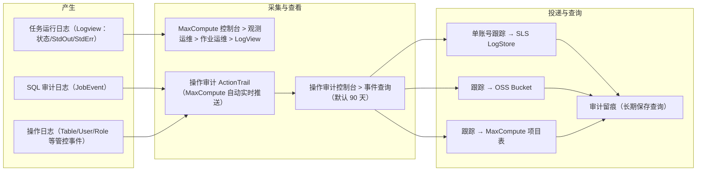

# MaxCompute · 日志与审计

> 产品：MaxCompute ｜ 口径：公共云 ｜ 复核：2026-11-18

## 日志流转图

**来源**
- 审计日志（ActionTrail 实时推送与投递范围）：https://help.aliyun.com/zh/maxcompute/user-guide/audit-logging ｜ 复核：2026-11-18
- Logview 2.0 查看作业信息（入口与 Basic Info）：https://help.aliyun.com/zh/maxcompute/use-logview-v2-0-to-view-job-information ｜ 复核：2026-11-18
- 作业运维（控制台查看/LogView 跳转）：https://help.aliyun.com/zh/maxcompute/user-guide/manage-jobs-in-the-new-maxcompute-console ｜ 复核：2026-11-18
- ActionTrail 审计事件迁移至 MaxCompute（单/多账号跟踪）：https://help.aliyun.com/zh/maxcompute/user-guide/migrate-audit-event-data-to-maxcompute ｜ 复核：2026-11-18
- 日志服务直接投递至 MaxCompute：https://help.aliyun.com/zh/maxcompute/user-guide/use-loghub-to-migrate-log-data-to-maxcompute ｜ 复核：2026-11-18

## 日志类型总表

| 类型 | 产生方 | 查看入口 | 默认保留期 | 是否计费 |
|---|---|---|---|---|
| 任务运行日志（Logview：状态/子状态/StdOut/StdErr） | MaxCompute 计算引擎 | MaxCompute 控制台 > 观测运维 > 作业运维 > LogView；或提交作业后生成的 Logview URL | 📋 待补（结构性）（官方未标注日志保留期；Logview 链接有效期一周，2026-11-18 复核） | 否（计费项总览无日志查看项） |
| SQL 审计日志（审计事件 JobEvent，OperationText 记录 SQL 全文） | 操作审计 ActionTrail（MaxCompute 自动实时推送） | 操作审计控制台 > 事件查询（eventName 如 InsertJob、JobChange） | 默认 90 天 | 操作审计本身免费；投递按目标产品计费 |
| 操作日志（Table/User/Role/Privilege/Admin/Function/Resource/Tunnel/Schema 等管控事件） | 操作审计 ActionTrail（MaxCompute 自动实时推送） | 操作审计控制台 > 事件查询 | 默认 90 天 | 同上 |
| 审计留痕（跟踪投递长期保存：SLS / OSS / MaxCompute 表） | 操作审计 ActionTrail（单账号/多账号跟踪） | 跟踪投递目标：SLS LogStore、OSS Bucket、MaxCompute 项目表 | 📋 待补（结构性）（随投递目标的保存策略，MaxCompute 侧无独立保留期口径） | 操作审计免费，投递目标按各自定价单独付费 |

- MaxCompute 自动将使用 MaxCompute 所产生的操作日志实时推送到 ActionTrail；事件查询可查看包括 MaxCompute 在内的各服务历史事件。
- 提交 MaxCompute 作业时系统自动生成以 `https://logview.aliyun.com/logview` 开头的 URL，odpscmd 提交需手工复制到浏览器访问，DataWorks 提交可直接点击打开。
- 审计事件的 OperationText 字段记录 SQL 查询语句全文，可用于 SQL 级留痕回溯。

**来源**
- 审计日志（ActionTrail 实时推送与投递范围）：https://help.aliyun.com/zh/maxcompute/user-guide/audit-logging ｜ 复核：2026-11-17
- Logview 2.0 查看作业信息（入口与 Basic Info）：https://help.aliyun.com/zh/maxcompute/use-logview-v2-0-to-view-job-information ｜ 复核：2026-11-17
- Logview 查看作业信息（链接有效期一周）：https://help.aliyun.com/zh/maxcompute/use-logview-to-view-job-information ｜ 复核：2026-11-17
- 作业运维（控制台查看/终止/LogView 跳转）：https://help.aliyun.com/zh/maxcompute/user-guide/manage-jobs-in-the-new-maxcompute-console ｜ 复核：2026-11-17
- 操作审计使用限制（默认 90 天、跟踪配额）：https://help.aliyun.com/zh/actiontrail/product-overview/limits ｜ 复核：2026-11-17
- 操作审计计费说明：https://help.aliyun.com/zh/actiontrail/product-overview/billing-1 ｜ 复核：2026-11-17
- 计费项与计费方式概述（无日志查看计费项）：https://help.aliyun.com/zh/maxcompute/overview-price ｜ 复核：2026-11-17

## 关键日志详表

**A. 任务运行日志（Logview Basic Info 与运行详情）**

| 字段 | 类型/取值 | 含义 |
|---|---|---|
| `Status` | Success / Failed / Canceled / Waiting / Running / Terminated | 作业状态 |
| `Type` | SQL / SQLRT / LOT / XLib / CUPID / AlgoTask / Graph | 作业类型 |
| `Start Time` / `End Time` | 时间 | 作业提交时间 / 执行结束时间 |
| `Latency` | 时长 | 作业执行消耗的时长 |
| `Progress` | 百分比 | 作业执行进度 |
| `Queue` | 数值 | 作业在资源配额组内的排队位置 |
| `StdOut` / `StdErr` | 文本（可下载） | Fuxi Instance 的输出与错误信息，含用户自定义打印日志 |

- 执行图按 Fuxi Job → Fuxi Task → Operation 三层展示依赖；Fuxi Task 上的 R/W 表示 Task 读取和写的行数（扫描量口径）。
- Fuxi Job 分类：M（数据扫描）、R（Reduce）、J（Join）、C（虚拟节点，仅分支判断）。

**B. 阶段子状态历史（SubStatusHistory）**

| 字段 | 类型/取值 | 含义 |
|---|---|---|
| `Code` | 数字状态码（如 1010、1020、1030） | 执行阶段子状态码 |
| `Description` | 状态描述文本 | 如 Waiting for scheduling、SQLTask is compiling query、Offline Job is running 等 |
| `StartTime` | 时间 | 该阶段开始时间 |
| `Latency` | 时长 | 该阶段耗时 |
| `TimeLine` | 时间线进度条 | 阶段时间线进度 |

- 常见等待阶段：Waiting for cluster resource（Fuxi 计算集群无资源）、Waiting for concurrent task slot（Project 级流控，可设置并行提交 SQL 个数）、Waiting for execution slot（系统级流控）。
- 阶段耗时异常定位：SQLTask is generating execution plan 耗时长可能是读取分区太多或小文件太多。

**C. 审计事件公共字段（ActionTrail）**

| 字段 | 样例（类型/示例） | 含义 |
|---|---|---|
| `eventId` | 918510a4-7b63-47d2-b053-8f9db82c431a | ActionTrail 为每个事件产生的 GUID |
| `eventTime` | 2020-01-09T12:12:14Z | 事件发生时间（UTC 格式） |
| `eventName` | InsertJob | 事件名称 |
| `eventType` | JobEvent | 事件类型 |
| `sourceIpAddress` | 47.100.XX.XX | 提交 API 请求的源 IP 地址 |
| `userIdentity` | type: root-account | 请求者身份（accountId、principalId、type、userName） |
| `referencedResources` | Instance: ["2020102713575683gc2j****"] | 事件涉及资源（InstanceId、表名等） |
| `additionalEventData` | Status: Failed、TaskType: SQL | 事件特有附加信息：Status 作业状态、TaskType 作业类型、OperationText SQL 语句全文、ProjectName |

**来源**
- Logview 2.0 查看作业信息（Basic Info、Fuxi 层级、R/W、SubStatusHistory 字段与阶段状态）：https://help.aliyun.com/zh/maxcompute/use-logview-v2-0-to-view-job-information ｜ 复核：2026-11-17
- 审计日志（日志字段与 JobEvent 附加信息）：https://help.aliyun.com/zh/maxcompute/user-guide/audit-logging ｜ 复核：2026-11-17
- 管控事件结构定义（公共字段参考）：https://help.aliyun.com/zh/actiontrail/user-guide/management-event-structure ｜ 复核：2026-11-17
- 执行计划生成耗时优化（生成执行计划慢的判读）：https://help.aliyun.com/zh/maxcompute/user-guide/reduce-the-time-required-to-generate-execution-plans ｜ 复核：2026-11-17

## 投递与加工

| 通道 | 去向与参数 | 关键限制 / 额度 | 计费要点 |
|---|---|---|---|
| 操作审计单账号跟踪 → 日志服务 SLS | 事件实时投递到 SLS 项目内 LogStore，可基于事件触发的实时日志分析（如敏感数据访问告警处理） | 在操作审计控制台创建单账号跟踪 | 操作审计免费；SLS 存储/查询按 SLS 定价 |
| 操作审计单账号跟踪 → OSS | 事件以 JSON 归档到指定 OSS Bucket 供离线分析 | 1 个跟踪最多配置 1 个 OSS Bucket | 操作审计免费；OSS 侧按 OSS 定价 |
| 操作审计 → MaxCompute 项目表 | 创建跟踪将审计事件以 JSON 格式投递至 MaxCompute 项目表 | 支持单账号跟踪与多账号跟踪配置 | MaxCompute 侧按存储计费 |
| 多账号跟踪 | 资源目录成员账号的 MaxCompute 事件统一投递到同一目标 | 需资源目录环境 | 同上 |
| SLS Logstore → MaxCompute（日志入仓，反向） | 通过 SLS 的 MaxCompute 投递功能将 Logstore 数据定期归档到 MaxCompute 离线表，配置分区列映射与时间分区格式 | 仅主账号操作 | SLS 与 MaxCompute 各自按定价计费 |

- 采样与过滤参数：官方文档未给出 MaxCompute 日志投递的采样/过滤参数说明 📋 待补（结构性）。

**来源**
- 审计日志（单账号跟踪投递 SLS/OSS）：https://help.aliyun.com/zh/maxcompute/user-guide/audit-logging ｜ 复核：2026-11-17
- ActionTrail 审计事件迁移至 MaxCompute（单/多账号跟踪）：https://help.aliyun.com/zh/maxcompute/user-guide/migrate-audit-event-data-to-maxcompute ｜ 复核：2026-11-17
- 日志服务直接投递至 MaxCompute：https://help.aliyun.com/zh/maxcompute/user-guide/use-loghub-to-migrate-log-data-to-maxcompute ｜ 复核：2026-11-17
- 操作审计使用限制（跟踪配额）：https://help.aliyun.com/zh/actiontrail/product-overview/limits ｜ 复核：2026-11-17
- 操作审计计费说明：https://help.aliyun.com/zh/actiontrail/product-overview/billing-1 ｜ 复核：2026-11-17

## 审计与合规

| 项 | 官方口径 |
|---|---|
| 接入方式 | MaxCompute 自动将使用 MaxCompute 所产生的操作日志实时推送到 ActionTrail |
| 留痕范围 | 针对作业（Instance）、表（Table）、用户（User）、角色（Role）、授权（Privilege）事件的多种操作行为进行审计，并覆盖函数、资源、Tunnel、项目、Schema 与 Catalog API 事件 |
| 代表事件 | InsertJob（提交作业）、JobChange（作业结束或主动终止，含 Status）、ReadTableData / ChangeTableData（读/写表数据）、UploadTable / DownloadTable（Tunnel 上传/下载）、GrantACL / RevokeRole（授权/撤权）、CreateProject / UpdateProject（项目管理） |
| SQL 留痕 | JobEvent 的 `OperationText` 字段记录 SQL 查询语句全文 |
| 查询与保留 | 操作审计控制台「事件查询」默认记录最近 90 天操作事件 |
| 长期保存 | 超过 90 天需创建跟踪，将事件投递到 SLS、OSS 或 MaxCompute 项目表（长期审计/合规留存场景） |
| 公共字段 | eventId、eventTime、eventName、eventType、sourceIpAddress、userIdentity、referencedResources、additionalEventData 等 |
| 配额 | 单账号跟踪每地域 5 个；1 个跟踪最多配置 1 个 OSS Bucket |
| 计费 | 操作审计本身免费；通过跟踪投递到 SLS/OSS/MaxCompute 时按各自定价单独付费 |

- 事件详细列表（含各事件的 referencedResources 与 additionalEventData 字段说明）见官方《大数据计算服务 MaxCompute 的审计事件》。
- MaxCompute 同时具备安全白皮书披露的审计日志能力，覆盖访问控制、加密、容灾、脱敏、IP 白名单等安全项。

**来源**
- 审计日志（留痕范围、事件列表、公共字段、投递）：https://help.aliyun.com/zh/maxcompute/user-guide/audit-logging ｜ 复核：2026-11-17
- 大数据计算服务MaxCompute的审计事件：https://help.aliyun.com/document_detail/607978.html ｜ 复核：2026-11-17
- 操作审计使用限制（默认 90 天、跟踪配额）：https://help.aliyun.com/zh/actiontrail/product-overview/limits ｜ 复核：2026-11-17
- 什么是操作审计 ActionTrail：https://help.aliyun.com/zh/actiontrail/product-overview/what-is-actiontrail ｜ 复核：2026-11-17
- 操作审计计费说明：https://help.aliyun.com/zh/actiontrail/product-overview/billing-1 ｜ 复核：2026-11-17
- MaxCompute 安全白皮书（审计日志）：https://help.aliyun.com/zh/maxcompute/user-guide/maxcompute-security-white-paper ｜ 复核：2026-11-17
