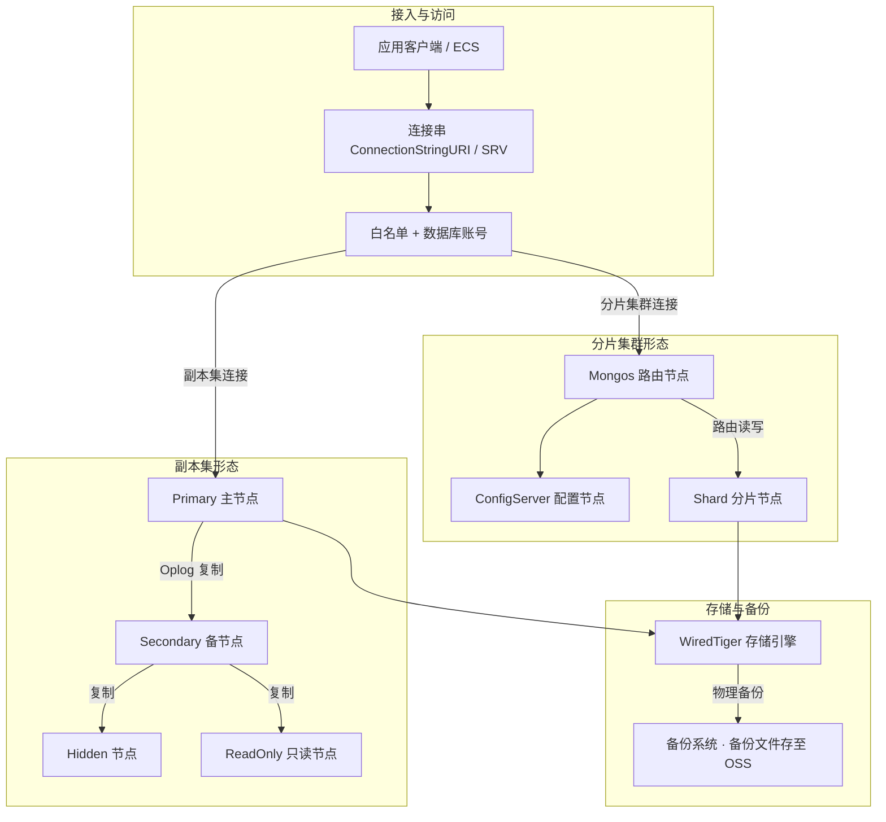

# MongoDB · 产品架构

> 产品：云数据库 MongoDB 版 ｜ 口径：公共云 ｜ 复核：2026-11-16

## 产品定位

- 云数据库 MongoDB 版（ApsaraDB for MongoDB）是阿里云基于飞天分布式系统和高可靠存储引擎研发的文档数据库。
- 产品完全兼容 MongoDB 协议，用于处理非结构化或半结构化数据。
- 管理方式：控制台、CLI、SDK、API（四者能力等价，控制台操作均可由 API 实现）。
- 访问方式：DMS、Mongo Shell、通用客户端（如 Robo 3T、Studio 3T）。

**来源**：
- 什么是云数据库MongoDB版：https://help.aliyun.com/zh/mongodb/product-overview/what-is-apsaradb-for-mongodb ｜ 复核：2026-11-16

## 架构图

**来源**
- 产品架构说明（组件与备份系统）：https://help.aliyun.com/zh/mongodb/product-overview/architecture ｜ 复核：2026-11-17
- 副本集架构（Primary/Secondary/Hidden/ReadOnly）：https://help.aliyun.com/zh/mongodb/product-overview/replica-set-instances ｜ 复核：2026-11-17
- 分片集群架构（Mongos/Shard/ConfigServer）：https://help.aliyun.com/zh/mongodb/product-overview/sharded-cluster-instances ｜ 复核：2026-11-17
- 实例连接地址说明（连接串接入）：https://help.aliyun.com/zh/mongodb/user-guide/overview-of-instance-connections ｜ 复核：2026-11-17
- 设置白名单（访问前提）：https://help.aliyun.com/zh/mongodb/getting-started/set-up-a-white-list ｜ 复核：2026-11-17
- 版本及存储引擎（WiredTiger）：https://help.aliyun.com/zh/mongodb/product-overview/mongodb-versions-and-storage-engines ｜ 复核：2026-11-17
- 备份恢复概览（备份文件与长期保留）：https://help.aliyun.com/zh/mongodb/user-guide/data-backup-and-restoration ｜ 复核：2026-11-17

## 组件清单

| 组件 | 作用 | 必选/可选 | 是否独立计费 | 备注 |
|---|---|---|---|---|
| 实例（DBInstance） | 承载数据库服务的最小部署单元，创建时固定数据库版本与存储引擎 | 必选 | 是（按量付费/包年包月，存储另计） | 单节点、副本集、分片集群三种架构；Serverless 预设容量版已停购 |
| 副本集节点（Primary/Secondary/Hidden/ReadOnly） | Primary 承接写入，Secondary 基于 Oplog 复制，Hidden 只参与高可用，ReadOnly 分担只读请求 | 必选（副本集架构） | 否（含在实例费用内） | 1 Primary + 1/3/5 Secondary + 1 Hidden + 0~5 ReadOnly；主备切换产生 30 秒内连接闪断 |
| Mongos | 分片集群路由节点，接收客户端连接并路由读写请求 | 必选（分片集群） | 否 | 节点 ID 以 `s-` 为前缀 |
| ConfigServer | 保存分片集群元数据与 chunk 信息 | 必选（分片集群） | 否 | 与 Mongos、Shard 并列的三组件之一 |
| Shard 分片节点 | 承载分片数据，每个 Shard 为三节点副本集 + 0~5 个只读节点 | 必选（分片集群） | 否 | 节点 ID 以 `d-` 为前缀 |
| 存储引擎 WiredTiger | 默认且当前唯一在售引擎，基于 BTree 组织数据并支持压缩 | 必选 | 否 | 4.4 及以上全架构均为 WiredTiger；RocksDB、TerarkDB 已下线 |
| 备份系统 | 自动/手动备份，备份文件存储至 OSS，保存 7 天内的备份文件 | 必选 | 否（备份功能不单独收费，长期保留备份另计） | 更早数据需「长期保留备份」延长 |
| 数据库账号 | 访问鉴权与权限控制，按库隔离 | 必选 | 否 | 角色分 normal（副本集）、cs（ConfigServer）、db（Shard 直连）、mongos；root 账号不可删除 |
| 连接串（ConnectionStringURI / SRV） | 客户端接入实例的唯一入口 | 必选 | 否 | 私网默认提供、公网需申请；格式见 [05-网络参数](05-网络参数.md) |
| 关联产品 ECS | 应用部署侧，经白名单加载 ECS 内网 IP 后用连接串访问实例 | 可选 | 是（ECS 独立计费） | [ECS](../ecs/) |
| 关联产品 DTS | 副本集/分片集群间迁移、自建 MongoDB 上云、跨账号互通 | 可选 | 是（DTS 独立计费） | [DTS](../dts/) |

**来源**
- 产品架构说明（主要组件）：https://help.aliyun.com/zh/mongodb/product-overview/architecture ｜ 复核：2026-11-17
- 产品优势（节点构成与部署架构）：https://help.aliyun.com/zh/mongodb/product-overview/benefits ｜ 复核：2026-11-17
- 分片集群架构（Mongos/Shard/ConfigServer）：https://help.aliyun.com/zh/mongodb/product-overview/sharded-cluster-instances ｜ 复核：2026-11-17
- 版本及存储引擎：https://help.aliyun.com/zh/mongodb/product-overview/mongodb-versions-and-storage-engines ｜ 复核：2026-11-17
- 副本集架构（30 秒连接闪断）：https://help.aliyun.com/zh/mongodb/product-overview/replica-set-instances ｜ 复核：2026-11-17
- 数据库账号管理（账号角色与 root 不可删）：https://help.aliyun.com/zh/mongodb/manage-database-accounts-through-the-console ｜ 复核：2026-11-17
- 设置白名单（ECS 内网 IP 接入）：https://help.aliyun.com/zh/mongodb/getting-started/set-up-a-white-list ｜ 复核：2026-11-17
- DTS 迁移 ECS 自建 MongoDB 上云：https://help.aliyun.com/zh/mongodb/user-guide/migrate-an-ecs-hosted-self-managed-mongodb-database-that-uses-the-standalone-or-replica-set-architecture-to-apsaradb-for-mongodb ｜ 复核：2026-11-17
- 计费项：https://help.aliyun.com/zh/mongodb/product-overview/billable-items ｜ 复核：2026-11-17

## 部署架构（三种在售 + Serverless 停购）

| 架构 | 节点构成 | 适用场景 |
|---|---|---|
| 单节点 | 1 个 StandAlone 节点，单副本 | 开发、测试、学习培训等非核心数据 |
| 副本集 | 1 个 Primary + 1/3/5 个 Secondary + 1 个 Hidden + 0~5 个 ReadOnly | 读多写少、临时活动等突发业务 |
| 分片集群 | Mongos + Shard + ConfigServer 三组件；每个 Shard 为三节点副本集 + 0~5 个只读节点 | 高并发读写，性能与存储可横向扩展 |
| Serverless | 预设容量版已于 2022-07-11 停止新购 | 已停购（存量进入 EOFS 阶段） |

- 单节点架构不提供高可用：极端故障下约 30 分钟服务不可用。
- 单节点默认不支持 Oplog，因此不支持增量迁移同步与按时间点恢复。

**来源**：
- 产品优势（部署架构）：https://help.aliyun.com/zh/mongodb/product-overview/benefits ｜ 复核：2026-11-16
- 单节点架构：https://help.aliyun.com/zh/mongodb/product-overview/standalone-instances ｜ 复核：2026-11-16
- 副本集架构：https://help.aliyun.com/zh/mongodb/product-overview/replica-set-instances ｜ 复核：2026-11-16
- 分片集群架构：https://help.aliyun.com/zh/mongodb/product-overview/sharded-cluster-instances ｜ 复核：2026-11-16
- 计费项（Serverless 停购）：https://help.aliyun.com/zh/mongodb/product-overview/billable-items ｜ 复核：2026-11-16

## 系统组件（平台侧）

| 组件 | 职责 |
|---|---|
| 任务控制 | 创建实例、变更配置、备份等任务的跟踪与出错管理 |
| HA 控制系统 | 探测实例运行状况，主节点不可用时自动切换主备，也支持手动切换 |
| 日志收集系统 | 慢操作日志、审计日志收集 |
| 监控系统 | 基础指标、磁盘容量、网络请求、操作次数采集 |
| 备份系统 | 备份文件存储至 OSS，支持自动备份与手动备份，保存 7 天内的备份文件 |
| 在线迁移系统 | 物理机故障时依据备份文件重新搭建实例 |

**来源**：
- 产品架构说明：https://help.aliyun.com/zh/mongodb/product-overview/architecture ｜ 复核：2026-11-16

## 存储引擎（WiredTiger）

| 存储引擎 | 状态 | 说明 |
|---|---|---|
| WiredTiger | 默认引擎 | 基于 BTree 组织数据，相比早期 MMAPv1 性能提升明显，支持数据压缩 |
| RocksDB | 已下线 | 基于 LSM tree，面向多写少读场景，历史版本适用 |
| TerarkDB | 已下线 | 借助全局压缩提高随机查询性能，历史分片集群适用 |

- 版本与引擎适配：4.4 及以上版本的副本集、分片集群、单节点实例均为 WiredTiger。
- 创建实例时存储引擎固定为 WiredTiger（售卖页不可改）。
- 支持的数据库版本：8.3、8.0、7.0、6.0、5.0、4.4、4.2、4.0；3.4 已于 2023-01-01 停售。版本升级后不支持降级。

**来源**：
- 版本及存储引擎：https://help.aliyun.com/zh/mongodb/product-overview/mongodb-versions-and-storage-engines ｜ 复核：2026-11-16
- 副本集快速入门（存储引擎固定为 WiredTiger）：https://help.aliyun.com/zh/mongodb/getting-started/create-a-replica-set-instance-1 ｜ 复核：2026-11-16

## 可靠性与 SLA

| 项目 | 数值/规则 |
|---|---|
| 服务可用性承诺（多可用区部署） | 99.95% |
| 服务可用性承诺（单可用区部署） | 99.90% |
| 适用范围 | 仅三节点副本集和分片集群；单节点系列不适用 SLA |
| SLA 版本生效日期 | 2025-07-15 |
| 单节点架构 | 无 SLA 保障，故障恢复时间较长（约 30 分钟不可用） |
| 赔偿形式 | 代金券，上限为当月该实例月度服务费用 |
| 赔偿申请时限 | 次月第 5 个工作日后提出，且不晚于次月结束后 2 个月 |

- 赔偿档位（多可用区）：99.00%≤可用性<99.95% 赔 15%；95.00%≤可用性<99.00% 赔 30%；<95.00% 赔 100%。
- 赔偿档位（单可用区）：99.00%≤可用性<99.90% 赔 15%；95.00%≤可用性<99.00% 赔 30%；<95.00% 赔 100%。
- 节点角色切换（手动或自动）会产生 1 次 30 秒内的连接闪断。
- 备份文件保存 7 天内；更早数据需通过「长期保留备份」延长。

**来源**：
- 云数据库MongoDB版服务等级协议：https://terms.aliyun.com/legal-agreement/terms/suit_bu1_ali_cloud/suit_bu1_ali_cloud201803051033_42307.html ｜ 复核：2026-11-16
- 单节点架构（无 SLA / 30 分钟不可用）：https://help.aliyun.com/zh/mongodb/product-overview/standalone-instances ｜ 复核：2026-11-16
- 副本集架构（30 秒连接闪断）：https://help.aliyun.com/zh/mongodb/product-overview/replica-set-instances ｜ 复核：2026-11-16
- 产品架构说明（备份保存 7 天）：https://help.aliyun.com/zh/mongodb/product-overview/architecture ｜ 复核：2026-11-16
- 备份恢复概览（长期保留备份）：https://help.aliyun.com/zh/mongodb/user-guide/data-backup-and-restoration ｜ 复核：2026-11-16
