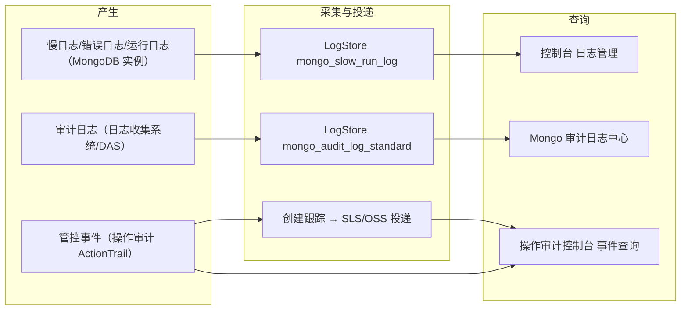

# MongoDB · 日志与审计

> 产品：云数据库 MongoDB 版 ｜ 口径：公共云 ｜ 复核：2026-11-18

## 日志流转图

**来源**
- 日志管理（慢日志/错误日志/运行日志导航）：https://help.aliyun.com/zh/mongodb/user-guide/log-management ｜ 复核：2026-11-18
- 开通审计日志（SLS 融合、计费单价、性能损耗、API）：https://help.aliyun.com/zh/mongodb/user-guide/enable-the-audit-log-feature-1 ｜ 复核：2026-11-18
- 操作审计-OSS/ MongoDB 管控事件投递：https://help.aliyun.com/zh/actiontrail/product-overview/auditable-events-of-apsaradb-for-mongodb ｜ 复核：2026-11-18
- 操作审计使用限制（跟踪配额）：https://help.aliyun.com/zh/actiontrail/product-overview/limits ｜ 复核：2026-11-18

## 日志类型总表

| 类型 | 产生方 | 查看入口 | 默认保留期 | 是否计费 |
|---|---|---|---|---|
| 慢查询日志（慢日志） | MongoDB 实例（执行时长超过 `operationProfiling.slowOpThresholdMs`，默认 100 毫秒） | 控制台 > 实例 > 日志管理 > 慢日志 | 7 天（仅可查看 7 天内；不支持删除） | 否 |
| 错误日志 | MongoDB 实例 | 控制台 > 日志管理 > 错误日志 | 7 天 | 否 |
| 运行日志 | MongoDB 实例 | 控制台 > 日志管理 > 运行日志 | 7 天（可下载日志文件） | 否 |
| 审计日志·正式版（基于 SLS） | 日志收集系统 → SLS LogStore `mongo_audit_log_standard` | 控制台 > 数据安全性 > 审计日志（Mongo 审计日志中心） | 1~365 天可配，默认 30 天（设置对同地域所有实例生效） | 是：按存储用量 + 保留时长按量计费（中国境内 0.008 元/GB/小时） |
| 审计日志·DAS 企业版（新版，冷热分层） | 数据库自治服务 DAS | Mongo 审计日志中心；新版需通过 DAS OpenAPI 管理 | 按实例独立配置；冷存储可选 30/180/365/1095/1825 天 | 是：按存储用量计费，账单分账到实例维度 |
| 审计日志·免费试用版（已终止新申请） | SLS | 同上 | 1 天、同地域最大 100 GB | 免费（仅通用型/独享型本地盘版存量实例） |
| 管控事件（操作审计 ActionTrail） | 操作审计 | 操作审计控制台 > 事件查询 | 默认记录最近 90 天 | 操作审计本身免费；投递 SLS/OSS 按目标产品计费 |

- 单节点实例不支持查看慢日志、错误日志、运行日志，也不支持开通审计日志。
- 部分地域暂未开放日志管理功能，实际以控制台显示为准。
- 慢日志与审计日志字段相同，通过 `audit_type` 区分（慢日志固定为 `slowop`）。
- 2026-02-01 起新版审计日志分地域生效：从未开启的实例只能开新版；旧版关闭后无法重开；`DescribeAuditRecords` 仅支持旧版。

**来源**
- 日志管理（慢日志/错误日志/运行日志导航）：https://help.aliyun.com/zh/mongodb/user-guide/log-management ｜ 复核：2026-11-17
- 查看慢日志（7 天、阈值默认 100 毫秒、单节点不支持）：https://help.aliyun.com/zh/mongodb/user-guide/view-slow-query-logs ｜ 复核：2026-11-17
- 查看错误日志：https://help.aliyun.com/zh/mongodb/user-guide/view-error-logs ｜ 复核：2026-11-17
- 查看运行日志：https://help.aliyun.com/zh/mongodb/user-guide/view-operational-logs ｜ 复核：2026-11-17
- 开通审计日志（保留 1~365 天默认 30 天、计费、前提条件）：https://help.aliyun.com/zh/mongodb/user-guide/enable-the-audit-log-feature-1 ｜ 复核：2026-11-17
- 审计日志功能升级公告（新版冷热分层、2026-02-01 变更）：https://help.aliyun.com/zh/mongodb/product-overview/mongodb-audit-log-function-upgrade-and-management-mode-change ｜ 复核：2026-11-17
- DAS 企业版审计日志：https://help.aliyun.com/zh/mongodb/user-guide/das-enterprise-audit-logs ｜ 复核：2026-11-17
- 更改 DAS 企业版审计日志设置（冷存储保留时长档位）：https://help.aliyun.com/zh/mongodb/user-guide/modify-das-enterprise-audit-log-settings ｜ 复核：2026-11-17
- 开通免费试用版审计日志（1 天/100 GB、终止申请）：https://help.aliyun.com/zh/mongodb/user-guide/enable-the-audit-log-feature ｜ 复核：2026-11-17
- 操作审计使用限制（90 天留痕）：https://help.aliyun.com/zh/actiontrail/product-overview/limits ｜ 复核：2026-11-17
- 操作审计计费说明：https://help.aliyun.com/zh/actiontrail/product-overview/billing-1 ｜ 复核：2026-11-17

## 关键日志详表

**A. 慢查询日志（LogStore：`mongo_slow_run_log`，topic：`mongo_slow_log`）**

| 字段 | 类型/示例 | 含义 |
|---|---|---|
| `time` | 时间戳（秒） | 慢操作发生时间 |
| `db` / `coll` | 字符串 | 数据库名 / 数据集合 |
| `optype` | query、find、insert、update、delete、remove、getMore、command | 操作类别 |
| `latency` | 数值 | 消耗时间 |
| `docs_examined` | 数值 | 文档扫描行数 |
| `keys_examined` | 数值 | 索引扫描行数 |
| `return_num` | 数值 | 返回记录数 |
| `user_ip` | IP 地址 | 连接 MongoDB 客户端的 IP（另有 `user` 为登录用户名） |

**B. 审计日志（LogStore：`mongo_audit_log_standard`，topic：`mongo_audit_log`）**

| 字段 | 类型/示例 | 含义 |
|---|---|---|
| `audit_type` | slowop / admin / query / insert / update / delete / command 等 | 日志类型；值为 `slowop` 时即慢日志，其余为审计日志 |
| `time` | 时间戳 | 事件时间 |
| `db` / `coll` | 字符串 | 数据库名 / 数据集合 |
| `optype` | query、insert、update、delete、command 等 | 操作类别 |
| `latency` | 数值 | 消耗时间 |
| `user` / `user_ip` | 字符串 / IP | 登录用户名 / 客户端 IP |
| `instanceid` | 字符串 | MongoDB 实例 ID |
| `thread_id` | 数值 | 线程 ID |

- `audit_type` 为 `command` 时覆盖查询聚合、索引、集合数据库、服务器诊断、副本集管理、分片管理、用户/角色、会话、事务、认证等命令分类。

**C. 运行日志（LogStore：`mongo_slow_run_log`，topic：`mongo_run_log`）**

| 字段 | 类型/示例 | 含义 |
|---|---|---|
| `time` | 时间戳 | 日志生成时间 |
| `category` | 如 NETWORK | 日志类别（如网络连接日志） |
| `level` | 字符串 | 日志级别 |
| `content` | 字符串 | 日志内容 |
| `ip` / `port` | IP / 端口 | 相关节点 IP 与端口 |
| `connection` | 字符串 | 日志连接信息 |
| `instanceid` | 字符串 | MongoDB 实例 ID |

**来源**
- 日志字段详情（审计/慢/运行日志字段）：https://help.aliyun.com/zh/mongodb/user-guide/log-fields-16 ｜ 复核：2026-11-17
- 查看慢日志：https://help.aliyun.com/zh/mongodb/user-guide/view-slow-query-logs ｜ 复核：2026-11-17
- 开通审计日志（操作类型与默认勾选）：https://help.aliyun.com/zh/mongodb/user-guide/enable-the-audit-log-feature-1 ｜ 复核：2026-11-17
- 更改审计操作类型（ModifyAuditLogFilter）：https://help.aliyun.com/zh/mongodb/user-guide/modify-the-operation-type-for-audit-logs ｜ 复核：2026-11-17

## 投递与加工

| 通道 | 去向与参数 | 关键限制 / 额度 | 计费要点 |
|---|---|---|---|
| 审计日志写入 SLS | 开通即写入 LogStore `mongo_audit_log_standard`（审计）与 `mongo_slow_run_log`（慢/运行） | 审计日志中心提供 SQL 增强、时间选择、刷新、告警、订阅工具栏能力；保留时长 1~365 天可改 | 按存储用量 + 保留时长按量计费；中国境内 0.008 元/GB/小时 |
| 审计操作类型过滤 | `ModifyAuditLogFilter`：admin / slow / query / insert / update / delete / command；默认仅勾选 admin 和 slow | 取消类型后该类型日志停止上传，保留期内历史随过期自动删除；DAS 企业版可对 db 节点与 mongos 节点分别配置 | 减少类型可降低存储成本 |
| 审计日志保留时长 | `ModifyAuditPolicy` / 控制台「服务设置 > 全局设置」 | 设置对当前地域所有实例生效；旧版关闭后无法重开 | 保留越久费用越高 |
| 审计日志下载 | 控制台导出 CSV（按图表或完整日志） | 单次超 2000 条需转 SLS 控制台查询；DAS 企业版控制台最多展示 10000 条 | 按 SLS 查询/下载口径 |
| 慢日志/错误日志/运行日志导出 | 控制台下载按钮导出当前页 | 仅 7 天内数据，不支持删除 | 否 |
| 报警信息投递 | 云监控报警可写入 SLS 日志库、轻量消息队列（原 MNS）Topic、函数计算、URL 回调 | 需在创建报警规则的「高级设置」中开启 | 按目标产品（SLS/MNS/函数计算）计费 |
| 管控事件投递（ActionTrail） | 创建跟踪 → SLS LogStore 或 OSS Bucket | 单账号跟踪每地域 5 个；1 个跟踪允许配置 1 个 OSS Bucket | 操作审计免费，投递目标按各自定价付费 |
| 跨账号投递 | 多账号跟踪（所有地域 1 个）可统一收集资源目录成员的管控事件 | 见操作审计使用限制 | 同上 |

- 慢日志阈值参数 `operationProfiling.slowOpThresholdMs` 默认 100 毫秒，调整该参数可改变入库慢日志量。
- 审计日志写入量会造成性能损耗：6.0 及以上约 15%~20%，6.0 以下可能更大。

**来源**
- 开通审计日志（SLS 融合、计费单价、性能损耗、API）：https://help.aliyun.com/zh/mongodb/user-guide/enable-the-audit-log-feature-1 ｜ 复核：2026-11-17
- 更改审计日志保留时长：https://help.aliyun.com/zh/mongodb/user-guide/modify-the-retention-period-for-audit-logs ｜ 复核：2026-11-17
- 更改审计操作类型：https://help.aliyun.com/zh/mongodb/user-guide/modify-the-operation-type-for-audit-logs ｜ 复核：2026-11-17
- 查询审计日志（查询与展示上限）：https://help.aliyun.com/zh/mongodb/user-guide/view-audit-logs-1 ｜ 复核：2026-11-17
- 下载审计日志（CSV/2000 条限制）：https://help.aliyun.com/zh/mongodb/user-guide/download-audit-logs-1 ｜ 复核：2026-11-17
- 查询 DAS 企业版审计日志（10000 条上限）：https://help.aliyun.com/zh/mongodb/user-guide/query-das-enterprise-audit-logs ｜ 复核：2026-11-17
- 设置阈值报警规则（SLS/MNS/函数计算/URL 回调投递）：https://help.aliyun.com/zh/mongodb/user-guide/configure-threshold-triggered-alert-rules-for-an-apsaradb-for-mongodb-instance ｜ 复核：2026-11-17
- 操作审计-OSS/ MongoDB 管控事件投递：https://help.aliyun.com/zh/actiontrail/product-overview/auditable-events-of-apsaradb-for-mongodb ｜ 复核：2026-11-17
- 操作审计使用限制（跟踪配额）：https://help.aliyun.com/zh/actiontrail/product-overview/limits ｜ 复核：2026-11-17
- 查看慢日志（slowOpThresholdMs 默认 100 毫秒）：https://help.aliyun.com/zh/mongodb/user-guide/view-slow-query-logs ｜ 复核：2026-11-17

## 审计与合规

| 项 | 官方口径 |
|---|---|
| 接入方式 | 云数据库 MongoDB 版已与操作审计（ActionTrail）集成，可查询用户通过 OpenAPI 或控制台操作实例产生的管控事件 |
| 留痕范围 | 管控事件，如 `CreateDBInstance`/`CreateShardingDBInstance`（创建实例）、`CreateNode`/`DeleteNode`（增删 Shard/Mongos 节点）、`CreateAccount`（创建账号）、`CreateBackup`（手动备份）、`ModifyAuditPolicy`（审计策略）、`SwitchDBInstanceHA`（主备切换）、`DeleteDBInstance`（释放实例）等 |
| 数据面审计 | 数据读写操作由审计日志（SLS）覆盖，需开通正式版/DAS 企业版审计日志；与管控事件互补 |
| 查询与留痕保留 | 操作审计默认为每个阿里云账号记录最近 90 天操作事件；操作后 10 分钟内可在控制台查询 |
| 长期保存 | 超过 90 天需创建跟踪，将事件投递到 SLS 或 OSS（等保等要求更长留存的场景） |
| 配额 | 单账号跟踪每地域 5 个、多账号跟踪所有地域 1 个；1 个跟踪允许配置 1 个 OSS Bucket；`LookupEvents` 每秒最多 2 次 |
| 数据库侧审计保留 | 正式版审计日志 1~365 天可配（默认 30 天）；DAS 企业版冷存储 30/180/365/1095/1825 天可选 |
| 计费 | 操作审计本身免费；投递到 SLS/OSS 按目标产品计费；数据库侧审计日志按存储用量与保留时长按量计费 |

- 操作审计事件含义部分仍在完善中（官方标注「部分事件缺少的事件含义后续将逐步完善」）。

**来源**
- 操作审计-MongoDB 审计事件：https://help.aliyun.com/zh/actiontrail/product-overview/auditable-events-of-apsaradb-for-mongodb ｜ 复核：2026-11-17
- 什么是操作审计 ActionTrail：https://help.aliyun.com/zh/actiontrail/product-overview/what-is-actiontrail ｜ 复核：2026-11-17
- 操作审计使用限制（90 天/10 分钟/跟踪配额/LookupEvents 2 次每秒）：https://help.aliyun.com/zh/actiontrail/product-overview/limits ｜ 复核：2026-11-17
- 管控事件结构定义：https://help.aliyun.com/zh/actiontrail/user-guide/management-event-structure ｜ 复核：2026-11-17
- 操作审计计费说明：https://help.aliyun.com/zh/actiontrail/product-overview/billing-1 ｜ 复核：2026-11-17
- 开通审计日志（保留时长与计费）：https://help.aliyun.com/zh/mongodb/user-guide/enable-the-audit-log-feature-1 ｜ 复核：2026-11-17
- 更改 DAS 企业版审计日志设置（冷存储档位）：https://help.aliyun.com/zh/mongodb/user-guide/modify-das-enterprise-audit-log-settings ｜ 复核：2026-11-17
