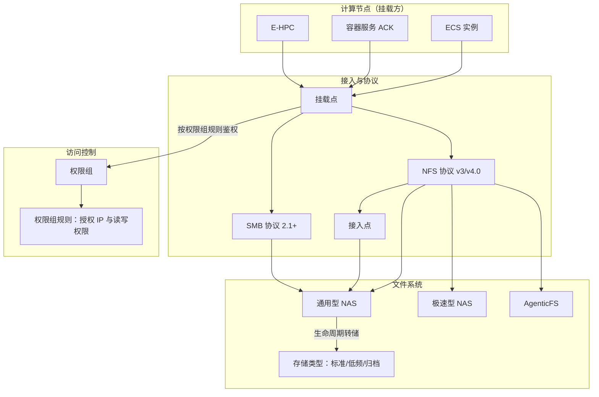

# NAS · 产品架构

> 产品：NAS ｜ 口径：公共云 ｜ 复核：2026-11-16

## 产品定义

| 项 | 事实 |
|---|---|
| 产品全称 | 文件存储 NAS（File Storage NAS） |
| 面向对象 | 阿里云 ECS 实例、E-HPC、容器服务等计算节点 |
| 形态 | 可共享访问、弹性扩展、高可靠、高性能的分布式文件系统 |
| 接口 | 基于 POSIX 文件接口，兼容 NFS 和 SMB 协议 |
| 计费资源 | 文件系统存储容量（通用型按实际用量、极速型按配置容量） |

要点：

- 多个 ECS 实例可同时访问同一 NAS 文件系统；容量随文件增删自动弹性增长和收缩。
- NAS 适合通过应用程序使用，不适合作为网盘；暂不支持 RESTful 接口访问。
- 文件系统创建成功后不能更换云账号和地域。

**来源**

- 什么是文件存储NAS：https://help.aliyun.com/zh/nas/product-overview/what-is-nas ｜ 复核：2026-11-16
- 基本概念：https://help.aliyun.com/zh/nas/product-overview/terms ｜ 复核：2026-11-16

## 架构图

**来源**
- 文件存储NAS使用架构（计算节点与 NAS 各模块关系）：https://help.aliyun.com/zh/nas/product-overview/terms ｜ 复核：2026-11-17
- 什么是文件存储NAS：https://help.aliyun.com/zh/nas/product-overview/what-is-nas ｜ 复核：2026-11-17
- NAS 使用限制（协议与挂载限制）：https://help.aliyun.com/zh/nas/product-overview/limits ｜ 复核：2026-11-17

## 组件清单

| 组件 | 作用 | 必选/可选 | 是否独立计费 | 备注 |
|---|---|---|---|---|
| 计算节点（挂载方） | 挂载并访问 NAS 文件系统的使用方 | 必选（使用方） | —（本体在各自产品计费） | 强关联 [ECS](../ecs/)、[ACK](../ack/)；单文件系统同一时刻最多挂载 1000 个计算节点 |
| 文件系统 | 以目录树形式管理数据和元数据的存储主体 | 必选 | 是（计费主体：通用型按实际用量、极速型按配置容量） | 创建成功后不能更换云账号和地域 |
| 挂载点 | 文件系统在网络环境中的连接点，以域名形式出现 | 必选（网络访问必需） | 否（NAS 计费项仅存储容量类） | 一个文件系统最多 2 个；网络类型必须与计算节点一致；强关联 [VPC](../vpc/) |
| 权限组 / 权限组规则 | 配置经挂载点访问的授权 IP 与读写权限 | 必选（每个挂载点必须且只能绑定 1 个权限组） | 否 | 一个权限组可被多个挂载点绑定 |
| 接入点 | 针对不同应用/用户访问文件系统的接入方式 | 可选 | ⚠️ 待核（官方未核到独立计费项） | 仅通用型 NFS；须用 NFS 传输加密挂载；单文件系统最多 1000 个，延迟约 +10%、IOPS 约 −30% |
| NFS 协议 | Linux 及大多数容器的挂载协议（v3、v4.0） | 必选（与文件系统强绑定） | 否 | 创建时指定、创建后无法更改；官方建议一般用 NFS v3 |
| SMB 协议 | Windows 及 Windows 容器的挂载协议（2.1 及以上） | 可选（作为文件系统的协议类型） | 否 | macOS 仅支持挂载 SMB 文件系统 |
| 存储类型（标准/低频/归档） | 通用型 NAS 的分层数据存储池 | 必选（标准）/ 低频、归档可选 | 是（低频/归档容量与读写流量另计费） | 低频/归档不支持直接写入，须由生命周期策略转储 |
| 生命周期管理 | 按最后访问时间自动转储冷数据到低频/归档 | 可选 | 是（命中低频/归档计费项） | 文件限 64 KiB~4.88 TiB；加密文件系统、极速型不支持 |
| 回收站 | 被删除文件暂存，保留期内可恢复 | 可选 | 否（功能不收费；暂存文件按原存储类型计费） | 可配置保留天数；清空后释放空间 |
| 快照 | 极速型高级型的数据快照备份 | 可选 | 否（快照功能免费公测中） | 仅极速型高级型支持；手动/自动快照各最多 128 个 |
| 目录配额 | 按目录/用户（组）限制容量与文件数 | 可选 | 否 | 单文件系统最多 500 个，最大 8 层深度 |
| 日志分析（日志转储） | 将 NAS 访问日志实时采集到日志服务 SLS | 可选 | 是（SLS 按使用功能或写入数据量计费） | 需授权 AliyunNASLogArchiveRole；详见 [08-日志与审计](08-日志与审计.md) |
| 云监控（CloudMonitor） | 容量与性能指标监控、报警规则 | 必选（基础云监控默认免费接入） | 否 | Namespace `acs_nas`；详见 [09-监控与告警](09-监控与告警.md) |
| 云备份（关联产品） | 定期备份通用型/极速型 NAS 的目录和文件 | 可选（关联产品） | 是（云备份侧计费） | 备份仅含文件数据，不含挂载点/日志/回收站等元数据 |

**来源**
- NAS 基本概念（文件系统/挂载点/接入点/权限组/协议）：https://help.aliyun.com/zh/nas/product-overview/terms ｜ 复核：2026-11-17
- 使用限制（挂载点/文件数/协议限制）：https://help.aliyun.com/zh/nas/product-overview/limits ｜ 复核：2026-11-17
- 通用型NAS计费（计费项仅存储容量/低频/归档/流量类）：https://help.aliyun.com/zh/nas/product-overview/billing-of-general-purpose-nas-file-systems ｜ 复核：2026-11-17
- NAS 生命周期管理：https://help.aliyun.com/zh/nas/user-guide/lifecycle-management ｜ 复核：2026-11-17
- NAS 通用型文件系统回收站：https://help.aliyun.com/zh/nas/user-guide/recycle-bin ｜ 复核：2026-11-17
- 极速型 NAS 快照（免费公测）：https://help.aliyun.com/zh/nas/user-guide/manage-snapshots ｜ 复核：2026-11-17
- 目录配额：https://help.aliyun.com/zh/nas/user-guide/manage-directory-quotas ｜ 复核：2026-11-17
- 接入点概述：https://help.aliyun.com/zh/nas/user-guide/access-point-overview ｜ 复核：2026-11-17
- 开通日志分析功能：https://help.aliyun.com/zh/nas/user-guide/enable-the-log-analysis-feature-4 ｜ 复核：2026-11-17
- 通用型NAS备份与恢复（云备份）：https://help.aliyun.com/zh/nas/user-guide/back-up-files-from-a-general-purpose-nas-file-system ｜ 复核：2026-11-17
- NAS 监控与日志（基础云监控免费）：https://help.aliyun.com/zh/nas/security-and-compliance/monitoring-and-logging ｜ 复核：2026-11-17

## 资源模型：文件系统 / 挂载点 / 接入点 / 权限组

| 术语 | 定义 | 关键限制 |
|---|---|---|
| 文件系统 | 存储文件的地方，以目录树形式管理数据和元数据 | 一个文件系统最多 2 个挂载点 |
| 挂载点 | 文件系统在网络环境中的连接点，以域名形式出现 | 网络类型必须与计算节点一致（VPC 对 VPC、经典对经典） |
| 接入点 | 针对不同应用/用户访问文件系统的接入方式 | 仅支持通用型 NFS 协议文件系统；须用 NFS 传输加密挂载 |
| 权限组 | 配置经挂载点访问的授权 IP、读写权限 | 一个挂载点必须且只能绑定一个权限组；权限组可被多个挂载点绑定 |
| 挂载 | 将计算节点与文件系统连接 | ECS 走控制台或命令行；K8s 走控制台或配置文件 |

- 一个网络环境只需 1 个挂载点，即可被同网络环境下数百个计算节点同时使用。
- 单个文件系统同一时刻最多挂载 1000 个计算节点。

**来源**

- 基本概念：https://help.aliyun.com/zh/nas/product-overview/terms ｜ 复核：2026-11-16
- 使用限制：https://help.aliyun.com/zh/nas/product-overview/limits ｜ 复核：2026-11-16

## 协议栈

| 协议 | 版本支持 | 适用客户端 | 备注 |
|---|---|---|---|
| NFS | 仅 NFS v3 和 NFS v4.0 | Linux 及大多数容器 | 不支持 NFS v4.1；挂载时用参数选版本；v3 性能一般优于 v4.0 |
| NFS v4.0 | 需文件锁时用 | 多计算节点同时改同一文件 | 不支持 Delegation；不支持部分属性与操作命令 |
| NFS（极速型） | 仅 NFS v3 | Linux | 极速型不支持 v4.0 |
| SMB | SMB 2.1 及以上 | Windows 及 Windows 容器 | 不支持 LDAP 身份认证、Multichannel、交换数据流等 |
| AgenticFS | 仅 NFSv3 | 仅 Linux | 不支持 SMB、Windows、macOS |

- 文件系统与协议类型强绑定，创建时指定、创建后无法更改。
- macOS 仅支持挂载 SMB 文件系统；AIX 不支持。
- 官方建议：一般用 NFS v3；需要多节点同时修改同一文件时用 NFS v4.0 以获得文件锁。

**来源**

- 基本概念（协议绑定/版本建议）：https://help.aliyun.com/zh/nas/product-overview/terms ｜ 复核：2026-11-16
- 使用限制（NFS/SMB 版本与功能限制）：https://help.aliyun.com/zh/nas/product-overview/limits ｜ 复核：2026-11-16

## 产品家族定位

| 家族 | 细分类型 | 定位 |
|---|---|---|
| 通用型 NAS | 通用容量型、通用高级型、通用性能型 | 频繁访问的热数据；Linux/Windows 企业应用、Web 内容管理、数据库备份、日志、主目录 |
| 极速型 NAS | 极速标准型、极速高级型 | 全闪存 + 新一代网络；Linux 时延敏感应用、CI/CD、高性能 Web、在线教育/游戏、数据库 |
| AgenticFS | — | 面向 AI Agent 场景的 Serverless 文件存储，单文件系统可管理 100 万 AgenticSpace |

- 极速型快照仅高级型支持（见 04-配套参数）。
- CPFS 为独立产品（并行文件存储），不在本目录口径内。

**来源**

- 什么是文件存储NAS：https://help.aliyun.com/zh/nas/product-overview/what-is-nas ｜ 复核：2026-11-16

## 可靠性与 SLA

| 指标 | 数值 |
|---|---|
| 数据持久性 | 99.999999999%（11 个 9） |
| 服务可用性（产品页口径） | 99.95% |
| 冗余机制 | 单可用区（AZ）数据存储，同一可用区内多设备多副本 |
| 数据擦除 | 删除后元数据立即更新；物理空间再分配前先清零 |

- NAS 不支持双活和多 AZ 场景（单 AZ 多副本）。
- ⚠️ 待核：阿里云《文件存储 NAS 服务等级协议》的具体可用性承诺与赔付比例未在本次抓取的官方页中核到，暂以产品页 99.95% 可用性为准。

**来源**

- 什么是文件存储NAS（持久性/可用性/擦除机制）：https://help.aliyun.com/zh/nas/product-overview/what-is-nas ｜ 复核：2026-11-16
- 常见问题（不支持双活和多AZ）：https://help.aliyun.com/knowledge_detail/184057.html ｜ 复核：2026-11-16
