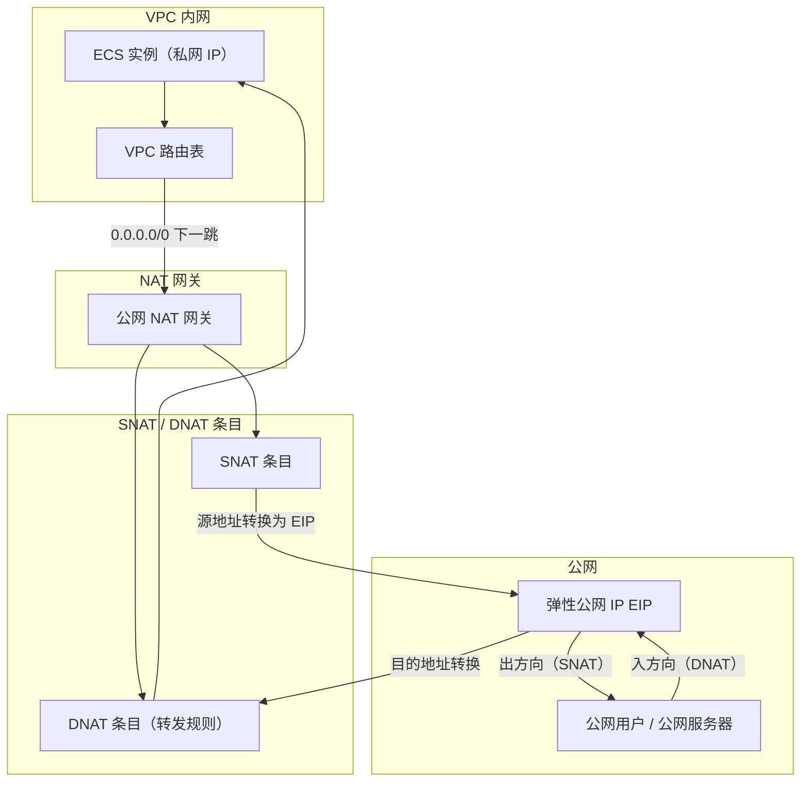

# NAT 网关 · 产品架构

> 产品：NAT 网关 ｜ 口径：公共云 ｜ 复核：2026-11-17

## 产品定义与两条产品线

NAT 网关（NAT Gateway）是阿里云全托管的网络地址转换网关，通过转换和隐藏云服务地址，防止地址直接暴露。

| 产品线 | 转换对象 | 用途 |
|---|---|---|
| 公网 NAT 网关 | VPC 内私网 IPv4 地址 ↔ EIP | 多服务器共享 EIP 访问公网、对外提供公网服务 |
| VPC NAT 网关 | VPC 内私网 IPv4 地址 ↔ NAT IP | 网段冲突互访、以指定私网 IP 访问本地 IDC |

API `NetworkType` 取值：`internet`（公网 NAT 网关）、`intranet`（VPC NAT 网关）。

**来源**
- 什么是 NAT 网关：https://help.aliyun.com/zh/nat-gateway/product-overview/what-is-nat-gateway ｜ 复核：2026-11-16
- CreateNatGateway：https://help.aliyun.com/zh/nat-gateway/developer-reference/api-vpc-2016-04-28-createnatgateway-natgws ｜ 复核：2026-11-16

## 架构图

- 出网路径：ECS 按 VPC 路由表 `0.0.0.0/0` 下一跳转发到公网 NAT 网关，按 SNAT 条目把源地址转换为 EIP 发往公网，回包按会话映射表还原。
- 入网路径：公网用户访问 EIP，网关按 DNAT 条目（转发规则）转换为目的私网 IP:端口，转发到 ECS。

**来源**
- 使用公网 NAT 网关实现公网访问（SNAT/DNAT 工作原理与路由配置）：https://help.aliyun.com/zh/nat-gateway/user-guide/use-internet-nat-gateway-for-public-network-access ｜ 复核：2026-11-17
- 什么是 NAT 网关（公网 NAT 网关 - 公网访问）：https://help.aliyun.com/zh/nat-gateway/product-overview/what-is-nat-gateway ｜ 复核：2026-11-17

## 组件清单

| 组件 | 作用 | 必选/可选 | 是否独立计费 | 备注 |
|---|---|---|---|---|
| 公网 NAT 网关 | 全托管地址转换网关，VPC 内私网 IPv4 地址 ↔ EIP，多 ECS 共享 EIP 出网/入网 | 必选（公网出网或入网场景） | 是（实例费 + CU 费，按使用量后付费） | 增强型（`NatType=Enhanced`）；跨可用区/单可用区容灾；同 VPC 最多 5 个 |
| VPC NAT 网关 | VPC 内私网 IPv4 地址 ↔ NAT IP，解决网段冲突互访、以指定私网 IP 访问 IDC | 可选（另一产品线） | 是（实例费 + CU 费，按使用量后付费） | API `NetworkType=intranet`；与公网 NAT 二选一按场景配置 |
| 弹性公网 IP（EIP） | 公网 NAT 网关绑定后才具备公网能力，是 SNAT/DNAT 的公网地址载体 | 必选（公网 NAT 网关） | 是（EIP 有独立计费规则） | 单网关默认绑定 20 个；关联 [VPC](../vpc/)，EIP 参数见 [EIP 相关见 VPC](../vpc/04-配套参数.md) |
| SNAT 条目 | 把私网网段/实例的源地址转换为指定 EIP，实现多 ECS 共享出网 | 可选（出网场景） | 否 | 单网关默认 40 条；源网段重叠按最长子网掩码匹配 |
| DNAT 条目（转发规则） | 把 EIP:端口映射到私网 IP:端口，对外提供公网服务 | 可选（入网场景） | 否 | 单网关默认 100 条；支持 IP 映射（任意端口）、端口映射、端口段 |
| VPC 路由表 `0.0.0.0/0` 路由 | 把默认流量的下一跳指向 NAT 网关 | 必选 | 否（计费项仅实例费、CU 费与 EIP） | 创建该 VPC 首个公网 NAT 网关时系统自动添加；关联 [VPC](../vpc/) |
| 会话映射表 | 记录转换前后五元组对应关系，回包按会话还原为私网地址 | 必选（内置） | 否 | 不可配置；SNAT 空闲超时 TCP 900 秒、UDP 60 秒 |
| NAT 会话日志（可选） | 记录 SNAT 会话并投递 SLS，用于审计公网访问行为 | 可选 | 否（日志生成免费，SLS 存储/检索另计费） | 仅覆盖 SNAT、不支持 DNAT；详见 [08-日志与审计](08-日志与审计.md) |

**来源**
- 什么是 NAT 网关：https://help.aliyun.com/zh/nat-gateway/product-overview/what-is-nat-gateway ｜ 复核：2026-11-17
- 使用公网 NAT 网关实现公网访问：https://help.aliyun.com/zh/nat-gateway/user-guide/use-internet-nat-gateway-for-public-network-access ｜ 复核：2026-11-17
- 限制与配额（EIP/SNAT/DNAT/每 VPC 网关数）：https://help.aliyun.com/zh/nat-gateway/product-overview/nat-gateway-quotas ｜ 复核：2026-11-17
- NAT 网关计费（实例费 + CU 费、EIP 独立计费）：https://help.aliyun.com/zh/nat-gateway/nat-gateway-billing ｜ 复核：2026-11-17
- 常见问题（SNAT 优先级、SNAT 空闲超时）：https://help.aliyun.com/zh/nat-gateway/support/nat-gateway-faq/ ｜ 复核：2026-11-17
- NAT 网关会话日志：https://help.aliyun.com/zh/nat-gateway/session-log-overview ｜ 复核：2026-11-17

## SNAT 原理（服务器访问公网）

以 ECS（私网 IP 192.168.1.100）访问公网为例：

1. 路由转发：按 VPC 路由表中指向 NAT 网关的路由规则，数据包转发至公网 NAT 网关。
2. 源地址转换：网关按 SNAT 规则把源 IP 192.168.1.100 转换为绑定的 EIP，并记录原始五元组与转换后五元组的对应关系。
3. 发往公网：请求发起方变为 EIP 而非 ECS 私网 IP；响应回包按会话映射表还原为私网 IP 转发回 ECS。

出口 IP 优先级：实例持有的固定公网 IP/EIP > DNAT IP 映射（任意端口） > SNAT 条目绑定的 EIP。
SNAT 条目优先级：源网段重叠时按最长子网掩码匹配，ECS 粒度（/32）优先级最高。

**来源**
- 使用公网 NAT 网关实现公网访问（SNAT 工作原理）：https://help.aliyun.com/zh/nat-gateway/user-guide/enhanced-nat-gateways ｜ 复核：2026-11-16
- 常见问题（SNAT 优先级）：https://help.aliyun.com/zh/nat-gateway/support/nat-gateway-faq/ ｜ 复核：2026-11-16

## DNAT 原理（对外提供服务）

1. 公网用户访问的目标 IP 为 NAT 网关绑定的 EIP。
2. 网关按 DNAT 规则把 EIP 转换为 ECS 私网 IP，并记录映射关系，转发至目标 ECS。
3. ECS 响应包回流至 NAT 网关，按会话映射表转换回 EIP 发往公网。

- DNAT 支持 IP 映射（任意端口）、端口映射、端口段映射。
- 仅配置 DNAT 条目时，ECS 收到的数据包源 IP 为公网 IP，安全组入方向需放行真实公网源 IP。
- NAT 网关与后端 ECS 无需同可用区，同一地域 + 同一 VPC 即可配置 DNAT。

**来源**
- 使用公网 NAT 网关实现公网访问（DNAT 工作原理）：https://help.aliyun.com/zh/nat-gateway/user-guide/enhanced-nat-gateways ｜ 复核：2026-11-16

## 形态定位：增强型与容灾类型

- API `NatType` 当前取值仅 `Enhanced`（增强型公网 NAT 网关）；创建增强型公网 NAT 网关后，系统自动在 VPC 路由表添加 `0.0.0.0/0` → NAT 网关的路由。
- 容灾类型两种：跨可用区容灾（默认，主备两可用区，故障自动切换）与单可用区容灾（仅指定可用区，设备级冗余，实例费约为跨可用区的 50%，CU 费约为 80%）。
- 存量按固定规格（小/中/大）与包年包月已停止新购，详见 [02-网关类型与规格](02-网关类型与规格.md)、[07-计费与生命周期](07-计费与生命周期.md)。

**来源**
- CreateNatGateway：https://help.aliyun.com/zh/nat-gateway/developer-reference/api-vpc-2016-04-28-createnatgateway-natgws ｜ 复核：2026-11-16
- 什么是 NAT 网关（高可用能力）：https://help.aliyun.com/zh/nat-gateway/product-overview/what-is-nat-gateway ｜ 复核：2026-11-16

## 可靠性与 SLA

- 架构：分布式高可靠集群，所有流量平均分配到集群多台系统服务器转发；单会话吞吐量上限 = 吞吐量弹性上限 ÷ 集群服务器个数，PPS 同理。
- SLA（2024-10-01 修订）：多可用区实例可用性不低于 99.995%；单可用区实例可用性不低于 99.95%。
- 性能超过最大指标时业务面临丢包风险；更高性能需联系商务申请。

**来源**
- 【变更公告】NAT 网关服务等级协议（SLA）变更：https://help.aliyun.com/zh/nat-gateway/product-overview/sla-update-announcement ｜ 复核：2026-11-16
- 什么是 NAT 网关（自动弹性/集群架构）：https://help.aliyun.com/zh/nat-gateway/product-overview/what-is-nat-gateway ｜ 复核：2026-11-16
- 功能特性（SLA 管理）：https://help.aliyun.com/zh/nat-gateway/product-overview/product-function-custom-node-nat-normal ｜ 复核：2026-11-16
