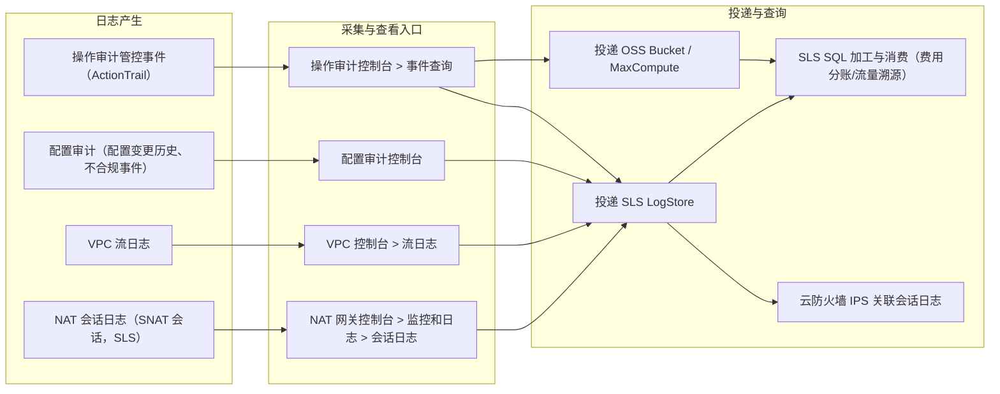

# NAT 网关 · 日志与审计

> 产品：NAT 网关 ｜ 口径：公共云 ｜ 复核：2026-11-18

## 日志流转图

**来源**
- NAT 网关监控与日志总览（基础云监控/配置审计）：https://help.aliyun.com/zh/nat-gateway/monitoring-and-logging ｜ 复核：2026-11-18
- NAT 网关会话日志（适用范围/投递机制）：https://help.aliyun.com/zh/nat-gateway/session-log-overview ｜ 复核：2026-11-18
- VPC 流日志（粒度/投递 SLS）：https://help.aliyun.com/zh/vpc/vpc-flow-logs ｜ 复核：2026-11-18
- 什么是操作审计 ActionTrail（默认保存 90 天）：https://help.aliyun.com/zh/actiontrail/product-overview/what-is-actiontrail ｜ 复核：2026-11-18
- 操作审计使用限制（跟踪/投递额度）：https://help.aliyun.com/zh/actiontrail/product-overview/limits ｜ 复核：2026-11-18

## 日志类型总表

| 类型 | 产生方 | 查看入口 | 默认保留期 | 是否计费 |
|---|---|---|---|---|
| NAT 会话日志（SNAT 会话，SLS） | NAT 网关 + 日志服务 SLS | NAT 网关控制台 > 实例详情 > 监控和日志 > 会话日志；SLS 控制台 | 📋 待补（控制台口径：日志存于用户选择的 Logstore，保存时间以 SLS 控制台 TTL 为准，官方未标注默认值；停止会话日志不删除已有日志） | 日志生成不收费；存储与检索按 SLS 计费 |
| VPC 流日志（NAT 网关弹性网卡/交换机/VPC 粒度五元组流量） | VPC 流日志 | VPC 控制台 > 流日志；SLS 控制台 | 📋 待补（控制台口径：随投递 LogStore TTL 配置，官方未标注默认值） | 投递到 SLS，存储/检索按 SLS 计费 |
| 时序监控数据（云监控指标） | 云监控 CloudMonitor | NAT 网关控制台监控页；云监控控制台 | 与 Period 有关（Period=60 秒 31 天、Period≥300 秒 91 天）；NAT 指标 Period 官方未标注 ⚠️ 待核（2026-11-18 复核仍无产品级 Period 标注） | 基础云监控免费 |
| 审计日志·管控事件 | 操作审计 ActionTrail | 操作审计控制台 > 事件查询 | 默认 90 天 | 操作审计免费；投递到 SLS/OSS/MaxCompute 按目标产品计费 |
| 配置审计（资源配置变更历史、不合规事件） | 配置审计 Cloud Config | 配置审计控制台 | 📋 待补（控制台口径：官方未标注保留期） | 官方口径「免费试用」；投递到 SLS 按 SLS 计费 |

- NAT 网关官方文档未提供产品自带的引擎日志/访问日志；流量与会话级日志由 VPC 流日志与 NAT 会话日志承载。
- 会话日志仅覆盖 SNAT 会话，不支持捕获 DNAT 会话；VPC 流日志以网络层数据流逐方向记录，会话日志以 NAT 会话为单位把私网地址、NAT 转换地址、公网地址及双向流量聚合为一条记录（同一场景流日志 4 条、会话日志 1 条）。

**来源**
- NAT 网关监控与日志总览（基础云监控/配置审计）：https://help.aliyun.com/zh/nat-gateway/monitoring-and-logging ｜ 复核：2026-11-17
- NAT 网关会话日志（适用范围/计费/投递机制）：https://help.aliyun.com/zh/nat-gateway/session-log-overview ｜ 复核：2026-11-17
- VPC 流日志（粒度/投递 SLS）：https://help.aliyun.com/zh/vpc/vpc-flow-logs ｜ 复核：2026-11-17
- 什么是操作审计 ActionTrail（默认保存 90 天）：https://help.aliyun.com/zh/actiontrail/product-overview/what-is-actiontrail ｜ 复核：2026-11-17
- 操作审计使用限制（跟踪/投递额度）：https://help.aliyun.com/zh/actiontrail/product-overview/limits ｜ 复核：2026-11-17
- 云监控使用限制（监控数据存储时长与 Period）：https://help.aliyun.com/zh/cms/cloudmonitor-1-0/product-overview/restrictions-on-use ｜ 复核：2026-11-17

## 关键日志详表

**A. NAT 会话日志（SLS 字段，官方字段表共 15 个）**

| 字段 | 类型/示例 | 含义 |
|---|---|---|
| `instance` | 字符串（natgw-xxx） | NAT 网关实例 ID |
| `protocol` | 数值（1 / 6 / 17） | 流量的 IANA 协议编号：1 为 ICMP、6 为 TCP、17 为 UDP |
| `pri_ip` | IP（172.16.20.21） | 源地址（ECS 私网 IP） |
| `pri_port` | 端口（47176） | 源端口；ICMP 报文对应 ICMP ID 字段 |
| `pub_ip` | IP（106.x.x.203） | 目的地址 |
| `pub_port` | 端口（12180） | 目的端口 |
| `nat_ip` | IP（172.16.10.13） | NAT 转换地址：公网 NAT 为 EIP 普通模式下 EIP 对应的私网 IP（多 EIP 网卡可见模式为 EIP 本身）；VPC NAT 为绑定的 NAT IP |
| `nat_port` | 端口（48155） | NAT 转换端口：公网 NAT 为 EIP 端口，VPC NAT 为 NAT IP 端口 |

- 其余字段：`vpc_id`、`bytes_from_pub`/`pkts_from_pub`（公网侧字节/包数）、`bytes_from_vpc`/`pkts_from_vpc`（VPC 侧字节/包数）、`start_time`、`end_time`。
- 捕获周期约 10 分钟，投递延迟 5 分钟之内；按最大能力交付原则，不保证 100% 交付所有会话。

**B. VPC 流日志（NAT 网关场景，SLS 字段节选）**

| 字段 | 类型/示例 | 含义 |
|---|---|---|
| `srcaddr` | IP | 源 IP 地址 |
| `dstaddr` | IP | 目的 IP 地址 |
| `srcport` / `dstport` | 端口 | 源端口 / 目的端口 |
| `protocol` | 数值（1 / 6 / 17） | 流量的 IANA 协议编号 |
| `direction` | in / out | 流量方向：in 为流入弹性网卡，out 为流出弹性网卡 |
| `action` | ACCEPT / REJECT | 安全组或网络 ACL 是否允许该访问 |
| `bytes` | 数值 | 字节数 |

- 另有 `version`（当前为 1）、`packets`、`start`/`end`（采集窗口时间戳）、`flags` 等字段。
- NAT 排查时按 `direction` + `srcaddr`/`dstaddr` 区分 4 条链路：ECS→NAT 网关、NAT 网关→公网、公网→NAT 网关、NAT 网关→ECS。

**C. 操作审计管控事件结构（ActionTrail）**

| 字段 | 类型/示例 | 含义 |
|---|---|---|
| `eventTime` | UTC 时间格式 | 事件发生时间（UTC 格式） |
| `eventName` | 字符串（API 名称） | 事件名称；`eventType` 为 ApiCall 时即 API 名称 |
| `eventSource` | 📋 待补（结构性：官方字段表未给类型/示例） | 事件来源 |
| `eventType` | ApiCall / ConsoleOperation / ConsoleSignin / ConsoleSignout / AliyunServiceEvent 等 | 事件类型：ApiCall / ConsoleOperation / ConsoleSignin / ConsoleSignout / AliyunServiceEvent 等 |
| `eventRW` | Read / Write | 事件读写类型：Read / Write |
| `sourceIpAddress` | IP 地址 | 事件发起的源 IP 地址 |
| `userIdentity` | root-account / ram-user / assumed-role 等（type 字段） | 请求者身份信息（type 含 root-account / ram-user / assumed-role 等） |
| `errorCode` | 错误码 | 云服务处理 API 请求发生错误时记录的错误码 |

**来源**
- NAT 网关会话日志（会话日志格式）：https://help.aliyun.com/zh/nat-gateway/session-log-overview ｜ 复核：2026-11-17
- VPC 流日志（流日志字段说明）：https://help.aliyun.com/zh/vpc/vpc-flow-logs ｜ 复核：2026-11-17
- VPC 流日志排查高流量 ECS 实例（NAT 四条链路分析）：https://help.aliyun.com/zh/nat-gateway/troubleshoot-high-traffic-ecs-instances-in-nat-gateway ｜ 复核：2026-11-17
- 管控事件结构定义：https://help.aliyun.com/zh/actiontrail/user-guide/management-event-structure ｜ 复核：2026-11-17

## 投递与加工

| 通道 | 去向与参数 | 关键限制 / 额度 | 计费要点 |
|---|---|---|---|
| 会话日志投递 SLS | 启动时选择 Project 与 Logstore（官方建议新建 Project/Logstore 隔离）；投递类型 `sls`；启动后自动创建服务关联角色 `AliyunServiceRoleForNatgwLogDelivery` 并向 Logstore 授权 | 实例须与 SLS 同地域；Logstore 需手动创建索引；捕获周期约 10 分钟、投递延迟 ≤5 分钟；默认单 Project 全部 Logstore 写入限制 30 GB/min；投递失败禁投 5 分钟后探测恢复；按固定规格计费的实例不可开启 | 日志生成免费；SLS 存储、检索按 SLS 计费 |
| VPC 流日志投递 | `CreateFlowLog` 指定投递到 SLS LogStore；采样间隔 1/5/10 分钟；TrafficType 可选 All/Allow/Drop | 采集粒度：弹性网卡/交换机/VPC；勾选「分析报表」可自动在 LogStore 创建索引 | SLS 存储、检索按 SLS 计费 |
| 配置审计投递 | 将 NAT 网关配置变更历史与不合规事件投递到 SLS 指定日志库，统一查询分析 | 配置审计仅支持部分阿里云服务的资源清单 | 配置审计「免费试用」口径；SLS 侧按 SLS 计费 |
| 操作审计投递 | 创建跟踪 → SLS LogStore / OSS Bucket / MaxCompute 项目 | 单账号跟踪每地域 5 个；1 个跟踪最多配置 1 个 OSS Bucket；不创建跟踪仅能追溯最近 90 天 | 操作审计免费；投递目标按各自定价单独付费 |
| SLS SQL 加工与消费 | 会话日志按网段统计流量占比做费用分账；按时间窗口与目的 IP 筛选定位异常流量（流量溯源） | 依赖会话日志已启用且建好索引 | SLS 查询分析按 SLS 计费 |
| 云防火墙 IPS 关联 | 云防火墙 IPS 攻击日志自动关联 NAT 会话日志，分钟级定位被攻击私网 IP | 需开启互联网防火墙与 NAT 会话日志，NAT 网关需按 CU 计费 | 会话日志联动会产生 SLS 费用 |

**来源**
- NAT 网关会话日志（配置/投递/错误码）：https://help.aliyun.com/zh/nat-gateway/session-log-overview ｜ 复核：2026-11-17
- VPC 流日志：https://help.aliyun.com/zh/vpc/vpc-flow-logs ｜ 复核：2026-11-17
- VPC-CreateFlowLog（采样间隔/TrafficType/投递）：https://help.aliyun.com/zh/vpc/developer-reference/api-vpc-2016-04-28-createflowlog ｜ 复核：2026-11-17
- NAT 网关监控与日志总览（配置审计投递 SLS）：https://help.aliyun.com/zh/nat-gateway/monitoring-and-logging ｜ 复核：2026-11-17
- 操作审计使用限制（跟踪额度）：https://help.aliyun.com/zh/actiontrail/product-overview/limits ｜ 复核：2026-11-17
- 会话日志进行 NAT 网关费用分账：https://help.aliyun.com/zh/nat-gateway/analyze-the-splitting-scheme-through-the-session-log ｜ 复核：2026-11-17
- 会话日志进行流量溯源：https://help.aliyun.com/zh/nat-gateway/traffic-tracing-through-session-logs ｜ 复核：2026-11-17
- NAT 会话日志联动云防火墙 IPS 私网溯源：https://help.aliyun.com/zh/nat-gateway/best-practices-for-nat-log-based-ips-private-ip-tracing ｜ 复核：2026-11-17

## 审计与合规

| 项 | 官方口径 |
|---|---|
| 接入方式 | 专有网络 VPC 已与操作审计（ActionTrail）集成，NAT 网关的管控操作随 VPC 事件在操作审计中查询；支持将管控事件投递到 SLS LogStore 或 OSS 存储空间 |
| NAT 相关事件（示例） | `CreateNatGateway`/`DeleteNatGateway`/`ModifyNatGatewayAttribute`（网关增删改）、`CreateSnatEntry`/`ModifySnatEntry`/`DeleteSnatEntry`（SNAT 条目）、`CreateForwardEntry`/`ModifyForwardEntry`/`DeleteForwardEntry`（DNAT 条目）、`EnableNatGatewayEcsMetric`/`DisableNatGatewayEcsMetric`（ECS 流量监控开关）、`UpdateNatGatewayNatType`（普通型升级增强型）等 |
| 查询与留痕保留 | 操作审计默认为每个账号保存最近 90 天管控事件，支持在线查询和下载；不创建跟踪无法追溯 90 天以前的操作事件 |
| 长期保存 | 超过 90 天需创建跟踪，把事件投递到 SLS、OSS 或 MaxCompute（等保 2.0 要求 180 天留存的场景） |
| 排查示例 | 官方用例：以 NAT 网关误绑 EIP 为例，在事件查询页按资源名称（实例 ID）筛选，查看事件详情定位执行绑定操作的 RAM 用户与时间 |
| 配置审计 | NAT 网关已接入配置审计（官方口径「免费试用」），提供跨地域聚合资源清单、配置变更历史与配置合规审计，可投递 SLS |
| 会话日志审计用途 | 会话日志以 NAT 会话为单位聚合私网地址、NAT 转换地址、公网地址与双向流量，用于审计公网访问行为或分析 SNAT 端口使用趋势（不支持 DNAT） |
| RAM 权限 | 官方提供 NAT 网关系统权限策略（管理权限 `AliyunNATGatewayFullAccess` 与只读权限）及服务关联角色 `AliyunServiceRoleForNatgw`；会话日志投递另用 `AliyunServiceRoleForNatgwLogDelivery` |

**来源**
- 专有网络 VPC 审计事件（NAT 网关/SNAT/DNAT 事件清单）：https://help.aliyun.com/zh/actiontrail/product-overview/audit-events-of-vpc ｜ 复核：2026-11-17
- 什么是操作审计 ActionTrail（90 天留痕）：https://help.aliyun.com/zh/actiontrail/product-overview/what-is-actiontrail ｜ 复核：2026-11-17
- 操作审计使用限制（跟踪/投递额度）：https://help.aliyun.com/zh/actiontrail/product-overview/limits ｜ 复核：2026-11-17
- 控制台查询事件追溯操作者（NAT 误绑 EIP 用例）：https://help.aliyun.com/zh/actiontrail/use-cases/use-actiontrail-to-query-events ｜ 复核：2026-11-17
- NAT 网关监控与日志总览（配置审计）：https://help.aliyun.com/zh/nat-gateway/monitoring-and-logging ｜ 复核：2026-11-17
- NAT 网关会话日志（审计公网访问行为）：https://help.aliyun.com/zh/nat-gateway/session-log-overview ｜ 复核：2026-11-17
- NAT 网关系统权限策略参考：https://help.aliyun.com/zh/nat-gateway/security-and-compliance/natgateway-1694081558390 ｜ 复核：2026-11-17
- NAT 网关服务关联角色：https://help.aliyun.com/zh/nat-gateway/security-and-compliance/service-linked-role ｜ 复核：2026-11-17
