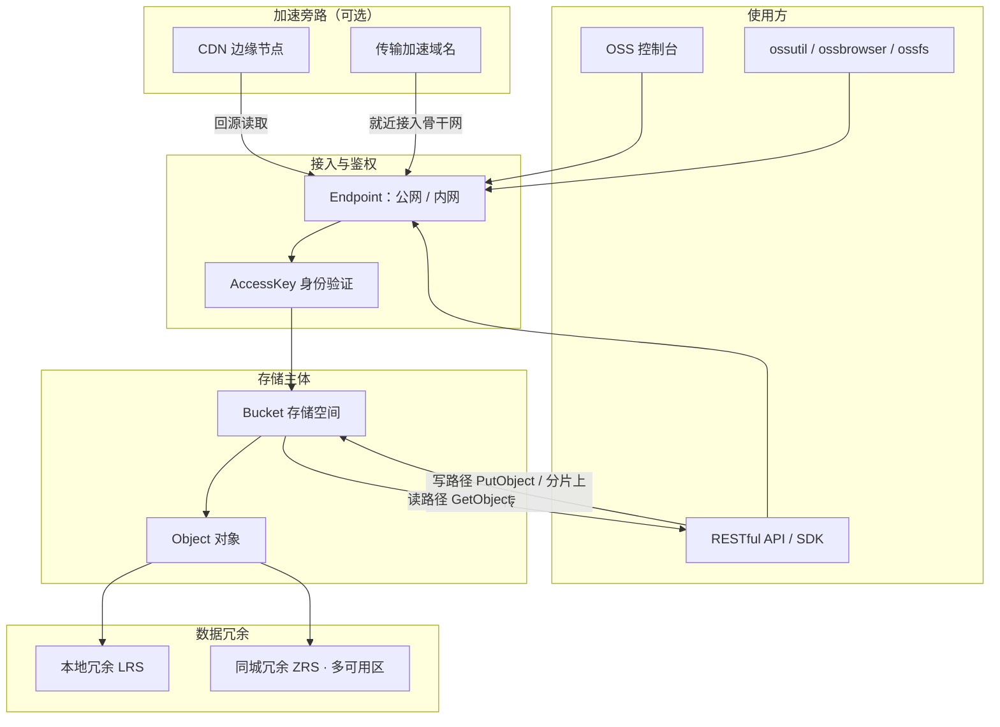
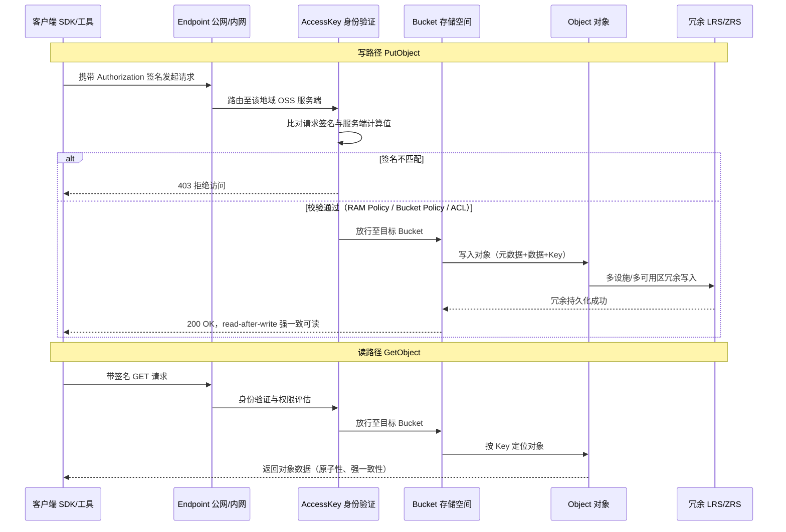

# OSS · 产品架构

> 产品：对象存储 OSS ｜ 口径：公共云 ｜ 复核：2026-11-18

## 产品定义与定位

- OSS（Object Storage Service）以 RESTful API 提供服务，可在任何应用、任何时间、任何地点存储和访问任意类型的数据。
- 数据以对象（Object）形式存储在存储空间（Bucket）中；使用前先创建 Bucket，指定地域、访问权限、存储类型等属性。
- OSS 计费资源 = 存储容量 + 请求次数 + 流量（外网流出/CDN 回源/跨区域复制）+ 增值服务。
- OSS 与 ECS 相互独立：ECS 关机、停止或释放不影响 OSS 中已存储的数据。

| 官方可靠性基线 | 数值 |
|---|---|
| 数据持久性（设计） | 99.9999999999%（12 个 9） |
| 服务可用性（产品页口径） | 99.995% |
| 标准存储-本地冗余 LRS 可用性 | 99.99% |
| 标准存储-同城冗余（多 AZ）可用性 | 99.995% |
| 标准存储-同城冗余（2AZ）可用性 | 99.99% |

**来源**：
- 什么是对象存储OSS：https://help.aliyun.com/zh/oss/user-guide/what-is-oss ｜ 复核：2026-11-16
- 存储类型（对比表）：https://help.aliyun.com/zh/oss/user-guide/overview-53/ ｜ 复核：2026-11-16

## 架构图

**来源**
- 对象存储OSS概述（OSS工作原理）：https://help.aliyun.com/zh/oss/user-guide/what-is-oss ｜ 复核：2026-11-17
- 访问域名与网络连接概述：https://help.aliyun.com/zh/oss/user-guide/access-and-network-overview ｜ 复核：2026-11-17
- 存储类型（LRS/ZRS 冗余）：https://help.aliyun.com/zh/oss/user-guide/overview-53/ ｜ 复核：2026-11-17
- CDN 加速访问 OSS：https://help.aliyun.com/zh/oss/user-guide/cdn-acceleration ｜ 复核：2026-11-17
- OSS 传输加速：https://help.aliyun.com/zh/oss/user-guide/transfer-acceleration ｜ 复核：2026-11-17
- OSS快速入门（API/SDK/工具）：https://help.aliyun.com/zh/oss/user-guide/get-started-with-oss ｜ 复核：2026-11-17

## 关键链路

一次对象写入/读取的请求链路：客户端携签名 → Endpoint 接入 → AccessKey 身份验证 → Bucket/Object → LRS/ZRS 冗余持久化 → 返回。

**来源**
- 对象存储OSS概述（OSS工作原理/一致性）：https://help.aliyun.com/zh/oss/user-guide/what-is-oss ｜ 复核：2026-11-18
- 访问域名与网络连接概述：https://help.aliyun.com/zh/oss/user-guide/access-and-network-overview ｜ 复核：2026-11-18
- 鉴权流程详解（签名比对与多层鉴权）：https://help.aliyun.com/zh/oss/user-guide/authentication ｜ 复核：2026-11-18
- 存储类型（LRS/ZRS 冗余）：https://help.aliyun.com/zh/oss/user-guide/overview-53/ ｜ 复核：2026-11-18

## 组件清单

| 组件 | 作用 | 必选/可选 | 是否独立计费 | 备注 |
|---|---|---|---|---|
| 存储空间 Bucket | 对象的容器，创建时指定地域、访问权限、存储类型 | 必选 | 否（按存储、请求、流量计费） | 同账号同地域内最多 100 个 |
| 对象 Object | 存储数据的基本单元，由元数据、数据和 Key 组成 | 必选 | 否 | 无目录层级，Key 在 Bucket 内唯一 |
| 访问控制 ACL | 设置 Bucket/对象级访问权限 | 可选 | 否 | 与「阻止公共访问」配合使用 |
| 桶策略 Bucket Policy | 以策略 JSON 授权跨账号、匿名、IP/VPC 访问 | 可选 | 否 | 显式 Deny 优先于 Allow；与 RAM Policy 联合评估 |
| 版本控制 | 覆盖/删除时保留历史版本，可恢复误删对象 | 可选 | 否（功能本身不收费，历史版本收存储费） | 开启后无法回到「未开启」，只能暂停 |
| 生命周期规则 | 自动转储存储类型、过期删除、清理碎片 | 可选 | 否（按命中对象产生请求费） | 单 Bucket 最多 1,000 条 |
| 跨区域复制 CRR | 源 Bucket 对象创建/更新/删除异步复制到异地 Bucket | 可选 | 是（跨区域复制流量费 + 每成功复制对象请求费） | 源/目标版本控制状态必须一致；内地↔非内地须开传输加速 |
| CORS 跨域设置 | 配置浏览器跨域请求规则（来源/方法/Headers） | 可选 | 否 | Web 前端直传场景必需 |
| 防盗链 Referer | 按 Referer 白名单/黑名单限制访问来源 | 可选 | 否 | 黑名单优先于白名单 |
| 日志转存 | 将访问日志按小时写入指定目标 Bucket | 可选 | 否（日志文件按目标 Bucket 存储计费） | 建议源/目标不同 Bucket，避免日志循环生成 |
| CDN 加速 | 将 Bucket 静态资源缓存到 CDN 边缘节点就近访问 | 可选（关联产品） | 是（CDN 侧计费） | 强关联 [CDN](../cdn/)，含私有 Bucket 回源 |
| 传输加速 | 通过 oss-accelerate 域名就近接入阿里云骨干网 | 可选 | 是（传输加速费） | 与 CDN 回源可叠加双重加速 |
| DTS RAGFlow 知识库关联 | DTS RAGFlow 知识库关联 OSS Bucket 导入文档 | 可选 | —（OSS 侧无独立计费项，DTS 侧见 [DTS](../dts/)） | 需 AliyunOSSReadOnlyAccess 权限 |

**来源**
- 对象存储OSS概述：https://help.aliyun.com/zh/oss/user-guide/what-is-oss ｜ 复核：2026-11-17
- OSS 权限与访问控制概述（ACL/Bucket Policy/防盗链/CORS）：https://help.aliyun.com/zh/oss/user-guide/permissions-and-access-control-overview ｜ 复核：2026-11-17
- Bucket Policy 授权策略配置：https://help.aliyun.com/zh/oss/user-guide/oss-bucket-policy ｜ 复核：2026-11-17
- 版本控制：https://help.aliyun.com/zh/oss/user-guide/overview-78/ ｜ 复核：2026-11-17
- 生命周期规则配置：https://help.aliyun.com/zh/oss/user-guide/overview-54/ ｜ 复核：2026-11-17
- 跨区域复制：https://help.aliyun.com/zh/oss/user-guide/cross-region-replication-overview/ ｜ 复核：2026-11-17
- OSS 跨域设置 CORS：https://help.aliyun.com/zh/oss/user-guide/configure-cross-origin-resource-sharing ｜ 复核：2026-11-17
- OSS 防盗链：https://help.aliyun.com/zh/oss/user-guide/hotlink-protection ｜ 复核：2026-11-17
- 日志转存：https://help.aliyun.com/zh/oss/user-guide/logging ｜ 复核：2026-11-17
- CDN 加速访问 OSS：https://help.aliyun.com/zh/oss/user-guide/cdn-acceleration ｜ 复核：2026-11-17
- OSS 传输加速：https://help.aliyun.com/zh/oss/user-guide/transfer-acceleration ｜ 复核：2026-11-17
- OSS 数据接入 DTS RAGFlow 知识库：https://help.aliyun.com/zh/dts/user-guide/transfer-the-data-of-oss-to-dts-ragflow ｜ 复核：2026-11-17

## 资源模型：对象 / 存储空间 / 地域

| 概念 | 官方定义要点 |
|---|---|
| 对象（Object） | OSS 存储数据的基本单元，由元数据（Object Meta）、用户数据（Data）和文件名（Key）组成；无文件系统目录层级，由 Bucket 内唯一的 Key 标识 |
| 存储空间（Bucket） | 对象的容器；配置属性包括地域、访问权限、存储类型等；创建后名称、地域、存储类型不可修改 |
| 地域（Region） | 数据中心所在物理位置；距离用户越近访问速度越快 |
| 访问域名（Endpoint） | 不同地域、不同网络（内网/外网）使用不同 Endpoint；杭州外网 `oss-cn-hangzhou.aliyuncs.com`，内网 `oss-cn-hangzhou-internal.aliyuncs.com` |
| 访问密钥（AK） | AccessKey ID + AccessKey Secret 对称加密验证请求者身份；来源：Bucket 拥有者自有 AK、RAM 授权 AK、STS 临时 AK |

- 单个存储空间容量不限制。
- 同一阿里云账号在同一地域内创建的 Bucket 总数不能超过 100 个。

**来源**：
- 什么是对象存储OSS：https://help.aliyun.com/zh/oss/user-guide/what-is-oss ｜ 复核：2026-11-16
- OSS使用限制及性能指标：https://help.aliyun.com/zh/oss/user-guide/limits ｜ 复核：2026-11-16

## 数据冗余：LRS / ZRS

| 冗余类型 | 机制 | 适用范围 |
|---|---|---|
| 本地冗余 LRS | 单可用区内多个设施的多个设备冗余；该可用区不可用时数据不可访问 | 全部存储类型；冷归档、深度冷归档仅支持 LRS |
| 同城冗余 ZRS（多 AZ） | 同一地域 3 个或以上可用区冗余；某可用区不可用仍可正常访问 | 标准/低频/归档；杭州、上海、北京、张家口、乌兰察布、深圳、香港、东京、新加坡、雅加达、法兰克福、吉隆坡等地域 |
| 同城冗余 ZRS（2AZ） | 同一地域双可用区冗余 | 仅标准存储；硅谷、马尼拉、曼谷、首尔、迪拜、伦敦等地域 |

- 无地域属性 Bucket：仅支持标准存储（本地冗余），可用性 99.00%。
- 标准存储默认 Object 存储类型为标准存储；Bucket 存储类型创建后不可修改，对象可通过生命周期转换。

**来源**：
- 存储类型：https://help.aliyun.com/zh/oss/user-guide/overview-53/ ｜ 复核：2026-11-16
- OSS使用限制及性能指标：https://help.aliyun.com/zh/oss/user-guide/limits ｜ 复核：2026-11-16

## 跨区域冗余：跨区域复制（CRR）

- 跨区域复制将源 Bucket 中 Object 的创建、更新、删除自动、异步（近实时）复制到另一地域的目标 Bucket；目标对象是精确副本（同名、版本信息、元数据、ACL、内容）。
- 默认保证两端数据最终一致性；复制期间若向目标 Bucket 写入同名文件则无法保证。
- 前置：源/目标 Bucket 版本控制状态必须一致且不为暂停状态；复制期间不允许改变版本控制状态。
- 中国内地与非中国内地地域之间进行跨区域复制必须开启传输加速。
- 每成功复制 1 个 Object 收取请求费用；复制流量按跨区域复制流量计费（跨账号由源 Bucket 账号承担）；低频/归档对象复制不涉及解冻、不收取取回容量费用。

**来源**：
- 跨区域复制：https://help.aliyun.com/zh/oss/user-guide/cross-region-replication-overview/ ｜ 复核：2026-11-16
- 流量费用：https://help.aliyun.com/zh/oss/traffic-fees ｜ 复核：2026-11-16

## 一致性与原子性

- Object 操作具有原子性：操作要么成功要么失败，不存在中间状态；上传完成即可读到完整对象。
- Object 操作具有强一致性：收到 PUT 成功响应即 read-after-write 可读，且冗余数据已写入成功。
- 删除操作同样强一致：删除指定 Object 成功后该 Object 立即不存在。

**来源**：
- 什么是对象存储OSS：https://help.aliyun.com/zh/oss/user-guide/what-is-oss ｜ 复核：2026-11-16

## 可靠性机制与 SLA（2026-03-01 版）

SLA 按地域 + 存储类型分别统计月度服务可用性；可用性 =（1 − 服务周期内 ∑每5分钟错误率 ÷ 5分钟总个数）×100%。

| 存储类型 | 地域 | 月度可用性承诺 |
|---|---|---|
| 标准型（本地冗余 LRS） | 全部公共云地域 | 99.99% |
| 标准型（同城冗余 ZRS） | 杭州/上海/北京/深圳/张家口/乌兰察布/香港/新加坡/东京/法兰克福/雅加达/吉隆坡 | 99.995% |
| 标准型（同城冗余 ZRS） | 硅谷/弗吉尼亚/伦敦/首尔/马尼拉/曼谷/迪拜 | 99.99% |
| 低频/归档（本地冗余）/冷归档/深度冷归档 | 全部公共云地域 | 99.00% |
| 低频/归档（同城冗余） | 全部公共云地域 | 99.50% |
| 标准型（本地冗余，无地域属性） | 无地域属性 | 99.00% |

赔偿规则（摘要）：

| 可用性区间 | 赔偿代金券（占月度服务费用） |
|---|---|
| 低于承诺但 ≥99.90%（LRS 标准 ≥99.90% 档） | 10% |
| 低于 99.90% 但 ≥95.00% | 30% |
| 低于 95.00% | 50% |

- 赔偿总额不超过当月该地域该存储类型月度服务费用的 50%（不含代金券抵扣部分）。
- 有效请求不含 403（鉴权失败/欠费）、CRR 与生命周期后端请求、GetService 请求、黑客攻击请求；503（超配额流控）、424（镜像回源超时）等不计失败请求。
- 赔偿申请：每月第 5 个工作日后提出，且须在相关月份结束后 2 个月内提出。

**来源**：
- 对象存储OSS服务等级协议（版本生效日期 2026年3月1日）：https://terms.aliyun.com/legal-agreement/terms/suit_bu1_ali_cloud/suit_bu1_ali_cloud201803021527_93160.html ｜ 复核：2026-11-16
