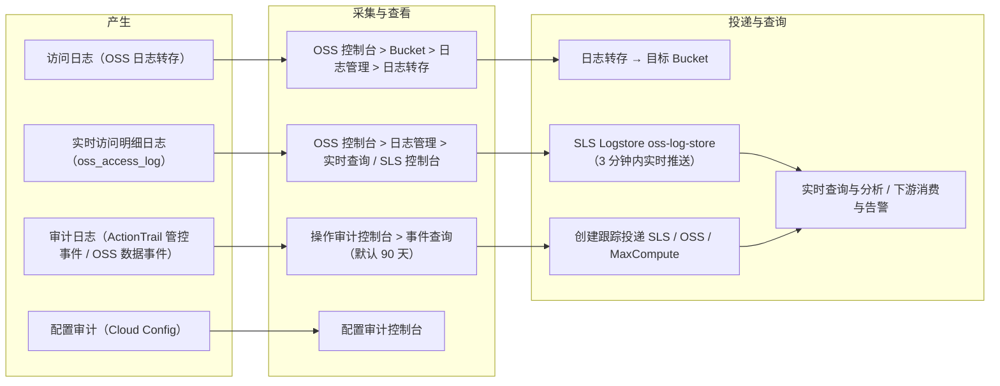

# OSS · 日志与审计

> 产品：对象存储 OSS ｜ 口径：公共云 ｜ 复核：2026-11-18

## 日志流转图

**来源**
- 日志与监控概述：https://help.aliyun.com/zh/oss/user-guide/logging-and-monitoring ｜ 复核：2026-11-18
- 日志转存：https://help.aliyun.com/zh/oss/user-guide/logging ｜ 复核：2026-11-18
- OSS 实时日志查询：https://help.aliyun.com/zh/oss/user-guide/real-time-log-query ｜ 复核：2026-11-18
- 操作审计-OSS 管控事件：https://help.aliyun.com/zh/actiontrail/product-overview/audit-events-of-oss ｜ 复核：2026-11-18

## 日志类型总表

| 类型 | 产生方 | 查看入口 | 默认保留期 | 是否计费 |
|---|---|---|---|---|
| 访问日志（OSS 自带·日志转存） | OSS | OSS 控制台 > Bucket > 日志管理 > 日志转存 | 每小时生成一个日志文件，不自动清除，需配置生命周期规则清理 | 日志功能不单独收费；日志文件按目标 Bucket 存储计费（官方提示及时清理以减少存储费用） |
| 实时访问明细日志（`oss_access_log`，含批量删除日志 `oss_batch_delete_log`） | OSS + 日志服务 SLS | OSS 控制台 > 日志管理 > 实时查询；SLS 控制台 | SLS Logstore 默认保存 7 天，可调整保留时间 | 存储 ≤7 天且当天写入+索引流量（压缩后）≤900 GB 免费；超期或超量由 SLS 计费 |
| 每小时计量日志（`oss_metering_log`） | 日志服务 SLS | SLS 控制台 Logstore `oss-log-store`（Project：`oss-log-<账号ID>-<地域>`） | 📋 待补（控制台口径：SLS Logstore TTL，官方未标注该日志类型默认保留期） | 默认免费开通 |
| 时序监控数据（10 秒/5 分钟粒度指标） | 日志服务 SLS | SLS 控制台 | 📋 待补（控制台口径：SLS MetricStore TTL，官方未标注默认保留期） | 默认免费开通 |
| 审计日志·管控事件 | 操作审计 ActionTrail | 操作审计控制台 > 事件查询 | 默认 90 天 | 操作审计本身免费；投递到 SLS/OSS/MaxCompute 按目标产品计费 |
| 审计日志·OSS 数据事件（PutObject/GetObject/DeleteObject 等，需创建跟踪开启） | 操作审计 ActionTrail | 创建跟踪后在 SLS LogStore / OSS Bucket 中查询 | 📋 待补（控制台口径：随投递目标 SLS Logstore/OSS Bucket 的保存策略） | 同上（操作审计免费，投递目标另计费） |
| 配置审计（资源配置变更历史） | 配置审计 Cloud Config | 配置审计控制台 | 📋 待补（控制台口径：官方未标注保留期） | 官方口径「免费试用」；投递到 SLS/OSS 按目标产品计费 |

- OSS 自带日志与 SLS 访问记录日志字段一一对应但字段名不同，SLS 版本包含 OSS 自带日志的全部信息。
- 实时日志查询要求：无地域属性的 Bucket 不支持。

**来源**
- 日志与监控概述：https://help.aliyun.com/zh/oss/user-guide/logging-and-monitoring ｜ 复核：2026-11-17
- 日志转存：https://help.aliyun.com/zh/oss/user-guide/logging ｜ 复核：2026-11-17
- OSS 实时日志查询：https://help.aliyun.com/zh/oss/user-guide/real-time-log-query ｜ 复核：2026-11-17
- 日志字段详情（OSS 日志类型）：https://help.aliyun.com/zh/sls/log-fields-13 ｜ 复核：2026-11-17
- OSS 访问日志清理机制：https://help.aliyun.com/zh/oss/user-guide/will-oss-access-logs-be-cleared-regularly ｜ 复核：2026-11-17
- 操作审计使用限制：https://help.aliyun.com/zh/actiontrail/product-overview/limits ｜ 复核：2026-11-17
- 操作审计计费说明：https://help.aliyun.com/zh/actiontrail/product-overview/billing-1 ｜ 复核：2026-11-17

## 关键日志详表

**A. 实时访问明细日志（`oss_access_log`，SLS 字段）**

| 字段 | 类型/示例 | 含义 |
|---|---|---|
| `bucket` | 字符串 | OSS Bucket 名称 |
| `object` | 字符串（URL 编码） | 请求的 Object Key；查询时可用 `select url_decode(object)` 解码 |
| `operation` | 枚举（如 GetObject） | 访问类型 |
| `http_status` | 数值（如 200） | HTTP 请求返回的状态 |
| `error_code` | 字符串 | OSS 返回的错误码 |
| `response_time` | 数值（毫秒） | HTTP 响应时间 |
| `referer` | 字符串 | 请求的 HTTP Referer |
| `client_ip` | IP 地址 | 发起请求的客户端 IP（含其防火墙或 Proxy IP） |

- `request_id` 为请求 ID，可关联 `oss_batch_delete_log` 批量删除日志（批量删除时 `object` 字段为短划线）。

**B. OSS 自带访问日志（日志转存文本字段，与 SLS 字段一一对应）**

| OSS 自带字段 | 对应 SLS 字段 | 含义 |
|---|---|---|
| Remote IP | `client_ip` | 客户端 IP 地址 |
| Time | `time` | OSS 请求结束时间 |
| HTTP Status | `http_status` | HTTP 请求返回的状态 |
| RequestTime (ms) | `response_time` | HTTP 响应时间，单位毫秒 |
| Operation | `operation` | 访问类型 |
| Bucket | `bucket` | Bucket 名称 |
| Key | `object` | Object 名称（URL 编码） |
| Error Code | `error_code` | OSS 返回的错误码 |

**C. 审计管控事件（ActionTrail，管控事件结构）**

| 字段 | 含义 |
|---|---|
| `eventTime` | 事件发生时间（UTC 格式） |
| `eventName` | 事件名称；`eventType` 为 ApiCall 时即 API 名称 |
| `eventSource` | 事件来源 |
| `eventType` | 事件类型：ApiCall / ConsoleOperation / ConsoleSignin / ConsoleSignout / AliyunServiceEvent 等 |
| `eventRW` | 事件读写类型：Read / Write |
| `sourceIpAddress` | 事件发起的源 IP 地址 |
| `userIdentity` | 请求者身份信息（type 含 root-account / ram-user / assumed-role 等） |
| `errorCode` | 云服务处理 API 请求发生错误时记录的错误码 |

**来源**
- 日志字段详情（访问日志字段）：https://help.aliyun.com/zh/sls/log-fields-13 ｜ 复核：2026-11-17
- 实时OSS日志查询常见示例：https://help.aliyun.com/zh/oss/user-guide/common-examples-of-real-time-log-queries ｜ 复核：2026-11-17
- 管控事件结构定义：https://help.aliyun.com/zh/actiontrail/user-guide/management-event-structure ｜ 复核：2026-11-17
- 操作审计-OSS 管控事件：https://help.aliyun.com/zh/actiontrail/product-overview/audit-events-of-oss ｜ 复核：2026-11-17

## 投递与加工

| 通道 | 去向与参数 | 关键限制 / 额度 | 计费要点 |
|---|---|---|---|
| 日志转存 | 目标 Bucket（须同账号同地域；源 Bucket 无地域属性时目标必须为同一 Bucket） | 每小时生成一个日志文件；目标 Bucket 须允许 OSS 经典内网访问；授权角色默认 `AliyunOSSLoggingDefaultRole` | 日志文件按目标 Bucket 存储计费，建议用生命周期规则定期清理 |
| 实时日志查询（投递 SLS） | Logstore `oss-log-store`，Project `oss-log-<账号ID>-<地域>` | 3 分钟内实时推送；可按 Bucket 名称、Object 名称、API 操作、时间过滤；免费提供最近 7 天查询，可修改保存时间 | 7 天内且当天写入+索引（压缩后）≤900 GB 免费；免费 Shard 额度 16×31 个·天/月，超出部分由 SLS 收费 |
| 自定义日志字段 | `user_defined_log_fields`（自定义请求头/查询参数） | 用于记录 `x-forwarded-for` 等自定义 header/param，SQL 查询定位经 CDN 等代理后的真实客户端 IP | OSS 侧无额外费用 |
| 实时查询与分析 | OSS 控制台「日志管理 > 实时查询」或 SLS 查询分析 | 示例：按 `operation` 统计 GetObject 次数、按目录统计外网流出流量、排除 CDN 回源请求 | SLS 查询/索引按 SLS 计费规则 |
| 下游消费与告警 | CloudLens for OSS（Bucket 粒度可观测）；SLS 告警（钉钉机器人等）；SLS 数据投递 | SLS 提供采集、查询分析、告警、消费与投递一站式能力 | SLS 存储、投递按 SLS 定价单独收费 |
| 审计事件投递 | 创建跟踪 → SLS LogStore / OSS Bucket / MaxCompute 项目 | 单账号跟踪每地域 5 个；1 个跟踪最多配置 1 个 OSS Bucket；多账号跟踪可将资源目录成员事件统一投递 | 操作审计免费，投递目标按各自定价单独付费 |

**来源**
- 日志转存：https://help.aliyun.com/zh/oss/user-guide/logging ｜ 复核：2026-11-17
- OSS 实时日志查询：https://help.aliyun.com/zh/oss/user-guide/real-time-log-query ｜ 复核：2026-11-17
- 设置日志记录请求头或查询参数：https://help.aliyun.com/zh/oss/user-guide/set-logging-request-headers-or-url-parameters ｜ 复核：2026-11-17
- 实时OSS日志查询常见示例：https://help.aliyun.com/zh/oss/user-guide/common-examples-of-real-time-log-queries ｜ 复核：2026-11-17
- CloudLens for OSS：https://help.aliyun.com/zh/oss/user-guide/use-cloudlens-for-oss ｜ 复核：2026-11-17
- SLS 告警监控 OSS 访问：https://help.aliyun.com/zh/oss/user-guide/use-sls-alerts-to-protect-your-oss-resources ｜ 复核：2026-11-17
- 什么是日志服务 SLS（数据投递）：https://help.aliyun.com/zh/sls/what-is-log-service ｜ 复核：2026-11-17
- 操作审计使用限制：https://help.aliyun.com/zh/actiontrail/product-overview/limits ｜ 复核：2026-11-17
- 创建多账号跟踪：https://help.aliyun.com/zh/actiontrail/user-guide/create-a-multi-account-trail ｜ 复核：2026-11-17
- 操作审计计费说明：https://help.aliyun.com/zh/actiontrail/product-overview/billing-1 ｜ 复核：2026-11-17

## 审计与合规

| 项 | 官方口径 |
|---|---|
| 接入方式 | OSS 已接入操作审计（ActionTrail），记录用户通过 OpenAPI、控制台等方式操作 OSS 产生的管控事件 |
| 管控事件范围 | Bucket 配置变更类事件，如 PutBucket、DeleteBucket、PutBucketAcl、PutBucketLifecycle、PutBucketReplication、DeleteBucketCors 等；不含 Object 数据操作 |
| 数据事件范围 | PutObject、GetObject、DeleteObject 等对象读写事件；需创建跟踪开启；LookupEvents 接口仅支持管控事件 |
| 查询与留痕保留 | 默认为每个阿里云账号记录最近 90 天操作事件；操作后 10 分钟内可在控制台/OSS 存储中查到 |
| 长期保存 | 超过 90 天需创建跟踪，将事件投递到 SLS、OSS 或 MaxCompute（等保 2.0 要求 180 天留存的场景） |
| 配额 | 单账号跟踪每地域 5 个；1 个跟踪允许配置 1 个 OSS Bucket；LookupEvents 每秒最多 2 次 |
| 特例 | GetBucket（ListObjects）事件自 2020-03-24 起停止追踪与查询（流量过大影响管控事件分发性能） |
| 计费 | 操作审计本身免费；通过跟踪投递到 SLS/OSS/MaxCompute 时按各自定价单独付费 |

- OSS 已同时接入配置审计（Cloud Config），提供资源配置历史追踪与配置合规审计（免费试用口径）。

**来源**
- 操作审计-OSS 管控事件：https://help.aliyun.com/zh/actiontrail/product-overview/audit-events-of-oss ｜ 复核：2026-11-17
- 操作审计-OSS 数据事件列表：https://help.aliyun.com/zh/actiontrail/product-overview/object-storage-oss-data-events ｜ 复核：2026-11-17
- 操作审计使用限制：https://help.aliyun.com/zh/actiontrail/product-overview/limits ｜ 复核：2026-11-17
- 什么是操作审计 ActionTrail：https://help.aliyun.com/zh/actiontrail/product-overview/what-is-actiontrail ｜ 复核：2026-11-17
- 操作审计计费说明：https://help.aliyun.com/zh/actiontrail/product-overview/billing-1 ｜ 复核：2026-11-17
- 公告：暂停 OSS GetBucket（ListObjects）事件：https://help.aliyun.com/zh/actiontrail/product-overview/announcement-actiontrail-suspends-its-support-for-the-getbucket-event ｜ 复核：2026-11-17
- 日志与监控概述（配置审计）：https://help.aliyun.com/zh/oss/user-guide/logging-and-monitoring ｜ 复核：2026-11-17
