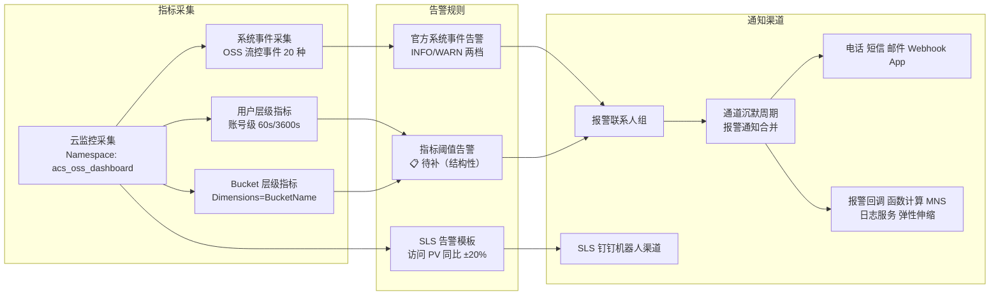

# OSS · 监控与告警

> 产品：对象存储 OSS ｜ 口径：公共云 ｜ 复核：2026-11-18

## 告警链路图

**来源**
- OSS 监控指标参考：https://help.aliyun.com/zh/oss/user-guide/metrics ｜ 复核：2026-11-18
- OSS 系统事件（事件名称/等级/触发条件）：https://help.aliyun.com/zh/oss/user-guide/oss-system-events ｜ 复核：2026-11-18
- SLS 告警监控 OSS 访问（±20% 示例阈值、钉钉机器人渠道）：https://help.aliyun.com/zh/oss/user-guide/use-sls-alerts-to-protect-your-oss-resources ｜ 复核：2026-11-18
- OSS 报警规则配置（沉默周期/回调/函数计算/MNS/日志服务/弹性伸缩/通知合并）：https://help.aliyun.com/zh/oss/user-guide/use-the-alert-service ｜ 复核：2026-11-18
- 云监控报警规则概述（电话/短信/邮件/Webhook/App）：https://help.aliyun.com/zh/cms/cloudmonitor-1-0/user-guide/overview-2 ｜ 复核：2026-11-18

## 核心监控指标

OSS 已接入云监控（CloudMonitor），Namespace 为 `acs_oss_dashboard`。
- 非计量类指标查询周期（Period）为 60s；计量类指标为 3600s。
- 用户层级指标为账号级（不传 Dimensions）；Bucket 层级指标传 `Dimensions={"BucketName":"<Bucket名>"}`，不传则汇总账号下全部 Bucket。

| 指标（英文名） | 含义 | 单位 | 统计周期 | 维度 |
|---|---|---|---|---|
| UserAvailability | 账号级可用性，按 `1 − 5xx 错误请求占总请求百分比` 计算 | % | 60s | 用户层级（账号） |
| UserTotalRequestCount | 账号级总请求数（OSS 服务端接收并处理的请求总数） | 次数 | 60s | 用户层级（账号） |
| UserServerErrorCount | 服务端错误请求总数（返回状态码 5xx） | 次数 | 60s | 用户层级（账号） |
| UserServerErrorRate | 服务端错误请求总数占总请求数的百分比 | % | 60s | 用户层级（账号） |
| UserAuthorizationErrorCount | 客户端授权错误请求总数（返回状态码 403） | 次数 | 60s | 用户层级（账号） |
| UserResourceNotFoundErrorCount | 客户端资源不存在错误请求总数（返回状态码 404） | 次数 | 60s | 用户层级（账号） |
| UserNetworkErrorCount | 网络错误请求总数（HTTP 状态码 499） | 次数 | 60s | 用户层级（账号） |
| UserInternetSend | 公网流出流量 | 字节 | 60s | 用户层级（账号） |
| UserCdnSend | CDN 流出流量（开通 CDN 后的回源流量） | 字节 | 60s | 用户层级（账号） |
| UserSyncSend | 跨区域复制流出流量 | 字节 | 60s | 用户层级（账号） |
| TotalRequestCount | 单 Bucket 总请求数 | 次数 | 60s | Bucket 层级（BucketName） |
| InternetSend | 单 Bucket 公网流出流量 | 字节 | 60s | Bucket 层级（BucketName） |
| GetObjectE2eLatency | GetObject 成功请求的平均端到端（E2E）延时 | 毫秒 | 60s | Bucket 层级（BucketName） |
| MeteringStorageUtilization | 存储大小（计量类，与计费口径对齐） | 字节 | 3600s | 指定 BucketName 为该 Bucket，未指定为账号级 |

- 请求状态详情类指标还提供 4xx/5xx/403/404/499/2xx/3xx 的请求总数与占比（如 `UserSuccessCount`、`UserRedirectCount`）。
- 监控数据存储时长与 Period 有关（Period=60s 存储 31 天）；云监控 OSS 数据存在 2~3 小时延迟（官方 FAQ 口径）。

**来源**
- OSS 监控指标参考：https://help.aliyun.com/zh/oss/user-guide/metrics ｜ 复核：2026-11-17
- 通过 API 访问 OSS 监控数据（Namespace/Period/Dimensions/Metric）：https://help.aliyun.com/zh/oss/user-guide/access-monitoring-data ｜ 复核：2026-11-17
- 云监控监控 OSS 指标：https://help.aliyun.com/zh/oss/user-guide/use-cloudmonitor-to-monitor-oss ｜ 复核：2026-11-17
- OSS 监控常见问题（数据延迟）：https://help.aliyun.com/zh/oss/user-guide/faq-25 ｜ 复核：2026-11-17
- 使用限制（监控数据存储时长）：https://help.aliyun.com/zh/cms/cloudmonitor-1-0/product-overview/restrictions-on-use ｜ 复核：2026-11-17

## 官方默认与推荐告警

**A. 官方系统事件告警（OSS 流控事件，云监控事件告警）**

| 事件名称 | 事件等级 | 事件触发条件 |
|---|---|---|
| BucketEgressBandwidth | 通知（INFO） | Bucket 下行带宽超过汇报阈值 |
| BucketEgressBandwidthThresholdExceeded | 警告（WARN） | Bucket 下行带宽超过流控阈值，访问延迟会增加 |
| BucketQps | 通知（INFO） | Bucket 每秒请求数超过 QPS 汇报阈值 |
| BucketQpsThresholdExceeded | 警告（WARN） | Bucket 每秒请求数超过 QPS 流控阈值，部分请求会被丢弃 |
| UserQpsThresholdExceeded | 警告（WARN） | 用户每秒请求数超过 QPS 流控阈值，部分请求会被丢弃 |
| BucketImageCpuThresholdExceeded | 警告（WARN） | Bucket 图片处理占用 CPU 核数大于流控阈值 |

- 官方共定义 20 种 OSS 流控系统事件（Bucket/User 级带宽、QPS、镜像回源、图片处理 CPU），事件等级仅 INFO / WARN 两档。
- 各事件的具体限制值（流控阈值）以《OSS 使用限制及性能指标》为准，非固定推荐告警值。

**B. 官方文档示例阈值**

| 场景 | 阈值/表达式 | 出处 |
|---|---|---|
| SLS 告警模板「OSS 访问 PV 同比昨日变化率过高」 | `(change_rate ≥ 0 && change_rate > 20) || (change_rate < 0 && -change_rate > 20)`，即 PV 同比陡增或陡降 20% 触发 | SLS 告警监控 OSS 访问（官方教程示例） |

**C. 指标阈值类告警**

- 总请求数、流量、错误率、4xx/5xx、延时等指标的阈值告警：**官方未发布推荐阈值** 📋 待补（结构性：官方文档仅提供创建报警规则的操作说明，未给出 OSS 推荐阈值；按阈值红线不收经验值）。

**来源**
- OSS 系统事件（事件名称/等级/触发条件）：https://help.aliyun.com/zh/oss/user-guide/oss-system-events ｜ 复核：2026-11-17
- OSS 流控监控告警：https://help.aliyun.com/zh/oss/user-guide/use-cloudmonitor-to-monitor-oss-throttling-information-in-real-time ｜ 复核：2026-11-17
- SLS 告警监控 OSS 访问（±20% 示例阈值）：https://help.aliyun.com/zh/oss/user-guide/use-sls-alerts-to-protect-your-oss-resources ｜ 复核：2026-11-17
- OSS 报警规则配置：https://help.aliyun.com/zh/oss/user-guide/use-the-alert-service ｜ 复核：2026-11-17
- OSS使用限制及性能指标：https://help.aliyun.com/zh/oss/user-guide/limits ｜ 复核：2026-11-17

## 通知与渠道

| 渠道/机制 | 说明 |
|---|---|
| 通知方式 | 云监控报警服务支持电话、短信、邮件和 Webhook 地址；安装阿里云 App 可通过 App 接收报警通知 |
| 报警联系人组 | 创建报警规则时选择已绑定报警联系人的联系人组 |
| 报警回调 | 公网可访问的 URL，云监控通过 POST 推送报警信息，目前仅支持 HTTP 协议 |
| 函数计算 | 报警发生时将通知发送至函数计算进行格式处理（需设置地域、服务、函数） |
| 轻量消息队列（原 MNS） | 报警发生时写入指定 Topic |
| 日志服务 | 报警发生时将报警信息发送至 SLS 日志库 |
| 弹性伸缩联动 | 报警发生时触发相应伸缩规则 |
| 通道沉默周期 | 取值：5 分钟、15 分钟、30 分钟、60 分钟、3 小时、6 小时、12 小时、24 小时；沉默期内不重复发送，超期未恢复再次发送 |
| 生效时间 / 无数据处理 | 报警规则仅在生效时间内检查数据；无数据处理取值：不做任何处理（默认）、发送无数据报警、视为正常 |
| 报警通知合并 | 同一账号多个资源在同一规则和周期内报警时，合并通知以减少冗余 |
| SLS 告警渠道 | SLS 支持钉钉自定义机器人 WebHook，以及短信、语音、邮件等通知渠道推送告警 |
| 告警升级策略 | 官方未发布 OSS 告警升级（Escalation）策略 📋 待补（结构性） |

**来源**
- OSS 报警规则配置（沉默周期/回调/函数计算/MNS/日志服务/弹性伸缩/无数据处理/通知合并）：https://help.aliyun.com/zh/oss/user-guide/use-the-alert-service ｜ 复核：2026-11-17
- 云监控报警规则概述（电话/短信/邮件/Webhook/App）：https://help.aliyun.com/zh/cms/cloudmonitor-1-0/user-guide/overview-2 ｜ 复核：2026-11-17
- SLS 告警监控 OSS 访问（钉钉机器人渠道）：https://help.aliyun.com/zh/oss/user-guide/use-sls-alerts-to-protect-your-oss-resources ｜ 复核：2026-11-17

## 告警配额

| 限制项 | 最大值 | 归属 |
|---|---|---|
| 单账号可新建的报警规则数量 | 10,000 条 | 基础云监控 |
| 单账号可新建的动态规则数量 | 1,200 个 | 基础云监控 |
| 单账号可新建的应用分组数量 | 20,000 个 | 基础云监控 |
| 一个应用分组内允许新建的可用性监控数量 | 500 个 | 基础云监控 |
| 一个应用分组内包含的每种资源数量 | 3,000 个 | 基础云监控 |
| 监控数据存储时长（Period < 60 秒） | 7 天 | 基础云监控 |
| 监控数据存储时长（Period = 60 秒） | 31 天 | 基础云监控 |
| 监控数据存储时长（Period ≥ 300 秒） | 91 天 | 基础云监控 |
| 单账号可新建的 PromQL 报警规则数量 | 20 条 | 企业云监控 |
| 单账号可新建的指标仓库数量 | 30 个 | 企业云监控 |
| 单账号可新建的 SLS Logstore 组数量 | 20 个（每组最多 25 个 Logstore） | 企业云监控 |
| 一个智能水位分析任务可设置的报警联系人组数量 | 5 个 | 企业云监控 |
| 报警联系人 / 报警联系人组的数量上限 | 📋 待补（结构性：官方使用限制页未列出该配额） | 基础云监控 |

**来源**
- 云监控使用限制（报警规则/应用分组/存储时长/企业云监控配额）：https://help.aliyun.com/zh/cms/cloudmonitor-1-0/product-overview/restrictions-on-use ｜ 复核：2026-11-17
- 创建报警规则（企业云监控 PromQL 报警规则 20 条）：https://help.aliyun.com/zh/cms/cloudmonitor-1-0/user-guide/create-an-alert-rule-2 ｜ 复核：2026-11-17
