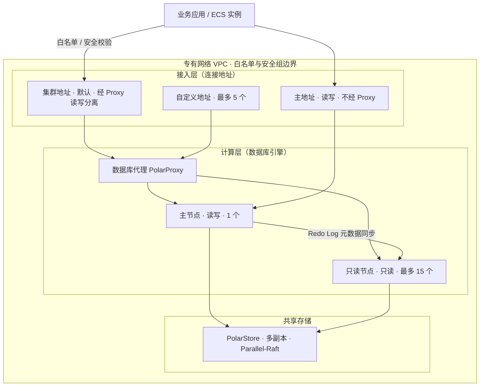

# PolarDB · 产品架构

> 产品：PolarDB ｜ 口径：公共云 ｜ 复核：2026-11-18

## 产品定位与系列

- PolarDB 是阿里云自研云原生关系型数据库，支持 3 种独立引擎：100% 兼容 MySQL、100% 兼容 PostgreSQL、高度兼容 Oracle 语法。
- PolarDB MySQL 版分两个产品版本：**企业版**、**标准版**。
- 企业版下分两个产品系列：**集群版**（一写多读）、**多主集群（Limitless）**（多写多读）；标准版仅一写多读。
- 2017 年 9 月发布公测，2018 年 3 月开始商用。
- 单个 PolarDB 集群支持跨可用区，**不支持跨地域**，面向集群进行管理和计费。

**来源**：
- 常见问题：https://help.aliyun.com/zh/polardb/polardb-for-mysql/faq-7 ｜ 复核：2026-11-16
- 企业版产品系列：https://help.aliyun.com/zh/polardb/polardb-for-mysql/polardb-for-mysql/overview ｜ 复核：2026-11-16
- 企业版和标准版功能对比：https://help.aliyun.com/zh/polardb/polardb-for-mysql/comparison-of-enterprise-edition-and-standard-edition ｜ 复核：2026-11-16

## 架构图

**来源**
- 企业版产品系列（集群版/多主架构、主节点、只读节点、PolarStore、数据库代理）：https://help.aliyun.com/zh/polardb/polardb-for-mysql/polardb-for-mysql/overview ｜ 复核：2026-11-17
- 连接地址（主地址、集群地址和自定义地址）：https://help.aliyun.com/zh/polardb/polardb-for-mysql/user-guide/connection-address ｜ 复核：2026-11-17
- 配置数据库代理（读写分离/负载均衡/一致性）：https://help.aliyun.com/zh/polardb/polardb-for-mysql/user-guide/configure-polarproxy ｜ 复核：2026-11-17
- 连接数据库（VPC、白名单与安全组）：https://help.aliyun.com/zh/polardb/polardb-for-mysql/user-guide/connect-to-polardb ｜ 复核：2026-11-17

## 组件清单

| 组件 | 作用 | 必选/可选 | 是否独立计费 | 备注 |
|---|---|---|---|---|
| 集群（DBCluster） | PolarDB 管理与计费的载体，单集群跨可用区、不跨地域 | 必选 | —（计费载体，费用 = 计算节点 + 存储空间 + 超额备份/SQL 洞察等） | 集群 ID 以 `pc` 开头 |
| 主节点（读写节点） | 集群内唯一处理读写请求的计算节点 | 必选 | 是（计入计算节点计费） | 每集群 1 个；主节点故障时只读节点可快速切换为主节点 |
| 只读节点 | 仅处理读请求，横向扩展读能力 | 可选 | 是（只读节点单价与主节点一致） | 集群版最多 15 个（至少保留 1 个）、标准版最多 7 个；增删不改变存储容量 |
| HTAP 节点（只读列存节点，列存索引 IMCI） | 基于列存储处理 OLAP 复杂查询，与行存节点行列分流 | 可选 | 是 | 新增列存节点建议规格高于主节点 |
| 数据库代理 PolarProxy | 集群地址的读写分离、负载均衡与一致性协调 | 必选（集群默认提供） | 否 | 集群地址与自定义地址的请求经 Proxy，主地址不经 Proxy |
| 连接地址 | 主地址（读写）、集群地址（默认）、自定义地址（业务隔离）接入集群 | 必选 | 否 | 主地址 1 个、集群地址 1 个、自定义地址最多再建 5 个；默认私网地址不可释放，公网地址需申请 |
| 存储空间（PolarStore PSL4/PSL5；标准版 ESSD 云盘） | 存放数据文件、索引、日志与临时文件的共享存储 | 必选 | 是（按 GB × 存储时长计费） | 官方计费口径无「ACU」：Serverless 计算按 PCU、存储按 GB，ACU 是 AnalyticDB MySQL 的单位 |
| 备份（一级备份/二级备份/日志备份） | 快照 + Redo 日志备份，支持任意时间点恢复（PITR） | 必选（一级备份默认开启） | 部分（超免费额度收费） | 一级备份默认保留 7 天（3~14 天可调） |
| 参数模板 | 集中管理集群参数并批量应用到同地域集群 | 可选 | 否 | 支持导出集群参数生成模板、key=value 导入 |
| [ECS](../ecs/)（关联产品） | 安全组内 ECS 或白名单 IP 访问集群 | 可选（关联） | —（ECS 侧计费见 [ECS](../ecs/)） | 同 VPC 私网访问性能最佳；默认端口 3306 |
| [DTS](../dts/)（关联产品） | 跨实例/跨引擎结构迁移、全量与增量同步 | 可选（关联） | —（DTS 侧计费见 [DTS](../dts/)） | 自建 MySQL 迁入需开启源库 Binlog；PolarDB 迁出需 `loose_polar_log_bin=ON` 且 Binlog 保留 ≥3 天 |

**来源**
- 企业版产品系列（主节点/只读节点/PolarStore/数据库代理/读写分离）：https://help.aliyun.com/zh/polardb/polardb-for-mysql/polardb-for-mysql/overview ｜ 复核：2026-11-17
- 计费项（计算节点/存储空间/备份存储/SQL 洞察）：https://help.aliyun.com/zh/polardb/polardb-for-mysql/billing-item/ ｜ 复核：2026-11-17
- 如何参与阿里云试用活动（PCU/ACU 定义）：https://help.aliyun.com/zh/document_detail/612726.html ｜ 复核：2026-11-17
- 连接地址：https://help.aliyun.com/zh/polardb/polardb-for-mysql/user-guide/connection-address ｜ 复核：2026-11-17
- 增加或删除计算节点（只读节点数量与价格）：https://help.aliyun.com/zh/polardb/polardb-for-mysql/user-guide/add-or-remove-read-only-nodes ｜ 复核：2026-11-17
- 行列分流（列存节点/IMCI）：https://help.aliyun.com/zh/polardb/polardb-for-mysql/user-guide/request-distribution-among-row-store-and-column-store-nodes ｜ 复核：2026-11-17
- 备份与恢复：https://help.aliyun.com/zh/polardb/polardb-for-mysql/user-guide/backup-and-restoration ｜ 复核：2026-11-17
- 使用参数模板：https://help.aliyun.com/zh/polardb/polardb-for-mysql/user-guide/apply-a-parameter-template ｜ 复核：2026-11-17
- 连接数据库（VPC/白名单/安全组/端口）：https://help.aliyun.com/zh/polardb/polardb-for-mysql/user-guide/connect-to-polardb ｜ 复核：2026-11-17
- 数据同步-PolarDB MySQL版（DTS/GDN）：https://help.aliyun.com/zh/polardb/polardb-for-mysql/user-guide/data-synchronization ｜ 复核：2026-11-17
- 自建 MySQL 迁移至 PolarDB（DTS，需开启源库 Binlog）：https://help.aliyun.com/zh/polardb/polardb-for-mysql/user-guide/migrate-data-from-a-self-managed-mysql-database-to-a-polardb-for-mysql-cluster ｜ 复核：2026-11-17
- PolarDB MySQL 迁移至 RDS MySQL（`loose_polar_log_bin` 要求）：https://help.aliyun.com/zh/polardb/polardb-for-mysql/user-guide/migrate-data-from-a-polardb-for-mysql-cluster-to-an-apsaradb-rds-for-mysql-instance ｜ 复核：2026-11-17

## 存算分离与共享存储

- 计算节点仅存储元数据；数据文件、Redo Log 存储在共享分布式存储（PolarStore）的存储节点中。
- 各计算节点之间仅同步 Redo Log 相关元数据信息，降低主节点与只读节点间的复制延迟。
- 计算节点与存储节点之间采用高速网络互联，通过 RDMA 协议传输数据。
- 存储节点数据采用多副本形式，通过 Parallel-Raft 协议保证一致性。
- 存储容量在线平滑扩展，可应对上百 TB 级数据规模（选型指南口径：企业版集群版最大存储 500 TB，PolarStore 支持 PB 级需联系预留）。

**来源**：
- 企业版产品系列：https://help.aliyun.com/zh/polardb/polardb-for-mysql/polardb-for-mysql/overview ｜ 复核：2026-11-16
- PolarDB MySQL版选型指南：https://help.aliyun.com/zh/polardb/polardb-for-mysql/polardb-mysql-edition-selection-guide ｜ 复核：2026-11-16

## 一写多读与多主集群

| 系列 | 拓扑 | 节点上限 | 适用 |
|---|---|---|---|
| 集群版 | 1 主节点（读写）+ 多只读节点 | 主节点 1 个 + 只读节点最多 15 个（可只含主节点） | 大中型企业生产库、金融核心库 |
| 多主集群（Limitless） | 多读写节点 + 全局只读节点 | 选型指南/增删节点文档口径：最多 63 个节点同时写入；企业版产品系列页口径：最多 32 个节点同时写入（2026-11-18 复核两处官方口径仍冲突，以购买页为准 ⚠️ 待核） | SaaS 多租户、游戏、电商高并发读写 |

- 主节点与只读节点之间采用 Active-Active 的 Failover 方式提供高可用。
- 多主集群数据文件存于共享存储 PolarStore，各 RW 节点通过分布式文件系统 PolarFileSystem 共享数据；集群地址由数据库代理自动转发 SQL 到正确主节点。
- Limitless 仅 PolarDB MySQL 版 8.0 内核支持；最多 63 个读写节点 + 15 个只读节点（增删节点文档口径）。

**来源**：
- 企业版产品系列：https://help.aliyun.com/zh/polardb/polardb-for-mysql/polardb-for-mysql/overview ｜ 复核：2026-11-16
- 增加或删除计算节点：https://help.aliyun.com/zh/polardb/polardb-for-mysql/user-guide/add-or-remove-read-only-nodes ｜ 复核：2026-11-16
- PolarDB MySQL版选型指南：https://help.aliyun.com/zh/polardb/polardb-for-mysql/polardb-mysql-edition-selection-guide ｜ 复核：2026-11-16

## 企业版 vs 标准版（定位差异）

| 维度 | 企业版 | 标准版 |
|---|---|---|
| 一写多读只读节点上限 | 15 个 | 7 个 |
| 倚天 ARM 架构 | 不支持 | 支持（仅 MySQL 8.0.1） |
| 多主集群（Limitless） | 支持（仅 8.0） | 不支持 |
| 全球数据库网络 GDN | 支持 | 不支持 |
| 存储类型 | PolarStore（PSL4/PSL5） | ESSD 云盘 / PolarStore |
| 最大存储（选型指南口径） | 500 TB | ESSD 系 64 TB（PL0 为 32 TB） |
| 默认最大连接数（最高规格） | 独享 15 万 / 通用 3.2 万 | 独享 6.4 万 / 通用 1.6 万 |

**来源**：
- 企业版和标准版功能对比：https://help.aliyun.com/zh/polardb/polardb-for-mysql/comparison-of-enterprise-edition-and-standard-edition ｜ 复核：2026-11-16
- PolarDB MySQL版选型指南：https://help.aliyun.com/zh/polardb/polardb-for-mysql/polardb-mysql-edition-selection-guide ｜ 复核：2026-11-16

## 可靠性机制（多可用区与故障切换）

| 部署方案 | 说明 |
|---|---|
| 单可用区（关闭存储热备集群） | 仅主可用区提供服务，成本较低 |
| 双可用区（开启存储热备集群） | 主备可用区各 3 副本数据（共 6 副本） |
| 双可用区（开启存储热备集群和计算热备集群） | 同上 + 计算热备 |
| 三可用区（开启存储热备集群和 Logger 节点） | 仅支持新购时选择 |

- 开启「自动切换可用区」后，主可用区故障时集群自动主备可用区切换。
- 不支持多可用区部署的地域：华北 1（青岛）、华北 5（呼和浩特）、西南 1（成都）、韩国、菲律宾、泰国（曼谷）。
- 热备切换：可为只读节点开启热备功能，主备切换时快速切换并保持事务。
- 无感秒切：基于 VDS 的 Leader/Follower/Observer 角色与共享存储上的 CAS Block、Polar Cluster Registry（PCR）实现选主与拓扑重建；一般 1 Leader + 1 Follower + 多 Observer。

**来源**：
- 高可用模式（存储热备集群）：https://help.aliyun.com/zh/polardb/polardb-for-mysql/user-guide/cluster-hot-standby ｜ 复核：2026-11-16
- 企业版和标准版功能对比：https://help.aliyun.com/zh/polardb/polardb-for-mysql/comparison-of-enterprise-edition-and-standard-edition ｜ 复核：2026-11-16
- 无感秒切：https://help.aliyun.com/document_detail/424292.html ｜ 复核：2026-11-16

## SLA（服务可用性承诺）

PolarDB MySQL 版按部署形态承诺（单实例月度服务可用性）：

| 形态 | 单节点 | 多节点集群 |
|---|---|---|
| 开启存储热备集群和计算热备集群 | 99.96% | 99.995% |
| 开启存储热备集群 | 99.95% | 99.99% |
| 关闭存储热备集群 | 99.90% | 99.96% |

- 赔偿以代金券形式，总额不超过当月月度服务费用的 25%（不含代金券抵扣部分）。
- 赔偿分档：如多节点+开存储热备，99.90% ≤ 可用性 < 99.99% 赔 10%，< 99.90% 赔 25%（各档因形态而异）。
- 除外情形含：预先通知的维护、客户侧网络/攻击/误操作、不可抗力等 8 类。
- 产品页口径：支持单 AZ、双 AZ、三 AZ（RPO=0）、跨 Region 多级高可用，最高 99.995% 可用性。

**来源**：
- 云原生数据库 PolarDB 服务等级协议：https://terms.alicdn.com/legal-agreement/terms/product/20230316111253201/20230316111253201.html ｜ 复核：2026-11-16
- 服务等级协议索引：https://help.aliyun.com/document_detail/56773.html ｜ 复核：2026-11-16
- PolarDB 产品页：https://www.aliyun.com/product/polardb ｜ 复核：2026-11-16
