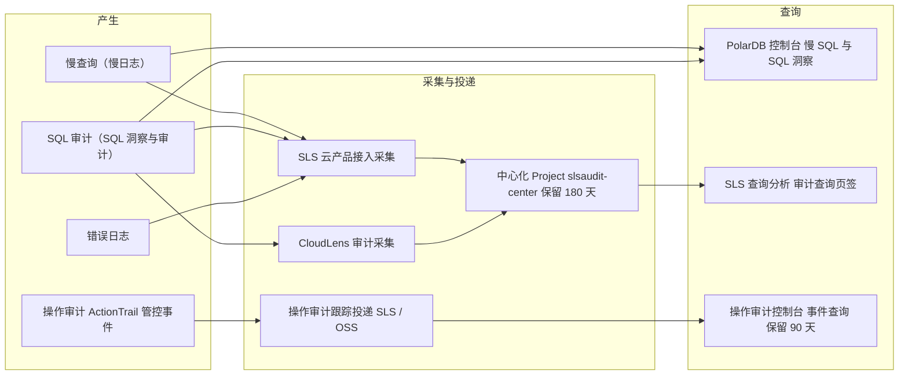

# PolarDB · 日志与审计

> 产品：PolarDB ｜ 口径：公共云 ｜ 复核：2026-11-18

## 日志流转图

**来源**
- 订阅集群日志到 SLS（云产品接入采集、中心化 Project、180 天保留）：https://help.aliyun.com/zh/polardb/polardb-for-mysql/subscribe-to-the-polardb-for-mysql-cluster-logs ｜ 复核：2026-11-18
- SQL 洞察与审计（CloudLens 审计采集联动、控制台入口）：https://help.aliyun.com/zh/polardb/polardb-for-mysql/user-guide/sql-explorer-and-audit.md ｜ 复核：2026-11-18
- 慢 SQL（控制台入口、30 天查询窗口）：https://help.aliyun.com/zh/polardb/polardb-for-mysql/user-guide/slow-sql-query.md ｜ 复核：2026-11-18
- 操作审计使用限制（90 天事件查询、跟踪投递配额）：https://help.aliyun.com/zh/actiontrail/product-overview/limits ｜ 复核：2026-11-18
- 操作审计-PolarDB 审计事件：https://help.aliyun.com/zh/actiontrail/product-overview/audit-events-of-polardb ｜ 复核：2026-11-18

## 日志类型总表

| 类型 | 产生方 | 查看入口 | 保留期 | 是否计费 |
|---|---|---|---|---|
| 引擎日志·慢查询（慢日志） | PolarDB MySQL 引擎（执行时长超过 `long_query_time` 的 SQL） | PolarDB 控制台 > 诊断与优化 > 慢 SQL；OpenAPI `DescribeSlowLogRecords` | 控制台/API 可查最近 30 天；投递 SLS 后按 SLS 中心化默认 180 天 | 控制台查询不单独计费；投递 SLS 按 SLS 计费 |
| 引擎日志·SQL 审计（SQL 洞察与审计） | 数据库内核全量输出 DQL/DML/DDL，由 DAS 提供服务 | PolarDB 控制台 > 日志与审计 > SQL 洞察；SLS 审计日志（`polardb_audit_log`） | 存储时长可修改，存于 DAS 侧不占集群存储；投递 SLS 后中心化默认 180 天 | 计费（`sql_explorer` 计费项）：企业版 V0 0.008 元/GB/小时（中国内地）、0.0122（香港及海外）；V0 以上按 DAS 计费 |
| 引擎日志·错误日志 | PolarDB MySQL 引擎 | 日志服务 SLS > 云产品接入 > PolarDB（`polardb_error_log`） | SLS 中心化默认 180 天 | SLS 存储与索引按 SLS 计费 |
| 引擎日志·性能日志 | PolarDB 监控数据采集 | 日志服务 SLS > 云产品接入 > PolarDB（`mysql_perf_*` 指标） | SLS 中心化默认 180 天 | SLS 计费 |
| 操作日志/审计·管控事件 | 操作审计 ActionTrail（OpenAPI 与控制台操作） | 操作审计控制台 > 事件查询 | 默认 90 天（不创建跟踪无法追溯 90 天前事件） | 操作审计目前不收取任何费用；投递到 SLS/OSS/MaxCompute 按目标产品计费 |

- 慢 SQL 判定阈值：`long_query_time` 取值 0.03~31536000 秒，默认 1 秒，可在参数配置中调整。
- 慢日志单条最大长度 16 KB，超出部分被截断。
- 开启 SQL 洞察后约需等待半小时才能看到审计日志。
- SQL 审计日志采集（SLS 路径）以集群已开启 SQL 洞察功能为前提；仅采集慢日志或性能日志无需开启。

**来源**
- 慢 SQL（阈值、16 KB 截断、控制台入口）：https://help.aliyun.com/zh/polardb/polardb-for-mysql/user-guide/slow-sql-query.md ｜ 复核：2026-11-17
- DescribeSlowLogRecords（慢日志明细、30 天查询窗口）：https://help.aliyun.com/zh/polardb/api-polardb-2017-08-01-describeslowlogrecords.md ｜ 复核：2026-11-17
- SQL 洞察与审计（入口、计费、存储时长、半小时延迟）：https://help.aliyun.com/zh/polardb/polardb-for-mysql/user-guide/sql-explorer-and-audit.md ｜ 复核：2026-11-17
- 订阅集群日志到 SLS（四类日志、180 天/30 天保留、采集开关）：https://help.aliyun.com/zh/polardb/polardb-for-mysql/subscribe-to-the-polardb-for-mysql-cluster-logs ｜ 复核：2026-11-17
- PolarDB 日志字段（SLS：审计/慢/错误/性能日志）：https://help.aliyun.com/zh/sls/polardb-for-mysql ｜ 复核：2026-11-17
- 计费项（SQL 洞察 `sql_explorer`）：https://help.aliyun.com/zh/polardb/polardb-for-mysql/billing-item/ ｜ 复核：2026-11-17
- 操作审计使用限制（90 天）：https://help.aliyun.com/zh/actiontrail/product-overview/limits ｜ 复核：2026-11-17
- 操作审计计费说明（免费口径）：https://help.aliyun.com/zh/actiontrail/product-overview/billing-1 ｜ 复核：2026-11-17

## 关键日志详表

**A. 慢日志明细（OpenAPI `DescribeSlowLogRecords`，仅 PolarDB MySQL 版）**

| 字段 | 类型/单位 | 含义 |
|---|---|---|
| `SQLText` | 字符串 | 查询语句原文（超 16 KB 被截断） |
| `QueryTimes` | 秒 | SQL 执行时长 |
| `QueryTimeMS` | 毫秒 | SQL 查询耗时 |
| `LockTimes` | 秒 | SQL 锁定时长 |
| `ReturnRowCounts` | 个 | 返回行数 |
| `ParseRowCounts` | 个 | 解析行数 |
| `HostAddress` | 字符串 | 连接数据库的客户端地址 |
| `ExecutionStartTime` | UTC 时间 | SQL 开始执行的时间 |

- `SQLHash` 为该 SQL 在慢日志统计中的唯一标识，用于由统计下钻明细；`DBNodeId` 标识产生慢日志的节点。

**B. 审计日志（SLS 字段，日志主题固定 `polardb_audit_log`）**

| 字段 | 类型/单位 | 含义 |
|---|---|---|
| `__topic__` | 字符串 | 日志主题，固定为 `polardb_audit_log` |
| `db` | 字符串 | 数据库名称 |
| `user` | 字符串 | 执行 SQL 的用户名 |
| `client_ip` | IP 地址 | 访问集群的客户端 IP |
| `sql` | 字符串 | 执行的 SQL 语句 |
| `latency` | 微秒 | SQL 返回结果耗时 |
| `thread_id` | 数值 | 会话线程 ID |
| `fail` | 数值 | SQL 是否失败：0 成功，非 0 失败 |

- 同类字段还有 `cluster_id`（集群 ID）、`node_id`（节点 ID）、`check_rows`/`return_rows`/`update_rows`（行数）、`origin_time`（执行时间）。

**C. 错误日志（SLS 字段，日志主题固定 `polardb_error_log`）**

| 字段 | 类型/单位 | 含义 |
|---|---|---|
| `__topic__` | 字符串 | 日志主题，固定为 `polardb_error_log` |
| `content` | 字符串 | 错误日志内容 |
| `event_type` | 字符串 | 事件类型 |
| `collect_time` | 时间 | 采集时间 |
| `instance_id` | 字符串 | PolarDB 实例 ID |
| `region` | 字符串 | 实例所属地域 |
| `db_version` | 字符串 | 实例数据库版本号 |

**来源**
- DescribeSlowLogRecords（慢日志明细字段）：https://help.aliyun.com/zh/polardb/api-polardb-2017-08-01-describeslowlogrecords.md ｜ 复核：2026-11-17
- PolarDB 日志字段（审计/慢/错误日志字段）：https://help.aliyun.com/zh/sls/polardb-for-mysql ｜ 复核：2026-11-17
- 慢 SQL（16 KB 截断、`long_query_time`）：https://help.aliyun.com/zh/polardb/polardb-for-mysql/user-guide/slow-sql-query ｜ 复核：2026-11-17

## 投递与加工

| 通道 | 去向与参数 | 关键限制 / 额度 | 计费要点 |
|---|---|---|---|
| SLS 日志审计服务（云产品接入） | 中心化 Project `slsaudit-center-<阿里云账号ID>-<地域ID>`；可分别开启审计、慢、错误、性能 4 类日志采集 | 每类日志采集开关默认关闭；默认存储模式为中心化、保留 180 天；审计/慢/错误日志还支持额外保留天数设置（默认 30 天）；配置后约 2 分钟完成初始同步 | SLS 存储、索引与读写流量按 SLS 定价计费 |
| 采集策略（过滤维度） | `account.id`、`region`、`cluster.id`、`cluster.name`、`cluster.db_type`、`cluster.db_version`、`tag.*` 自定义标签 | 策略中不添加地域时，系统会为所有地域创建日志库 | SLS 侧计费 |
| 同账号 / 跨账号采集 | 同账号按页面提示完成授权；跨账号使用自定义鉴权管理模式 | 关闭采集后日志库需手动删除，删除会清空项目全部数据 | SLS 侧计费 |
| CloudLens for PolarDB 审计采集 | 日志服务内开启 PolarDB MySQL 版审计日志采集 | 开启审计日志采集会自动开启对应集群的 SQL 洞察功能，需一并关闭采集入口才能停用 SQL 洞察 | SQL 洞察按审计日志存储容量计费；SLS 按 SLS 计费 |
| 操作审计投递 | 创建跟踪 → SLS LogStore / OSS Bucket | 单账号跟踪每地域 5 个；1 个跟踪最多配置 1 个 OSS Bucket；操作后 10 分钟内可查 | 操作审计免费；投递目标（SLS/OSS/MaxCompute）按各自定价单独付费 |
| 下游加工 | SLS 查询分析、SLS 告警、SLS 数据投递 | 审计日志可在中心 Project 的「审计查询」页签按 PolarDB 展开查看 | SLS 侧功能按 SLS 定价 |

**来源**
- 订阅集群日志到 SLS（中心项目、采集策略、180/30 天保留、跨账号鉴权）：https://help.aliyun.com/zh/polardb/polardb-for-mysql/subscribe-to-the-polardb-for-mysql-cluster-logs ｜ 复核：2026-11-17
- SQL 洞察与审计（CloudLens 审计采集联动说明）：https://help.aliyun.com/zh/polardb/polardb-for-mysql/user-guide/sql-explorer-and-audit ｜ 复核：2026-11-17
- 操作审计使用限制（跟踪与 OSS 配额、10 分钟可查）：https://help.aliyun.com/zh/actiontrail/product-overview/limits ｜ 复核：2026-11-17
- 操作审计计费说明（投递 SLS/OSS/MaxCompute 计费）：https://help.aliyun.com/zh/actiontrail/product-overview/billing-1 ｜ 复核：2026-11-17

## 审计与合规

| 项 | 官方口径 |
|---|---|
| 接入方式 | PolarDB 已与操作审计（ActionTrail）集成，记录用户通过 OpenAPI、控制台等方式操作 PolarDB 产生的管控事件 |
| 留痕范围（示例事件） | `CreateDBCluster` 创建集群、`CreateDBNodes`/`DeleteDBNodes` 增删只读节点、`FailoverDBCluster` 手动主备切换、`ModifyDBClusterAccessWhiteList` 修改白名单、`AddFirewallRules` 添加 SQL 防火墙、`ModifyDBClusterParameters` 修改参数、`CreateBackup`/`DeleteBackup` 备份、`CreateParameterGroup` 参数模板、`CreateGlobalDatabaseNetwork` 新建全球数据库网络 |
| 查询与留痕保留 | 默认为每个阿里云账号记录最近 90 天操作事件；用户操作后 10 分钟内可在控制台查询 |
| 长期留存 | 超过 90 天需创建跟踪，将事件投递到日志服务 SLS 的 LogStore 或对象存储 OSS 的 Bucket |
| 配额 | 单账号跟踪每地域 5 个；多账号跟踪所有地域 1 个；1 个跟踪允许配置 1 个 OSS Bucket；`LookupEvents` 每秒最多查询 2 次 |
| 计费 | 操作审计目前不收取任何费用；通过跟踪投递到 SLS/OSS/MaxCompute 按各自定价单独付费 |
| SQL 审计合规 | SQL 洞察与审计全量采集 SQL 明细（含数据库、用户、客户端 IP、执行时间等），审计数据存于 DAS 侧不占集群存储 |
| 审计日志销毁警告 | 关闭 SQL 洞察与审计或减少存储时长，DAS 会立刻清空对应 SQL 审计日志；官方要求先导出保存再操作 |

- 操作审计创建跟踪投递到 SLS 后，删除跟踪不会自动删除已创建的 Logstore，残留数据会持续产生存储费用。

**来源**
- 操作审计-PolarDB 审计事件：https://help.aliyun.com/zh/actiontrail/product-overview/audit-events-of-polardb ｜ 复核：2026-11-17
- 操作审计使用限制（90 天留痕/跟踪配额/LookupEvents）：https://help.aliyun.com/zh/actiontrail/product-overview/limits ｜ 复核：2026-11-17
- 操作审计计费说明（免费与投递计费、删除跟踪残留费用）：https://help.aliyun.com/zh/actiontrail/product-overview/billing-1 ｜ 复核：2026-11-17
- SQL 洞察与审计（全量采集、关闭/缩短存储时长的清空警告）：https://help.aliyun.com/zh/polardb/polardb-for-mysql/user-guide/sql-explorer-and-audit ｜ 复核：2026-11-17
