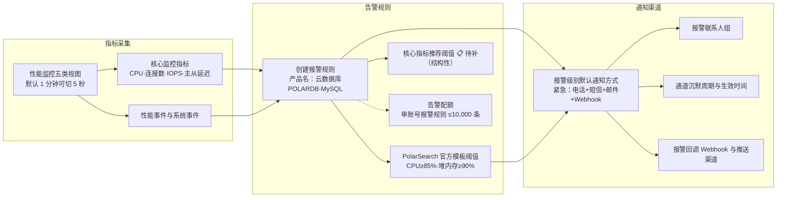

# PolarDB · 监控与告警

> 产品：PolarDB ｜ 口径：公共云 ｜ 复核：2026-11-18

## 告警链路图

**来源**
- PolarDB 性能监控指标（指标英文名与单位）：https://help.aliyun.com/zh/polardb/performance-metric-monitoring ｜ 复核：2026-11-18
- 创建报警规则（产品名与资源范围、沉默周期、回调、推送渠道）：https://help.aliyun.com/zh/polardb/polardb-for-mysql/user-guide/create-an-alert-rule ｜ 复核：2026-11-18
- PolarSearch报警模板配置（官方推荐阈值表）：https://help.aliyun.com/zh/polardb/polardb-for-mysql/user-guide/polardb-mysql-polarsearch-alarm-template ｜ 复核：2026-11-18
- 云监控报警规则概述（电话/短信/邮件/Webhook/App）：https://help.aliyun.com/zh/cms/cloudmonitor-1-0/user-guide/overview-2 ｜ 复核：2026-11-18
- 云监控使用限制（报警规则配额）：https://help.aliyun.com/zh/cms/cloudmonitor-1-0/product-overview/restrictions-on-use ｜ 复核：2026-11-18

## 核心监控指标

- PolarDB 控制台「性能监控」页签分为：集群、数据库代理、计算节点、高级监控、性能事件五类视图。
- 监控频率默认 1 分钟，可在「时间粒度」下拉框切换为 5 秒；查询范围越长显示粒度越粗（如 5 秒频率下 ≤1 小时显示 5 秒粒度、>30 天显示 1 天粒度）。
- 维度口径：集群视图按集群、计算节点视图按节点 ID、数据库代理视图按集群地址选择。
- 云监控报警侧产品名：云数据库POLARDB-MySQL(新版)；资源范围取值：全部资源 / 应用分组 / 集群。

| 指标英文名（监控项） | 含义 | 单位 | 统计周期 | 维度 |
|---|---|---|---|---|
| PolarDBCPU（`cpu_ratio`） | CPU 使用率 | 百分比 | 默认 60 秒，可切 5 秒 | 集群 / 计算节点 |
| PolarDBMemory（`mem_ratio`） | 内存使用率 | 百分比 | 默认 60 秒，可切 5 秒 | 计算节点 |
| PolarDBConnections（`mean_total_session`） | 当前总连接数 | 个 | 默认 60 秒，可切 5 秒 | 计算节点 |
| PolarDBConnections（`mean_active_session`） | 活跃连接数 | 个 | 默认 60 秒，可切 5 秒 | 集群 / 计算节点 |
| PolarDBQPSTPS（`mean_qps`） | 每秒请求数（QPS） | 次 | 默认 60 秒，可切 5 秒 | 集群 / 计算节点 |
| PolarDBQPSTPS（`mean_tps`） | 每秒事务数（TPS） | 次 | 默认 60 秒，可切 5 秒 | 集群 / 计算节点 |
| PolarDBIOSTAT（`mean_iops`） | 总 IOPS | 次/秒 | 默认 60 秒，可切 5 秒 | 计算节点 |
| PolarDBIOSTAT（`mean_io_throughput`） | 总 I/O 吞吐量 | MB | 默认 60 秒，可切 5 秒 | 计算节点 |
| PolarDBDiskUsage（`mean_data_size`） | 数据占用的存储量 | MB | 默认 60 秒，可切 5 秒 | 集群 |
| PolarDBDiskUsage（`mean_redolog_size`） | Redolog 占用的存储量 | MB | 默认 60 秒，可切 5 秒 | 集群 |
| PolarDBReplicaLag（`mean_replication_delay`） | 主节点数据复制到只读节点的延迟 | 秒 | 默认 60 秒，可切 5 秒 | 计算节点（只读） |
| PolarDBNetworkTraffic（`mean_input_traffic`） | 每秒输入流量 | KB/s | 默认 60 秒，可切 5 秒 | 计算节点 |
| PolarDBInnoDBBufferRatio（`mean_innodb_buffer_read_hit`） | 缓冲池读命中率 | 百分比 | 默认 60 秒，可切 5 秒 | 计算节点 |
| PolarProxy_CurrentConns（`service_current_connections`） | 数据库代理（PolarProxy）当前连接数 | 个 | 默认 60 秒，可切 5 秒 | 数据库代理（按集群地址） |
| PolarProxy_Rt（`service_proxy_rt`） | 数据库代理往返延迟 | 微秒 | 默认 60 秒，可切 5 秒 | 数据库代理（按集群地址） |

- 节点状态（运行/异常）类信息通过「性能事件」页签与云监控系统事件查看；官方未发布该类监控指标英文名 📋 待补（控制台口径：以性能事件页签与云监控控制台系统事件为准）。
- 云监控侧 PolarDB 指标另有 `cluster_*` 前缀口径（如 `cluster_com_delete` 等 4 个指标统计方法于 2024-07-10 调整，数值变为原 1%）。
- 集群无业务流量时 QPS 仍显示约 10 次/秒，来自系统后台监控、日志采集与管控任务。

**来源**
- PolarDB 性能监控指标（MySQL 版/PolarProxy 指标英文名与单位）：https://help.aliyun.com/zh/polardb/performance-metric-monitoring ｜ 复核：2026-11-17
- 查看性能监控指标（五类视图、维度与数据来源）：https://help.aliyun.com/zh/polardb/polardb-for-mysql/user-guide/view-performance-monitoring-data ｜ 复核：2026-11-17
- 修改监控频率（默认 1 分钟/可切 5 秒、显示粒度）：https://help.aliyun.com/zh/polardb/polardb-for-mysql/user-guide/change-the-interval-at-which-monitoring-data-is-collected ｜ 复核：2026-11-17
- 创建报警规则（产品名与资源范围）：https://help.aliyun.com/zh/polardb/polardb-for-mysql/user-guide/create-an-alert-rule ｜ 复核：2026-11-17
- 支持系统事件的云产品列表（PolarDB 系统事件入口）：https://help.aliyun.com/zh/cms/cloudmonitor-1-0/user-guide/appendix-2-system-events ｜ 复核：2026-11-17
- PolarDB MySQL 指标统计方法调整（`cluster_*` 指标口径）：https://help.aliyun.com/zh/cms/cloudmonitor-1-0/product-overview/announcement-cloud-database-polardb-mysql-version-metric-adjustment ｜ 复核：2026-11-17

## 官方默认与推荐告警

**A. 集群/代理/计算节点核心指标（CPU、内存、连接数、QPS、IOPS、存储、复制延迟等）**

- 阈值告警：**官方未发布推荐阈值** 📋 待补（结构性：官方文档仅提供创建报警规则的操作说明与参数解释，未给出 PolarDB 指标推荐数值；按阈值红线不收经验值）。
- CPU 水位：官方最佳实践仅要求「CPU 监控应设定安全水位，超出即处理」，未给出具体百分比 📋 待补（结构性）。
- 报警规则仅支持部分通用场景，官方明确暂不支持如「SQL 执行超时 300 秒报警」等特定场景。

**B. 官方推荐配置报警的指标（无数值阈值）**

| 场景 | 官方建议 |
|---|---|
| AutoETL 同步链路 | 建议对「同步作业重启次数」和「同步作业延迟」配置报警规则，以便及时发现同步异常（未给数值阈值） |

**C. 官方报警模板阈值（PolarSearch 子功能，云监控产品名「云数据库POLARDB-Search」）**

| 规则名称 | 监控指标 | 警告（Warn） | 紧急（Critical） |
|---|---|---|---|
| PolarSearch 节点 CPU 利用率过高 | cpu利用率 | ≥85%，连续 10 个周期 | ≥95%，连续 5 个周期 |
| PolarSearch 节点堆内存使用率过高 | 堆内存使用率 | ≥90%，连续 15 个周期 | ≥95%，连续 10 个周期 |
| PolarSearch 节点 GC 时间过长 | jvm每秒gc时间 | ≥0.30 秒，连续 10 个周期 | ≥0.60 秒，连续 5 个周期 |
| PolarSearch 节点 Search 延迟过高 | 节点search延迟 | ≥1,000,000 微秒，连续 5 个周期 | ≥3,000,000 微秒，连续 3 个周期 |
| PolarSearch 节点写入延迟过高 | 节点写入延迟 | ≥500,000 微秒，连续 5 个周期 | ≥2,000,000 微秒，连续 3 个周期 |
| PolarSearch 节点 Fetch 延迟过高 | 节点fetch延迟 | ≥1,000,000 微秒，连续 5 个周期 | ≥3,000,000 微秒，连续 3 个周期 |
| PolarSearch http 连接数 | http连接数 | 已验证容量的 70% | 已验证容量的 85% |

- 官方说明该组阈值为通用参考值，需结合集群规格、业务流量与查询特征调整；连续周期按 1 分钟采样周期设置。
- 云监控还支持对 PolarDB 设置事件类报警（系统事件清单见云监控 metric-meta 控制台入口）。

**来源**
- 创建报警规则（无推荐阈值、不支持特定场景说明）：https://help.aliyun.com/zh/polardb/polardb-for-mysql/user-guide/create-an-alert-rule ｜ 复核：2026-11-17
- PolarDB MySQL版CPU使用率高（安全水位表述）：https://help.aliyun.com/zh/polardb/polardb-for-mysql/high-cpu-utilization-in-polardb-for-mysql ｜ 复核：2026-11-17
- AutoETL监控和报警（官方建议监控指标）：https://help.aliyun.com/zh/polardb/polardb-for-mysql/user-guide/monitoring-and-alerting-of-autoetl ｜ 复核：2026-11-17
- PolarSearch报警模板配置（推荐阈值表）：https://help.aliyun.com/zh/polardb/polardb-for-mysql/user-guide/polardb-mysql-polarsearch-alarm-template ｜ 复核：2026-11-17
- 支持系统事件的云产品列表：https://help.aliyun.com/zh/cms/cloudmonitor-1-0/user-guide/appendix-2-system-events ｜ 复核：2026-11-17

## 通知与渠道

| 项 | 官方口径 |
|---|---|
| 通知方式 | 云监控报警服务支持电话、短信、邮件和 Webhook 地址；安装阿里云 App 可通过 App 接收报警通知 |
| 报警级别默认通知方式 | 紧急（Critical）：电话 + 短信 + 邮件 + Webhook；警告（Warn）：短信 + 邮件 + Webhook；普通（Info）：邮件 + Webhook |
| 报警联系人组 | 创建报警规则时选择报警联系人组（可包含一个或多个报警联系人） |
| 报警回调 | 公网可访问的 URL，云监控通过 POST 推送报警信息，目前仅支持 HTTP 协议，可在线测试连通性 |
| 推送渠道（高级设置） | 弹性伸缩（触发伸缩规则）、日志服务（发送至日志库）、轻量消息队列 topic（原 MNS）、函数计算（格式处理） |
| 通道沉默周期 | 创建规则时设置，最短 1 分钟、最长 24 小时；未恢复时按该间隔重复发送 |
| 生效时间 | 报警规则仅在生效时间内发送通知，非生效时间产生的报警只记录报警历史 |
| 恢复通知 | 可选开启：监控指标恢复时发送恢复通知 |
| 无数据报警处理 | 取值：不做任何处理（默认）、发送无数据报警、视为正常 |
| 告警升级（Escalation） | 官方未发布 PolarDB 告警升级策略 📋 待补（结构性） |

**来源**
- 创建报警规则（沉默周期、生效时间、回调、推送渠道、恢复通知、无数据处理）：https://help.aliyun.com/zh/polardb/polardb-for-mysql/user-guide/create-an-alert-rule ｜ 复核：2026-11-17
- 云监控报警规则概述（电话/短信/邮件/Webhook/App）：https://help.aliyun.com/zh/cms/cloudmonitor-1-0/user-guide/overview-2 ｜ 复核：2026-11-17
- PolarSearch报警模板配置（报警级别默认通知方式）：https://help.aliyun.com/zh/polardb/polardb-for-mysql/user-guide/polardb-mysql-polarsearch-alarm-template ｜ 复核：2026-11-17

## 告警配额

| 限制项 | 最大值 | 归属 |
|---|---|---|
| 单账号可新建的报警规则数量 | 10,000 条 | 基础云监控 |
| 单账号可新建的应用分组数量 | 20,000 个 | 基础云监控 |
| 单账号可新建的动态规则数量 | 1,200 个 | 基础云监控 |
| 一个应用分组内包含的每种资源数量 | 3,000 个 | 基础云监控 |
| 一个应用分组内允许新建的可用性监控数量 | 500 个 | 基础云监控 |
| 标签创建应用分组时单地域允许添加的标签数量 | 100 个 | 基础云监控 |
| 监控数据存储时长（Period < 60 秒） | 7 天 | 基础云监控 |
| 监控数据存储时长（Period = 60 秒） | 31 天 | 基础云监控 |
| 监控数据存储时长（Period ≥ 300 秒） | 91 天 | 基础云监控 |
| 单账号可新建的 PromQL 报警规则数量 | 20 条 | 企业云监控 |
| 单账号可新建的指标仓库数量 | 30 个 | 企业云监控 |
| 单账号可新建的 SLS Logstore 组数量 | 20 个（每组最多 25 个 Logstore） | 企业云监控 |
| 一个智能水位分析任务可设置的报警联系人组数量 | 5 个 | 企业云监控 |
| 报警联系人 / 报警联系人组的数量上限 | 📋 待补（结构性：官方使用限制页未列出该配额） | 基础云监控 |

**来源**
- 云监控使用限制（报警规则/应用分组/动态规则/存储时长/企业云监控配额）：https://help.aliyun.com/zh/cms/cloudmonitor-1-0/product-overview/restrictions-on-use ｜ 复核：2026-11-17
