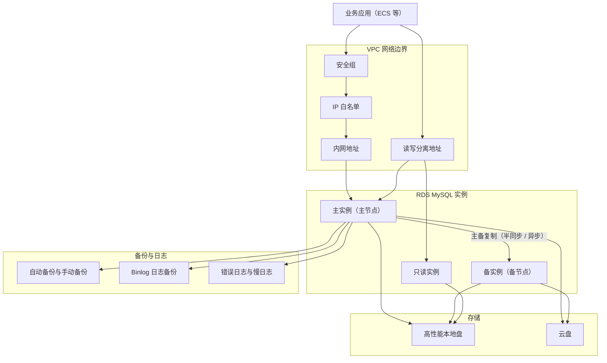

# RDS MySQL · 产品架构

> 产品：云数据库 RDS MySQL 版 ｜ 口径：公共云 ｜ 复核：2026-11-16

## 产品定义与组件

- RDS（Relational Database Service）是托管式关系型数据库服务，支持 MySQL、SQL Server、PostgreSQL、MariaDB 四个引擎。
- RDS 基于计算、存储、网络基础设施，提供自动备份、容灾、恢复、监控、迁移、弹性扩容能力，按需使用、按需付费。
- RDS MySQL 的自研内核为 AliSQL；存储引擎仅支持 InnoDB（X-Engine 已停止新购，TokuDB/MyISAM/Memory 均不支持）。
- 实例的基本管理单元：实例、账号、数据库（schema）、参数模板、备份集、连接地址。

**来源**：
- 阿里云云数据库RDS可信云：https://help.aliyun.com/zh/rds/support/apsaradb-rds-passes-trusted-cloud-service-authentication ｜ 复核：2026-11-16
- RDS MySQL使用限制：https://help.aliyun.com/zh/rds/apsaradb-rds-for-mysql/limits ｜ 复核：2026-11-16

## 架构图

**来源**
- RDS MySQL 产品简介（只读实例、读写分离地址、数据库代理、备份恢复、白名单）：https://help.aliyun.com/zh/rds/apsaradb-rds-for-mysql/overview-3 ｜ 复核：2026-11-17
- RDS MySQL 高可用系列（一主一备与复制方式）：https://help.aliyun.com/zh/rds/apsaradb-rds-for-mysql/rds-high-availability-edition ｜ 复核：2026-11-17
- 存储类型概览（高性能本地盘 / 高性能云盘 / ESSD 云盘）：https://help.aliyun.com/zh/rds/apsaradb-rds-for-mysql/storage-types-for-apsaradb-rds-for-mysql ｜ 复核：2026-11-17

## 组件清单

| 组件 | 作用 | 必选/可选 | 是否独立计费 | 备注 |
|---|---|---|---|---|
| 实例（主节点/备节点） | 托管 MySQL 服务进程与算力单元 | 必选 | 是 | 高可用系列默认一主一备，备节点仅供备份、不可访问 |
| 数据库（schema） | 实例内的逻辑数据单元 | 必选 | 否 | 一个实例可创建多个数据库，实例内命名唯一 |
| 数据库账号 | 连接实例的身份与权限载体 | 必选 | 否 | 与数据库授权分离管理 |
| 参数模板 | 数据库参数的保存与批量套用 | 必选 | 否 | 默认参数模板 + 自定义参数模板 |
| IP 白名单 | 限制可访问实例的来源 IP | 必选 | 否 | 高安全模式按网络类型隔离白名单分组 |
| 安全组 | 实例关联 ECS 安全组做访问控制 | 可选 | 否 | 控制台可设置、可关联多个安全组 |
| 备份（自动备份/手动备份） | 数据恢复、克隆与库表恢复的来源 | 必选 | 部分 | 备份空间超免费额度后计费 |
| 只读实例 | 分担读请求、扩展读能力 | 可选 | 是 | 高可用系列/集群系列可添加；计算包可抵扣其计算资源 |
| 读写分离地址 | 联动主实例与只读实例的统一分流地址 | 可选 | 部分 | 写请求发往主实例，读请求按权重发往只读实例 |
| 数据库代理 | 独立代理计算资源，提供读写分离、连接池等能力 | 可选 | 部分 | 集群系列默认开通通用型数据库代理（免费） |
| 存储（高性能本地盘 / [云盘](../ebs/)） | 实例数据与日志的持久化存储 | 必选 | 是 | 本地盘实例的磁盘不经云盘产品 |
| 关联：[DTS](../dts/) | 数据迁移、同步与异地灾备实例同步 | 可选 | 是 | 异地灾备实例通过 DTS 实时同步 |

**来源**
- RDS MySQL 产品简介（基本功能与高级功能）：https://help.aliyun.com/zh/rds/apsaradb-rds-for-mysql/overview-3 ｜ 复核：2026-11-17
- RDS 计费项（规格/存储/备份空间/数据库代理等计费口径）：https://help.aliyun.com/zh/rds/product-overview/billable-items-billing-methods-and-pricing ｜ 复核：2026-11-17
- 设置安全组：https://help.aliyun.com/zh/rds/apsaradb-rds-for-mysql/set-security-group ｜ 复核：2026-11-17
- RDS MySQL 计算包（抵扣主实例、只读实例、数据库代理计算资源）：https://help.aliyun.com/zh/rds/apsaradb-rds-for-mysql/compute-plans ｜ 复核：2026-11-17

## 系列拓扑（基础 / 高可用 / 集群 / 三节点企业）

| 指标 | 基础系列 | 高可用系列 | 集群系列 |
|---|---|---|---|
| 节点数 | 1 个 | 2 个（默认一主一备） | 2~9 个（默认一主二备 3 个；备节点最多增至 8 个） |
| 备节点是否可读 | 不涉及 | 否 | 是 |
| 地址类型 | 读写地址 | 读写地址 | 读写地址（指主节点）+ 只读地址（指备节点） |
| 复制模式 | 无 | 异步、半同步 | 异步、半同步、组复制（MGR） |
| 最大容忍不可用节点数 | 0 | 1 | n-1（n 为节点总数） |
| 可用区数量 | 1 | ≤2 | ≤ 节点总数 |

- 基础系列单节点、计算与存储分离，官方定位「售价低至高可用系列的一半」，不支持主备切换、只读实例、灾备实例。
- 高可用系列采用一主一备，官方称其「适合 80% 以上的用户场景」；备节点仅作备份，不提供业务访问；主备节点不可跨地域。
- 集群系列计算与存储分离、一主多备，任意备节点可切换为主节点，可启用 MGR 保障 RPO=0。
- 三节点企业系列（原名金融版）采用「一主一备一日志」三节点架构，多副本同步复制、RPO=0，建议三节点部署在不同可用区实现跨可用区容灾；该系列自 2023-03-27 起停止新购，官方建议改选集群系列或 PolarDB-X 2.0 标准版。

**来源**：
- 集群系列（含三系列技术指标对比表）：https://help.aliyun.com/zh/rds/apsaradb-rds-for-mysql/rds-cluster-edition ｜ 复核：2026-11-16
- 基础系列：https://help.aliyun.com/zh/rds/apsaradb-rds-for-mysql/rds-basic-edition ｜ 复核：2026-11-16
- 高可用系列：https://help.aliyun.com/zh/rds/apsaradb-rds-for-mysql/rds-high-availability-edition ｜ 复核：2026-11-16
- 三节点企业系列（停止新购公告与架构）：https://help.aliyun.com/zh/rds/apsaradb-rds-for-mysql/financial-edition ｜ 复核：2026-11-16

## 主备复制与切换机制

- 默认参数模板下主备复制为半同步：主节点执行完成后将日志同步传给备节点，备节点收到日志即视为事务提交，不等待执行。
- 备节点不可用或主备间网络异常时，半同步退化为异步；备节点处理能力跟不上主节点时同样会退化为异步。
- 异步参数模板/高性能参数模板为异步复制：主节点完成即响应，备节点不可用不影响主节点，但主节点故障时可能造成主备数据不一致。
- 备节点故障时主节点会进行实时备份，备份临近完成时产生全局锁（FTWRL）导致主节点只读，一般不超过 5 秒。
- 集群系列备节点故障发现已从分钟级优化到秒级；基于 EBS 秒级快照，数据恢复从几十分钟缩短到 1 分钟，99% 场景下备节点从故障到恢复不超过 10 分钟。
- 集群系列备节点延迟超过 7200 秒（2 小时）时，会通过自动重搭方式修复。

**来源**：
- 高可用系列：https://help.aliyun.com/zh/rds/apsaradb-rds-for-mysql/rds-high-availability-edition ｜ 复核：2026-11-16
- 集群系列：https://help.aliyun.com/zh/rds/apsaradb-rds-for-mysql/rds-cluster-edition ｜ 复核：2026-11-16

## 可用性承诺与数据持久性

RDS MySQL 各系列/规格类型的服务可用性（可信云认证口径）：

| 规格类型 | 基础系列 | 高可用系列 | 集群系列 | 三节点企业系列 |
|---|---|---|---|---|
| 独享型 | 暂无该类型规格 | 不低于 99.99% | 不低于 99.99% | 三可用区：不低于 99.99%；单/双可用区：不低于 99.95% |
| 通用型 | 不低于 99.50% | 不低于 99.95% | 三可用区及以上：不低于 99.99%；单/双可用区：不低于 99.95% | 三可用区及以上：不低于 99.99%；单/双可用区：不低于 99.95% |

- 云盘实例数据持久性目标 99.9999999% 以上。
- 高性能本地盘实例存在硬件故障导致数据损坏的概率，靠配套备库提供冗余保护；高可用系列本地盘实例 SLA 可达 99.995%。
- 本地盘/云盘的可靠性、持久性和读写性能均满足产品 SLA 承诺；赔付条款见 RDS 服务等级协议 SLA。

**来源**：
- 阿里云云数据库RDS可信云：https://help.aliyun.com/zh/rds/support/apsaradb-rds-passes-trusted-cloud-service-authentication ｜ 复核：2026-11-16
- 存储类型概览：https://help.aliyun.com/zh/rds/apsaradb-rds-for-mysql/storage-types-for-apsaradb-rds-for-mysql ｜ 复核：2026-11-16
