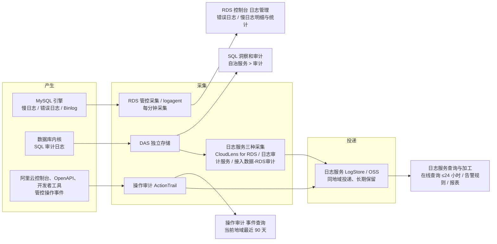

# RDS MySQL · 日志与审计

> 产品：RDS MySQL ｜ 口径：公共云 ｜ 复核：2026-11-18

## 日志流转图

**来源**
- 投递 RDS MySQL 日志到日志服务：https://help.aliyun.com/zh/rds/apsaradb-rds-for-mysql/collect-the-audit-logs-of-an-apsaradb-rds-for-mysql-instance-by-using-log-service ｜ 复核：2026-11-18
- 采集 RDS SQL 审计日志（三种采集方式）：https://help.aliyun.com/zh/sls/collect-rds-sql-audit-logs ｜ 复核：2026-11-18
- 查看错误日志和慢日志：https://help.aliyun.com/zh/rds/apsaradb-rds-for-mysql/view-error-logs-and-slow-logs ｜ 复核：2026-11-18
- 通过操作审计（ActionTrail）查看资源操作事件：https://help.aliyun.com/zh/rds/apsaradb-rds-for-mysql/view-the-operations-on-apsaradb-rds-for-mysql-resources ｜ 复核：2026-11-18

## 日志类型总表

| 类型 | 日志 | 产生方 | 查看入口 | 默认保留期 | 是否计费 |
|---|---|---|---|---|---|
| 引擎日志 | 错误日志 | MySQL 引擎与 RDS 管控采集 | RDS 控制台 > 实例 > 日志管理 > 错误日志 | 1 个月内可查（华北3张家口仅保留最近 9 天） | 否（RDS 计费项不含错误日志查看） |
| 引擎日志 | 慢日志明细 | MySQL 引擎（执行时间超过 long_query_time，默认 1 秒） | 日志管理 > 慢日志明细 | 7 天，控制台每分钟更新一次 | 否（RDS 计费项不含慢日志查看） |
| 引擎日志 | 慢日志统计 | RDS 管控 logagent 每分钟采集 mysql.slow_log 并汇总 | 日志管理 > 慢日志统计 | 7 天，统计非实时、延迟 6~8 小时 | 否（RDS 计费项不含慢日志查看） |
| 引擎日志 | SQL 审计日志（SQL 洞察和审计） | 数据库内核输出，由 DAS 独立存储 | 自治服务 > SQL 洞察和审计 > 审计 | 服务设置中可修改；旧版 API 档位 30/180/365/1095/1825 天 | 是（0.008 元/（GB\*小时）；中国香港、新加坡 0.0122 元/（GB\*小时），或按 DAS 企业版计费） |
| 引擎日志 | Binlog 与日志备份 | MySQL 引擎 | 备份恢复 > 下载备份 | 已写完的 Binlog 定期转存 OSS 保存 7 天；日志备份随备份策略保留 | 部分（备份空间超免费额度后计费） |
| 操作日志 | 管控操作事件 | 阿里云控制台、OpenAPI、开发者工具 | 操作审计（ActionTrail）> 事件 > 事件查询 | 控制台可查当前地域最近 90 天；投递 SLS/OSS 后长期保留 | 否（该页标注「不涉及费用」） |

**来源**
- 查看错误日志和慢日志：https://help.aliyun.com/zh/rds/apsaradb-rds-for-mysql/view-error-logs-and-slow-logs ｜ 复核：2026-11-17
- RDS MySQL 慢日志采集策略：https://help.aliyun.com/zh/rds/apsaradb-rds-for-mysql/rds-collection-policy-for-slow-logs-in-rds ｜ 复核：2026-11-17
- SQL 洞察和审计（操作指南与计费）：https://help.aliyun.com/zh/rds/apsaradb-rds-for-mysql/use-the-sql-explorer-and-audit-feature-on-an-apsaradb-rds-for-mysql-instance-6 ｜ 复核：2026-11-17
- 修改 SQL 洞察日志保存时长（可选 30/180/365/1095/1825 天）：https://help.aliyun.com/zh/rds/apsaradb-rds-for-mysql/api-rds-2014-08-15-modifysqlcollectorretention-mysql ｜ 复核：2026-11-17
- RDS 计费项：https://help.aliyun.com/zh/rds/product-overview/billable-items-billing-methods-and-pricing ｜ 复核：2026-11-17
- 通过操作审计（ActionTrail）查看资源操作事件：https://help.aliyun.com/zh/rds/apsaradb-rds-for-mysql/view-the-operations-on-apsaradb-rds-for-mysql-resources ｜ 复核：2026-11-17

## 关键日志详表

### 慢日志（topic：rds_slow_log）

| 字段 | 类型 | 含义 |
|---|---|---|
| query_sql | 字符串 | 慢日志 SQL 语句 |
| query_time | 数值 | 查询耗时，单位：秒 |
| lock_time | 数值 | 锁等待耗时，单位：秒 |
| rows_examined | 数值 | 扫描的行数 |
| rows_sent | 数值 | 返回的行数 |
| start_time | 时间 | 开始执行的时间 |
| user_host | 字符串 | 客户端信息 |
| db_name | 字符串 | 数据库名称 |

- 慢日志明细页单条记录最长 8192 字节，超出截断。
- 慢日志不包含锁等待时间字段，锁等待时间在洞察日志中记录。

### SQL 审计日志（topic：rds_audit_log）

| 字段 | 类型 | 含义 |
|---|---|---|
| sql | 字符串 | 执行的 SQL 语句 |
| user | 字符串 | 执行操作的用户名 |
| client_ip | 字符串 | 访问 RDS 实例的客户端 IP 地址 |
| latency | 数值 | 执行 SQL 后返回结果的耗时，单位：微秒 |
| check_rows | 数值 | 扫描的行数 |
| return_rows | 数值 | 返回的行数 |
| fail | 数值 | SQL 执行是否出错（MySQL 执行成功为 0，非 0 表示失败） |
| origin_time | 时间 | 执行操作的时间点 |

- 审计记录的 SQL 语句最大长度为 8192 字节，且受参数取三者最小值限制。
- RDS MySQL 默认不记录登录日志；开启 SQL 洞察和审计后才按 LOGIN 操作类型记录登录事件。

### 错误日志（topic：rds_error_log）

| 字段 | 类型 | 含义 |
|---|---|---|
| content | 字符串 | 日志内容 |
| collect_time | 时间 | 采集时间 |
| eventType | 字符串 | 事件类型 |
| db_version | 字符串 | 数据库版本 |

- 错误日志不包含死锁日志；死锁日志需在自治服务 > 一键诊断 > 锁分析页签查看。
- 张家口地域实例的错误日志仅保留最近 9 天。

**来源**
- RDS 日志字段说明（审计日志/慢日志/错误日志字段）：https://help.aliyun.com/zh/sls/log-fields-11 ｜ 复核：2026-11-17
- 慢日志明细查看与常见问题（8192 字节截断）：https://help.aliyun.com/zh/rds/apsaradb-rds-for-mysql/view-details-about-the-slow-query-logs-of-an-apsaradb-rds-for-mysql-instance ｜ 复核：2026-11-17
- SQL 洞察和审计（操作指南）：https://help.aliyun.com/zh/rds/apsaradb-rds-for-mysql/use-the-sql-explorer-and-audit-feature-on-an-apsaradb-rds-for-mysql-instance-6 ｜ 复核：2026-11-17
- 查看错误日志和慢日志：https://help.aliyun.com/zh/rds/apsaradb-rds-for-mysql/view-error-logs-and-slow-logs ｜ 复核：2026-11-17

## 投递与加工

日志服务支持三种方式采集 RDS SQL 审计日志：

| 对比项 | CloudLens for RDS | 日志审计服务 | 接入数据-RDS审计 |
|---|---|---|---|
| 指定 RDS 实例粒度 | 支持 | 支持 | 支持 |
| 灵活指定存储目标库 | 支持 | 不支持 | 支持 |
| 跨地域采集 | 不支持 | 支持 | 不支持 |
| 跨账号采集 | 不支持 | 支持 | 不支持 |
| 自动采集 | 支持 | 支持 | 不支持 |
| 手动采集 | 支持 | 不支持 | 支持 |
| 查看采集状态视图 | 支持 | 不支持 | 不支持 |

- CloudLens for RDS 与「接入数据-RDS审计」的采集配置互通；日志审计服务为独立采集渠道。
- 开通投递的前提：实例已开启付费版 SQL 洞察（RDS MySQL），并在实例所在地域创建日志服务 Project 与 LogStore。
- 同一地域下的 RDS 实例只能投递到相同地域的日志服务 LogStore。
- RAM 授权后自动创建角色 AliyunLogArchiveRole，日志服务以该角色收集日志。
- 日志服务默认为 RDS SQL 审计日志对应的 LogStore 开启并配置索引。
- CloudLens for RDS 的自动化采集条件支持阿里云账号 ID、地域、实例 ID、实例名、DB 类型、DB 版本号、标签等属性。
- 单次在线查询时间范围最多 24 小时；更大范围查询使用日志服务接入洞察日志。
- 下游加工：日志服务内基于 LogStore 创建告警规则（通知方式可选钉钉机器人 Webhook），CloudLens for RDS 提供可视化报表与报表邮件、钉钉群订阅及内置告警规则。

**来源**
- 投递 RDS MySQL 日志到日志服务：https://help.aliyun.com/zh/rds/apsaradb-rds-for-mysql/collect-the-audit-logs-of-an-apsaradb-rds-for-mysql-instance-by-using-log-service ｜ 复核：2026-11-17
- 采集 RDS SQL 审计日志：https://help.aliyun.com/zh/sls/collect-rds-sql-audit-logs ｜ 复核：2026-11-17
- CloudLens for RDS（原 RDS 审计中心）：https://help.aliyun.com/zh/sls/cloudlens-for-rds ｜ 复核：2026-11-17
- 开启日志采集功能（自动化采集条件）：https://help.aliyun.com/knowledge_detail/265780.html ｜ 复核：2026-11-17
- SQL 洞察和审计（单次在线查询 24 小时限制）：https://help.aliyun.com/zh/rds/apsaradb-rds-for-mysql/use-the-sql-explorer-and-audit-feature-on-an-apsaradb-rds-for-mysql-instance-6 ｜ 复核：2026-11-17

## 审计与合规

| 项目 | 事实 |
|---|---|
| 留痕范围 | 操作审计（ActionTrail）记录通过阿里云控制台、OpenAPI、开发者工具对 RDS 的访问和使用行为 |
| 查询入口 | 操作审计控制台 > 事件 > 事件查询，可按读写类型、操作者名称、云服务名称、事件名称、关联资源等条件过滤 |
| 事件示例 | 搜索 RDS 实例 ID 可查到该实例全部操作事件，如在 CreateDBInstance 事件详情中查看创建实例的 RAM 账号 |
| 控制台可查时长 | 只能查询当前地域最近 90 天的事件；超过 90 天需创建单账号跟踪并投递到存储服务 |
| 可见延迟 | 云上操作后 10 分钟才可通过操作审计控制台查询相关事件 |
| 查询频控 | 单账号跟踪的事件每秒最多查询 2 次；多账号跟踪事件只能在对应 SLS Logstore 或 OSS 中查询 |
| 费用 | 不涉及费用 |
| 批量留存 | 创建单账号跟踪，将事件投递到 SLS Logstore 或 OSS Bucket；SLS 中按 `serviceName : Rds` 过滤 RDS 事件 |
| SQL 审计侧权限 | RAM 用户使用审计（含导出）功能需 AliyunRDSReadOnlyWithSQLLogArchiveAccess 权限 |
| 审计导出 | 单次最多导出 7 天内的 1000 万条数据；关闭 SQL 洞察和审计前需先导出保存 |

**来源**
- 通过操作审计（ActionTrail）查看资源操作事件：https://help.aliyun.com/zh/rds/apsaradb-rds-for-mysql/view-the-operations-on-apsaradb-rds-for-mysql-resources ｜ 复核：2026-11-17
- SQL 洞察和审计（权限、导出、关闭警告）：https://help.aliyun.com/zh/rds/apsaradb-rds-for-mysql/use-the-sql-explorer-and-audit-feature-on-an-apsaradb-rds-for-mysql-instance-6 ｜ 复核：2026-11-17
