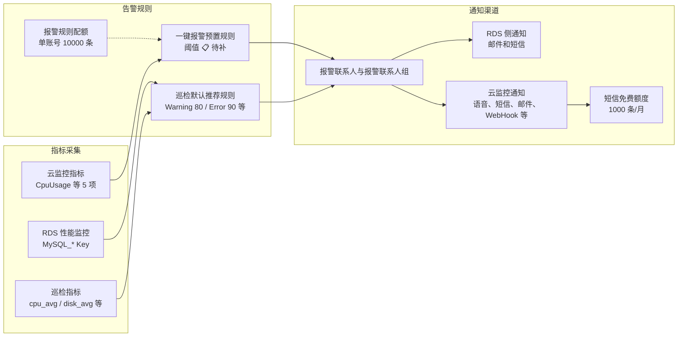

# RDS MySQL · 监控与告警

> 产品：RDS MySQL ｜ 口径：公共云 ｜ 复核：2026-11-18

## 告警链路图

**来源**
- 管理报警（一键告警、报警规则管理）：https://help.aliyun.com/zh/rds/apsaradb-rds-for-mysql/configure-an-alert-rule-for-an-apsaradb-rds-for-mysql-instance ｜ 复核：2026-11-18
- 开启一键报警（预置报警规则与一键报警列表）：https://help.aliyun.com/zh/cms/cloudmonitor-1-0/user-guide/enable-the-initiative-alert-feature ｜ 复核：2026-11-18
- RDS MySQL 实例巡检（默认 Warning/Error 推荐规则）：https://help.aliyun.com/zh/rds/apsaradb-rds-for-mysql/instance-check-items-and-rules ｜ 复核：2026-11-18
- 告警联系人管理：https://help.aliyun.com/zh/cms/cloudmonitor-1-0/user-guide/create-and-manage-contacts ｜ 复核：2026-11-18
- 云监控产品优势（报警通道类型）：https://help.aliyun.com/zh/cms/cloudmonitor-1-0/product-overview/benefits ｜ 复核：2026-11-18
- 基础云监控免费额度：https://help.aliyun.com/zh/cms/cloudmonitor-1-0/product-overview/free-quota ｜ 复核：2026-11-18
- 云监控使用限制与配额：https://help.aliyun.com/zh/cms/cloudmonitor-1-0/product-overview/restrictions-on-use ｜ 复核：2026-11-18

## 核心监控指标

指标分两套官方口径：CpuUsage 等 5 项为云监控（CloudMonitor）指标名，MySQL\_* 为 RDS 性能监控接口 DescribeDBInstancePerformance 的 Key（标准监控/性能趋势同源）。云监控 RDS 指标的 Namespace 为 `acs_rds_dashboard`（产品类目 rds、rds_cluster）。

| 指标英文名 | 含义 | 单位 | 统计周期 | 维度 |
|---|---|---|---|---|
| CpuUsage | 实例 CPU 使用率 | % | 60 秒 | 实例（userId + instanceId） |
| MemoryUsage | 实例内存使用率 | % | 60 秒 | 实例（userId + instanceId） |
| DiskUsage | 磁盘（存储空间）使用率 | % | 60 秒 | 实例（userId + instanceId） |
| IOPSUsage | IOPS 使用率 | % | 60 秒 | 实例（userId + instanceId） |
| ConnectionUsage | 连接数使用率 | % | 60 秒 | 实例（userId + instanceId） |
| MySQL_MemCpuUsage | 实例 CPU 使用率与内存使用率（非 Serverless 实例） | % | 5 秒/30 秒/1 分钟 | 实例（DBInstanceId） |
| MySQL_Sessions | 当前活跃连接数与当前总连接数 | 个 | 5 秒/30 秒/1 分钟 | 实例（DBInstanceId） |
| MySQL_QPSTPS | 平均每秒 SQL 语句执行次数与平均每秒事务数 | 次/秒、个/秒 | 5 秒/30 秒/1 分钟 | 实例（DBInstanceId） |
| MySQL_IOPS | 实例每秒 IO 请求次数 | 次/秒 | 5 秒/30 秒/1 分钟 | 实例（DBInstanceId） |
| MySQL_ReplicationDelay | 备实例的复制延迟 | 秒 | 5 秒/30 秒/1 分钟 | 实例（DBInstanceId） |
| slavestat | 只读实例延迟 | 秒 | 5 秒/30 秒/1 分钟 | 实例（DBInstanceId） |
| MySQL_DetailedSpaceUsage | 实例总空间、数据空间、日志空间、临时空间和系统空间使用量 | MB | 5 秒/30 秒/1 分钟 | 实例（DBInstanceId） |

- 统计周期说明：RDS 云盘实例的监控频率固定为 60 秒/次；标准监控数据粒度支持 5 秒、30 秒、1 分钟。云监控 API 的 Min Periods 以「指标和事件中心 > 基础云监控指标」RDS 指标列表为准 ⚠️ 待核。
- 仅高可用系列与集群系列支持 Replication（备节点复制线程状态、节点复制延迟）指标项。
- RDS 控制台标准监控仅支持查询过去 30 天内的监控数据；云监控按 Period=60 秒存储 31 天、Period≥300 秒存储 91 天。

**来源**
- 智能水位分析支持的云产品及其监控项（RDS：CpuUsage/DiskUsage/IOPSUsage/MemoryUsage/ConnectionUsage）：https://help.aliyun.com/zh/cms/cloudmonitor-1-0/user-guide/alibaba-cloud-services-and-related-metrics-that-are-supported-in-resource-usage-reports ｜ 复核：2026-11-17
- RDS 性能参数表（MySQL\_* Key 与含义、单位）：https://help.aliyun.com/zh/rds/apsaradb-rds-for-mysql/performance-parameters ｜ 复核：2026-11-17
- 查看 RDS MySQL 监控指标（标准监控指标项、数据粒度、60 秒监控频率、30 天查询范围）：https://help.aliyun.com/zh/rds/apsaradb-rds-for-mysql/view-the-metrics-of-an-apsaradb-rds-for-mysql-instance ｜ 复核：2026-11-17
- 附录1 云产品监控指标（Namespace/MetricName/Dimensions/Period 取值规则）：https://help.aliyun.com/zh/cms/cloudmonitor-1-0/support/appendix-1-metrics ｜ 复核：2026-11-17
- 云服务指标接入阿里云 Prometheus 说明（acs_rds_dashboard 命名空间）：https://help.aliyun.com/zh/cms/cloudmonitor-1-0/developer-reference/untitled-document-1753770404448 ｜ 复核：2026-11-17
- 云监控使用限制与配额（监控数据存储时长）：https://help.aliyun.com/zh/cms/cloudmonitor-1-0/product-overview/restrictions-on-use ｜ 复核：2026-11-17

## 官方默认与推荐告警

- RDS 控制台「监控与报警 > 报警」页支持一键告警开关，开启后云监控自动建立 RDS 关键监控项的报警体系；预置报警规则可在云监控「一键报警」列表查看并修改、删除、禁用。
- 一键报警的预置规则明细（指标、阈值、等级）仅在云监控控制台「一键报警列表」展示，官方文档未公布 RDS 预置规则的具体阈值 📋 待补。
- 官方未发布云监控侧 RDS 推荐阈值 📋 待补。
- RDS 暂不支持配置备份失败告警：云监控的 RDS 监控指标不包含备份失败相关项，备份任务状态在 RDS 控制台「备份恢复」页或 DescribeBackupTasks API 查看。

RDS 实例巡检的系统默认推荐规则（官方文档明示 Warning/Error 阈值，属巡检基线，非云监控报警规则）：

| 指标（Key） | 含义 | 单位 | Warning | Error |
|---|---|---|---|---|
| cpu_avg | 巡检窗口内 CPU 使用率均值 | % | > 80 | > 90 |
| memory_avg | 巡检窗口内内存使用率均值 | % | > 80 | > 90 |
| disk_avg | 巡检窗口内磁盘使用率均值 | % | > 80 | > 90 |
| conn_avg | 巡检窗口内连接使用率均值 | % | > 80 | > 90 |
| replication_delay | 主从复制延迟 | 秒 | > 60 | > 300 |
| qps_avg | 巡检窗口内 QPS 均值 | 次/秒 | > 1000 | > 5000 |
| slow_query_count | 慢查询总数 | 项 | > 1000 | > 2000 |
| backup_retention_days | 备份保留天数 | 天 | < 7 | ≤ 3 |
| innodb_buffer_hit_avg | InnoDB 缓冲池命中率均值 | % | < 95 | < 90 |

- 官方说明：默认阈值为通用取值，不能覆盖所有业务负载特征，建议先在少量代表性实例上运行再校准。
- RDS 实例巡检目前仅支持 MySQL 引擎。

**来源**
- 管理报警（一键告警、报警规则管理、备份失败告警常见问题）：https://help.aliyun.com/zh/rds/apsaradb-rds-for-mysql/configure-an-alert-rule-for-an-apsaradb-rds-for-mysql-instance ｜ 复核：2026-11-17
- 开启一键报警（预置报警规则与一键报警列表）：https://help.aliyun.com/zh/cms/cloudmonitor-1-0/user-guide/enable-the-initiative-alert-feature ｜ 复核：2026-11-17
- RDS MySQL 实例巡检（61 项/191 指标与默认 Warning/Error 推荐规则）：https://help.aliyun.com/zh/rds/apsaradb-rds-for-mysql/instance-check-items-and-rules ｜ 复核：2026-11-17

## 通知与渠道

| 项目 | 事实 |
|---|---|
| 告警实现 | RDS 的监控报警通过阿里云云监控（CloudMonitor）实现 |
| 通知对象 | 触发条件满足时通知报警联系组中的所有联系人 |
| RDS 侧通知方式 | 邮件和短信 |
| 云监控通知方式 | 语音、短信、邮件，以及 WebHook、消息队列、函数计算、日志服务 |
| 联系人管理 | 在云监控创建报警联系人与报警联系人组，电话通知需先验证手机号 |
| 静默与黑名单 | 云监控术语包含通道沉默周期、报警联系人/组、报警黑名单策略 |
| 事件通知 | 可通过云监控订阅 RDS 事件通知（设置事件报警、调试事件通知） |
| 短信额度 | 基础云监控短信报警免费额度 1000 条/月；超出后按 0.045 元/条计费 |

**来源**
- 管理报警：https://help.aliyun.com/zh/rds/apsaradb-rds-for-mysql/configure-an-alert-rule-for-an-apsaradb-rds-for-mysql-instance ｜ 复核：2026-11-17
- 云监控产品优势（报警通道类型）：https://help.aliyun.com/zh/cms/cloudmonitor-1-0/product-overview/benefits ｜ 复核：2026-11-17
- 告警联系人管理：https://help.aliyun.com/zh/cms/cloudmonitor-1-0/user-guide/create-and-manage-contacts ｜ 复核：2026-11-17
- 云监控基本概念术语表：https://help.aliyun.com/zh/cms/cloudmonitor-1-0/product-overview/terms ｜ 复核：2026-11-17
- 使用云监控订阅事件通知：https://help.aliyun.com/zh/rds/apsaradb-rds-for-mysql/subscribe-to-event-notifications ｜ 复核：2026-11-17
- 基础云监控免费额度：https://help.aliyun.com/zh/cms/cloudmonitor-1-0/product-overview/free-quota ｜ 复核：2026-11-17
- 基础云监控按量计费（短信 0.045 元/条）：https://help.aliyun.com/zh/cms/cloudmonitor-1-0/product-overview/pay-as-you-go-1 ｜ 复核：2026-11-17

## 告警配额

| 限制项 | 最大值 | 口径 |
|---|---|---|
| 单账号可新建的报警规则数量 | 10000 条 | 基础云监控 |
| 单账号可新建的动态规则数量 | 1200 个 | 基础云监控 |
| 单账号可新建的应用分组数量 | 20000 个 | 基础云监控 |
| 一个应用分组内包含的每种资源数量 | 3000 个 | 基础云监控 |
| 一个应用分组内可新建的可用性监控数量 | 500 个 | 基础云监控 |
| 通过标签创建应用分组时单地域可添加的标签数量 | 100 个 | 基础云监控 |
| 单账号可新建的 PromQL 报警规则数量 | 20 条 | 企业云监控 |
| 单个智能水位分析任务可设置的报警联系人组数量 | 5 个 | 企业云监控 |
| 报警联系人/报警联系人组的数量配额 | 官方未在使用限制页列出 📋 待补 | 基础云监控 |

- 监控数据存储时长与 Period 相关：Period<60 秒存储 7 天，Period=60 秒存储 31 天，Period≥300 秒存储 91 天。

**来源**
- 云监控使用限制与配额：https://help.aliyun.com/zh/cms/cloudmonitor-1-0/product-overview/restrictions-on-use ｜ 复核：2026-11-17
- 智能阈值报警规则概览（规则与试用配额入口）：https://help.aliyun.com/zh/cms/cloudmonitor-1-0/user-guide/overview-alert ｜ 复核：2026-11-17
