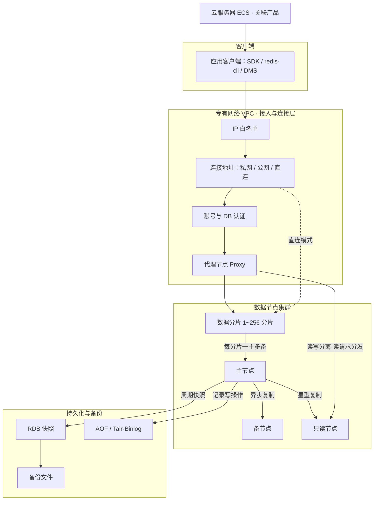

# Redis · 产品架构

> 产品：Redis ｜ 口径：公共云 ｜ 复核：2026-11-17

## 产品定义

云数据库 Tair（兼容 Redis）是兼容 Redis 协议标准的数据库服务，基于双机热备架构及集群架构。

| 实例类型 | 简介 |
|---|---|
| Redis 开源版 | 兼容 Redis 的高性能内存数据库，支持标准（主备）、集群、读写分离等架构 |
| Tair（企业版） | 在 Redis 开源版基础上开发的强化版，基于 DRAM / NVM / ESSD 云盘三类存储介质，分内存型、持久内存型、磁盘型 |
| Tair Serverless KV | 分布式集群架构，自动扩缩容、按实际用量计费 |

**来源**：
- 什么是云数据库 Tair（兼容 Redis）：https://help.aliyun.com/zh/redis/product-overview/what-is-apsaradb-for-redis ｜ 复核：2026-11-16

## 架构图

**来源**
- 产品架构概述：https://help.aliyun.com/zh/redis/product-overview/product-architecture ｜ 复核：2026-11-17
- 标准架构（主备双节点）：https://help.aliyun.com/zh/redis/product-overview/standard-master-replica-instances ｜ 复核：2026-11-17
- 集群架构（每分片主备 + 代理/直连模式）：https://help.aliyun.com/zh/redis/product-overview/cluster-master-replica-instances ｜ 复核：2026-11-17
- 读写分离（Proxy 分发读请求、星型复制）：https://help.aliyun.com/zh/redis/product-overview/read-or-write-splitting-instances-1 ｜ 复核：2026-11-17
- Tair Proxy 特性（路由转发）：https://help.aliyun.com/zh/redis/product-overview/features-of-proxy-nodes ｜ 复核：2026-11-17
- 设置 IP 白名单：https://help.aliyun.com/zh/redis/user-guide/configure-whitelists ｜ 复核：2026-11-17
- 查看连接地址（专有网络/公网/直连）：https://help.aliyun.com/zh/redis/user-guide/view-endpoints ｜ 复核：2026-11-17
- 备份与恢复概述（RDB 备份）：https://help.aliyun.com/zh/redis/user-guide/backup-and-restoration-solutions ｜ 复核：2026-11-17
- Tair 使用限制（256 分片）：https://help.aliyun.com/zh/redis/product-overview/limits ｜ 复核：2026-11-17

## 组件清单

| 组件 | 作用 | 必选/可选 | 是否独立计费 | 备注 |
|---|---|---|---|---|
| 实例（云数据库 Tair 实例） | 托管的 Redis 兼容数据库服务单元，按地域/可用区部署 | 必选 | 是（实例规格费，包年包月/按量付费） | 部署形态分云原生版与经典版 |
| 主从节点（主节点/备节点/只读节点） | 主节点承接读写，备节点异步复制并在主节点故障时 30 秒内切换，只读节点分担读请求 | 必选（标准版-单副本除外，单副本无备节点） | 否 | 备节点：云原生版最多 1 主 9 备、经典版 1 主 1 备；读写分离只读节点标准架构 1~9 个、集群每分片 1~4 个 |
| 数据分片 | 集群架构下按 Slot 切分数据的单元（1~256 分片） | 必选（集群架构） | 否 | 存储量最大 16 TB（64 GB × 256 分片） |
| 代理节点 Proxy | 转发路由读写请求，支持多 DB（SELECT）与代理查询缓存；读写分离实例由其分发读请求 | 可选（代理模式与直连模式二选一） | 否 | 标准架构（非读写分离）无 Proxy；云原生版集群不支持同时开代理与直连 |
| 持久化（RDB / AOF / Tair-Binlog） | RDB 周期快照、AOF 记录全部写操作（AOF_FSYNC_EVERYSEC 每秒异步 fsync）、Tair-Binlog 增量归档 | 必选（RDB/AOF；Tair-Binlog 仅 Tair 内存型） | 否 | 官方建议保持 AOF 开启，关闭后极端故障下增量数据可能无法恢复 |
| 备份 | 实例数据的自动/手动备份文件，用于恢复 | 可选（自动备份策略可配；单副本架构不支持备份） | 是（超出免费额度的部分按存储计费） | 默认每天备份一次；详见 [04-存储与配套](04-存储与配套.md) |
| 账号与 DB | 创建账号并授予只读/读写权限，DB 编号隔离数据 | 必选（账号） | 否 | 单实例最多 256 个 DB；密码可控制台重置，立即生效无需重启 |
| 关联产品：云服务器 ECS | 应用侧常见部署位置，经同 VPC 内网 + IP 白名单访问实例 | 可选（关联产品） | —（ECS 侧计费见 [ECS](../ecs/)） | 白名单支持一键加载同 VPC 下 ECS 的私网 IP |

**来源**
- 产品架构概述：https://help.aliyun.com/zh/redis/product-overview/product-architecture ｜ 复核：2026-11-17
- 标准架构：https://help.aliyun.com/zh/redis/product-overview/standard-master-replica-instances ｜ 复核：2026-11-17
- 集群架构：https://help.aliyun.com/zh/redis/product-overview/cluster-master-replica-instances ｜ 复核：2026-11-17
- 读写分离功能：https://help.aliyun.com/zh/redis/product-overview/read-or-write-splitting-instances-1 ｜ 复核：2026-11-17
- Tair Proxy 特性：https://help.aliyun.com/zh/redis/product-overview/features-of-proxy-nodes ｜ 复核：2026-11-17
- Tair 基本概念（数据分片/节点类型）：https://help.aliyun.com/zh/redis/product-overview/terms ｜ 复核：2026-11-17
- Tair 使用限制（256 个 DB）：https://help.aliyun.com/zh/redis/product-overview/limits ｜ 复核：2026-11-17
- 创建与管理账号：https://help.aliyun.com/zh/redis/user-guide/create-and-manage-database-accounts ｜ 复核：2026-11-17
- 设置 IP 白名单（一键加载 ECS 私网 IP）：https://help.aliyun.com/zh/redis/user-guide/configure-whitelists ｜ 复核：2026-11-17
- 备份与恢复概述：https://help.aliyun.com/zh/redis/user-guide/backup-and-restoration-solutions ｜ 复核：2026-11-17
- Tair 计费项（实例规格/备份计费）：https://help.aliyun.com/zh/redis/product-overview/billable-items ｜ 复核：2026-11-17

## 社区版与 Tair 的差异

| 维度 | Redis 开源版 | Tair（企业版） |
|---|---|---|
| 内核 | 基于开源代码强化 | 在开源版基础上增加企业级特性 |
| 存储介质 | DRAM | DRAM（内存型）、NVM（持久内存型）、ESSD/SSD（磁盘型） |
| 性能基准 | 基准 | 内存型约同规格开源版的 3 倍（多线程模型） |
| 持久化 | RDB + AOF | 内存型额外支持 Tair-Binlog（AOF 增量归档、秒级 PITR） |
| 扩展数据结构 | 仅标准 Redis 结构 | 额外支持多种 Tair 扩展数据结构 |

- 磁盘型：成本最低为 Redis 开源版的 15%，性能约为 Redis 开源版的 60%。
- 持久内存型：数据持久化不依赖传统磁盘，每个操作均保证持久化；标准版单实例成本对比 Redis 开源版最高可降低 30%。

**来源**：
- 什么是云数据库 Tair（兼容 Redis）：https://help.aliyun.com/zh/redis/product-overview/what-is-apsaradb-for-redis ｜ 复核：2026-11-16
- 实例规格概览：https://help.aliyun.com/zh/redis/product-overview/overview-4/ ｜ 复核：2026-11-16

## 五种部署架构

| 架构 | 结构 | 关键事实 |
|---|---|---|
| 标准版-单副本 | 单节点 | 无热备，节点故障数据丢失；不支持自动/手动备份、离线全量 Key 分析、回收站；SLA 不适用 |
| 标准架构（高可用） | 一主多备（Master-Replica） | 主备位于不同物理机；主节点故障系统 30 秒内自动切换至备节点；云原生版最多 1 主 + 9 备，经典版 1 主 1 备 |
| 集群版-单副本 | 每分片单节点 | 分片节点故障后 30 秒内重新拉起无数据进程，该分片数据丢失；SLA 不适用 |
| 集群架构 | 每分片一主多备 + Proxy | 备节点数量范围 1~4；支持代理模式（推荐）与直连模式；主节点故障 30 秒内切换；存储量最大 16 TB（64 GB × 256 分片） |
| 读写分离 | 主节点 + 只读节点 + Proxy | 只读节点数：标准架构 1~9 个、集群架构每分片 1~4 个；星型复制；读 QPS 最高提升 9 倍 |

- 标准架构适用 10 万 QPS 以下业务；更高性能需开读写分离或选集群架构。
- 云原生版集群架构不支持同时使用代理模式和直连模式；云原生集群直连模式实例无法升级大版本。
- 经典版集群架构仅支持单副本、双副本，不支持开启读写分离。

**来源**：
- 标准架构：https://help.aliyun.com/zh/redis/product-overview/standard-master-replica-instances ｜ 复核：2026-11-16
- 集群架构：https://help.aliyun.com/zh/redis/product-overview/cluster-master-replica-instances ｜ 复核：2026-11-16
- 读写分离功能：https://help.aliyun.com/zh/redis/product-overview/read-or-write-splitting-instances-1 ｜ 复核：2026-11-16
- 什么是云数据库 Tair（兼容 Redis）：https://help.aliyun.com/zh/redis/product-overview/what-is-apsaradb-for-redis ｜ 复核：2026-11-16
- 升级大版本：https://help.aliyun.com/zh/redis/user-guide/upgrade-the-major-version-1 ｜ 复核：2026-11-16

## 主从切换与读写分离要点

- 自研 HA 系统实时探测主节点异常（磁盘 IO、CPU 故障等），自动主备切换。
- 多可用区触发 HA 时优先在同可用区切换，避免业务跨可用区访问。
- 读写分离实例 Proxy 将读请求平均分配到主节点和只读节点，不支持自定义权重（如 3 个只读节点时主 + 3 只读各 25%）。
- 只读节点异常时产品不承诺恢复时间指标；Redis 异步同步在写入量大时可能产生数据同步延迟，业务需能接受一定程度脏数据。
- 双可用区读写分离最小配置：主可用区 1 主 + 1 只读，备可用区 1 只读；备可用区读请求仅路由至备可用区只读节点。

**来源**：
- 标准架构：https://help.aliyun.com/zh/redis/product-overview/standard-master-replica-instances ｜ 复核：2026-11-16
- 集群架构：https://help.aliyun.com/zh/redis/product-overview/cluster-master-replica-instances ｜ 复核：2026-11-16
- 读写分离功能：https://help.aliyun.com/zh/redis/product-overview/read-or-write-splitting-instances-1 ｜ 复核：2026-11-16

## 持久化机制

- 实例提供 RDB、AOF 和 Tair-Binlog 三种持久化策略。
- RDB：周期性快照，默认每天备份一次；Tair 实例做了「无阻塞备份」优化，备份不影响客户端请求。
- AOF：日志形式记录全部写操作，策略为 `AOF_FSYNC_EVERYSEC`（每秒异步 fsync）；文件过大时自动 AOF Rewrite。
- Tair-Binlog：Tair（企业版）内存型独有，AOF 增量归档，保留每次写操作及时间戳，支持秒级 PITR。
- 官方提示：若关闭 AOF，仅依赖周期性 RDB 备份，上次备份后的增量数据在极端故障下可能无法恢复，建议保持 AOF 开启。

**来源**：
- 备份与恢复概述：https://help.aliyun.com/zh/redis/user-guide/backup-and-restoration-solutions ｜ 复核：2026-11-16
- 使用限制（持久化策略）：https://help.aliyun.com/zh/redis/product-overview/limits ｜ 复核：2026-11-16

## SLA（服务等级协议）

版本生效日期：2025 年 7 月 8 日。

| 可用区及实例类型 | 服务可用性承诺 |
|---|---|
| 多可用区，高可用类型 | 99.99% |
| 单可用区，高可用类型 | 99.90% |
| 单可用区，单节点类型 | 99.00% |

- 不适用范围：公测/邀测/免费的功能及版本、Tair（金融云版）、单副本架构实例（单副本不保证数据可靠性）。
- 不可用定义：某分钟内所有建立连接的连续尝试均失败，计为 1 分钟不可用。
- 赔偿方式仅限代金券，总额不超过当月月度服务费用的 100%；申请最迟不晚于未达标月份结束后 2 个月。

**来源**：
- 云数据库 Tair（兼容 Redis）服务等级协议：https://terms.aliyun.com/legal-agreement/terms/suit_bu1_ali_cloud/suit_bu1_ali_cloud201803071050_54811.html ｜ 复核：2026-11-16
- 集群版-单副本（SLA 不适用单副本）：https://help.aliyun.com/zh/redis/product-overview/standalone-cluster-instances ｜ 复核：2026-11-16
