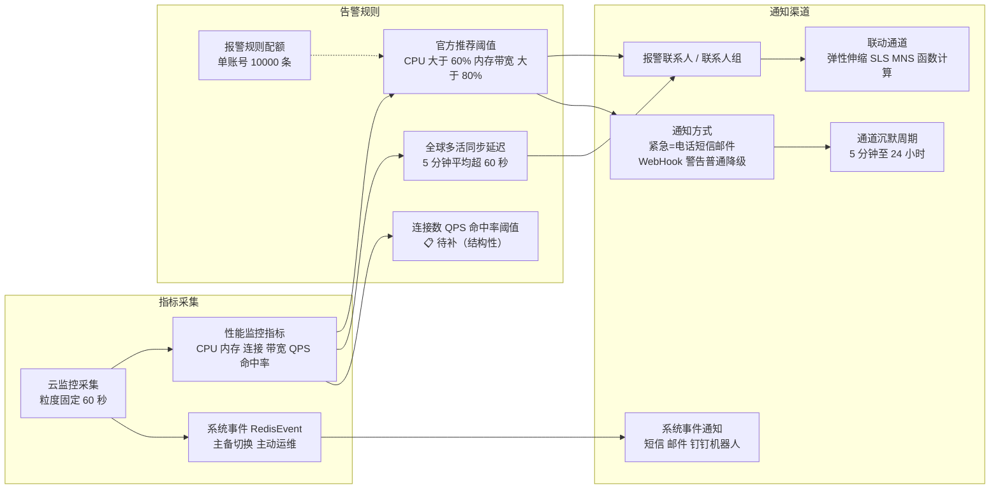

# Redis · 监控与告警

> 产品：Redis ｜ 口径：公共云 ｜ 复核：2026-11-18

## 告警链路图

**来源**
- DescribeHistoryMonitorValues（指标表与采集口径）：https://help.aliyun.com/zh/redis/developer-reference/api-r-kvstore-2015-01-01-describehistorymonitorvalues-redis ｜ 复核：2026-11-18
- 报警设置（推荐阈值 CPU 大于 60%/内存带宽 大于 80%、订阅事件通知）：https://help.aliyun.com/zh/redis/user-guide/alert-settings ｜ 复核：2026-11-18
- 订阅事件通知（系统事件/短信邮件钉钉机器人/分发通道）：https://help.aliyun.com/zh/redis/user-guide/subscribe-to-event-notifications ｜ 复核：2026-11-18
- 全球多活同步延迟报警（5 分钟平均延迟超 60 秒示例）：https://help.aliyun.com/zh/redis/user-guide/configure-an-alert-rule-to-monitor-the-synchronization-latency-of-child-instances ｜ 复核：2026-11-18
- 云监控创建报警规则（级别通知方式/沉默周期/联动）：https://help.aliyun.com/zh/cms/cloudmonitor-1-0/user-guide/create-an-alert-rule ｜ 复核：2026-11-18
- 云监控使用限制与配额（报警规则 10000 条）：https://help.aliyun.com/zh/cms/cloudmonitor-1-0/product-overview/restrictions-on-use ｜ 复核：2026-11-18

## 核心监控指标

- 云数据库 Tair（兼容 Redis）已接入云监控（CloudMonitor）；控制台「性能监控」与 OpenAPI `DescribeHistoryMonitorValues` 提供同源指标。
- 采集粒度固定 60 秒（`ModifyDBInstanceMonitor` 的 `Interval` 参数已废弃，固定取值 60 秒）。
- 支持查询最近 1 个月的监控数据；控制台单次查询范围通常不超过 3 天，API 单次最长 7 天。
- 查询聚合：查询范围 ≤10 分钟时按 5s/次聚合返回；数据分片数 ≥32 时最小聚合频率为 1 分钟/次。
- 云监控存储时长：Period=60s 的监控数据存储 31 天。
- 单位变更：2025-08-20 起磁盘型/持久内存型/Serverless 的 `IntranetIn/Out` 类指标单位由 bit/s 修正为 KiB/s；`CpuUsage` 与 `RedisCpuUsage` 归一化返回相同值，`InFlow/OutFlow` 仅统计业务流量（不含主备复制流量）。
- 主备状态无独立指标，通过系统事件「实例主备切换（故障切换）」订阅监控（见「官方默认与推荐告警」「通知与渠道」）。

| 指标（官方英文名） | 含义 | 单位 | 统计周期 | 维度（官方支持范围） |
|---|---|---|---|---|
| `CpuUsage` | CPU 使用率，范围 0~100（原 `RedisCpuUsage` 仍兼容可用） | % | 60s | 数据节点 DB / DB 聚合 / 代理节点 Proxy / Proxy 聚合 |
| `MemoryUsage`（子项 `memoryUsage`） | 内存使用率 | % | 60s | DB / DB 聚合 |
| `UsedMemory` | 已使用内存量，包含数据和缓存部分 | Bytes | 60s | DB / DB 聚合 |
| `ConnectionUsage` | 连接数使用率 = 已连接数 ÷ 实例支持的总连接数；客户端经直连地址连接时看 DB 维度，经 Proxy 连接时看 Proxy 维度 | % | 60s | DB / DB 聚合 / Proxy / Proxy 聚合 |
| `UsedConnection`（子项 `ConnCount`） | 已使用连接数 | Counts | 60s | DB / DB 聚合 / Proxy / Proxy 聚合 |
| `IntranetIn` / `IntranetOut`（子项 `InFlow` / `OutFlow`） | 内网入、出流量速率 | KB/s（部分系列 2025-08-20 起为 KiB/s） | 60s | DB / DB 聚合 / Proxy / Proxy 聚合 |
| `IntranetInRatio` / `IntranetOutRatio` | 内网入、出流量使用率 | % | 60s | DB / DB 聚合 |
| `UsedQps`（子项 `TotalQps` / `GetQps` / `PutQps`） | 每秒总请求数（读+写）；读/写拆分需兼容版本 Redis 4.0 及以上 | Counts/s | 60s | DB / DB 聚合 / Proxy / Proxy 聚合 |
| `Hit_Rate_Monitor`（子项 `hit_rate`） | Key 命中率 = 命中数 ÷（命中数 + 未命中数） | % | 60s | DB / DB 聚合 |
| `Redis_Avg_Rt_Monitor`（子项 `AvgRt`） | 平均时延：后端节点从接收命令到发出响应的平均耗时 | us（微秒） | 60s | DB / DB 聚合 / Proxy / Proxy 聚合 |
| `Redis_Max_Rt_Monitor`（子项 `MaxRt`） | 最大时延：节点从接收命令到发出响应的最大耗时 | us（微秒） | 60s | DB / DB 聚合 / Proxy / Proxy 聚合 |
| `Redis_Basic_Monitor`（子项 `Keys`） | Key 总数量，即实例存储的一级 Key 总数 | Counts | 60s | DB / DB 聚合 |
| `EvictedKeysPerSecond` | 每秒逐出的 Key 数量（内存满逐出） | Counts/s | 60s | DB / DB 聚合 |
| `NewUserConnQps` | 客户端到 Proxy 节点每秒建立的连接数 | Counts/s | 60s | Proxy / Proxy 聚合 |

- 只读节点指标需在 `DescribeHistoryMonitorValues` 传入 `NodeRole=READONLY`；查询单节点建议单次不超过 5 个指标，聚合指标不超过 1 个。
- 2020-08 官方下线集群版/标准版/读写分离版的命令频率类报警指标，保留 CPU/内存/连接数/带宽使用率等核心指标。

**来源**
- DescribeHistoryMonitorValues（MonitorKeys 指标表/单位/维度/聚合规则）：https://help.aliyun.com/zh/redis/developer-reference/api-r-kvstore-2015-01-01-describehistorymonitorvalues-redis ｜ 复核：2026-11-17
- 查看性能监控（入口/最近 1 个月/查询范围/聚合口径）：https://help.aliyun.com/zh/redis/user-guide/view-monitoring-data ｜ 复核：2026-11-17
- ModifyDBInstanceMonitor（采集粒度固定 60 秒）：https://help.aliyun.com/zh/redis/developer-reference/api-r-kvstore-2015-01-01-modifydbinstancemonitor-redis ｜ 复核：2026-11-17
- Tair 监控指标单位变更（2025-08-20 KiB/s）：https://help.aliyun.com/zh/redis/product-overview/updates-to-tair-monitoring-metrics ｜ 复核：2026-11-17
- CPU 使用率与流量监控指标升级（CpuUsage/InFlow/OutFlow 口径）：https://help.aliyun.com/zh/redis/product-overview/notice-on-the-update-of-the-cpu-utilization-and-inbound-and-outbound-traffic-metrics ｜ 复核：2026-11-17
- 云监控 Redis 指标下线通知（命令频率类指标下线）：https://help.aliyun.com/zh/redis/product-overview/deprecated-alarm-metrics-in-cloud-monitor ｜ 复核：2026-11-17
- 云监控使用限制（Period=60s 存储 31 天）：https://help.aliyun.com/zh/cms/cloudmonitor-1-0/product-overview/restrictions-on-use ｜ 复核：2026-11-17

## 官方默认与推荐告警

**A. 官方推荐阈值（Redis 控制台「报警设置」页）**

| 指标 | 推荐阈值 | 等级 | 出处 |
|---|---|---|---|
| CPU 使用率 | 大于 60% | 官方未标注等级 | 报警设置页「建议为下述关键指标设置报警阈值」 |
| 内存使用率 | 大于 80% | 官方未标注等级 | 同上 |
| 流入带宽使用率 | 大于 80% | 官方未标注等级 | 同上 |
| 流出带宽使用率 | 大于 80% | 官方未标注等级 | 同上 |

**B. 官方系统事件告警（云监控事件订阅，RedisEvent）**

| 事件 | 等级 | 说明 |
|---|---|---|
| 实例主备切换（故障切换）`Instance_Failover` | 订阅示例选择严重（Critical）；调试内容 `level` 示例为 WARN | 事件中心订阅，可「调试事件订阅」发送测试通知 |
| 实例主动运维事件 `InstanceMaintenance`（实例迁移等） | 见事件中心事件等级 | 报警设置页「订阅事件通知」包含 InstanceMaintenance、实例异常、实例维护等 |
| 实例小版本升级、实例迁移 | 见事件中心事件等级 | 已接入云监控的系统事件（Redis 与 Tair） |

**C. 官方文档示例阈值**

| 场景 | 阈值 | 出处 |
|---|---|---|
| 全球多活子实例同步时延报警 | 5 分钟内平均延迟超过 60 秒触发报警（支持邮件/钉钉通知） | 全球多活同步延迟报警配置教程（仅全球多活场景） |

**D. 指标阈值类告警空位**

- 连接数、QPS、命中率、时延、逐出速率、Key 数量等指标的阈值告警：**官方未发布推荐阈值** 📋 待补（结构性：官方文档仅提供创建报警规则的操作说明与 A 节 3 项推荐阈值；按阈值红线不收经验值）。
- Redis 专属的告警模板/默认规则集：📋 待补（结构性：官方未发布 Redis 默认告警规则集文档）。

**来源**
- 报警设置（推荐阈值 CPU>60%/内存>80%/带宽>80%、产品 metric-meta 入口、订阅事件通知）：https://help.aliyun.com/zh/redis/user-guide/alert-settings ｜ 复核：2026-11-17
- 订阅事件通知（系统事件/事件订阅/调试事件订阅）：https://help.aliyun.com/zh/redis/user-guide/subscribe-to-event-notifications ｜ 复核：2026-11-17
- 全球多活同步延迟报警（5 分钟平均延迟超 60 秒示例）：https://help.aliyun.com/zh/redis/user-guide/configure-an-alert-rule-to-monitor-the-synchronization-latency-of-child-instances ｜ 复核：2026-11-17
- 云监控创建报警规则（阈值报警操作与级别模型）：https://help.aliyun.com/zh/cms/cloudmonitor-1-0/user-guide/create-an-alert-rule ｜ 复核：2026-11-17

## 通知与渠道

| 渠道 / 机制 | 说明 |
|---|---|
| 报警联系人 / 联系人组 | 需先创建报警联系人并加入联系人组；规则触发后通知组内所有联系人 |
| 通知方式（阈值报警） | 报警服务支持电话、短信、邮件和 Webhook 地址；安装阿里云 App 可通过 App 接收；级别决定通知方式：紧急=电话+短信+邮件+WebHook，警告=短信+邮件+WebHook，普通=邮件+WebHook（仅紧急支持电话） |
| 联动通道 | 报警回调（公网 URL，POST，仅 HTTP）、弹性伸缩、日志服务 SLS、轻量消息队列（原 MNS）Topic、函数计算 |
| 系统事件通知 | 通过短信、邮件、钉钉机器人发送；可将事件分发到轻量消息队列、函数计算、URL 回调和日志服务做自动化处理 |
| 事件订阅策略 | 云监控 事件中心 > 事件订阅：订阅类型选系统事件，产品选「云数据库 Redis 版」，支持合并降噪、通知配置（直接设置通知组）、调试事件订阅；API `PutEventRule` |
| 通道沉默周期 | 报警未恢复时重复发送的间隔：5 分钟、15 分钟、30 分钟、60 分钟、3 小时、6 小时、12 小时、24 小时 |
| 生效时间 / 无数据处理 | 报警规则仅在生效期内发送通知（历史仍记录）；无数据处理取值：不做任何处理（默认）、发送无数据报警、视为正常 |
| 告警升级 | 事件中心-通知配置支持按严重（Critical）/告警（Warn）/通知（Info）/恢复 级别分别设置通知组以实现升级；Redis 专属升级策略文档 📋 待补（结构性） |
| 审计日志报表通知 | 邮件与钉钉等 WebHook 机器人周期推送（详见 [08-日志与审计](08-日志与审计.md)） |

**来源**
- 报警设置（联系人组/入口）：https://help.aliyun.com/zh/redis/user-guide/alert-settings ｜ 复核：2026-11-17
- 订阅事件通知（短信/邮件/钉钉机器人/分发通道/事件订阅策略）：https://help.aliyun.com/zh/redis/user-guide/subscribe-to-event-notifications ｜ 复核：2026-11-17
- 云监控报警规则概述（电话/短信/邮件/Webhook/App）：https://help.aliyun.com/zh/cms/cloudmonitor-1-0/user-guide/overview-2 ｜ 复核：2026-11-17
- 云监控创建报警规则（级别通知方式/沉默周期/生效时间/无数据处理/联动）：https://help.aliyun.com/zh/cms/cloudmonitor-1-0/user-guide/create-an-alert-rule ｜ 复核：2026-11-17
- 管理通知配置策略（按级别设置通知组实现升级）：https://help.aliyun.com/zh/cms/cloudmonitor-1-0/user-guide/manage-escalation-policies ｜ 复核：2026-11-17
- 订阅审计日志报表（邮件/钉钉 WebHook）：https://help.aliyun.com/zh/redis/user-guide/subscribe-to-audit-log-reports ｜ 复核：2026-11-17

## 告警配额

| 限制项 | 最大值 | 归属 |
|---|---|---|
| 单账号可新建的报警规则数量 | 10,000 条 | 基础云监控 |
| 单账号可新建的动态规则数量 | 1,200 个 | 基础云监控 |
| 单账号可新建的应用分组数量 | 20,000 个 | 基础云监控 |
| 一个应用分组内允许新建的可用性监控数量 | 500 个 | 基础云监控 |
| 一个应用分组内包含的每种资源数量 | 3,000 个 | 基础云监控 |
| 标签创建应用分组时一个地域可添加的标签数量 | 100 个 | 基础云监控 |
| 监控数据存储时长（Period < 60 秒 / = 60 秒 / ≥ 300 秒） | 7 天 / 31 天 / 91 天 | 基础云监控 |
| 单账号可新建的 PromQL 报警规则数量 | 20 条 | 企业云监控 |
| 单账号可新建的指标仓库数量 | 30 个 | 企业云监控 |
| 单账号可新建的 SLS Logstore 组数量 | 20 个（每组最多 25 个 Logstore） | 企业云监控 |
| 一个智能水位分析任务可设置的报警联系人组数量 | 5 个 | 企业云监控 |
| 报警联系人 / 报警联系人组数量上限 | 📋 待补（结构性：官方使用限制页未列出该配额） | 基础云监控 |

- 冲突注记：应用分组数量在《云监控使用限制》为 20,000 个，在《应用分组概述》为「单账号最多 5,000 个分组」；本表取《使用限制》口径，两处均为官方文档。
- 操作审计侧告警相关配额（跟踪、`LookupEvents`）见 [08-日志与审计](08-日志与审计.md)。

**来源**
- 云监控使用限制与配额（报警规则/应用分组/存储时长/企业云监控）：https://help.aliyun.com/zh/cms/cloudmonitor-1-0/product-overview/restrictions-on-use ｜ 复核：2026-11-17
- 应用分组概述（单账号最多 5,000 个分组，冲突对照）：https://help.aliyun.com/zh/cms/cloudmonitor-1-0/user-guide/overview-10 ｜ 复核：2026-11-17
