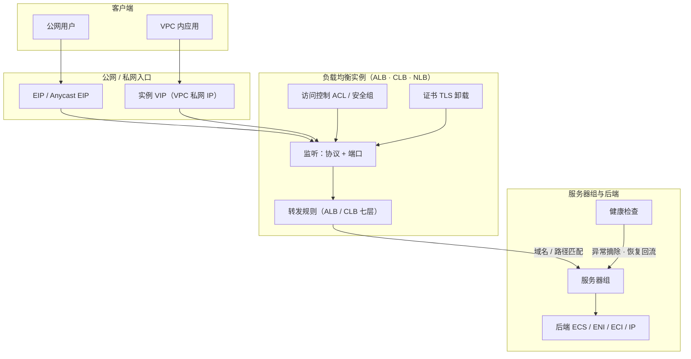

# SLB · 产品架构

> 产品：SLB/ALB/NLB ｜ 口径：公共云 ｜ 复核：2026-11-16

## 负载均衡是什么

负载均衡 SLB 是对流量按需分发的服务，通过把流量分发到不同后端服务器扩展应用吞吐能力、消除单点故障。
SLB 产品家族 = ALB + NLB + CLB 三个子产品。

**来源**
- 负载均衡SLB产品家族介绍：https://help.aliyun.com/knowledge_detail/196874.html ｜ 复核：2026-11-16

## 架构图

- 公网实例经 EIP（或共享带宽）接入，私网实例使用 VPC 内的 VIP；四层监听（NLB TCP/UDP/TCPSSL、CLB TCP/UDP）由监听直接转发到服务器组，不经转发规则。
- 三型适用范围：监听、服务器组、健康检查、证书、访问控制为 ALB/CLB/NLB 通用组件；转发规则为 ALB 与 CLB 七层监听能力。

**来源**
- CLB 产品架构（四层 LVS+Keepalived / 七层 Tengine、入网流量路径）：https://help.aliyun.com/zh/slb/classic-load-balancer/product-overview/architecture ｜ 复核：2026-11-17
- 负载均衡SLB产品家族介绍：https://help.aliyun.com/zh/slb/product-overview/slb-overview ｜ 复核：2026-11-17
- 什么是应用型负载均衡ALB：https://help.aliyun.com/zh/slb/application-load-balancer/what-is-alb ｜ 复核：2026-11-17
- 什么是网络型负载均衡NLB：https://help.aliyun.com/zh/slb/network-load-balancer/product-overview/what-is-nlb ｜ 复核：2026-11-17
- 什么是传统型负载均衡CLB：https://help.aliyun.com/zh/slb/classic-load-balancer/product-overview/what-is-clb ｜ 复核：2026-11-17
- ALB 健康检查配置与管理：https://help.aliyun.com/zh/slb/application-load-balancer/alb-health-check ｜ 复核：2026-11-17
- SLB 访问控制功能（ACL / 安全组）：https://help.aliyun.com/zh/slb/security-and-compliance/access-control ｜ 复核：2026-11-17

## 组件清单

| 组件 | 作用 | 必选/可选 | 是否独立计费 | 备注 |
|---|---|---|---|---|
| 负载均衡实例 | 运行的负载均衡服务，承载监听与流量分发入口 | 必选 | 是（实例费 + LCU/规格费，公网费用另计，见 [07-计费与生命周期](07-计费与生命周期.md)） | ALB 单实例最大 100 万 QPS；NLB 单实例最大 1 亿并发连接 |
| 监听 | 最小业务单元，配置协议与端口；每个实例至少一个监听才能分发流量 | 必选 | 否 | ALB：HTTP/HTTPS/QUIC；NLB：TCP/UDP/TCPSSL；CLB：TCP/UDP/HTTP/HTTPS |
| 转发规则 | 按域名、路径、HTTP 标头等匹配条件将请求路由到服务器组 | 可选（ALB/CLB 七层，ALB 默认规则兜底不可删） | 否 | NLB 四层无转发规则，由监听直连服务器组 |
| 服务器组 | 独立于实例存在的逻辑后端组，挂载后端服务器 | 必选 | 否（后端资源另计费） | ALB 每个服务器组默认最多 1000 个后端服务器 |
| 证书 | HTTPS/TCPSSL 监听的服务器证书与 CA 证书，用于 TLS 卸载与双向认证 | 可选（HTTPS/TCPSSL 监听必配） | 否（SLB 计费项不含证书） | ALB 支持 RSA/ECC/SM2；证书由数字证书管理服务统一存储 |
| 健康检查 | 持续探测后端可用性，异常自动摘除、恢复自动回流 | 可选（ALB 服务器组默认开启） | 否（官方口径：健康检查不产生额外费用） | 探测源地址段 100.64.0.0/10 |
| 访问控制（ACL / 安全组） | 监听级 IP 黑白名单（ALB/CLB）与实例入向安全组（ALB/NLB） | 可选 | 否 | 空策略组不生效；ALB/NLB 托管安全组默认放通 Local IP |
| EIP / 共享带宽 | 公网实例的公网接入与带宽承载 | 可选（公网实例需要） | 是（EIP/共享带宽侧计费，见 [05-网络参数](05-网络参数.md)） | 一个公网实例可有多个 EIP，至少 2 个分布不同可用区以保高可用 |
| 后端服务器 [ECS](../ecs/README) | 承载业务流量的计算资源 | 必选 | 是（ECS 侧计费，见 [ECS](../ecs/README)） | 后端类型还支持 ENI、ECI、IP（ALB 另支持函数计算 FC） |
| 专有网络 [VPC](../vpc/README) | 实例网络载体，VIP 为 VPC 内私网 IP | 必选 | —（VPC 侧计费见 [VPC](../vpc/README)） | 实例需至少部署 2 个可用区的交换机 |

**来源**
- 什么是应用型负载均衡ALB（实例/监听/服务器组/100 万 QPS）：https://help.aliyun.com/zh/slb/application-load-balancer/what-is-alb ｜ 复核：2026-11-17
- 什么是网络型负载均衡NLB（1 亿并发/TCPSSL）：https://help.aliyun.com/zh/slb/network-load-balancer/product-overview/what-is-nlb ｜ 复核：2026-11-17
- 什么是传统型负载均衡CLB（实例/监听/后端服务器三部分）：https://help.aliyun.com/zh/slb/classic-load-balancer/product-overview/what-is-clb ｜ 复核：2026-11-17
- ALB 健康检查配置与管理（默认开启、不产生额外费用）：https://help.aliyun.com/zh/slb/application-load-balancer/alb-health-check ｜ 复核：2026-11-17
- SLB 访问控制功能（ACL 黑白名单/安全组/托管安全组）：https://help.aliyun.com/zh/slb/security-and-compliance/access-control ｜ 复核：2026-11-17
- ALB 管理证书：https://help.aliyun.com/zh/slb/application-load-balancer/manage-certificates ｜ 复核：2026-11-17
- NLB 证书管理（TCPSSL 监听）：https://help.aliyun.com/zh/slb/network-load-balancer/user-guide/management-certificate ｜ 复核：2026-11-17
- CLB 证书管理：https://help.aliyun.com/zh/slb/classic-load-balancer/user-guide/clb-certificate-management ｜ 复核：2026-11-17
- ALB 计费概述（实例费 + LCU 费 + 公网费）：https://help.aliyun.com/zh/slb/application-load-balancer/billing-overview ｜ 复核：2026-11-17
- NLB 计费规则（实例费 + LCU 费 + 公网网络费）：https://help.aliyun.com/zh/slb/network-load-balancer/product-overview/nlb-billable-items ｜ 复核：2026-11-17
- CLB 计费概述（计费项）：https://help.aliyun.com/zh/slb/classic-load-balancer/product-overview/billing-overview ｜ 复核：2026-11-17

## 三型定位

| 子产品 | 定位 | 协议焦点 | 架构 | 单实例性能上限（官方口径） |
|---|---|---|---|---|
| 应用型 ALB | 七层处理 + 高级路由，官方云原生 Ingress 网关 | HTTP、HTTPS、QUIC | NFV 虚拟化平台，支持弹性伸缩 | 最大 100 万 QPS |
| 网络型 NLB | 四层处理 + 大规模 SSL 卸载，面向网络层交付 | TCP、UDP、TCPSSL | NFV 虚拟化平台，不依赖物理机 | 最大 1 亿并发连接 |
| 传统型 CLB | 良好四层 + 基础七层 | TCP、UDP、HTTP、HTTPS | 基于物理机架构 | 最大 100 万并发、5 万 QPS |

**来源**
- 负载均衡SLB产品家族介绍：https://help.aliyun.com/knowledge_detail/196874.html ｜ 复核：2026-11-16
- 什么是应用型负载均衡ALB：https://help.aliyun.com/zh/slb/application-load-balancer/what-is-alb ｜ 复核：2026-11-16
- 什么是网络型负载均衡NLB：https://help.aliyun.com/zh/slb/network-load-balancer/product-overview/what-is-nlb ｜ 复核：2026-11-16
- 什么是传统型负载均衡CLB：https://help.aliyun.com/zh/slb/classic-load-balancer/product-overview/what-is-clb ｜ 复核：2026-11-16

## 三型差异表（官方「产品功能特性对比」）

| 对比项 | ALB | NLB | CLB |
|---|---|---|---|
| 转发能力 | 多种七层特性、基于内容的路由；HTTP 标头改写、重定向、重写、限速 | 多种四层高级特性，支持 TCPSSL 卸载；洪峰限速、优雅中断、Anyport | 四、七层基础能力；仅支持基于域名或 URL 转发 |
| 后端业务类型 | ECS、ENI、ECI、IP、函数计算 FC | ECS、ENI、ECI、IP | ECS、ENI、ECI |
| 运维能力 | 自动弹性，处理能力随峰值自动伸缩 | 自动弹性，处理能力随峰值自动伸缩 | 按规格售卖模式需主动管理规格、预估峰值 |
| 云原生集成 | 云原生 Ingress 网关；流量拆分、镜像、灰度、蓝绿 | 支持 ACK/ASK 集成（1.24 版本以后） | 支持较弱，需与 ACK/ASK 结合使用 |
| 高级协议 | 支持 QUIC、gRPC | 支持 TCPSSL | 无 |

**来源**
- 负载均衡SLB产品家族介绍（产品功能特性对比）：https://help.aliyun.com/knowledge_detail/196874.html ｜ 复核：2026-11-16

## 组件：实例 / 监听 / 服务器组 / 健康检查

| 组件 | 说明（官方口径） |
|---|---|
| 实例 | 运行的负载均衡服务；ALB 单实例可处理高达 100 万 QPS，NLB 单实例最大 1 亿并发连接；CLB 使用需创建实例并至少添加一个监听和两台云服务器 |
| 监听 | 最小业务单元，配置协议与端口；ALB 默认最多 50 个监听；NLB 支持 TCP、UDP、TCPSSL；每个实例至少一个监听才能分发流量 |
| 转发规则（ALB） | 决定请求如何路由到一个或多个服务器组；可基于 HTTP 标头、Cookie、请求方法等匹配 |
| 服务器组 | 独立于实例存在的逻辑后端组，可挂载到不同实例；ALB 每个服务器组默认最多 1000 个后端服务器 |
| 健康检查 | 持续探测后端可用性，异常自动摘除、恢复自动回流；ALB 服务器组默认开启健康检查 |
| VIP | 实施流量分发的实体，每个 VIP 是 VPC 中的私网 IP |
| EIP / 共享带宽 | 公网实例才需要；一个公网实例可有多个 EIP，至少 2 个分布不同可用区以保高可用 |

**来源**
- 什么是应用型负载均衡ALB：https://help.aliyun.com/zh/slb/application-load-balancer/what-is-alb ｜ 复核：2026-11-16
- 什么是网络型负载均衡NLB：https://help.aliyun.com/zh/slb/network-load-balancer/product-overview/what-is-nlb ｜ 复核：2026-11-16
- 什么是传统型负载均衡CLB：https://help.aliyun.com/zh/slb/classic-load-balancer/product-overview/what-is-clb ｜ 复核：2026-11-16
- 配置和管理健康检查（ALB）：https://help.aliyun.com/zh/slb/application-load-balancer/alb-health-check ｜ 复核：2026-11-16

## SLA（服务等级协议，版本生效 2026-05-01）

| 产品类型 | 服务可用性 |
|---|---|
| NLB（多可用区） | 99.995% |
| NLB（单可用区） | 99.95% |
| ALB（多可用区） | 99.995% |
| ALB（单可用区） | 99.95% |
| GWLB（多可用区） | 99.995% |
| GWLB（单可用区） | 99.95% |
| CLB（多可用区） | 99.95% |
| CLB（单可用区） | 99.90% |

- 适用范围：仅 NLB、ALB、GWLB 实例和 CLB 性能保障型实例；CLB 性能共享型实例不适用。
- 赔偿（代金券，上限为当月该实例月度服务费用）：ALB/NLB/GWLB 多可用区 99.90%≤可用性<99.995% 赔 10%，99.50%≤可用性<99.90% 赔 25%，<99.50% 赔 100%；CLB 多可用区 99.00%≤可用性<99.95% 赔 10%，95.00%≤可用性<99.00% 赔 25%，<95.00% 赔 100%。
- 除外情形含：客户业务访问量超过所购买实例规格、客户配置安全策略禁止可用性探测网段 100.64.0.0/10 等 10 类。
- 赔偿申请时限：相关月份结束后 2 个月内提出。

**来源**
- 负载均衡SLB服务等级协议：http://terms.aliyun.com/legal-agreement/terms/suit_bu1_ali_cloud/suit_bu1_ali_cloud201803060942_69876.html ｜ 复核：2026-11-16
- 什么是应用型负载均衡ALB（CNAME 解析下最高 99.995% SLA）：https://help.aliyun.com/zh/slb/application-load-balancer/what-is-alb ｜ 复核：2026-11-16
