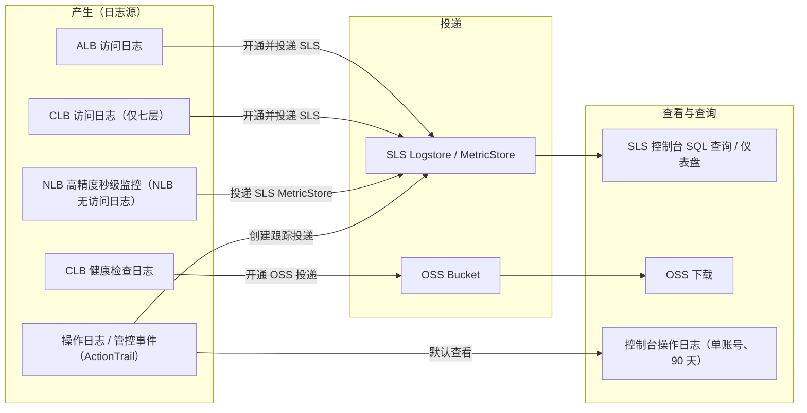

# SLB/ALB/NLB · 日志与审计

> 产品：SLB/ALB/NLB ｜ 口径：公共云 ｜ 复核：2026-11-18

## 日志流转图

**来源**
- ALB 访问日志（开通投递、计费与查询）：https://help.aliyun.com/zh/slb/application-load-balancer/access-logs ｜ 复核：2026-11-18
- CLB 存储和下载健康检查日志（OSS 投递）：https://help.aliyun.com/zh/slb/classic-load-balancer/user-guide/store-and-download-health-check-logs ｜ 复核：2026-11-18
- ALB 操作日志（跟踪投递与事件高级查询）：https://help.aliyun.com/zh/slb/application-load-balancer/audit-events ｜ 复核：2026-11-18

## 日志类型总表

| 类型 | 产生方 | 查看入口 | 默认保留期 | 是否计费 |
|---|---|---|---|---|
| 访问日志（ALB，七层 HTTP/HTTPS/QUIC，需开通并投递 SLS） | ALB + 日志服务 SLS | ALB 控制台 > 实例详情 > 访问日志（配置项目 Project 与日志库 Logstore） | 📋 待补（保留时间由 SLS Logstore 保存策略决定，ALB 文档未规定） | ALB 侧无额外费用；投递后由 SLS 按存储、读取流量、请求数、数据加工、数据投递计费 |
| 访问日志（CLB，仅七层 HTTP/HTTPS 监听，需开通并投递 SLS；四层 TCP/UDP 不支持） | CLB + SLS | CLB 控制台 > 日志管理 > 访问日志 | 📋 待补（同上，随 SLS Logstore 保存策略） | CLB 功能无需额外付费，仅需支付日志服务（SLS）费用 |
| 健康检查日志（CLB，需开通 OSS 投递长期存储） | CLB | CLB 控制台 > 日志管理 > 健康检查日志 | 控制台仅存 3 天；开通 OSS 后按小时生成文件长期存储 | 控制台查看不额外收费；长期存储投递到 OSS Bucket，按 [OSS](../oss/) 存储计费 |
| 秒级监控数据（NLB 高精度秒级监控、CLB 四层高精度秒级监控；ALB 秒级监控依托访问日志） | 负载均衡 + SLS | NLB 实例详情 > 高精度秒级监控；SLS MetricStore / Logstore | 📋 待补（随 SLS 侧存储策略） | 投递到 SLS 后按 SLS 计费规则收费 |
| 操作日志 / 管控事件（ActionTrail，ALB/CLB/NLB 均已接入） | 操作审计 ActionTrail | 各产品控制台 > 操作日志；或操作审计控制台 > 事件查询 | 控制台仅支持单账号、单地域、最近 90 天查询 | 管控事件查询免费；创建跟踪投递到 SLS/OSS 时按目标产品计费 |
| NLB 访问日志 | — | ⚠️ 待核（官方文档未提供 NLB 访问日志功能页；NLB 四层仅有秒级监控与操作日志） | — | — |

- 访问日志仅记录成功建立的 HTTP/HTTPS 请求，不记录 TCP 建联失败、端口扫描与 TLS 握手失败。
- 云监控（CloudMonitor）时序指标不属于日志，见 [09-监控与告警.md](09-监控与告警.md)。

**来源**
- ALB 访问日志（开通、计费、字段与限制）：https://help.aliyun.com/zh/slb/application-load-balancer/access-logs ｜ 复核：2026-11-17
- CLB 访问日志（七层限制、SLS 投递、计费）：https://help.aliyun.com/zh/slb/classic-load-balancer/user-guide/clb-access-logs ｜ 复核：2026-11-17
- CLB 存储和下载健康检查日志（默认 3 天、OSS 投递）：https://help.aliyun.com/zh/slb/classic-load-balancer/user-guide/store-and-download-health-check-logs ｜ 复核：2026-11-17
- NLB 高精度秒级监控（SLS MetricStore 投递与计费）：https://help.aliyun.com/zh/slb/network-load-balancer/user-guide/nlb-access-high-precision-second-monitoring-to-be-modified ｜ 复核：2026-11-17
- CLB 高精度秒级监控（四层监听秒级指标）：https://help.aliyun.com/zh/slb/classic-load-balancer/user-guide/configure-fine-grained-monitoring ｜ 复核：2026-11-17
- ALB 操作日志（ActionTrail 集成、90 天查询）：https://help.aliyun.com/zh/slb/application-load-balancer/audit-events ｜ 复核：2026-11-17
- NLB 操作日志（ActionTrail 集成、90 天查询）：https://help.aliyun.com/zh/slb/network-load-balancer/user-guide/view-operation-logs-of-nlb ｜ 复核：2026-11-17
- CLB 查看操作日志（ActionTrail 集成）：https://help.aliyun.com/zh/slb/classic-load-balancer/user-guide/view-operation-logs ｜ 复核：2026-11-17
- 操作审计计费说明：https://help.aliyun.com/zh/actiontrail/product-overview/billing-1 ｜ 复核：2026-11-17
- NLB 文档目录（无访问日志条目）：https://help.aliyun.com/zh/slb/network-load-balancer/llms.txt ｜ 复核：2026-11-17

## 关键日志详表

**A. ALB 访问日志（SLS 字段，标准版）**

| 字段 | 类型/示例 | 含义 |
|---|---|---|
| `time` | `YYYY-MM-DDThh:mm:ssZ` | 日志记录时间，格式 `YYYY-MM-DDThh:mm:ssZ` |
| `client_ip` / `client_port` | IP 地址 / 端口号 | 请求客户端 IP 与端口（五元组源地址；未开启「查找真实客户端源 IP」时为上一跳 IP） |
| `vip_addr` / `slb_vport` | 虚拟 IP / 监听端口号 | 虚拟 IP 与监听端口（五元组目的地址与目的端口） |
| `scheme` / `server_protocol` | HTTP/HTTPS；协议版本 📋 待补 | 请求协议（HTTP/HTTPS）与 HTTP 协议版本（五元组协议） |
| `request_method` / `request_uri` | 📋 待补 | 请求方法与请求 URI |
| `status` / `upstream_status` | 状态码 | 负载均衡应答状态码 / 后端服务器响应状态码（响应码） |
| `request_time` | 数值（单位：秒） | 收到第一个请求报文到返回应答的总耗时（RT），单位：秒 |
| `upstream_response_time` | 数值（单位：秒） | 与后端建立连接到接收完数据关闭连接的耗时，单位：秒 |

- 另有 `client_ip` 外的来源字段 `http_x_forwarded_for`、`body_bytes_sent`、`upstream_addr`、`ssl_protocol`、`ssl_cipher` 等；自定义 header 记入 `slb_headers`（默认 1 KB，最大 8 KB）。

**B. CLB 访问日志（SLS 字段，仅七层）**

| 字段 | 类型/示例 | 含义 |
|---|---|---|
| `slbid` | 实例 ID | 负载均衡实例 ID（多实例共用 Logstore 时必须与 `slb_vport` 一起过滤） |
| `client_ip` / `client_port` | IP 地址 / 端口号 | 网络层观测到的连接源 IP 与端口；统计访问来源以 `client_ip` 为准（`http_x_forwarded_for` 可能被伪造） |
| `slb_vport` | 监听端口号 | 监听端口 |
| `http_host` | 📋 待补 | 请求报文 host header 内容 |
| `request_method` / `request_uri` | 📋 待补 | 请求方法与请求 URI |
| `status` / `upstream_status` | 状态码 | 应答状态码 / 后端响应状态码 |
| `request_time` | 数值（单位：秒） | 收到首包到返回应答的总耗时，单位：秒 |
| `upstream_response_time` | 数值（单位：秒） | 与后端建立连接到接收完数据的耗时，单位：秒 |

- 访问日志不含服务器组 ID 或转发策略 ID；命中判断需结合 `request_uri`、`host` 与控制台转发策略比对。

**C. 管控事件（ActionTrail，ALB/CLB/NLB 通用）**

| 字段 | 类型/示例 | 含义 |
|---|---|---|
| `eventTime` | UTC 时间格式 | 事件发生时间（UTC 格式） |
| `eventName` | 如 CreateLoadBalancer、CreateListener、SetLoadBalancerStatus | 事件名称（如 CreateLoadBalancer、CreateListener、SetLoadBalancerStatus） |
| `eventType` | ApiCall / ConsoleOperation / ConsoleSignin / ConsoleSignout 等 | 事件类型：ApiCall / ConsoleOperation / ConsoleSignin / ConsoleSignout 等 |
| `eventRW` | Read / Write | 事件读写类型：Read / Write |
| `sourceIpAddress` | IP 地址 | 事件发起的源 IP 地址 |
| `userIdentity` | root-account / RAM 用户 | 请求者身份（root-account / RAM 用户等；操作日志页展示为操作者名称） |
| `errorCode` | 错误码 | 云服务处理 API 请求发生错误时记录的错误码 |

**D. CLB 健康检查日志**

| 字段/内容 | 类型/示例 | 含义 |
|---|---|---|
| 生成条件 | 每小时一次 | 仅检查到后端 ECS 异常时生成；每小时生成一次，1 小时内无异常则无日志 |
| 日志文件 | OSS 路径，如 `20220907/00.txt` | OSS 路径 `AliyunSLBHealthCheckLogs/<日期>/<小时>.txt`（如 `20220907/00.txt`） |
| 检查对象与状态 | abnormal / normal | `SLB_instance_IP:port to Added_ECS_instance_IP:port abnormal; cause:XXX`（异常）/ `... normal`（恢复正常） |
| `cause` | 📋 待补 | 健康检查异常原因 |

**来源**
- ALB 访问日志（日志字段说明-标准版）：https://help.aliyun.com/zh/slb/application-load-balancer/access-logs ｜ 复核：2026-11-17
- CLB 访问日志（字段表、client_ip 与 X-Forwarded-For、转发策略识别）：https://help.aliyun.com/zh/slb/classic-load-balancer/user-guide/clb-access-logs ｜ 复核：2026-11-17
- 管控事件结构定义：https://help.aliyun.com/zh/actiontrail/user-guide/management-event-structure ｜ 复核：2026-11-17
- CLB 操作日志（事件名称/事件源/操作者名称）：https://help.aliyun.com/zh/slb/classic-load-balancer/user-guide/view-operation-logs ｜ 复核：2026-11-17
- CLB 存储和下载健康检查日志（日志内容格式）：https://help.aliyun.com/zh/slb/classic-load-balancer/user-guide/store-and-download-health-check-logs ｜ 复核：2026-11-17

## 投递与加工

| 通道 | 去向与参数 | 关键限制 / 要点 | 计费要点 |
|---|---|---|---|
| ALB 访问日志投递 | ALB 控制台实例详情 > 访问日志，指定 SLS 项目 Project 与日志库 Logstore；系统自动创建服务关联角色 | 仅创建后采集，不支持回查历史；新建 Logstore 自动创建索引并开启仪表盘；仅记录成功建立的 HTTP/HTTPS 请求；扩展版不支持 `DualStack_` 秒级双栈指标与自定义 header | SLS 按存储空间、读取流量、请求数量、数据加工、数据投递计费 |
| CLB 访问日志投递 | CLB 控制台 > 日志管理 > 访问日志，设置 Project/Logstore（同地域） | 仅七层监听；首次需账号授权（RAM 用户需主账号授权）；仪表盘 `slb_layer7_access_center_cn`；多实例共用 Logstore 须按 `slbid` + `slb_vport` 过滤 | CLB 功能无需额外付费，仅 SLS 费用 |
| CLB 健康检查日志 → OSS | 开通 OSS 后授权日志角色 `SLBLogDefaultRole`（AliyunOSSFullAccess），按地域设置 Bucket | Bucket 需与 CLB 同地域；写入 `AliyunSLBHealthCheckLogs/` 文件夹，按日期/小时分文件；仅后端异常时产生记录 | OSS 存储按 [OSS](../oss/) 计费 |
| NLB 高精度秒级监控投递 | NLB 实例详情 > 高精度秒级监控，地域级开启并指定 Project + MetricStore | 系统自动创建角色 `AliyunServiceRoleForNLBLogDelivery`（勿删除）；数据约 5 秒延迟；仅统计开启后新建的连接；指标含 `actConns`/`connsPS`/`dropConnPS`/`totalConns` 等，支持 PromQL 与 SQL | SLS 按存储、读取流量、请求数量、加工、投递计费 |
| 操作审计投递 | 创建跟踪 → SLS LogStore / OSS Bucket；跨账号可创建多账号跟踪统一投递 | 控制台仅查单账号单地域 90 天；跨账号、跨地域、更长留存与自定义 SQL 用「事件高级查询」 | 管控事件查询免费，投递目标按各自定价计费 |
| 查询与下游加工 | SLS 控制台 SQL 查询/分析、仪表盘、下载、投递、告警；ALB 访问日志内建监控中心、访问中心、秒级监控报表 | ALB「报警设置」跳转 CloudLens for ALB 查看告警事务；字段级查询前需为字段创建索引 | 查询/索引/告警按 SLS 计费规则 |

- 采样与过滤：ALB/CLB 访问日志按全量采集（无采样参数），查询侧用 `field:value` 与 SQL 过滤；ALB 自定义 header 经 `记录自定义header设置` 按监听开启。

**来源**
- ALB 访问日志（创建/计费/自定义 header/查询示例）：https://help.aliyun.com/zh/slb/application-load-balancer/access-logs ｜ 复核：2026-11-17
- CLB 访问日志（设置/授权/共用 Logstore/仪表盘）：https://help.aliyun.com/zh/slb/classic-load-balancer/user-guide/clb-access-logs ｜ 复核：2026-11-17
- CLB 存储和下载健康检查日志（角色与 OSS 路径）：https://help.aliyun.com/zh/slb/classic-load-balancer/user-guide/store-and-download-health-check-logs ｜ 复核：2026-11-17
- NLB 高精度秒级监控（MetricStore/角色/延迟/指标）：https://help.aliyun.com/zh/slb/network-load-balancer/user-guide/nlb-access-high-precision-second-monitoring-to-be-modified ｜ 复核：2026-11-17
- ALB 操作日志（跟踪投递与事件高级查询）：https://help.aliyun.com/zh/slb/application-load-balancer/audit-events ｜ 复核：2026-11-17
- 创建多账号跟踪：https://help.aliyun.com/zh/actiontrail/user-guide/create-a-multi-account-trail ｜ 复核：2026-11-17
- 什么是日志服务 SLS：https://help.aliyun.com/zh/sls/what-is-log-service ｜ 复核：2026-11-17

## 审计与合规

| 项 | 官方口径 |
|---|---|
| 接入方式 | ALB、NLB、CLB 均已接入操作审计（ActionTrail），记录账号通过 OpenAPI、控制台等方式操作产生的管控事件 |
| 事件范围 | ALB 文档逐项列出 CreateLoadBalancer、CreateListener、CreateRule、UpdateListenerAttribute、EnableLoadBalancerAccessLog 等实例/监听/服务器组/转发规则/ACL/证书/安全策略事件；NLB 列出 CreateLoadBalancer、DeleteListener、LoadBalancerJoinSecurityGroup 等 40+ 事件；CLB 控制台按事件名称（如 SetLoadBalancerStatus）筛选 |
| 查询与留痕保留 | 控制台仅支持单账号、单地域、最近 90 天内的事件查询，且查询条件只支持单个属性 |
| 长期保存与跨账号 | 跨账号、跨地域、更长时长与多属性/自定义 SQL 查询：先创建跟踪投递，再用「事件高级查询」；投递目标为 SLS LogStore 或 OSS Bucket |
| 可筛选属性 | 读写类型、事件名称、操作者名称、资源类型、资源名称、事件类型、是否敏感操作 |
| 配置审计 | 负载均衡侧未见配置审计（Cloud Config）接入文档 ⚠️ 待核 |
| 计费 | 管控事件查询本身免费；通过跟踪投递到 SLS/OSS 按目标产品定价单独付费 |

**来源**
- ALB 操作日志（审计事件清单与 90 天查询）：https://help.aliyun.com/zh/slb/application-load-balancer/audit-events ｜ 复核：2026-11-17
- NLB 操作日志（40+ 管控事件与投递）：https://help.aliyun.com/zh/slb/network-load-balancer/user-guide/view-operation-logs-of-nlb ｜ 复核：2026-11-17
- CLB 查看操作日志（ActionTrail 集成与筛选）：https://help.aliyun.com/zh/slb/classic-load-balancer/user-guide/view-operation-logs ｜ 复核：2026-11-17
- 什么是操作审计 ActionTrail：https://help.aliyun.com/zh/actiontrail/product-overview/what-is-actiontrail ｜ 复核：2026-11-17
- 操作审计使用限制：https://help.aliyun.com/zh/actiontrail/product-overview/limits ｜ 复核：2026-11-17
- 操作审计计费说明：https://help.aliyun.com/zh/actiontrail/product-overview/billing-1 ｜ 复核：2026-11-17
- 管控事件结构定义：https://help.aliyun.com/zh/actiontrail/user-guide/management-event-structure ｜ 复核：2026-11-17
