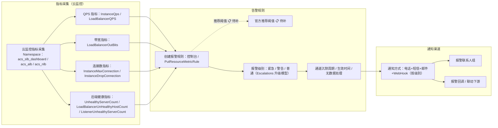

# SLB/ALB/NLB · 监控与告警

> 产品：SLB/ALB/NLB ｜ 口径：公共云 ｜ 复核：2026-11-18

## 告警链路图

**来源**
- ALB 监控与报警（Namespace acs_alb、指标与维度）：https://help.aliyun.com/zh/slb/application-load-balancer/alb-monitoring-metrics ｜ 复核：2026-11-18
- CLB 监控（Namespace acs_slb_dashboard、指标与维度）：https://help.aliyun.com/zh/slb/classic-load-balancer/user-guide/monitoring-and-alerting-metrics ｜ 复核：2026-11-18
- NLB 监控（Namespace acs_nlb、指标与维度）：https://help.aliyun.com/zh/slb/network-load-balancer/user-guide/nlb-monitoring-metrics ｜ 复核：2026-11-18
- 创建报警规则（PutResourceMetricRule、Escalations、沉默周期/生效时间/无数据/回调/联系人组/联动）：https://help.aliyun.com/zh/cms/cloudmonitor-1-0/user-guide/create-an-alert-rule ｜ 复核：2026-11-18
- 报警规则概述（电话/短信/邮件/Webhook/App）：https://help.aliyun.com/zh/cms/cloudmonitor-1-0/user-guide/overview-2 ｜ 复核：2026-11-18

## 核心监控指标

三型接入云监控（CloudMonitor），Namespace 各不相同：CLB 为 `acs_slb_dashboard`，ALB 为 `acs_alb`，NLB 为 `acs_nlb`。
- Period 默认 60 秒，也可为 60 的整数倍；监控数据存储时长与 Period 有关（Period=60s 存 31 天，见 [09 告警配额](#告警配额)）。
- ALB 双栈指标可带 `DualStack_` 前缀按 IPv4/IPv6 分别统计；ALB 监控按实例、监听、VIP（可用区）、转发规则、服务器组分维度。

| 型号 | 指标（英文名） | 含义 | 单位 | 统计周期 | 维度 |
|---|---|---|---|---|---|
| CLB | `InstanceQps` | 实例每秒可处理的 HTTP/HTTPS 请求数（七层） | Count/s | 60s | instanceId |
| CLB | `InstanceMaxConnection` | 实例处理的所有 TCP 和 UDP 连接数量（并发连接） | Count | 60s | instanceId |
| CLB | `InstanceNewConnection` | 实例每秒处理的新建 TCP 和 UDP 连接数量 | Count/s | 60s | instanceId |
| CLB | `InstanceDropConnection` | 实例每秒丢失的 TCP 和 UDP 连接数量（丢弃连接） | Count/s | 60s | instanceId |
| CLB | `Rt` | 该监听端口从客户端发请求到后端返回响应的时间（七层 RT） | ms | 60s | instanceId、port、vip |
| CLB | `UnhealthyServerCount` | 该监听端口健康检查异常的后端 ECS 数量 | Count | 60s | instanceId、port、vip |
| ALB | `LoadBalancerQPS` | ALB 实例每秒处理的所有请求数 | Count/s | 60s | userId、loadBalancerId |
| ALB | `LoadBalancerRejectedConnection` | ALB 实例每秒主动丢弃连接请求的数量 | Count/s | 60s | userId、loadBalancerId |
| ALB | `LoadBalancerUnHealthyHostCount` | ALB 实例健康检查异常状态的服务器数量 | Count | 60s | userId、loadBalancerId |
| ALB | `LoadBalancerRequestTime` | 收到第一个请求报文到返回应答之间的时间间隔 | ms | 60s | userId、loadBalancerId |
| ALB | `LoadBalancerOutBits` | ALB 实例访问外部所消耗的带宽（出带宽） | bit/s | 60s | userId、loadBalancerId |
| NLB | `InstanceNewConnection` | NLB 实例每秒处理的新建 TCP 和 UDP 连接数量 | Count/s | 60s | userId、instanceId |
| NLB | `InstanceDropConnection` | NLB 实例每秒丢失的 TCP 和 UDP 连接数量 | Count/s | 60s | userId、instanceId |
| NLB | `InstanceMaxConnection` | NLB 实例处理的所有 TCP 和 UDP 连接数量 | Count | 60s | userId、instanceId |
| NLB | `ListenerUnhealthyServerCount` | 该监听端口健康检查异常的实例数量 | Count | 60s | userId、instanceId、listenerPort、listenerProtocol |

- 三型差异：QPS/状态码/RT 类指标仅 ALB 与 CLB（七层）提供，NLB 为四层连接/流量指标；健康检查指标 CLB 为 `UnhealthyServerCount`/`HeathyServerCount`（官方拼写如此），ALB 为 `LoadBalancerUnHealthyHostCount`，NLB 为 `ListenerUnhealthyServerCount`。
- 秒级补充：NLB 高精度秒级监控提供 `actConns`、`connsPS`、`dropConnPS`、`failConnPS`、`totalConns`、`flow_in_rx_bps` 等 SLS 时序指标（约 5 秒延迟）；CLB 四层高精度秒级监控提供 `actConnsPS`/`connsPS`/`inBitsPS` 等。

**来源**
- ALB 监控与报警（Namespace acs_alb、Period、指标与维度）：https://help.aliyun.com/zh/slb/application-load-balancer/alb-monitoring-metrics ｜ 复核：2026-11-17
- CLB 监控（Namespace acs_slb_dashboard、指标与维度）：https://help.aliyun.com/zh/slb/classic-load-balancer/user-guide/monitoring-and-alerting-metrics ｜ 复核：2026-11-17
- NLB 监控（Namespace acs_nlb、指标与维度）：https://help.aliyun.com/zh/slb/network-load-balancer/user-guide/nlb-monitoring-metrics ｜ 复核：2026-11-17
- NLB 高精度秒级监控（秒级指标）：https://help.aliyun.com/zh/slb/network-load-balancer/user-guide/nlb-access-high-precision-second-monitoring-to-be-modified ｜ 复核：2026-11-17
- CLB 高精度秒级监控（四层秒级指标）：https://help.aliyun.com/zh/slb/classic-load-balancer/user-guide/configure-fine-grained-monitoring ｜ 复核：2026-11-17
- 云监控使用限制（监控数据存储时长与 Period）：https://help.aliyun.com/zh/cms/cloudmonitor-1-0/product-overview/restrictions-on-use ｜ 复核：2026-11-17

## 官方默认与推荐告警

- 指标阈值类告警（QPS、带宽、连接数、丢弃连接、后端健康状态、状态码等）：**官方未发布推荐阈值** 📋 待补。三型文档仅提供创建报警规则的操作流程（控制台或 `PutResourceMetricRule` API），未给出 SLB 专属的默认规则或推荐阈值；按阈值红线不收经验值。

| 型号 | 官方文档明确的告警行为 | 阈值状态 |
|---|---|---|
| CLB | 健康检查异常不会自动触发报警通知，需在云监控手动创建报警规则并选择健康检查指标（`UnhealthyServerCount`/`HeathyServerCount`）设置阈值 | 官方未发布推荐阈值 📋 待补 |
| ALB | 云监控控制台「报警规则」创建阈值报警，资源范围可选全部资源/应用分组/实例 | 官方未发布推荐阈值 📋 待补 |
| NLB | 云监控控制台或 `PutResourceMetricRule`（Namespace `acs_nlb`）配置报警规则，报警级别分紧急（Critical）/警告（Warn）/普通（Info） | 官方未发布推荐阈值 📋 待补 |

- 报警级别采用升级（Escalations）模型：阈值达到某级别时仅触发该级别报警，不连带触发其他级别。
- 报警级别对应通知方式（官方定义）：紧急 = 电话+短信+邮件+WebHook；警告 = 短信+邮件+WebHook；普通 = 邮件+WebHook；仅紧急级别支持电话。

**来源**
- CLB 报警规则设置（健康检查不自动告警、指标与手动配置）：https://help.aliyun.com/zh/slb/classic-load-balancer/user-guide/configure-alert-rules ｜ 复核：2026-11-17
- ALB 监控与报警（创建报警规则流程）：https://help.aliyun.com/zh/slb/application-load-balancer/alb-monitoring-metrics ｜ 复核：2026-11-17
- NLB 监控报警规则配置（控制台/API、报警级别）：https://help.aliyun.com/zh/slb/network-load-balancer/user-guide/configure-alert-rules-for-nlb-metricscs ｜ 复核：2026-11-17
- 创建报警规则（Escalations 模型、级别与通知方式）：https://help.aliyun.com/zh/cms/cloudmonitor-1-0/user-guide/create-an-alert-rule ｜ 复核：2026-11-17

## 通知与渠道

| 渠道/机制 | 说明 |
|---|---|
| 报警服务渠道 | 报警服务支持电话、短信、邮件和 Webhook 地址；安装阿里云 App 可通过 App 接收报警通知 |
| 级别与通知方式 | 紧急（Critical）：电话+短信+邮件+WebHook；警告（Warn）：短信+邮件+WebHook；普通（Info）：邮件+WebHook；仅紧急支持电话 |
| 报警联系人组 | 创建报警规则时选择已绑定报警联系人的联系人组；API：`PutContact` 创建联系人、`PutContactGroup` 创建联系人组 |
| 资源范围 | 全部资源 / 应用分组 / 实例三种；重叠覆盖的规则独立评估、互不影响 |
| 通道沉默周期 | 报警未恢复时重复发送的间隔，取值：5 分钟、15 分钟、30 分钟、60 分钟、3 小时、6 小时、12 小时、24 小时 |
| 生效时间 | 报警规则仅在生效期内发送通知；不在生效期时仍记录报警历史 |
| 无数据处理 | 取值：不做任何处理（默认）、发送无数据报警、视为正常；触发无数据报警时按规则配置的最高级别通知 |
| 报警回调 | 公网可访问的 URL，云监控通过 POST 推送报警信息，目前仅支持 HTTP 协议 |
| 联动下游 | 弹性伸缩（触发伸缩规则）、函数计算、日志服务（写入 Logstore）、轻量消息队列（原 MNS）Topic |
| 产品侧入口 | CLB：实例监控面板 >「阈值报警设置」跳转云监控报警规则页；ALB/NLB：云监控控制台 > 报警服务 > 报警规则 |
| SLS 侧告警 | ALB 访问日志页「报警设置」跳转 CloudLens for ALB 查看告警事务 |
| 告警升级策略 | 官方定义为 Escalations 级别模型（达紧急仅触发紧急）；未见 SLB 专属的多级升级/值班轮转策略 📋 待补 |

**来源**
- 创建报警规则（沉默周期/生效时间/无数据处理/回调/联系人组/联动）：https://help.aliyun.com/zh/cms/cloudmonitor-1-0/user-guide/create-an-alert-rule ｜ 复核：2026-11-17
- 报警规则概述（电话/短信/邮件/Webhook/App）：https://help.aliyun.com/zh/cms/cloudmonitor-1-0/user-guide/overview-2 ｜ 复核：2026-11-17
- NLB 监控报警规则配置（级别通知方式/资源范围/API 流程）：https://help.aliyun.com/zh/slb/network-load-balancer/user-guide/configure-alert-rules-for-nlb-metricscs ｜ 复核：2026-11-17
- CLB 报警规则设置（实例面板阈值报警入口）：https://help.aliyun.com/zh/slb/classic-load-balancer/user-guide/configure-alert-rules ｜ 复核：2026-11-17
- ALB 访问日志（CloudLens for ALB 报警设置）：https://help.aliyun.com/zh/slb/application-load-balancer/access-logs ｜ 复核：2026-11-17

## 告警配额

| 限制项 | 最大值 | 归属 |
|---|---|---|
| 单账号可新建的报警规则数量 | 10,000 条 | 基础云监控 |
| 单账号可新建的动态规则数量 | 1,200 个 | 基础云监控 |
| 单账号可新建的应用分组数量 | 20,000 个 | 基础云监控 |
| 一个应用分组内允许新建的可用性监控数量 | 500 个 | 基础云监控 |
| 一个应用分组内包含的每种资源数量 | 3,000 个 | 基础云监控 |
| 通过标签创建应用分组时一个地域允许添加的标签数量 | 100 个 | 基础云监控 |
| 可管理的非阿里云主机数量 | 15,000 个 | 基础云监控 |
| 监控数据存储时长（Period < 60 秒） | 7 天 | 基础云监控 |
| 监控数据存储时长（Period = 60 秒） | 31 天 | 基础云监控 |
| 监控数据存储时长（Period ≥ 300 秒） | 91 天 | 基础云监控 |
| 单账号可新建的 PromQL 报警规则数量 | 20 条 | 企业云监控 |
| 单账号可新建的指标仓库数量 | 30 个 | 企业云监控 |
| 单账号可新建的 SLS Logstore 组数量 | 20 个（每组最多 25 个 Logstore） | 企业云监控 |
| 一个智能水位分析任务可设置的报警联系人组数量 | 5 个 | 企业云监控 |
| 一个智能守护任务可添加的资源数量 | 100 个 | 企业云监控 |
| 报警联系人 / 报警联系人组的数量上限 | 📋 待补（官方使用限制页未列出该配额） | 基础云监控 |

**来源**
- 云监控使用限制（报警规则/应用分组/存储时长/企业云监控配额）：https://help.aliyun.com/zh/cms/cloudmonitor-1-0/product-overview/restrictions-on-use ｜ 复核：2026-11-17
- 创建报警规则（报警联系人组）：https://help.aliyun.com/zh/cms/cloudmonitor-1-0/user-guide/create-an-alert-rule ｜ 复核：2026-11-17
