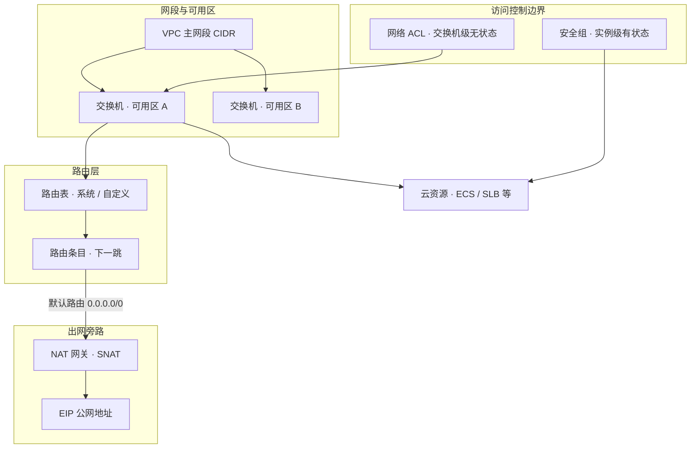

# VPC · 产品架构

> 产品：VPC ｜ 口径：公共云 ｜ 复核：2026-11-18

## 产品定义

专有网络 VPC（Virtual Private Cloud）是云上安全隔离的虚拟网络环境，支持自定义网络配置、部署和访问云产品资源。

- 不同 VPC 之间二层逻辑隔离。
- 用户可完全掌控：选择 IP 地址范围、创建交换机、配置路由表和网关。
- VPC 是**地域级别**资源，不支持跨地域部署。
- 官方优势表述：安全隔离（隧道技术）、稳定可靠（网络多路径检测和切换、故障快速切换自愈）、灵活易用、互联互通。

**来源**
- 什么是专有网络VPC：https://help.aliyun.com/zh/vpc/what-is-vpc
- 专有网络VPC（ECS 视角）：https://help.aliyun.com/zh/ecs/user-guide/vpc
- 复核：2026-11-18

## 架构图

**来源**
- 什么是专有网络VPC（私网网段、交换机、路由表三部分）：https://help.aliyun.com/zh/vpc/what-is-vpc ｜ 复核：2026-11-17
- VPC 技术原理与功能架构（交换机、路由表、网络 ACL、IPv4 网关）：https://help.aliyun.com/zh/vpc/service-architecture ｜ 复核：2026-11-17
- VPC 路由表（系统/自定义路由表与路由条目下一跳）：https://help.aliyun.com/zh/vpc/vpc-route-table ｜ 复核：2026-11-17
- VPC 公网访问（EIP、NAT 网关 SNAT 出网旁路）：https://help.aliyun.com/zh/vpc/public-network-access ｜ 复核：2026-11-17
- 安全组与网络 ACL 对比（实例级有状态 / 交换机级无状态）：https://help.aliyun.com/zh/vpc/access-control ｜ 复核：2026-11-17

## 组件清单

| 组件 | 作用 | 必选/可选 | 是否独立计费 | 备注 |
|---|---|---|---|---|
| 专有网络 VPC | 云上安全隔离的虚拟网络，提供私网网段与路由器 | 必选 | 否（VPC 本身免费） | 地域级资源，不支持跨地域部署；每 VPC 自动创建 1 个路由器 |
| 交换机 vSwitch | 可用区级子网，划分地址空间并部署云资源、分配 IP | 必选 | 否（免费功能） | 单 VPC 默认最多 150 个；每交换机必须绑定 1 张路由表 |
| 路由表 | 决定流量转发路径，绑定交换机生效 | 必选（系统自动创建） | 否（免费功能） | 分系统/自定义/网关路由表三类；每路由器至少关联 1 张 |
| 路由条目 | 路由表内的具体转发规则（目的网段 + 下一跳） | 必选（系统路由自动创建） | 否（免费功能） | 单路由表自定义条目默认 200 条；下一跳可指向 NAT 网关、ECS、对等连接等 |
| 安全组 | 实例级虚拟防火墙，有状态自动放行回包 | 必选（实例至少关联 1 个） | 否（普通/企业级安全组均免费） | 与网络 ACL 的对比见 [03-VPC 参数](03-VPC 参数.md) |
| 网络 ACL | 交换机级访问控制，无状态，回包需单独放行 | 可选 | 否（免费功能） | 每个交换机仅允许绑定 1 个；仅对绑定交换机内弹性网卡生效 |
| 弹性公网 IP（EIP） | 独立购买持有的公网 IPv4 地址，动态绑定/解绑云资源 | 可选 | 是（按量付费/包年包月） | 1 个 EIP 仅绑 1 个资源；参数见 [04-配套参数](04-配套参数.md) |
| NAT 网关（关联） | SNAT 多实例共享 EIP 出网、DNAT 端口映射入网 | 可选（关联产品） | 是 | 强关联产品：[NAT](../nat/README)；出网旁路见 [05-网络参数](05-网络参数.md) |
| 负载均衡 SLB（关联） | 统一公网流量入口，分发流量到多可用区后端 | 可选（关联产品） | 是 | 强关联产品：[SLB](../slb/README)；官方推荐 ALB/NLB 作为公网入口 |

**来源**
- 什么是专有网络VPC（三部分组成、VPC 免费）：https://help.aliyun.com/zh/vpc/what-is-vpc ｜ 复核：2026-11-17
- VPC 产品计费（免费功能含交换机、路由表、网络 ACL；收费功能清单）：https://help.aliyun.com/zh/vpc/vpc-product-billing ｜ 复核：2026-11-17
- VPC 路由表（路由条目与下一跳类型）：https://help.aliyun.com/zh/vpc/vpc-route-table ｜ 复核：2026-11-17
- VPC 限制与配额（交换机 150 个、路由条目 200 条）：https://help.aliyun.com/zh/vpc/understanding-vpc-quotas-in-alibaba-cloud ｜ 复核：2026-11-17
- 安全组与网络 ACL 对比（有状态/无状态、绑定关系）：https://help.aliyun.com/zh/vpc/access-control ｜ 复核：2026-11-17
- 网络 ACL 概述（每交换机仅绑 1 个、仅对绑定交换机内弹性网卡生效）：https://help.aliyun.com/zh/vpc/network-acl-overview ｜ 复核：2026-11-17
- 安全组概述（实例至少关联 1 个、两类安全组均免费）：https://help.aliyun.com/zh/ecs/user-guide/overview-44 ｜ 复核：2026-11-17
- 弹性公网 IP 概述（独立持有、动态绑定、按量/包月计费）：https://help.aliyun.com/zh/eip/product-overview/what-is-eip ｜ 复核：2026-11-17
- VPC 公网访问（负载均衡统一入口、NAT 网关 SNAT 出口）：https://help.aliyun.com/zh/vpc/public-network-access ｜ 复核：2026-11-17
- 负载均衡产品概述（ALB/NLB/CLB 形态与计费入口）：https://help.aliyun.com/zh/slb/product-overview ｜ 复核：2026-11-17

## 组件关系

每个 VPC 至少由三部分组成：私网网段、交换机、路由表（ECS 文档口径为：私网网段 + 路由器 vRouter + 交换机 vSwitch）。

| 组件 | 层级 | 作用 | 关键事实 |
|---|---|---|---|
| 私网网段（CIDR） | 地域级 | VPC 与交换机的 IP 分配来源 | 需以 CIDR 地址块指定，需合理规划 |
| 路由器（vRouter） | 地域级 | 连接 VPC 内各交换机，兼作连外部网络的网关设备 | 每个 VPC 创建后系统自动创建 1 个路由器；每个路由器至少关联 1 张路由表 |
| 路由表 | 地域级 | 决定流量转发路径 | 创建 VPC 时系统自动创建 1 张系统路由表并添加系统路由 |
| 交换机（vSwitch） | 可用区级 | 划分子网、部署云资源、提供 IP 地址 | 同一 VPC 内不同交换机之间内网互通 |
| EIP | 地域级（独立资源） | 为云资源提供公网访问能力 | 独立购买持有，可动态绑定/解绑 |

- 交换机绑定关系：每个交换机必须绑定路由表，且只能绑定 1 张路由表；1 张路由表可绑定多个交换机。
- 路由器数量配额：单个 VPC 支持创建的路由器数量 = 1 个，无法提升。

**来源**
- 专有网络VPC（ECS 视角）：https://help.aliyun.com/zh/ecs/user-guide/vpc
- VPC路由表：https://help.aliyun.com/zh/vpc/vpc-route-table
- 限制与配额：https://help.aliyun.com/zh/vpc/understanding-vpc-quotas-in-alibaba-cloud
- 复核：2026-11-18

## CIDR 规划

| 规则项 | 数值 |
|---|---|
| 建议网段 | RFC1918 私有 IPv4 地址，掩码 16~28 位（10.0.0.0/16、172.16.0.0/16、192.168.0.0/16） |
| 禁用网段 | 100.64.0.0/10、224.0.0.0/4、127.0.0.0/8、169.254.0.0/16 及其子网 |
| 附加 IPv4 网段 | 默认 5 个（不能与主网段重叠，同样受禁用网段约束） |
| 附加 IPv6 网段 | 默认 5 个 |
| 主网段修改 | 控制台不支持修改；API ModifyVpcAttribute 可在主网段内放大/缩小 |
| 交换机网段修改 | 交换机的 IPv4/IPv6 网段均不支持修改 |

标准私网网段可用 IP 数（不包括系统保留地址）：

| 网段 | 可用私网 IP 数量 |
|---|---|
| 192.168.0.0/16 | 65,532 |
| 172.16.0.0/12 | 1,048,572 |
| 10.0.0.0/8 | 16,777,212 |

**来源**
- 专有网络与交换机：https://help.aliyun.com/zh/vpc/vpc-and-vswitch
- 专有网络VPC（ECS 视角）：https://help.aliyun.com/zh/ecs/user-guide/vpc
- 限制与配额：https://help.aliyun.com/zh/vpc/understanding-vpc-quotas-in-alibaba-cloud
- 复核：2026-11-18

## 可靠性与 SLA

- 官方可靠性表述：支持网络多路径检测和切换，支持网络故障快速切换自愈（未给出具体可用性百分比）。
- 高可用建议（官方）：创建分布在不同可用区的多个交换机，避免应用受单可用区故障影响。
- 关联产品 SLA（非 VPC 本体）：公网 NAT 网关单可用区 99.95%、多可用区 99.995%；VPC 流日志、流量镜像各有独立 SLA。
- VPC 本体无独立 SLA（2026-11-18 复查）：阿里云《服务等级协议汇总》「网络与CDN > 云上网络」分类仅列 IPv6 网关、NAT 网关、VPC 流日志、VPC 流量镜像、PrivateZone、共享带宽、弹性公网 IP、私网连接、负载均衡等条目，无「专有网络 VPC 服务等级协议」；官方《VPC 服务协议与 SLA》页亦仅收录服务条款、VPC 流日志 SLA、VPC 流量镜像 SLA、跨地域对等连接可用性承诺四份协议。故 VPC 本体可用性无数值承诺。

**来源**
- 什么是专有网络VPC：https://help.aliyun.com/zh/vpc/what-is-vpc
- 功能特性（NAT SLA）：https://help.aliyun.com/zh/nat-gateway/product-overview/product-function-custom-node-nat-normal
- 服务等级协议汇总（云上网络分类条目清单）：https://help.aliyun.com/knowledge_detail/56773.html ｜ 复核：2026-11-18
- VPC 服务协议与 SLA（仅四份协议）：https://help.aliyun.com/zh/vpc/vpc-terms-of-service ｜ 复核：2026-11-18
- 复核：2026-11-18
