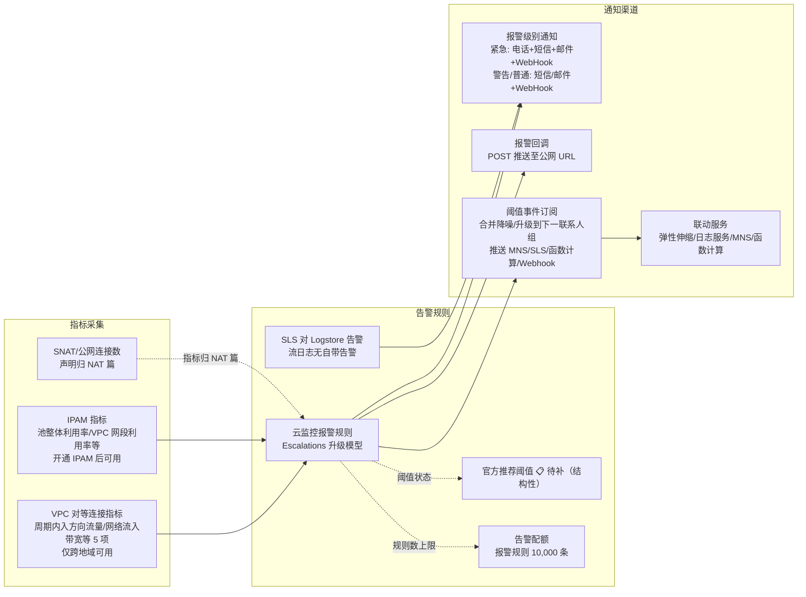

# VPC · 监控与告警

> 产品：VPC ｜ 口径：公共云 ｜ 复核：2026-11-18

## 告警链路图

**来源**
- VPC 监控与日志（可监控指标清单、阈值报警入口、订阅阈值事件）：https://help.aliyun.com/zh/vpc/monitoring-and-logging ｜ 复核：2026-11-18
- VPC 对等连接（监控指标项、创建报警规则与报警历史、Terraform 阈值示例）：https://help.aliyun.com/zh/vpc/vpc-peer-to-peer-connection ｜ 复核：2026-11-18
- 创建报警规则（Escalations 升级模型、级别与通知方式、报警回调、联动服务）：https://help.aliyun.com/zh/cms/cloudmonitor-1-0/user-guide/create-an-alert-rule ｜ 复核：2026-11-18
- 云监控使用限制（报警规则等配额、监控数据存储时长）：https://help.aliyun.com/zh/cms/cloudmonitor-1-0/product-overview/restrictions-on-use ｜ 复核：2026-11-18

## 核心监控指标

VPC 已接入基础云监控（免费），但 **VPC 自有可监控指标偏少**：官方「VPC 监控与日志」页列出的可监控指标仅 VPC 对等连接与 IPAM 两类，VPC 实例/交换机/路由表本身无官方指标清单。SNAT、公网连接数等经 NAT 网关的指标归 [NAT](../nat/README) 篇，EIP 流入/流出带宽见 [04-配套参数](04-配套参数.md) 的 EIP 口径，本篇只收 VPC 自有指标。

| 指标（官方英文名） | 含义 | 单位 | 统计周期 | 维度 |
|---|---|---|---|---|
| 周期内入方向流量（英文名 ⚠️ 待核） | 一个统计周期内对等连接发起端发送到接收端的流量 | ⚠️ 待核（官方中文文档未标注单位） | 60 秒（官方示例 Period） | VPC 对等连接实例（`acs_vpcpeer`，维度 `instanceId`） |
| 周期内出方向流量（英文名 ⚠️ 待核） | 一个统计周期内对等连接接收端发送到发起端的流量 | ⚠️ 待核 | 60 秒（示例） | 同上 |
| 网络流入带宽（英文名 ⚠️ 待核） | 对等连接从发起端进入接收端的带宽 | ⚠️ 待核 | 60 秒（示例） | 同上 |
| 网络流出带宽（英文名 ⚠️ 待核） | 对等连接从接收端发往发起端的带宽 | ⚠️ 待核 | 60 秒（示例） | 同上 |
| 网络流出限速丢包数（英文名 ⚠️ 待核） | 对等连接实例出方向因带宽限速被丢弃的数据包速率 | ⚠️ 待核 | 60 秒（示例） | 同上 |
| 池整体利用率 / 池分配子池利用率 / 池分配资源利用率（英文名 ⚠️ 待核） | IPAM 地址池的利用率类指标 | %（据指标名，官方未标注 ⚠️ 待核） | ⚠️ 待核 | IPAM 地址池（`acs_vpcipam`，维度 `vpcipam_pool`） |
| VPC 利用率 / VPC IPv4 网段利用率 / VPC IPv6 网段利用率（英文名 ⚠️ 待核） | IPAM 资源（VPC）的网段利用率 | %（⚠️ 待核） | ⚠️ 待核 | IPAM 资源 VPC（`acs_vpcipam`，维度 `vpcipam_resource_vpc`） |
| 子网利用率 / 子网 IPv4 网段利用率 / 子网 IPv6 网段利用率（英文名 ⚠️ 待核） | IPAM 资源（VSwitch）的子网利用率 | %（⚠️ 待核） | ⚠️ 待核 | IPAM 资源交换机（`acs_vpcipam`，维度 `vpcipam_resource_vswitch`） |
| 作用范围内合规/不合规/重叠/托管 CIDR 数量等（英文名 ⚠️ 待核） | IPAM 作用范围内的 CIDR 合规统计 | 个（⚠️ 待核） | ⚠️ 待核 | IPAM 作用范围（`acs_vpcipam`，维度 `vpcipam_scope`） |

- 对等连接指标**仅跨地域对等连接可用**，同地域对等连接不支持查看监控指标。
- 官方 Terraform 示例中出现指标英文名 `IntranetRX`（Namespace `acs_vpcpeer`、period 60、dimension `instanceId`），但未给出与上表中文指标项的逐一对应关系，故英文名整体标 ⚠️ 待核。
- IPAM 指标仅在开通 IPAM 后可用；IPAM 公测期间免费。
- 指标元数据可在云监控控制台 metric-meta 页（`acs_vpcpeer/vpcpeer`、`acs_vpcipam/*`）查询，官方文档未系统列出英文名/单位/周期的按 ⚠️ 待核 标注。

**来源**
- VPC 监控与日志（可监控指标清单：对等连接 5 项、IPAM 各维度；基础云监控免费、阈值报警）：https://help.aliyun.com/zh/vpc/monitoring-and-logging ｜ 复核：2026-11-18
- VPC 对等连接（监控指标项说明、同地域无监控、Terraform 示例 Namespace `acs_vpcpeer` / metric `IntranetRX` / period 60 / dimension `instanceId`）：https://help.aliyun.com/zh/vpc/vpc-peer-to-peer-connection ｜ 复核：2026-11-18
- 云监控使用限制（Period 与监控数据存储时长）：https://help.aliyun.com/zh/cms/cloudmonitor-1-0/product-overview/restrictions-on-use ｜ 复核：2026-11-18

## 官方默认与推荐告警

- 指标阈值类告警（对等连接流量/带宽/限速丢包、IPAM 利用率等）：**官方未发布推荐阈值** 📋 待补（结构性）。官方文档仅提供创建阈值报警规则的入口与操作说明，未给出 VPC 专属的默认规则或推荐阈值；按阈值红线不收经验值。

| 场景 | 官方告警行为 | 阈值状态 |
|---|---|---|
| VPC 对等连接 | 在云监控控制台「报警规则」为监控指标项配置各报警级别阈值，触发后通知报警联系人组；可查报警历史时间线 | 官方未发布推荐阈值 📋 待补（结构性） |
| VPC 对等连接（文档示例） | 官方 Terraform 示例：Namespace `acs_vpcpeer`、metric `IntranetRX`、period 60、statistics `Sum`、comparison `>=`、threshold `104857600`、critical 级、生效时间 06:00-20:00 | 官方文档示例阈值（示例配置，非推荐值） |
| IPAM 指标 | 官方未给出告警配置示例或阈值 | 官方未发布推荐阈值 📋 待补（结构性） |
| 流日志相关 | 流日志无自带告警；可用 SLS 对 Logstore 建告警（SLS 告警渠道与阈值由用户配置） | 官方未发布推荐阈值 📋 待补（结构性） |

- 报警级别采用升级（Escalations）模型：阈值达到某级别时仅触发该级别报警，不连带触发其他级别。
- 云监控控制台入口：报警规则页 `cloudmonitornext.console.aliyun.com/alert/rule`。

**来源**
- VPC 对等连接（创建报警规则操作、报警历史、Terraform 阈值示例 threshold 104857600）：https://help.aliyun.com/zh/vpc/vpc-peer-to-peer-connection ｜ 复核：2026-11-18
- VPC 监控与日志（监控指标阈值报警入口）：https://help.aliyun.com/zh/vpc/monitoring-and-logging ｜ 复核：2026-11-18
- 创建报警规则（Escalations 升级模型、规则描述与级别）：https://help.aliyun.com/zh/cms/cloudmonitor-1-0/user-guide/create-an-alert-rule ｜ 复核：2026-11-18

## 通知与渠道

| 渠道/机制 | 说明 |
|---|---|
| 报警级别与通知方式 | 紧急（Critical）：电话+短信+邮件+WebHook；警告（Warn）：短信+邮件+WebHook；普通（Info）：邮件+WebHook |
| 通知载体 | 报警服务支持电话、短信、邮件和 Webhook 地址；安装阿里云 App 可通过 App 接收报警通知 |
| 报警回调 | 公网可访问的 URL，云监控通过 POST 推送报警信息，目前仅支持 HTTP 协议；控制台提供连通性测试 |
| 联动服务 | 弹性伸缩（触发伸缩规则）、日志服务（发送至 Logstore）、轻量消息队列 MNS（写入 Topic）、函数计算（格式处理） |
| 通道沉默周期 | 取值：5 分钟、15 分钟、30 分钟、60 分钟、3 小时、6 小时、12 小时、24 小时；沉默期内不重复发送，超期未恢复再次发送 |
| 生效时间 | 报警规则仅在生效期内发送通知；不在生效期不发通知但保留报警历史 |
| 无数据处理 | 取值：不做任何处理（默认）、发送无数据报警、视为正常；无数据报警按规则配置的最高级别通知 |
| 阈值事件订阅（VPC 文档口径） | 订阅阈值事件后可：合并降噪（条件控制报警有效性）、有效报警未恢复时自动发给下一个报警联系人组、自定义通知渠道级别与模板并推送至 MNS/SLS/函数计算/Webhook |
| 报警级别升级 | 官方未发布 VPC 专属的告警升级（Escalation）策略 📋 待补（结构性） |

**来源**
- 创建报警规则（级别与通知方式、通道沉默周期、生效时间、无数据处理、报警回调、弹性伸缩/MNS/函数计算/日志服务联动）：https://help.aliyun.com/zh/cms/cloudmonitor-1-0/user-guide/create-an-alert-rule ｜ 复核：2026-11-18
- 报警服务概览（电话/短信/邮件/Webhook/阿里云 App）：https://help.aliyun.com/zh/cms/cloudmonitor-1-0/user-guide/overview-2 ｜ 复核：2026-11-18
- VPC 监控与日志（订阅阈值事件：合并降噪、升级到下一联系人组、推送 MNS/SLS/FC/Webhook）：https://help.aliyun.com/zh/vpc/monitoring-and-logging ｜ 复核：2026-11-18

## 告警配额

| 限制项 | 最大值 | 归属 |
|---|---|---|
| 单账号可新建的报警规则数量 | 10,000 条 | 基础云监控 |
| 单账号可新建的动态规则数量 | 1,200 个 | 基础云监控 |
| 单账号可新建的应用分组数量 | 20,000 个 | 基础云监控 |
| 一个应用分组内允许新建的可用性监控数量 | 500 个 | 基础云监控 |
| 一个应用分组内包含的每种资源数量 | 3,000 个 | 基础云监控 |
| 应用分组按标签创建时单地域可添加的标签数量 | 100 个 | 基础云监控 |
| 监控数据存储时长（Period < 60 秒） | 7 天 | 基础云监控 |
| 监控数据存储时长（Period = 60 秒） | 31 天 | 基础云监控 |
| 监控数据存储时长（Period ≥ 300 秒） | 91 天 | 基础云监控 |
| 单账号可新建的报警模板数量 | 100 个（每模板最多 30 个监控项） | 基础云监控 |
| 单账号可新建的 PromQL 报警规则数量 | 20 条 | 企业云监控 |
| 单账号可新建的指标仓库数量 | 30 个 | 企业云监控 |
| 单账号可新建的 SLS Logstore 组数量 | 20 个（每组最多 25 个 Logstore） | 企业云监控 |
| 一个智能水位分析任务可设置的报警联系人组数量 | 5 个 | 企业云监控 |
| 报警联系人 / 报警联系人组的数量上限 | 📋 待补（结构性）（官方使用限制页未列出该配额） | 基础云监控 |

**来源**
- 云监控使用限制（报警规则/动态规则/应用分组/可用性监控/存储时长/企业云监控配额）：https://help.aliyun.com/zh/cms/cloudmonitor-1-0/product-overview/restrictions-on-use ｜ 复核：2026-11-18
- 创建报警模板（每账号 100 个模板、每模板 30 个监控项）：https://help.aliyun.com/zh/cms/cloudmonitor-1-0/user-guide/create-an-alert-template ｜ 复核：2026-11-18
- 企业云监控创建报警规则（PromQL 报警规则账号上限 20 条）：https://help.aliyun.com/zh/cms/cloudmonitor-1-0/user-guide/create-an-alert-rule-2 ｜ 复核：2026-11-18
